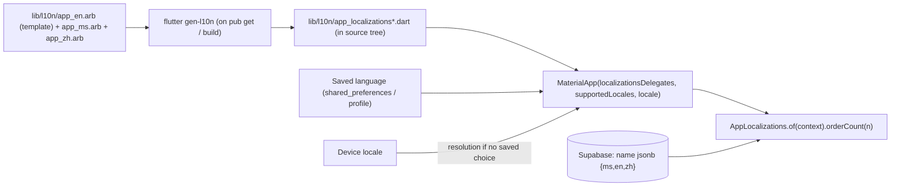

# Flutter - Internationalization & Localization

> [!info] Deep dive of [[Flutter]]

> [!abstract] TL;DR
> Use the built-in pipeline: `flutter_localizations` + `intl` + **`gen-l10n`** generating a typed `AppLocalizations` from **ARB files** (ICU plurals/select/placeholders) **into your source tree**, since the synthetic `package:flutter_gen` is gone.
> - For Malaysian apps, ship **`ms`, `en`, `zh` (Simplified)**, and format money as `RM` with `NumberFormat.currency(locale: 'ms_MY')` and dates in `Asia/Kuala_Lumpur`.
> - Keep user-generated and catalog content translated in the **database**, not in ARB.
> - Declare locales natively (iOS `CFBundleLocalizations`, Android `localeConfig`).

## Concept
| Layer | Where | Tool |
|---|---|---|
| UI strings | ARB → generated `AppLocalizations` | `gen-l10n` (`flutter: generate: true`) |
| Framework strings (date pickers, back buttons) | `GlobalMaterialLocalizations`, `GlobalCupertinoLocalizations`, `GlobalWidgetsLocalizations` | `flutter_localizations` |
| Numbers, currency, dates | `NumberFormat`, `DateFormat` | `intl` |
| Server/catalog content (menus, products, FAQs) | DB columns / `jsonb` per locale | [[Supabase]] |
| Native metadata (store listing languages, permission prompts) | `Info.plist` / `InfoPlist.strings`, `locales_config.xml` | Xcode / Android resources |
| Push/WhatsApp templates | Server, per user's locale | Backend + Meta template languages |

**ARB message features (ICU)**:

| Feature | Example | Note |
|---|---|---|
| Placeholder | `"hello": "Hai, {name}"` | Typed via `@hello.placeholders` |
| Plural | `{count, plural, =0{Tiada pesanan} other{{count} pesanan}}` | Malay and Chinese mostly use `other`. English needs `one` |
| Select | `{status, select, paid{Dibayar} pending{Belum bayar} other{-}}` | Enum-like values from your domain |
| Number/date format | `"type": "DateTime", "format": "yMMMd"` | Formatted per locale automatically |

## How It Works


## Practical Usage
**Config** (`l10n.yaml` at the project root; `pubspec.yaml` needs `flutter: generate: true`):
```yaml
arb-dir: lib/l10n
template-arb-file: app_en.arb
output-localization-file: app_localizations.dart
output-class: AppLocalizations
nullable-getter: false
synthetic-package: false            # generated files live in lib/l10n (required migration since 3.32)
untranslated-messages-file: build/untranslated.json
```
**ARB files**:
```json
{
  "@@locale": "ms",
  "orderCount": "{count, plural, =0{Tiada pesanan} other{{count} pesanan}}",
  "@orderCount": { "placeholders": { "count": { "type": "int" } } },
  "pickupAt": "Ambil pada {time}",
  "@pickupAt": { "placeholders": { "time": { "type": "DateTime", "format": "jm" } } },
  "paymentStatus": "{status, select, paid{Dibayar} pending{Menunggu bayaran} failed{Gagal} other{-}}",
  "@paymentStatus": { "placeholders": { "status": { "type": "String" } } }
}
```
**App wiring with a user-selectable language**:
```dart
import 'package:flutter_localizations/flutter_localizations.dart';
import 'l10n/app_localizations.dart';

MaterialApp.router(
  routerConfig: router,
  locale: ref.watch(localeProvider),                       // null → follow device
  supportedLocales: const [Locale('ms'), Locale('en'), Locale.fromSubtags(languageCode: 'zh', scriptCode: 'Hans')],
  localizationsDelegates: const [
    AppLocalizations.delegate,
    GlobalMaterialLocalizations.delegate,
    GlobalWidgetsLocalizations.delegate,
    GlobalCupertinoLocalizations.delegate,
  ],
);
// usage
final t = AppLocalizations.of(context);
Text(t.orderCount(orders.length));
```
**Money and dates** (MYR, local time zone):
```dart
final rm = NumberFormat.currency(locale: 'ms_MY', symbol: 'RM', decimalDigits: 2);
rm.format(1234.5);                                          // RM1,234.50
DateFormat.yMMMEd(Localizations.localeOf(context).toString()).format(order.createdAt.toLocal());
```
**Catalog content from Supabase** (fallback chain ms → en):
```dart
String localized(Map<String, dynamic> j, Locale l) =>
    (j[l.languageCode] ?? j['en'] ?? j.values.first) as String;
```
**Native declarations**:
```xml
<!-- android/app/src/main/res/xml/locales_config.xml (Android 13+ per-app language) -->
<locale-config xmlns:android="http://schemas.android.com/apk/res/android">
  <locale android:name="ms"/><locale android:name="en"/><locale android:name="zh-Hans"/>
</locale-config>
<!-- AndroidManifest.xml: <application android:localeConfig="@xml/locales_config" …> -->
<!-- ios/Runner/Info.plist: CFBundleLocalizations = [ms, en, zh-Hans] -->
```
**Wrong way**:
```dart
Text('Total: RM ' + total.toString());                // ❌ hardcoded, no grouping, 1234.5 → "RM 1234.5"
Text(count == 1 ? '1 order' : '$count orders');       // ❌ English plural rules for every language
DateFormat('dd/MM/yyyy').format(utcDate);             // ❌ UTC shown as local, fixed pattern
import 'package:flutter_gen/gen_l10n/app_localizations.dart';   // ❌ synthetic package removed
```

## Patterns & Anti-patterns
| Pattern | When | Anti-pattern to avoid |
|---|---|---|
| `gen-l10n` typed getters | All UI strings | String-key maps (`tr('order.count')`) without compile checks |
| ICU plural/select in ARB | Counts, statuses | Concatenating fragments ("You have " + n + " orders") |
| Descriptions in `@key` for translators | Every message | Bare keys translators guess at |
| DB `jsonb` per locale for catalog/user content | Menus, products | Shipping a new app version to fix a product name |
| Locale stored per user profile (server) | Push, WhatsApp, emails | Server sending English notifications to BM users |
| Missing-translation check in CI (`untranslated.json` empty) | Releases | Discovering English fallbacks in production |
| Layout tolerant of +30% text length | Buttons, tabs | Fixed-width buttons (BM strings run longer) |

## Performance & Trade-offs
- **Generated code** is plain Dart classes: no runtime parsing, tree-shaken per locale. App size cost is negligible for UI strings.
- **CJK fonts**: bundling Noto Sans SC adds ~8–10 MB. Prefer system fonts with `fontFamilyFallback`, or a subset font, unless brand fonts are required.
- **Runtime switching** rebuilds the widget tree from `MaterialApp`. That's fine, but cached formatted strings in state (e.g. preformatted prices) must be recomputed.
- **Translation workflow**: plain ARB in git works for 3 languages. A TMS (Tolgee self-hosted, Crowdin, Localizely) helps when non-developers translate. LLM drafts are fast, but need native review for tone (formal *anda* vs casual *awak*).

## Tips & Reminders
> [!tip] In ZP's stack
> - **Default set for SME apps**: `ms`, `en`, `zh-Hans`. The template ARB is English (developer language), and ship BM as the default locale where the client's customers are mostly Malay-speaking.
> - **Same codes everywhere**: Flutter `AppLocalizations`, Next.js web i18n and WhatsApp templates (`ms`, `en`, `zh_CN` in Meta's codes) share one `locale` column on the user profile.
> - **Supabase**: store `name jsonb` (`{"ms":…,"en":…,"zh":…}`) with a check that `en` exists, and resolve in a view or the client.

- Use `Asia/Kuala_Lumpur` (UTC+8, no DST) for business logic such as opening hours and cut-offs. Store UTC, display local.
- Localize permission prompts (`NSCameraUsageDescription` in `InfoPlist.strings`) and store listings. App Store review checks prompt clarity ([[Flutter - Build, Release & Store Compliance]]).
- Golden or widget tests per locale catch overflow from long BM strings ([[Flutter - Testing]]).
- Localize push notification text on the server using the user's saved locale ([[Flutter - Push Notifications & Background Work]]).

## Version Notes
| Version | Change relevant here |
|---|---|
| Flutter 2.x | `gen-l10n` + `flutter: generate: true` became the recommended approach |
| 3.28 pre / 3.32 stable | Synthetic `package:flutter_gen` deprecated. Set `synthetic-package: false` and generate into the source tree |
| Next stable after 3.32 | `package:flutter_gen` support removed. Imports must point at the generated file in `lib/` |
| Android 13 (API 33) | Per-app language preferences via `localeConfig` |
| 3.47 / Dart 3.13 (2026-08) | Current stable at re-check ([[Flutter]]) |

## Critical Issues & Gotchas
> [!danger] PDPA notices must be in Malay and English
> Malaysia's PDPA 2010 (s.7(3)) requires the personal data protection notice to be in the national and English languages. An app that localizes UI but shows its privacy notice and consent text only in English (or only in Chinese) is non-compliant. Put the privacy notice and consent strings through the same l10n pipeline, with legal-reviewed translations.

> [!danger] Silent English fallback for missing keys
> Untranslated messages fall back to the template language, so BM users see English text in checkout or error messages without any crash. Fail CI when `untranslated-messages-file` is non-empty, and review new keys in PRs.

- **`zh` vs `zh_Hans` vs `zh_CN`**: device locales vary (`zh_Hans_MY`, `zh_CN`). Supply `Locale.fromSubtags(languageCode: 'zh', scriptCode: 'Hans')` and test resolution, or Chinese users get English.
- **Server error messages**: APIs returning English messages bypass l10n. Return stable error `code`s and localize on the client ([[TypeScript - Error Handling & Result Types]]).
- **Number parsing**: `double.parse` on user input with locale grouping (`1,234.50`) fails. Use `NumberFormat.parse` or restrict input formats.
- **Hot reload** doesn't always regenerate ARB output. Run `flutter gen-l10n` or a full restart after editing ARB files.

## Related
- [[Flutter]]
- [[Dart]] — `intl` formatting and code generation basics
- [[Flutter - State Management]] — locale provider and persistence
- [[Flutter - Testing]] — per-locale widget/golden tests
- [[Flutter - Build, Release & Store Compliance]] — store listings and permission prompt localization
- [[Supabase]] — per-locale catalog content and user locale

## References
- https://docs.flutter.dev/ui/accessibility-and-internationalization/internationalization
- https://docs.flutter.dev/release/breaking-changes/flutter-generate-i10n-source
- https://pub.dev/packages/intl
- https://developer.android.com/guide/topics/resources/app-languages
- https://www.pdp.gov.my/
