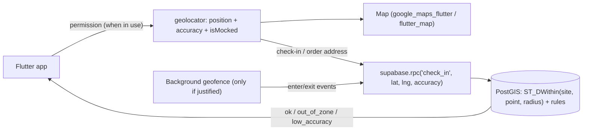

# Flutter - Maps, Location & Geofencing

> [!info] Deep dive of [[Flutter]]

> [!abstract] TL;DR
> - **Maps**: `google_maps_flutter` (native Google Maps) or `flutter_map` (OpenStreetMap/MapLibre tiles from a provider such as MapTiler/Stadia).
> - **Location**: `geolocator` with explicit permission UX, foreground use by default.
> - **Geofencing/background tracking**: only when the product truly needs it (rider tracking, attendance). It triggers **store policy reviews**, OS limits (Android ~100 geofences, iOS 20 regions), battery cost and PDPA duties.
> - **Do distance and zone checks on the server** (PostGIS `ST_DWithin`/polygons in Supabase), and treat device location as **spoofable**.
> - Since March 2025, Google Maps gives **per-SKU free monthly caps** instead of a $200 credit, so Places/Geocoding/Routes calls are where costs appear.

## Concept
| Need | Package / service | Notes |
|---|---|---|
| Interactive map | `google_maps_flutter` | Native SDK per platform. API keys per platform, restricted by package/bundle ID |
| Open map tiles | `flutter_map` + tile provider (MapTiler, Stadia, self-hosted) | Don't hammer `tile.openstreetmap.org` (usage policy) |
| Current position | `geolocator` | Accuracy modes, distance filter, `isMocked` (Android) |
| Address ↔ coordinates | Google Geocoding / Places, or Nominatim/self-hosted | Billed per request (Google). Cache results |
| Routes/ETA | Google Routes API, OSRM/Valhalla (self-hosted) | Billed or self-operated |
| Geofencing | Native APIs via plugins (`geofence_service`, `flutter_background_geolocation` (commercial)) | OS limits, background permissions |
| Server-side geo | PostGIS (`geography`, `ST_DWithin`, `ST_Contains`) on Supabase | Authoritative checks |

**Permission levels**:

| Level | Android | iOS | Store impact |
|---|---|---|---|
| While in use | `ACCESS_FINE/COARSE_LOCATION` | `NSLocationWhenInUseUsageDescription` | Normal |
| Background | `ACCESS_BACKGROUND_LOCATION` (separate request, Settings step on 11+) | "Always" + `NSLocationAlwaysAndWhenInUseUsageDescription` | **Play declaration form + video**, App Review scrutiny |
| Approximate only | Coarse | Reduced accuracy (iOS 14+) | Users may choose it, so handle it |

## How It Works


## Practical Usage
**Permission + position with sanity checks**:
```dart
Future<Position?> currentPosition() async {
  if (!await Geolocator.isLocationServiceEnabled()) return null;
  var perm = await Geolocator.checkPermission();
  if (perm == LocationPermission.denied) perm = await Geolocator.requestPermission();
  if (perm == LocationPermission.denied || perm == LocationPermission.deniedForever) return null;

  final pos = await Geolocator.getCurrentPosition(
    locationSettings: const LocationSettings(accuracy: LocationAccuracy.high, timeLimit: Duration(seconds: 15)),
  );
  if (pos.isMocked) throw const LocationSpoofed();          // Android mock provider; not a guarantee
  return pos;
}
```
**Server-side geofence check** (Supabase + PostGIS; RPC decides, not the app):
```sql
create extension if not exists postgis with schema extensions;
alter table public.sites add column location extensions.geography(Point, 4326), add column radius_m int not null default 150;
create index sites_location_gix on public.sites using gist (location);

create or replace function public.check_in(p_site uuid, p_lat float8, p_lng float8, p_accuracy_m float8)
returns text language plpgsql security invoker set search_path = '' as $$
declare v_ok boolean;
begin
  if p_accuracy_m > 100 then return 'low_accuracy'; end if;
  select extensions.st_dwithin(s.location,
           extensions.st_setsrid(extensions.st_makepoint(p_lng, p_lat), 4326)::extensions.geography,
           s.radius_m + p_accuracy_m)
    into v_ok from public.sites s where s.id = p_site;
  if not coalesce(v_ok, false) then return 'out_of_zone'; end if;
  insert into public.attendance (site_id, user_id, lat, lng, accuracy_m) values (p_site, auth.uid(), p_lat, p_lng, p_accuracy_m);
  return 'ok';
end $$;
```
**Map with markers** (`google_maps_flutter`):
```dart
GoogleMap(
  initialCameraPosition: const CameraPosition(target: LatLng(1.5535, 110.3593), zoom: 14),   // Kuching
  myLocationEnabled: true,
  markers: {for (final s in stores) Marker(markerId: MarkerId(s.id), position: LatLng(s.lat, s.lng), infoWindow: InfoWindow(title: s.name))},
);
```
**Wrong way**:
```text
❌ App decides "inside the geofence" and just posts check_in=true   → trivially faked; payroll fraud
❌ Requesting background location "just in case"                    → Play rejection, user distrust, battery drain
❌ Unrestricted Google Maps API key in the APK                      → key abuse runs up your bill
❌ Geocoding on every keystroke without debounce/caching            → Places/Geocoding charges spike
```

## Patterns & Anti-patterns
| Pattern | When | Anti-pattern to avoid |
|---|---|---|
| Foreground location at the moment of action (check-in, order) | Attendance, delivery address | Continuous background tracking |
| Server-side PostGIS checks with accuracy tolerance | Geofence decisions | Client-side boolean results |
| Restricted API keys (package name + SHA, bundle ID) | Google Maps keys | Unrestricted keys |
| Places Autocomplete sessions + debounce + cache | Address entry | Per-keystroke uncached requests |
| OSM/MapLibre tiles from a paid/self-hosted provider | Cost-sensitive, high-volume maps | Direct heavy use of public OSM tiles |
| Clear permission rationale screens before OS prompts | All location features | Prompt on app launch |
| Retention policy for location history | Tracking features | Keeping raw GPS trails forever |

## Performance & Trade-offs
- **Battery**: high-accuracy continuous GPS drains batteries fast. Use distance filters (e.g. 50 m), lower accuracy, and significant-change/geofence APIs for background use.
- **OS limits**: Android allows ~100 active geofences per app, iOS monitors up to 20 regions. Register only nearby sites and rotate dynamically.
- **Costs**: under March 2025 pricing each SKU has its own free monthly cap (Essentials 10k, Pro 5k, Enterprise 1k events), and allowances don't pool. Autocomplete, Geocoding and Routes add up with real users, so cache geocodes in your DB.
- **Accuracy**: indoor GPS in Malaysian malls/offices can be off by 50–200 m. Use radius + reported accuracy tolerance, or Wi-Fi/QR check-in as a fallback.

## Tips & Reminders
> [!tip] In ZP's stack
> - **SME attendance apps**: foreground location at check-in plus a server PostGIS check plus a selfie/QR fallback. Flag mocked locations and repeated out-of-zone attempts for HR review instead of auto-punishing.
> - **Delivery/radius checks** for F&B ordering: PostGIS `ST_DWithin` against outlet locations in an RPC, with polygons for delivery zones ([[Supabase - Database Functions, Triggers & RPC]]).
> - **Rider tracking** (real background tracking) is a bigger product: store policy forms, battery testing on low-end Android, consent and retention. Price it accordingly.

- Restrict Maps keys per platform, and set Google Cloud budget alerts ([[Flutter - App Security, Obfuscation & Secure Storage]]).
- Use Kuching/KL test coordinates and real-device field tests. Emulators hide permission and accuracy issues.
- Store coordinates with accuracy and timestamp. They're needed for disputes.
- Explain location use in the privacy notice (Malay + English) and the store data-safety forms ([[Flutter - Build, Release & Store Compliance]]).

## Version Notes
| Date | Change |
|---|---|
| Android 10–11 | Background location as a separate permission. Settings-page grant on 11+ |
| iOS 14 | Approximate location option for users |
| 2025-03-01 | Google Maps Platform: $200 monthly credit replaced by per-SKU free monthly thresholds (Essentials 10k, Pro 5k, Enterprise 1k). Map Tiles API 2D/Street View 100k |
| Flutter 3.47 (2026-08) | Current stable at re-check ([[Flutter]]) |

> [!warning] Unverified — check before relying on this
> Current `google_maps_flutter`/`geolocator` versions, Google Play's 2026 background-location policy details, and whether mobile Maps SDK map loads remain free weren't verified. Check the Maps pricing sheet and Play Console policy before quoting clients.

## Critical Issues & Gotchas
> [!danger] Location spoofing defeats client-side geofences
> Fake-GPS apps, rooted devices and emulators can report any location. `isMocked` catches only some cases. Attendance, payroll and delivery-proof features must validate server-side, combine signals (accuracy, Wi-Fi/QR, photo, device integrity via App Check/Play Integrity), and treat anomalies as review cases.

> [!danger] Location data is sensitive personal data
> Continuous location reveals home addresses, routines and religion (mosque/temple visits). Under PDPA, collect only what's needed, get clear consent, limit retention (e.g. 90 days for attendance points), restrict access, and never sell or share it. Background tracking of employees needs explicit policy and consent.

- **Play background-location review**: apps requesting `ACCESS_BACKGROUND_LOCATION` without a core, user-visible feature get rejected. Prepare the declaration form and demo video.
- **iOS purpose strings** missing or vague cause App Review rejections or crashes on permission requests.
- **Google Maps API keys** in the APK are public by design. Restrictions and quotas are the protection.
- **`deniedForever`** requires sending users to Settings (`Geolocator.openAppSettings()`). Handle it gracefully.

## Related
- [[Flutter]]
- [[Flutter - Push Notifications & Background Work]] — background execution limits
- [[Flutter - Platform Channels & FFI]] — native APIs when plugins fall short
- [[Flutter - Build, Release & Store Compliance]] — permission declarations and reviews
- [[Flutter - App Security, Obfuscation & Secure Storage]] — device integrity signals
- [[Supabase - Database Functions, Triggers & RPC]] — PostGIS checks in RPCs

## References
- https://developers.google.com/maps/billing-and-pricing/march-2025
- https://pub.dev/packages/google_maps_flutter
- https://pub.dev/packages/geolocator
- https://support.google.com/googleplay/android-developer/answer/9799150
- https://postgis.net/docs/ST_DWithin.html
