# Flutter - Migrating to 3.50 & Standalone Material Packages

> [!info] Deep dive of [[Flutter]]

> [!abstract] TL;DR
> **Flutter 3.50 + Dart 3.14** (Nov 2026) formalizes the biggest structural change in years: **Material and Cupertino move out of the core framework** into standalone packages, **`package:material_ui`** and **`package:cupertino_ui`**.
> - Timeline: the core libraries were frozen in 3.44, opt-in packages arrived in 3.47, and 3.50 deprecates `package:flutter/material.dart`/`cupertino.dart` (deprecated, not removed).
> - **Migration**: add the packages, run the dart fix migration (reported as `dart fix --apply --code=migrate_design_widgets`), and update localization delegates, which now live in the packages.
> - **Watch out**: Material types from the old and new libraries are **not interchangeable**. Third-party packages exposing Material types (pickers, form libraries, UI kits) must migrate before you can, or you'll hit type errors.
>
> Plan **one combined maintenance release** per client app:
> - Flutter 3.50;
> - the Material packages migration;
> - **supabase_flutter v3**;
> - iOS **SwiftPM** (before CocoaPods goes read-only on 2026-12-02);
> - and the store target-SDK updates.

## Concept
| Change | Since | Impact |
|---|---|---|
| Core `material.dart`/`cupertino.dart` frozen | 3.44 | New Material features only land in packages |
| `material_ui` / `cupertino_ui` opt-in | 3.47 | Can migrate early |
| Core libraries deprecated | 3.50 | Analyzer warnings. Removal in a future release |
| Localization delegates moved to packages | 3.47/3.50 | Update `localizationsDelegates` imports |
| FFIgen (Obj-C) / JNIgen (Java/Kotlin) stable | 3.50 (reported) | Simpler native interop than platform channels |
| Wasm lazy loading stable | 3.50 (reported) | Smaller initial web downloads |
| Impeller on Android 10+, Skia retired (reported) | 3.50 | Rendering differences on old devices. Test |
| Dart 3.14 | 2026-11-11 | Language/tooling updates. Check pub constraints |

**Dependency readiness matrix** (fill per client app):

| Dependency | Exposes Material types? | Migrated? | Action |
|---|---|---|---|
| go_router | No | — | Upgrade |
| flutter_form_builder / UI kits | Yes | Check | Wait / pin / replace |
| supabase_flutter | No (v3 has own breaking changes) | v3 | Separate migration step |
| intl / flutter_localizations | Delegates | Check | Update delegate imports |

## How It Works

```mermaid
flowchart LR
  A["Branch: upgrade/flutter-3.50"] --> B["flutter upgrade + bump SDK constraints (Dart 3.14)"]
  B --> C["flutter pub outdated → upgrade deps; check Material-exposing packages"]
  C --> D["add material_ui / cupertino_ui; run dart fix migration"]
  D --> E["fix type mismatches + localization delegates"]
  E --> F["flutter analyze, tests, golden updates"]
  F --> G["device QA: low-end Android (Impeller), iOS (SwiftPM build)"]
  G --> H["staged rollout + crash monitoring; raise min_version later"]
```


## Practical Usage
**Upgrade toolchain**:
```bash
flutter upgrade            # to 3.50.x (wait for the first hotfix if the split-APK issue affects you)
flutter --version
flutter pub outdated
flutter pub upgrade --major-versions --dry-run
```
**pubspec changes**:
```yaml
environment:
  sdk: ^3.14.0
  flutter: ">=3.50.0"
dependencies:
  flutter:
    sdk: flutter
  material_ui: ^1.0.0          # check pub.dev for the version matching your Flutter release
  cupertino_ui: ^1.0.0
  flutter_localizations:
    sdk: flutter
```
**Automated import migration** (verify the code name in the official guide):
```bash
dart fix --dry-run --code=migrate_design_widgets
dart fix --apply --code=migrate_design_widgets
```
```dart
// before
import 'package:flutter/material.dart';
// after
import 'package:flutter/widgets.dart';
import 'package:material_ui/material_ui.dart';
```
**Localization delegates**:
```dart
MaterialApp(
  localizationsDelegates: const [
    ...AppLocalizations.localizationsDelegates,   // your gen-l10n
    // Material/Cupertino delegates now come from material_ui / cupertino_ui exports
  ],
  supportedLocales: const [Locale('ms'), Locale('en'), Locale('zh')],
);
```
**Type mismatch with an unmigrated package** (symptom and workaround):
```text
Error: The argument type 'ThemeData' (package:flutter/material.dart) can't be assigned to
       the parameter type 'ThemeData' (package:material_ui/...)
→ Options: wait for the package to migrate, keep that screen on the old import temporarily
  (deprecated but available), fork/patch, or replace the package.
```
**Wrong way**:
```text
❌ Upgrading Flutter, Material migration, supabase_flutter v3 and SwiftPM in one untested commit → impossible to bisect failures
❌ Running dart fix --apply without a clean git tree   → hard to review/revert changes
❌ Mixing old and new Material imports across the app   → confusing type errors
❌ Skipping low-end Android testing                     → Impeller rendering issues reach customers
```

## Patterns & Anti-patterns
| Pattern | When | Anti-pattern to avoid |
|---|---|---|
| Separate commits per step (toolchain → deps → Material → Supabase v3 → SwiftPM) | All client apps | One giant upgrade commit |
| Dependency readiness check before migrating | Apps using UI kits | Discovering blockers mid-migration |
| Golden tests updated deliberately | Visual regressions | Blindly accepting all golden diffs ([[Flutter - Testing]]) |
| Staged rollout + crash monitoring | Release | 100% rollout |
| Raise `min_version` only after adoption | Post-release | Forcing updates immediately ([[Flutter - Feature Flags, Remote Config & Forced Updates]]) |
| Keep deprecated imports temporarily where blocked | Unmigrated deps | Forking many packages |

## Performance & Trade-offs
- **Deprecated ≠ removed**: there's time. Apps can ship on 3.50 with old imports and warnings, then migrate Material separately. Weigh it against the cost of maintaining two migrations.
- **Impeller on more Android devices** usually improves jank, but some GPUs show rendering bugs. Test on the oldest supported devices ([[Flutter - Performance & DevTools]]).
- **Package split** decouples Material release cadence from the SDK. Faster Material fixes, but more dependency management.
- **Effort estimate** for a typical SME app (30–60 screens): 0.5–2 days for toolchain + Material migration if dependencies are ready, plus supabase_flutter v3 and SwiftPM work.

## Tips & Reminders
> [!tip] In ZP's stack
> - **Bill it as a maintenance release**: "Flutter 3.50 + platform compliance update" for retainer clients, with a short changelog. Clients get value, and you keep apps current before store deadlines ([[Flutter - Build, Release & Store Compliance]]).
> - **Order of operations**:
>   1. Toolchain + deps.
>   2. iOS SwiftPM (deadline-driven, CocoaPods read-only 2026-12-02) ([[Swift - iOS Native Integration for Flutter Apps]]).
>   3. supabase_flutter v3 + new publishable key ([[Flutter - Supabase Integration, Auth & Realtime]]).
>   4. Material packages migration.
> - **Starter template**: migrate your internal Flutter starter first, so new client apps begin on `material_ui`.

- Pin Flutter version per project (FVM or `.tool-versions`) so CI and laptops match.
- Re-run `flutter build ipa` / `appbundle` in CI after each step.
- Check BM/ZH localization output after delegate changes ([[Flutter - Internationalization & Localization]]).
- Read the 3.50 breaking-changes page fully, since other API removals may affect you.

## Version Notes
| Version | Released | Relevant change |
|---|---|---|
| 3.44 | 2026-05 (I/O) | Core Material/Cupertino frozen. SwiftPM default |
| 3.47 | 2026-08 | `material_ui` / `cupertino_ui` opt-in |
| **3.50 / Dart 3.14** | 2026-11-11 | Core Material/Cupertino deprecated. FFIgen/JNIgen stable. Wasm lazy loading stable (reported) |
| Next | 2027 | Possible removal of deprecated core libraries. Watch announcements |

> [!warning] Unverified — check before relying on this
> The `migrate_design_widgets` fix code name, the first stable versions of `material_ui`/`cupertino_ui`, the split-APK hotfix and the Impeller/Skia claims come from secondary sources. Follow https://docs.flutter.dev/release/breaking-changes/material-ui-and-cupertino-ui and the 3.50 release notes.

## Critical Issues & Gotchas
> [!danger] Third-party packages block the migration
> Packages exposing Material types (theme extensions, form fields, date pickers, UI kits) cause type errors once your app uses `material_ui`, because the types are distinct. Migrating before your dependencies are ready leads to forks or rewrites under deadline pressure. Audit dependencies first, and keep deprecated imports until the ecosystem catches up.

> [!danger] Stacking deadline-driven changes into one release
> CocoaPods read-only (2026-12-02), store target-SDK requirements and Supabase legacy-key removal (late 2026) all land around the same time as Flutter 3.50. Combining everything without staged testing risks a broken release with no easy rollback. Sequence the changes, test each on devices, and use staged rollouts.

- **Golden tests** may change from rendering backend differences, so review diffs carefully.
- **Analyzer noise**: deprecation warnings can bury real issues. Fix or suppress deliberately.
- **Plugins with native code** must support Dart 3.14 / Flutter 3.50 and SwiftPM, so check plugin changelogs.
- **CI caches** of old Flutter versions produce inconsistent builds. Clear caches after upgrading.

## Related
- [[Flutter]]
- [[Flutter - Build, Release & Store Compliance]] — store requirements and release process
- [[Flutter - Supabase Integration, Auth & Realtime]] — supabase_flutter v3 migration
- [[Flutter - Internationalization & Localization]] — delegate changes
- [[Flutter - Testing]] — goldens and regression tests
- [[Swift - iOS Native Integration for Flutter Apps]] — SwiftPM migration

## References
- https://docs.flutter.dev/release/breaking-changes/material-ui-and-cupertino-ui
- https://docs.flutter.dev/release/release-notes/release-notes-3.50.0
- https://docs.flutter.dev/release/breaking-changes
- https://verygood.ventures/blog/flutter-3-50-dart-3-14/
- https://byteiota.com/flutter-350-dart-314-material-deprecated-native-interop/
