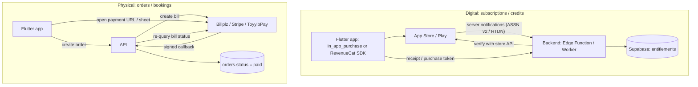

# Flutter - Payments, In-App Purchases & Store Rules

> [!info] Deep dive of [[Flutter]]

> [!abstract] TL;DR
> **First classify what you sell**:
> - **Physical goods or services used outside the app** (food, deliveries, bookings, repairs): any gateway works (FPX via Billplz/ToyyibPay/Stripe, DuitNow QR, e-wallets, cards). No store commission.
> - **Digital goods or features unlocked in the app** (subscriptions, credits, premium): Apple IAP and Google Play Billing are required on Malaysian storefronts, at 15–30% commission.
>
> Verify **every** purchase server-side (App Store Server API / Play Developer API, or RevenueCat webhooks), store **entitlements** in Supabase, and grant access from the server, never from the client's "success" callback.

## Concept
**What the stores require** (Malaysia storefront; summary, verify current guidelines):

| What the user pays for | Apple (3.1.x) | Google Play | Payment method |
|---|---|---|---|
| Physical goods / real-world services | Any external payment allowed (3.1.3(e) style) | Allowed | FPX, cards, e-wallets, DuitNow |
| Digital content / features / subscriptions used in the app | **IAP required** | **Play Billing required** (alt billing only in some regions) | StoreKit / Play Billing |
| B2B / multiplatform service bought elsewhere | Users can log in to access what they bought outside, but you can't steer to outside purchase inside the app (US storefront rules differ) | Similar; programs vary by region | Your web checkout |
| Person-to-person services (tutoring, consultations, 1:1) | Allowed outside IAP when delivered in real time between people | Generally allowed | External gateway |

- **Commission**: 30% standard. **15%** for small-business programs (under USD 1M/year) and Google subscriptions. Stores handle sales tax/SST collection on IAP.
- **Regional exceptions**: anti-steering changes (US court orders against Apple, 2025–26) and Google's alternative billing (UK/EEA/US, 2026) **don't apply to Malaysia** by default.

## How It Works


## Practical Usage
**Entitlements table** (server is the source of truth):
```sql
create table public.entitlements (
  user_id uuid not null references auth.users on delete cascade,
  product text not null,                       -- 'pro_monthly'
  source text not null check (source in ('app_store','play','web')),
  original_transaction_id text not null unique,
  status text not null,                        -- active | grace | expired | refunded | revoked
  expires_at timestamptz,
  updated_at timestamptz not null default now(),
  primary key (user_id, product)
);
alter table public.entitlements enable row level security;
create policy "read own" on public.entitlements for select to authenticated using (user_id = (select auth.uid()));
-- writes only from the backend (secret key), never from clients
```
**Purchase flow with `in_app_purchase`** (verify server-side, then complete):
```dart
final iap = InAppPurchase.instance;
late final StreamSubscription<List<PurchaseDetails>> sub;

void listen() {
  sub = iap.purchaseStream.listen((purchases) async {
    for (final p in purchases) {
      if (p.status == PurchaseStatus.purchased || p.status == PurchaseStatus.restored) {
        final ok = await api.verifyPurchase(                       // Edge Function calls Apple/Google APIs
          platform: Platform.isIOS ? 'app_store' : 'play',
          productId: p.productID,
          token: p.verificationData.serverVerificationData,
        );
        if (ok) ref.invalidate(entitlementsProvider);               // UI reads entitlements from Supabase
      }
      if (p.pendingCompletePurchase) await iap.completePurchase(p); // acknowledge (Play refunds unacknowledged buys)
    }
  });
}

Future<void> buy(ProductDetails product) =>
    iap.buyNonConsumable(purchaseParam: PurchaseParam(productDetails: product, applicationUserName: userIdHash));
```
**Physical goods: Billplz/FPX** via the external browser plus server verification:
```dart
final bill = await api.createBill(orderId);                       // server creates bill, stores bill.id
await launchUrl(Uri.parse(bill.url), mode: LaunchMode.externalApplication);
// return via deep link myapp://orders/{id}; the app then polls/streams order status from Supabase
```
The server marks an order paid **only** after verifying the callback signature (X-Signature) **and** re-querying the bill from Billplz ([[REST API - Webhooks & Idempotency]]).

**Wrong way**:
```dart
if (purchase.status == PurchaseStatus.purchased) prefs.setBool('isPro', true);   // ❌ client-side unlock: trivially spoofed
launchUrl(Uri.parse('https://myapp.my/upgrade'));                                // ❌ steering digital upgrades to web checkout → rejection
```

## Patterns & Anti-patterns
| Pattern | When | Anti-pattern to avoid |
|---|---|---|
| Server-verified entitlements in Supabase | Any IAP | Unlocking on client callbacks or local flags |
| Store server notifications (ASSN v2, Play RTDN) → backend | Subscriptions | Only checking at purchase time (missing renewals, refunds, chargebacks) |
| RevenueCat (or similar) for cross-platform subscriptions | Solo dev, both stores | Hand-rolling receipt parsing for both stores without need |
| "Restore purchases" button | iOS (required) | No restore path. Rejection |
| External gateway only for physical goods/services | Food, deliveries, bookings | Using Billplz for app features (policy violation) |
| Idempotent callback handling (bill ID unique) | Gateways | Double-crediting on retried callbacks |

## Performance & Trade-offs
- **Commission vs reach**: IAP costs 15–30% but gives one-tap purchase and store trust. Web checkout costs ~1.5–3% (FPX/cards) but can't be advertised inside the app on Malaysian storefronts for digital goods. Many SaaS apps sell on the web and keep the app "login only". That's allowed when the app doesn't steer and isn't the purchase venue; check the current rules for your category.
- **RevenueCat vs in-house**: RevenueCat is free up to a revenue threshold and then takes a percentage. It handles receipts, renewals, grace periods and webhooks. In-house means the App Store Server API, Play Developer API and Pub/Sub RTDN: more work, no fee.
- **Gateway UX**: FPX redirects to bank pages (more drop-off). Cards or wallets via a Stripe/gateway SDK sheet (Apple Pay/Google Pay) convert better for repeat customers.
- **Testing cost**: sandbox accounts, license testers and test cards take time to set up. Budget a day per platform the first time.

## Tips & Reminders
> [!tip] In ZP's stack
> - **SME ordering apps** (F&B, retail, services): physical goods, so use Billplz/ToyyibPay FPX + DuitNow QR + cards. Callbacks go through the Cloudflare Worker gateway → queue → Supabase order update ([[Cloudflare - Workers for Webhooks & Edge APIs]]).
> - **SaaS subscription apps**: IAP via RevenueCat (or `in_app_purchase` + Edge Function verification), with web billing for B2B accounts and an app that only logs in.

- Put product IDs, prices and entitlements in config, and keep store listings in sync (MYR tiers are set per store).
- Handle grace periods and billing retry states (`grace` status). Don't cut access the minute a renewal fails.
- Revoke entitlements on refunds and chargebacks via server notifications. Log the reason.
- Provide in-app account deletion (both stores require it) and define what happens to active subscriptions (users cancel via the store).

## Version Notes
| Date | Change |
|---|---|
| 2022–23 | Apple 3.1.3(e)/(g) clarifications: physical goods and person-to-person services outside IAP. Play user-choice billing pilots |
| 2025-04 | US court bars Apple from charging commission on external links (US storefront). Appeals continue into 2026 |
| 2025-12 | Ninth Circuit largely upholds the contempt injunction (reported). Possible cost-based fees |
| 2026-06 | Apple guideline text restructured (tracker). Google announces alternative payments and lower fees in UK/EEA/US |

> [!warning] Unverified — check before relying on this
> Store payment rules change frequently and by region. Malaysia-specific programs weren't found this run. Read the current App Store Review Guidelines §3.1 and Google Play Payments policy before designing monetization, and keep screenshots of the rules you relied on for review disputes.

## Critical Issues & Gotchas
> [!danger] Client-trusted purchases
> Unlocking features from the client purchase callback (or a local flag) is bypassable with modified apps and replayed receipts. Grant access only from server-verified entitlements, and re-verify via store notifications.

> [!danger] Wrong payment rail = rejection or removal
> Selling digital features through Billplz/Stripe inside an iOS/Android app (or linking to web checkout for them) violates store payment rules outside specific regions. Expect rejection, or removal after an update. Classify the product before building the payment flow.

- **Unacknowledged Play purchases** are refunded automatically after a few days. Always `completePurchase` after server verification.
- **Sandbox vs production receipts**: send the environment to your verifier. Apple's production API rejects sandbox receipts (and vice versa).
- **Gateway callbacks without re-query**: forged "paid" callbacks credit orders that were never paid. Verify the signature *and* fetch the bill status from the gateway API.
- **PDPA/PCI**: never store card data. Let the gateway's hosted pages or SDK handle it, and store only references (bill ID, last4 if provided).

## Related
- [[Flutter]]
- [[Flutter - Build, Release & Store Compliance]] — review guidelines, account deletion, signing
- [[Supabase - Edge Functions, Cron & Queues]] — verification functions and webhook queues
- [[REST API - Webhooks & Idempotency]] — callback verification and dedupe
- [[Cloudflare - Workers for Webhooks & Edge APIs]] — edge gateway for payment callbacks
- [[OWASP Top 10 - API Security Top 10 in Practice]] — API10 unsafe consumption of third-party APIs

## References
- https://developer.apple.com/app-store/review/guidelines/#payments
- https://support.google.com/googleplay/android-developer/answer/9858738
- https://pub.dev/packages/in_app_purchase
- https://developer.apple.com/documentation/appstoreserverapi
- https://www.macworld.com/article/551203/apple-epic-anti-steering-app-store-external-payments.html
- https://macrumors.com/2026/06/11/apple-fights-back-against-epic/
