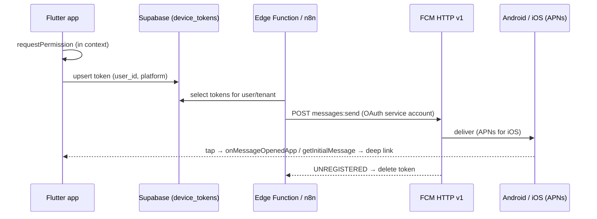

# Flutter - Push Notifications & Background Work

> [!info] Deep dive of [[Flutter]]

> [!abstract] TL;DR
> **Push**:
> - FCM for both platforms (APNs behind it on iOS), sent from your backend via the **FCM HTTP v1 API**.
> - Store tokens per device in Supabase, delete them on logout, prune on `UNREGISTERED`.
> - Ask for permission in context (Android 13+ and iOS both require it).
>
> **Background work** is scheduled by the OS, not by you. Android WorkManager is reliable-ish; iOS `BGTaskScheduler` runs when iOS decides and never after the user force-quits. For anything time-critical, **push from the server**, don't poll from the device.

## Concept
| Message type | Payload | Delivery when app is backgrounded | Use for |
|---|---|---|---|
| **Notification** message | `notification: {title, body}` (+ data) | OS shows it, reliable | User-visible alerts: order ready, new chat |
| **Data-only** message | `data: {...}` | App handler runs. On iOS throttled (`content-available`, low priority, a few per hour) | Silent sync triggers |
| Local notification | Created on device (`flutter_local_notifications`) | Scheduled by the OS | Reminders, foreground display of FCM messages |

**Token lifecycle**:

| Event | Action |
|---|---|
| App start / login | `getToken()`, then upsert `device_tokens(user_id, token, platform, app_version, last_seen)` |
| `onTokenRefresh` | Upsert the new token |
| Logout / account switch | Delete the token row (and `deleteToken()`), or the next user receives the previous user's pushes |
| Send returns `UNREGISTERED` / `INVALID_ARGUMENT` | Delete the token |

**Background execution options**:

| Need | Android | iOS | Notes |
|---|---|---|---|
| Periodic sync (≥15 min) | WorkManager (`workmanager` plugin) | `BGAppRefreshTask` (OS-chosen timing) | Not guaranteed on iOS. Never after force-quit |
| Long processing | WorkManager with constraints | `BGProcessingTask` (often overnight, while charging) | Large uploads, ML |
| Exact-time alarm | `SCHEDULE_EXACT_ALARM` (denied by default on Android 14+) | Local notification at a time | Prefer local notifications for reminders |
| Ongoing user-visible work | Foreground service (**type required** on Android 14+) | Background modes (audio, location) are restricted | Play/App Store policy declarations |
| "Do X when server event happens" | **Push** | **Push** | The reliable answer |

## How It Works


## Practical Usage
**Init, permission and token storage**:
```dart
@pragma('vm:entry-point')
Future<void> _bgHandler(RemoteMessage m) async {          // top-level; runs in a background isolate
  await Firebase.initializeApp();
  // keep it short: update local cache, no UI
}

Future<void> initPush(SupabaseClient sb) async {
  FirebaseMessaging.onBackgroundMessage(_bgHandler);
  final fm = FirebaseMessaging.instance;
  final settings = await fm.requestPermission(alert: true, badge: true, sound: true);   // also triggers Android 13+ prompt
  if (settings.authorizationStatus == AuthorizationStatus.denied) return;

  Future<void> save(String t) => sb.from('device_tokens').upsert({
        'token': t, 'user_id': sb.auth.currentUser!.id, 'platform': Platform.operatingSystem,
        'last_seen': DateTime.now().toUtc().toIso8601String(),
      }, onConflict: 'token');
  final token = await fm.getToken();
  if (token != null) await save(token);
  fm.onTokenRefresh.listen(save);

  FirebaseMessaging.onMessage.listen(showForegroundNotification);   // FCM doesn't show notifications while foregrounded
  FirebaseMessaging.onMessageOpenedApp.listen(routeFromMessage);
  final initial = await fm.getInitialMessage();                    // app launched from a terminated state by a tap
  if (initial != null) routeFromMessage(initial);
}
```
**Send from a Supabase Edge Function** (FCM HTTP v1; the access token is minted from a service account):
```ts
const accessToken = await getGoogleAccessToken(serviceAccount, 'https://www.googleapis.com/auth/firebase.messaging');
const res = await fetch(`https://fcm.googleapis.com/v1/projects/${projectId}/messages:send`, {
  method: 'POST',
  headers: { Authorization: `Bearer ${accessToken}`, 'Content-Type': 'application/json' },
  body: JSON.stringify({ message: {
    token,
    notification: { title: 'Order ready', body: 'Your order #1042 is ready for pickup' },
    data: { route: '/orders/1042' },                               // deep-link target; no personal data
    android: { priority: 'high', notification: { channel_id: 'orders' } },
    apns: { headers: { 'apns-priority': '10' }, payload: { aps: { sound: 'default' } } },
  } }),
});
if (res.status === 404 || (await res.clone().text()).includes('UNREGISTERED')) await deleteToken(token);
```
**Periodic background sync** (Android reliable, iOS best-effort):
```dart
@pragma('vm:entry-point')
void callbackDispatcher() => Workmanager().executeTask((task, input) async {
  await syncOutbox();          // idempotent; see offline outbox pattern
  return true;
});

Workmanager().initialize(callbackDispatcher);
Workmanager().registerPeriodicTask('sync', 'syncOutbox',
    frequency: const Duration(hours: 1),
    constraints: Constraints(networkType: NetworkType.connected, requiresBatteryNotLow: true));
```
**Wrong way**:
```dart
await FirebaseMessaging.instance.requestPermission();   // ❌ on first launch before any context → users deny, rarely re-enable
Timer.periodic(const Duration(minutes: 1), (_) => poll());   // ❌ dies in background; drains battery in foreground
// ❌ notification body: "Payment of RM 2,450 from Ahmad bin Ali (IC 900101-13-5678) received" → lock screen leak
```

## Patterns & Anti-patterns
| Pattern | When | Anti-pattern to avoid |
|---|---|---|
| Server-side push on events (queue → sender) | Order status, chats, reminders | Device polling the API |
| Contextual permission prompt with an in-app explainer first | First relevant moment (first order) | Prompt at cold start |
| Android notification channels per category (orders, marketing) | Android 8+ | One channel, so users mute everything |
| Generic notification text + fetch details in-app | Sensitive data | Personal or financial details in the payload |
| Tokens keyed by device, deleted on logout | Shared devices | Tokens keyed by user only, never cleaned |
| Collapse keys / thread IDs for chat bursts | Messaging | 20 separate notifications for 20 messages |

## Performance & Trade-offs
- **Delivery**: notification messages are delivered by the OS even if the app is killed. Data-only messages depend on app state, priority and OS throttling. Don't rely on silent pushes for critical logic on iOS.
- **Battery and policy**: high-priority messages that don't show a notification get deprioritized by Android over time. Use high priority only for user-visible, time-sensitive events.
- **Vendor coverage**: devices without Google Play services (many Huawei phones sold since 2019) don't receive FCM. That's relevant in Malaysia: add HMS Push Kit, SMS/WhatsApp fallback, or accept the gap.
- **Third-party push services** (OneSignal etc.) add segmentation and dashboards on top of FCM/APNs, with per-user pricing and data-sharing implications.

## Tips & Reminders
> [!tip] In ZP's stack
> - **Plumbing**: a `device_tokens` table in Supabase (RLS: users manage their own rows), pushes sent from a pgmq worker Edge Function or an n8n workflow via FCM HTTP v1 ([[Supabase - Edge Functions, Cron & Queues]]).
> - **Live screens**: Realtime for in-app live updates while foregrounded; push for everything when backgrounded ([[Supabase - Realtime, Presence & Broadcast]]).
> - **WhatsApp alternative**: for B2C notifications where the app may not be installed, WhatsApp templates often reach more users than push. Choose per message type.

- Upload an **APNs auth key (.p8)** to Firebase (it doesn't expire like certificates), and enable the Push Notifications + Background Modes (remote notifications) capabilities in Xcode.
- Test on real devices in release mode. Background handlers and iOS delivery differ in debug, and the simulator has limits.
- Track push metrics: sends, failures by error code, opens (tap → analytics event). A high `UNREGISTERED` rate means token hygiene is broken.
- For reminders at fixed times (appointments), schedule a local notification on device **and** send a server push as backup.

## Version Notes
| Date / platform | Change |
|---|---|
| 2023–2024-07 | FCM legacy HTTP/XMPP APIs deprecated, then shut down. **HTTP v1 only** (OAuth service accounts) |
| Android 13 (2022) | `POST_NOTIFICATIONS` runtime permission (`requestPermission()` shows it) |
| Android 14 (2023) | `SCHEDULE_EXACT_ALARM` denied by default for new installs. Foreground services must declare a type, plus Play declarations |
| iOS 13+ | `BGTaskScheduler` replaces background fetch. Tasks don't run after force-quit |
| FlutterFire (current) | `requestPermission()`, `onMessage`, `onMessageOpenedApp`, `getInitialMessage`, `onBackgroundMessage` (top-level + `vm:entry-point`) |

> [!warning] Unverified — check before relying on this
> Android 15/16 background-execution changes and current Play policy requirements for foreground services and exact alarms weren't re-checked this run. See the Android behavior-change pages and Play Console policy declarations before release.

## Critical Issues & Gotchas
> [!danger] Pushes to the wrong user after logout
> If device tokens aren't deleted on logout or account switch, a shared or resold phone keeps receiving the previous user's order and chat notifications. Delete the token row on logout, and re-register on login.

> [!danger] Personal data on lock screens
> Notification text is visible on locked screens and in OS notification history. It's often synced to watches too. Keep payloads generic ("You have a new message"), and load details after authentication in the app (PDPA).

- **Background isolate has no app state**: the background handler runs in a fresh isolate, so initialize Firebase/Supabase there and don't touch UI or providers.
- **iOS foreground behaviour**: notifications don't display while the app is in the foreground unless you set presentation options or show a local notification.
- **Missing `@pragma('vm:entry-point')`** on background callbacks gets them tree-shaken in release builds. They work in debug and silently fail in production.
- **Firebase project per environment**: dev and prod apps sharing one FCM project mix test pushes into production. Use separate Firebase projects and bundle IDs ([[Flutter - Build, Release & Store Compliance]]).

## Related
- [[Flutter]]
- [[Flutter - Platform Channels & FFI]] — background isolates and native integrations
- [[Flutter - Build, Release & Store Compliance]] — capabilities, store policy declarations
- [[Flutter - Offline Storage & Sync]] — idempotent background sync
- [[Supabase - Edge Functions, Cron & Queues]] — server-side push senders
- [[Supabase - Realtime, Presence & Broadcast]] — foreground live updates

## References
- https://firebase.google.com/docs/cloud-messaging/flutter/client
- https://firebase.google.com/docs/cloud-messaging/migrate-v1
- https://developer.android.com/develop/ui/views/notifications/notification-permission
- https://developer.apple.com/documentation/backgroundtasks/bgtaskscheduler
- https://github.com/fluttercommunity/flutter_workmanager
- https://github.com/fluttercommunity/plus_plugins/pull/2716.diff
