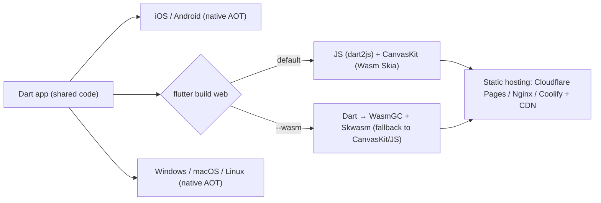

# Flutter - Web Support, PWA & Desktop Trade-offs

> [!info] Deep dive of [[Flutter]]

> [!abstract] TL;DR
> Flutter web renders to a canvas (**CanvasKit**, or **Skwasm** when built with `--wasm` on WasmGC-capable browsers), not to DOM elements. That makes it excellent for **app-like, logged-in experiences**: admin panels, internal tools, dashboards, and the same app on mobile + web. It's poor for **content/SEO sites, landing pages and ecommerce storefronts**.
> - **Initial load** is heavy (engine + app, often 2–5 MB+). Mitigate with `--wasm`, deferred loading, caching and a CDN.
> - **PWA**: installable and cacheable, but iOS PWAs have limits (push supported since iOS 16.4 for home-screen apps only, storage eviction).
> - **Desktop** (Windows/macOS/Linux) is stable and good for internal tools/kiosks/POS.
>
> **Recommendation for ZP's clients**: Next.js for public web + SEO, Flutter for mobile apps and optionally the logged-in web app if sharing code saves real effort.

## Concept
| Target | Maturity | Strengths | Weaknesses | Pick it when… |
|---|---|---|---|---|
| Flutter Web (CanvasKit) | Stable | Pixel-identical UI, code sharing | Large download, weak SEO, text selection/a11y quirks | Logged-in apps, internal tools |
| Flutter Web (Skwasm/Wasm) | Stable on Chromium/Firefox/Safari with WasmGC | Faster rendering, multi-threaded | Needs COOP/COEP headers for threads, browser support varies | Performance-sensitive web apps |
| Flutter PWA | Stable (service worker) | Installable, offline shell | iOS restrictions, cache invalidation | Field apps without app store needs |
| Flutter Desktop | Stable | Native binaries, plugins | Some plugins mobile-only, packaging/signing | POS, kiosks, internal desktop tools |
| Next.js / Astro | — | SEO, small JS, fast first load | Separate codebase from mobile | Public websites, storefronts, content |

## How It Works


## Practical Usage
**Build for web**:
```bash
flutter build web --release --wasm             # Wasm with automatic JS fallback
flutter build web --release --base-href /app/  # when served under a sub-path
```
**Headers for Skwasm multi-threading** (served by Nginx/Cloudflare/Traefik):
```nginx
add_header Cross-Origin-Opener-Policy same-origin;
add_header Cross-Origin-Embedder-Policy require-corp;   # breaks third-party iframes/images without CORP
```
**Deferred loading for heavy features** (smaller initial download):
```dart
import 'package:app/features/reports/reports_page.dart' deferred as reports;

Future<Widget> loadReports() async {
  await reports.loadLibrary();
  return reports.ReportsPage();
}
```
**Platform-specific code without breaking web builds**:
```dart
import 'package:flutter/foundation.dart' show kIsWeb, defaultTargetPlatform, TargetPlatform;

final canUseCamera = !kIsWeb && (defaultTargetPlatform == TargetPlatform.android || defaultTargetPlatform == TargetPlatform.iOS);
// dart:io is unavailable on web; use conditional imports for file APIs
```
**Clean URLs** (path strategy instead of `#/`):
```dart
void main() {
  usePathUrlStrategy();          // from flutter_web_plugins; server must rewrite unknown paths to index.html
  runApp(const App());
}
```
**Cache-busting deploys**: serve `index.html` with `Cache-Control: no-cache`, and hashed assets with long max-age. Check the service worker update behaviour after each release ([[Cloudflare - Caching Rules, CDN & Cache Purging]]).

**Wrong way**:
```text
❌ Building the client's marketing site/storefront in Flutter web  → poor SEO, slow first paint, no link previews
❌ Using dart:io File APIs in shared code                         → web build fails
❌ COEP require-corp without checking embeds                       → Google Maps/YouTube/payment iframes break
❌ Assuming iOS PWA = native app                                   → no background tasks, limited push, storage eviction
```

## Patterns & Anti-patterns
| Pattern | When | Anti-pattern to avoid |
|---|---|---|
| Next.js public site + Flutter logged-in app | Typical SME product | One Flutter web app for everything |
| Shared domain/data layers (packages) across mobile/web/desktop | Multi-platform | Copy-pasted logic per platform |
| `--wasm` + fallback, measured on target browsers | Web performance | Assuming Wasm everywhere |
| Deferred imports for rarely used modules | Large apps | Shipping every feature upfront |
| Responsive layouts (`LayoutBuilder`, breakpoints) | Web/desktop | Phone layouts stretched to 1440 px |
| Desktop for kiosks/POS with hardware plugins | In-store devices | Browser kiosks needing USB/printer access |
| Semantics checks on web | Accessibility | Assuming mobile a11y carries over ([[Flutter - Accessibility & Semantics]]) |

## Performance & Trade-offs
- **First load**: CanvasKit (~1.5–2 MB compressed) + app code. On 4G in rural areas, expect several seconds. Show a lightweight HTML splash in `index.html`.
- **Runtime**: smooth animations once loaded, and Skwasm improves frame times. Text-heavy scrolling and huge tables can lag versus DOM-based frameworks.
- **SEO**: the canvas content isn't indexable like HTML. Flutter has semantics/accessibility trees, but don't rely on them for SEO.
- **Desktop packaging**: code signing and notarization (macOS), MSIX/installer (Windows) and auto-update need setup. Budget time per platform.

## Tips & Reminders
> [!tip] In ZP's stack
> - **Admin panel for a Flutter app's backend**: building it in Flutter web reuses models and widgets, but a Next.js admin often ships faster with better tables/SEO-irrelevant tooling. Choose by team skills and code reuse, not ideology ([[Next.js - Admin Dashboards, Data Tables & Server-Side Filtering]]).
> - **Hosting**: Flutter web is static. Cloudflare Pages or an Nginx container on Coolify with proper cache headers works.
> - **POS/kiosk** for retail/F&B clients: Flutter desktop on Windows with receipt-printer plugins is a viable alternative to Electron.

- Test on Safari (iOS/macOS) explicitly. Most web-specific bugs show up there.
- Supabase Auth on web uses redirects, so configure site URL and redirect allow-list for the web origin ([[Flutter - Supabase Integration, Auth & Realtime]]).
- Keep web-specific plugins behind conditional imports.
- Measure bundle size per release (`build/web` size) and set a budget.

## Version Notes
| Version | Change relevant here |
|---|---|
| 2.0 (2021) | Web stable |
| 3.0 (2022) | Desktop (Windows, macOS, Linux) stable |
| 3.22 (2024-05) | WebAssembly (Wasm) support stable (`--wasm`) |
| 3.29 (2025-02) | HTML renderer removed. CanvasKit/Skwasm only |
| 3.47 / 3.50 (2026) | Current. Check release notes for web/desktop changes ([[Flutter]]) |

> [!warning] Unverified — check before relying on this
> Current browser support matrix for WasmGC/Skwasm (Safari version), exact CanvasKit size, and 3.50 web changes weren't verified this run. Check https://docs.flutter.dev/platform-integration/web/wasm.

## Critical Issues & Gotchas
> [!danger] Choosing Flutter web for SEO-dependent sites
> Storefronts, landing pages and content sites built in Flutter web load slowly on mobile networks, index poorly, and produce weak social previews. Clients then see lower traffic and conversions, and blame the agency. Use Next.js/Astro for anything that depends on search or first-visit speed, and reserve Flutter web for authenticated app experiences.

> [!danger] Stale service workers after deploys
> Flutter's generated service worker can keep serving old app versions. Users see broken screens after API changes until they hard-refresh. Version your API compatibly, set `index.html` to no-cache, and test the update flow (or disable the service worker if offline isn't needed).

- **Browser extensions/translation tools** (e.g. Google Translate) don't work on canvas text.
- **Text selection** needs `SelectionArea`, or users can't copy order numbers.
- **Right-click/keyboard shortcuts** need explicit handling on web/desktop.
- **Plugins** without web/desktop implementations crash at runtime. Check platform support per package on pub.dev.

## Related
- [[Flutter]]
- [[Flutter - Performance & DevTools]] — profiling web/desktop builds
- [[Flutter - Accessibility & Semantics]] — semantics on web
- [[Next.js]] — public web alternative
- [[Astro]] — content sites
- [[Flutter - Navigation & Routing]] — URL strategy and deep links on web

## References
- https://docs.flutter.dev/platform-integration/web
- https://docs.flutter.dev/platform-integration/web/wasm
- https://docs.flutter.dev/platform-integration/web/renderers
- https://docs.flutter.dev/platform-integration/desktop
- https://docs.flutter.dev/perf/deferred-components
