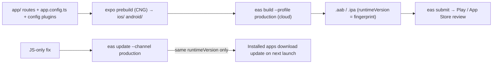

# React Native - Expo Router & EAS Builds

> [!info] Deep dive of [[React Native]]

> [!abstract] TL;DR
> Modern React Native is effectively **Expo**:
> - **Expo Router**: file-based navigation in `app/`, with layouts, tabs, typed routes and automatic deep links.
> - **Continuous Native Generation**: `expo prebuild` generates `ios/`/`android/` from `app.json` + config plugins, so native folders are disposable.
> - **EAS Build/Submit**: cloud builds, signing credentials and store uploads.
> - **EAS Update**: over-the-air JS/asset updates bound to a `runtimeVersion`.
>
> SDKs ship roughly every quarter (SDK 57 = RN 0.86 in June 2026, SDK 58 = RN 0.88). Upgrade one SDK at a time, and never OTA-ship changes that need new native code.

## Concept
| Piece | Role | Notes |
|---|---|---|
| Expo Router | File-based routes (`app/(tabs)/index.tsx`, `app/order/[id].tsx`), layouts, modals | Typed routes, deep links/universal links from the same tree |
| Development build | Your app's native shell + dev menu | Replaces Expo Go once you add native modules |
| CNG / `expo prebuild` | Generates native projects from config | Don't hand-edit `ios/`/`android/`. Use config plugins (SDK 57 prebuild clears native dirs) |
| Config plugins | Code that modifies native config at prebuild | Permissions, SDK keys, entitlements |
| EAS Build | Cloud (or `--local`) builds per profile | Manages keystores/certificates |
| EAS Submit | Upload to App Store Connect / Play Console | Uses API keys / service accounts |
| EAS Update | OTA updates of JS bundle + assets on channels | Only compatible with builds with the same `runtimeVersion` |

**Expo vs Flutter for ZP-style projects**:

| Factor | Expo/React Native | Flutter |
|---|---|---|
| Team skills | Shares React/TS with Next.js | Dart-only. ZP's main mobile stack |
| OTA updates | ✅ EAS Update (JS/assets) | ❌ (Shorebird as third-party) |
| UI consistency | Native components | Own rendering, pixel-consistent |
| Web reuse | Expo Router web/React Native Web | Flutter web (heavier for content sites) |

## How It Works


## Practical Usage
**Routes with Expo Router**:
```text
app/
├── _layout.tsx            # root Stack, providers (auth, query client)
├── (tabs)/
│   ├── _layout.tsx        # Tabs
│   ├── index.tsx          # /            → menu
│   └── orders.tsx         # /orders
├── order/[id].tsx         # /order/123   (deep link: myapp://order/123, https://app.client.my/order/123)
└── +not-found.tsx
```
```tsx
// app/order/[id].tsx
import { useLocalSearchParams, router } from 'expo-router';
export default function Order() {
  const { id } = useLocalSearchParams<{ id: string }>();
  const { data } = useOrder(id);                       // fetch by ID; don't pass objects through params
  return <OrderView order={data} onPaid={() => router.replace('/orders')} />;
}
```
**`eas.json` profiles and update channels**:
```json
{
  "cli": { "appVersionSource": "remote" },
  "build": {
    "development": { "developmentClient": true, "distribution": "internal", "channel": "development" },
    "preview": { "distribution": "internal", "channel": "preview" },
    "production": { "autoIncrement": true, "channel": "production" }
  },
  "submit": { "production": { "android": { "track": "internal" }, "ios": { "ascAppId": "1234567890" } } }
}
```
```ts
// app.config.ts (excerpt)
export default {
  name: 'Kedai Ah Seng', slug: 'kedai-ahseng', scheme: 'kedaiahseng',
  runtimeVersion: { policy: 'fingerprint' },           // native changes → new runtime → no incompatible OTA
  updates: { url: 'https://u.expo.dev/<project-id>' },
  ios: { bundleIdentifier: 'my.kedaiahseng.app', associatedDomains: ['applinks:app.kedaiahseng.my'] },
  android: { package: 'my.kedaiahseng.app', intentFilters: [/* App Links for https://app.kedaiahseng.my */] },
  plugins: ['expo-router', ['expo-location', { locationWhenInUsePermission: 'Untuk semak kawasan penghantaran' }]],
};
```
**Release commands**:
```bash
eas build --platform all --profile production
eas submit --platform all --profile production --latest
eas update --channel production --message "Fix BM translation on checkout"   # JS/assets only
```
**Wrong way**:
```text
❌ Editing ios/Podfile or AndroidManifest.xml by hand with CNG   → overwritten on next prebuild
❌ OTA update that requires a new native module                   → crashes on older binaries (wrong runtimeVersion policy)
❌ Skipping two SDK versions at once                              → stacked breaking changes (e.g. RN 0.87)
❌ Passing whole objects via route params                         → broken deep links, stale data
```

## Patterns & Anti-patterns
| Pattern | When | Anti-pattern to avoid |
|---|---|---|
| `runtimeVersion: fingerprint` | Any app using EAS Update | Manual runtime strings that drift |
| Channels per environment (development/preview/production) | OTA workflow | Shipping straight to production channel untested |
| Config plugins for native changes | Permissions, SDK setup | Hand-edited native folders |
| Upgrade one SDK at a time, read the changelog + router migration guide | Quarterly | Big-bang upgrades before store deadlines |
| IDs in routes, fetch in screen | Deep-linkable screens | Objects in params |
| Development builds for native modules | Beyond Expo Go | Fighting Expo Go limitations |
| Staged rollouts (Play) + OTA rollback plan | Production releases | 100% rollout with no rollback |

## Performance & Trade-offs
- **EAS cloud builds** remove the need for a Mac for iOS builds, at the cost of queue times on free tiers and paid plans for volume. `eas build --local` works if you have the toolchain.
- **OTA updates** fix JS bugs in hours instead of review days, but users get them on the next app launch (or a later one, depending on settings), and native fixes still need store releases.
- **Hermes bytecode diffing** for EAS Update shrinks update downloads (reported ~58% smaller on average), which helps on Malaysian mobile data.
- **CNG** makes upgrades easier (regenerate native code) but requires every native tweak to live in config plugins.

## Tips & Reminders
> [!tip] In ZP's stack
> - **Default mobile stack stays Flutter**. Choose Expo when the client's team is React/TS, the app shares a lot of logic with a Next.js web app, or OTA updates are a key requirement.
> - **Shared code**: Zod schemas, API clients and Supabase types in a monorepo package used by Next.js and Expo ([[Git - Monorepo Workflows with pnpm & Turborepo]], [[TypeScript - Runtime Validation with Zod & Type-Safe APIs]]).
> - **Store compliance** is the same as for Flutter: privacy labels, account deletion, target SDK deadlines ([[Flutter - Build, Release & Store Compliance]]).

- Keep EAS credentials (keystores, ASC API keys) owned by the client's developer accounts, with ZP as a team member.
- Use Universal Links/App Links via Expo Router instead of custom schemes for auth callbacks.
- Pin `expo` SDK and run `npx expo install --check` to align native module versions.
- Document the OTA policy in the SOW (what can ship without review, how rollbacks work).

## Version Notes
| Date / SDK | Change |
|---|---|
| SDK 55 (2025-12/2026) | RN 0.83, legacy architecture dropped |
| SDK 56 (2026-05-21) | RN 0.85 |
| SDK 57 (2026-06-30) | RN 0.86 (no breaking changes). `expo prebuild` clears native directories. React 19.2 |
| SDK 58 (2026, H2) | RN 0.88 (0.87 had breaking changes). iOS 27 scene changes. Router migration guide 57 → 58 |

> [!warning] Unverified — check before relying on this
> SDK 58's release date and full breaking-change list, Expo Router major version, and EAS pricing/free-tier limits weren't verified. Check https://expo.dev/changelog and https://expo.dev/pricing.

## Critical Issues & Gotchas
> [!danger] Incompatible OTA updates crash installed apps
> Shipping a JS bundle that expects native modules or APIs missing from older binaries crashes those apps on launch. Use `runtimeVersion: fingerprint`, test updates on the oldest supported binary in the channel, roll out gradually, and keep `eas update:rollback`/republish ready.

> [!danger] OTA updates and store policies
> App stores allow OTA updates of interpreted code, but not changes to the app's primary purpose or features that bypass review (e.g. adding payment flows for digital goods). Using EAS Update to smuggle reviewed-worthy changes risks rejection or removal. Use OTA for fixes and copy, and submit features through review.

- **Expo Go limitations**: custom native modules don't work there. Switch to development builds early.
- **Secrets in `app.config.ts`/`EXPO_PUBLIC_*`** ship in the bundle. Same rule as Flutter/Next public env: no secrets ([[Flutter - App Security, Obfuscation & Secure Storage]]).
- **Deep link conflicts**: Expo Router auto-generates links from file names. Renaming files breaks shared links, so keep redirects.
- **Library compatibility**: New Architecture-only RN means unmaintained native libraries block upgrades ([[React Native - New Architecture]]).

## Related
- [[React Native]]
- [[React Native - New Architecture]] — Fabric/TurboModules and library compatibility
- [[Flutter - Build, Release & Store Compliance]] — store rules shared across frameworks
- [[CI-CD - Deploy Pipelines for Coolify & Flutter Releases]] — mobile release pipeline patterns
- [[React]] — the UI model shared with web
- [[Next.js]] — code sharing with the web app

## References
- https://docs.expo.dev/router/introduction/
- https://docs.expo.dev/build/introduction/
- https://docs.expo.dev/eas-update/introduction/
- https://expo.dev/changelog/sdk-57
- https://expo.dev/blog/how-to-upgrade-to-sdk-58
