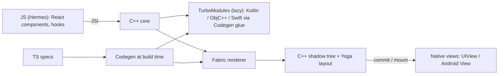

# React Native - New Architecture

> [!info] Deep dive of [[React Native]]

> [!abstract] TL;DR
> The New Architecture replaced the asynchronous JSON **bridge** with **JSI** (a C++ interface that lets JavaScript hold references to native objects and call them directly). On top of JSI:
> - **TurboModules**: lazy, type-safe native modules.
> - **Fabric**: a C++ renderer supporting synchronous layout and React concurrent features.
> - **Codegen**: generates native interfaces from TypeScript specs.
> - **Bridgeless mode**: the old bridge is gone entirely.
>
> It became the default in 0.76 and the **only** architecture from **0.82** (2025-10). Any library or custom native module must be New-Architecture compatible, ideally written with the **Expo Modules API** or as a Codegen TurboModule/Fabric component.

## Concept

### Old vs new
| Aspect | Legacy (bridge) | New Architecture |
|---|---|---|
| JS ↔ native calls | Async, batched JSON messages over the bridge | **JSI**: direct C++ host objects/functions, sync or async |
| Native modules | `NativeModules`, all initialized at startup | **TurboModules**: lazy-loaded, typed via Codegen |
| Rendering | Async UI manager, shadow tree in native per platform | **Fabric**: shared C++ shadow tree, Yoga layout, sync measure, concurrent-safe |
| Type safety | Runtime only | **Codegen** from TS/Flow specs → C++/ObjC/Java interfaces |
| Startup | Bridge init + eager module loading | Bridgeless, lazy modules → faster TTI |
| React features | No concurrent rendering | Concurrent features (transitions, Suspense), automatic batching, `useLayoutEffect` sync layout |

### Building blocks
- **JSI (JavaScript Interface)**: an engine-agnostic C++ API (Hermes, JSC) to expose `HostObject`s/`HostFunction`s to JS. It enables zero-copy patterns (`ArrayBuffer`) and sync calls (e.g. MMKV storage, Reanimated worklets, VisionCamera frame processors).
- **TurboModules**: a native module defined by a TS spec (`TurboModule` interface). Codegen produces the platform glue, and modules load on first access.
- **Fabric components**: native views described by a TS spec (`codegenNativeComponent`), with props typed end to end.
- **Hermes**: the default engine. It compiles JS to bytecode at build time for faster startup and lower memory. Bridgeless mode runs everything through JSI.

## How It Works

- **Render pipeline (Fabric)**: React render → C++ shadow tree (immutable, can be built on any thread) → layout (Yoga) → **commit** → **mount** on the UI thread. It supports synchronous layout reads, which removes the "flash of wrong layout" with `onLayout` workarounds.
- **Threading**: JS thread (React + business logic), UI/main thread (mounting, gestures), background threads (layout, shadow tree). Reanimated runs worklets on the UI thread via JSI for 60–120 fps animations.
- **Interop layers**: 0.76–0.81 shipped an interop layer for legacy modules/components. With legacy removed in 0.82, unmaintained bridge-only libraries break and must be replaced or forked.

## Practical Usage

### TurboModule spec (TypeScript) → Codegen
```ts
// specs/NativeDeviceInfo.ts
import type { TurboModule } from "react-native";
import { TurboModuleRegistry } from "react-native";

export interface Spec extends TurboModule {
  getBatteryLevel(): number;                      // synchronous via JSI
  getAdvertisingId(): Promise<string | null>;     // async
}
export default TurboModuleRegistry.getEnforcing<Spec>("NativeDeviceInfo");
```
```json
// package.json
"codegenConfig": {
  "name": "RarticleDeviceSpec",
  "type": "modules",
  "jsSrcsDir": "specs",
  "android": { "javaPackageName": "com.rarticle.device" }
}
```
Implement the generated interface in Kotlin (`NativeDeviceInfoSpec`) and ObjC++/Swift, then build. Codegen runs during Gradle/CocoaPods builds.

### Prefer the Expo Modules API for app-level native code
```swift
// ios/DeviceInfoModule.swift (Expo Modules API: works with New Architecture, Swift/Kotlin, no C++ glue)
import ExpoModulesCore

public class DeviceInfoModule: Module {
  public func definition() -> ModuleDefinition {
    Name("DeviceInfo")
    Function("getBatteryLevel") { () -> Float in UIDevice.current.batteryLevel }
    AsyncFunction("fetchConfig") { (url: String) async throws -> String in try await loadConfig(url) }
  }
}
```

### Checking library compatibility
```bash
npx expo-doctor                         # flags libraries incompatible with the New Architecture
npx react-native info                   # shows architecture, Hermes, versions
# React Native Directory (reactnative.directory) marks "New Architecture" support per library
```

## Patterns & Anti-patterns
| Pattern | When | Anti-pattern to avoid |
|---|---|---|
| Expo Modules API for custom native code | App-specific native features | Hand-writing legacy `RCTBridgeModule` modules (won't run on 0.82+) |
| Sync JSI calls for small, fast reads (MMKV, device info) | Hot paths | Sync calls that do I/O or heavy work on the JS thread |
| Reanimated/Gesture Handler worklets on UI thread | Animations, gestures | `setState`-driven animations per frame over JS |
| Typed specs + Codegen for libraries | Publishing native libs | Untyped `NativeModules.X` access |
| Audit dependencies before upgrading | Every RN minor | Upgrading RN with abandoned bridge-only libraries |

## Performance & Trade-offs
- **Startup**: lazy TurboModules + Hermes bytecode cut time-to-interactive, especially in apps with many native modules.
- **JS ↔ native overhead**: JSI calls are function calls (µs) instead of serialized messages (ms batches). Large data can be shared via `ArrayBuffer` without JSON copies.
- **Rendering**: Fabric enables concurrent React, but JS-thread work still blocks interactions. Heavy computation should move to native or worklets.
- **Cost**: more C++ in the build, longer native compile times, and native expertise needed for custom components. Debugging crashes now spans JS, C++ and platform code.

## Tips & Reminders
> [!tip]
> - Start new apps with Expo (prebuild/CNG + EAS). The New Architecture and Hermes are the defaults, with config plugins instead of manual native edits.
> - Before upgrading across 0.81 → 0.82+, list native dependencies and check New-Architecture support. Replace abandoned ones (e.g. older storage, camera or map libraries).
> - Profile with React Native DevTools (Hermes profiler, React Profiler) and native tools (Xcode Instruments, Android Studio profiler).
> - **In ZP's stack**: [[Flutter]] remains the default for client mobile apps. Consider React Native when a client already has a React/TypeScript team or web codebase to share logic with. Native integrations map 1:1 to Flutter's Pigeon/FFI approach ([[Flutter - Platform Channels & FFI]]): typed specs + generated glue + Kotlin/Swift implementations.

## Version Notes
| Version | Change |
|---|---|
| 0.68 (2022-03) | New Architecture opt-in |
| 0.71–0.73 | Better New Arch tooling, bridgeless preview |
| 0.74 (2024-04) | Bridgeless default when New Arch enabled, Yoga 3 |
| **0.76** (2024-10) | **New Architecture on by default** (interop layer for legacy libs) |
| 0.79–0.81 (2025) | JSC moved to community package, precompiled iOS builds, React 19 |
| **0.82** (2025-10-08) | **Legacy Architecture removed**. `newArchEnabled=false` ignored |
| 0.83–0.85 (2025-12 → 2026-05) | React 19.2, DevTools/perf improvements. Expo SDK 55 drops legacy, SDK 56 ships 0.85 |

## Critical Issues & Gotchas
> [!danger] Abandoned native libraries block upgrades
> Since 0.82, bridge-only libraries simply don't work. Apps depending on unmaintained native packages get stuck on old RN versions, and then can't meet App Store / Play target-SDK deadlines (see [[Flutter - Build, Release & Store Compliance]] for the same store rules). Audit dependencies yearly, prefer well-maintained or Expo-maintained libraries, and budget for replacing or forking legacy native code.

> [!danger] Synchronous JSI calls can freeze the UI
> JSI makes sync native calls easy, so a sync module that reads files, hits the keychain or does crypto on the JS thread causes jank and ANRs. Keep sync calls trivial (microseconds) and make everything else async.

> [!warning] Gotchas
> - Codegen requires specs to follow naming conventions (`Native*.ts`). Typos silently skip generation, which produces runtime "module not found" errors.
> - C++ build errors after upgrades often come from stale caches. Clean (`cd android && ./gradlew clean`, `pod install --repo-update`, delete `build/`/`Pods/`).
> - Fabric's stricter rendering exposes layout bugs that the old renderer hid (e.g. `zIndex`, measurement timing). Test UI thoroughly after migrating.
> - Hermes lacks some JS engine features/APIs (e.g. certain `Intl` parts on older versions). Check polyfill needs.
> - Third-party crash reporters need New-Architecture-aware symbolication (C++ frames, Hermes bytecode source maps).

## Related
- [[React Native]]
- [[React]] — the UI model running on Fabric
- [[Flutter - Platform Channels & FFI]] — Flutter's equivalent native-interop layer
- [[Kotlin]] · [[Swift]] — native module implementations
- [[Flutter - Rendering & Widget Lifecycle]] — contrast: Flutter's own rendering engine

## References
- New Architecture overview: https://reactnative.dev/architecture/landing-page
- TurboModules / Codegen guide: https://reactnative.dev/docs/turbo-native-modules-introduction
- Fabric components: https://reactnative.dev/docs/fabric-native-components-introduction
- Expo Modules API: https://docs.expo.dev/modules/overview/
- React Native 0.82 release (legacy removal): https://reactnative.dev/blog
- React Native Directory: https://reactnative.directory/
