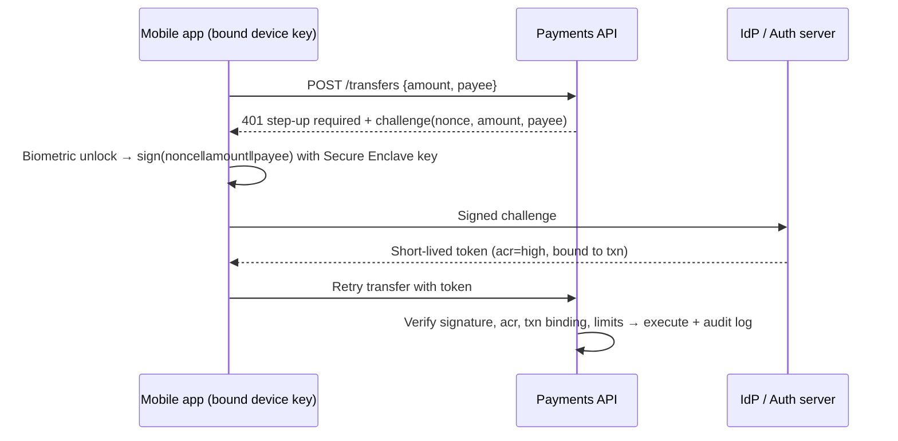
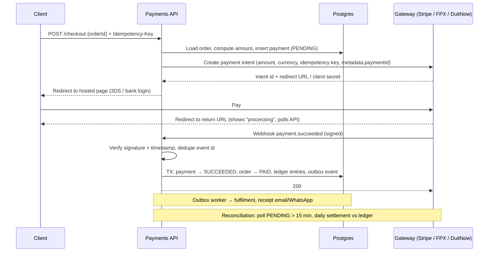
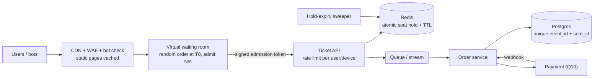

# Backend Interview Questions

> [!info] Reference for [[Backend MOC]]. Mobile counterpart: [[Flutter - Interview Questions]]

> [!abstract] TL;DR
> Eleven high-frequency full-stack/backend interview questions, each with **what the interviewer is grading → answer outline → the trap**. Two are personal (Q1 design patterns in your projects, Q4 your tech stack). They're pre-filled from ZP's actual stack, with `[!question]` boxes for project names and numbers you must supply. The rest are technical with concrete config and code: SQL vs NoSQL (Q2), Spring DI and bean scopes (Q3, Q8), debugging (Q5), finance-app auth (Q6), Redis deploy and resilience (Q7), OOP (Q9), and two system-design questions: payment flow (Q10) and a high-traffic concert ticketing system (Q11).

> [!tip] How to use this note
> Answer with a **causal chain**: *decision → why (mechanism or constraint) → how it ran in production → trade-off or what you'd change*. Interviewers score trade-offs and real incidents, not definitions. Keep each answer to **~2 minutes spoken** and let them pull the details.

## Q1. Explain the design patterns you used in your recent projects.

**Grading**: can you tie a pattern to a *problem it solved*, not recite GoF names? Do you know the cost?

**Answer frame**: one system, 3–4 patterns, each with *problem → pattern → result*. Use the WhatsApp AI-agent pipeline, which exercises the most patterns:

| Problem | Pattern | Implementation |
|---|---|---|
| Several inbound channels (WhatsApp Cloud API, web chat, Telegram) with different payloads | **Adapter** | Each channel adapter maps to one internal `InboundMessage`. The agent core never sees Meta's schema |
| Different LLMs per tenant/task (cost vs quality), provider outages | **Strategy** (+ Factory to pick it) | `LlmProvider` interface. Router picks a model by task type and tenant plan, with fallback order on 429/5xx |
| Meta retries webhooks that don't get a quick 200. LLM calls take 2–20 s | **Queue-based load leveling** (Producer–Consumer) | Webhook verifies the signature, enqueues, returns 200 in < 100 ms. Workers ([[n8n - Queue Mode & Scaling\|n8n queue mode]] / BullMQ on [[Redis]]) consume |
| Retries deliver the same message twice | **Idempotent Consumer** | `SET dedupe:{wamid} 1 NX EX 86400`. Skip if the key already exists |
| Data access mixed into business logic, hard to test | **Repository** | `ConversationRepo` over [[Supabase]]/[[PostgreSQL]]. Tests use an in-memory fake |
| Provider outage cascades into piled-up workers | **Retry with backoff + jitter, Circuit Breaker** | Exponential backoff with full jitter. Open the circuit after N failures and fall back to the next provider or a canned reply |

```typescript
interface LlmProvider {
  readonly id: string;
  complete(req: CompletionRequest, signal: AbortSignal): Promise<CompletionResult>;
}

class LlmRouter {
  constructor(private readonly providers: Map<string, LlmProvider>, private readonly breaker: CircuitBreaker) {}

  async complete(req: CompletionRequest, order: string[]): Promise<CompletionResult> {
    for (const id of order) {
      if (this.breaker.isOpen(id)) continue;
      try {
        return await this.breaker.run(id, () => this.providers.get(id)!.complete(req, AbortSignal.timeout(30_000)));
      } catch (err) {
        if (!isRetryable(err)) throw err;
      }
    }
    throw new AllProvidersFailedError(order);
  }
}

export async function handleWebhook(req: Request): Promise<Response> {
  if (!verifyMetaSignature(req)) return new Response(null, { status: 401 });
  for (const msg of parseWhatsAppPayload(await req.json())) {
    const fresh = await redis.set(`dedupe:${msg.id}`, '1', 'EX', 86_400, 'NX');
    if (fresh) await queue.add('inbound', msg, { attempts: 5, backoff: { type: 'exponential', delay: 2_000 } });
  }
  return new Response(null, { status: 200 });
}
```

- **Close with a trade-off**: "The queue added eventual consistency and a Redis dependency. I made Redis non-evicting with AOF and kept Postgres as the source of truth" (see Q7).
- **Trap**: listing Singleton/Factory/Observer with no problem attached, or overusing patterns ("I used Abstract Factory for two classes"). Saying *where you chose not to* add a pattern scores well.
- Deep dive: [[Design Patterns]] · [[System Design]] · [[AI Agents - Tool Calling & Agent Loops]]

> [!question] Fill in before the interview
> Project name/client type, message volume (msgs/day), p95 webhook latency, and one number the pattern moved (e.g. duplicate replies → 0, LLM cost −X% via routing).

## Q2. What is the difference between SQL and NoSQL databases?

**Grading**: do you reason from **access patterns and consistency needs**, or repeat "NoSQL scales, SQL doesn't"?

| Axis | SQL (relational) | NoSQL |
|---|---|---|
| Data model | Tables, rows, foreign keys. Normalized | Document, key-value, wide-column, graph ([[NoSQL]] families) |
| Schema | Schema-on-write, enforced (`NOT NULL`, `CHECK`, FK) | Schema-on-read. App enforces (or optional validators) |
| Query | Declarative SQL, ad-hoc joins, aggregations | Access-pattern-specific APIs. Joins limited or absent. Model **query-first** |
| Transactions | ACID multi-row/multi-table by default | Varies: single-document atomic everywhere; MongoDB multi-doc transactions since 4.0 (with cost); Cassandra LWT only |
| Consistency | Strong on the primary. Replicas async by default | Often tunable (Cassandra `QUORUM`, Dynamo eventual/strong reads). PACELC trade-offs |
| Scaling | Vertical + read replicas. Sharding is manual (Citus) or via distributed SQL | Horizontal partitioning built in (partition key design is everything) |
| Strength | Integrity, complex queries, reporting, money | Huge write throughput, flexible/denormalized aggregates, predictable key lookups |
| Examples | [[PostgreSQL]], [[MySQL]] | MongoDB, Cassandra/ScyllaDB, DynamoDB, [[Redis]], Neo4j |

- **The blur in 2026**: Postgres `JSONB` + GIN indexes cover most "flexible schema" needs. Distributed SQL (CockroachDB, YugabyteDB, Spanner) gives horizontal scale with SQL and ACID. MongoDB has transactions. So the real question is **access pattern + consistency + ops cost**, not the label.
- **My default**: Postgres as the system of record (ledgers, users, orders). Add NoSQL for a *specific* access pattern: Redis for cache/queues/rate limits, a document or wide-column store for high-volume event/telemetry writes, a vector index (pgvector first) for RAG.
- **Trap**: "NoSQL has no schema". The schema still exists, it just moves into application code and migrations become your problem. Also: "MongoDB isn't ACID" (it has been, per document always and multi-document since 4.0).
- Deep dive: [[PostgreSQL - Transactions & MVCC]] · [[NoSQL]] · [[Vector Databases]]

## Q3. How do you implement dependency injection in Spring Boot?

**Grading**: IoC container basics, **constructor injection and why**, resolving multiple beans, scopes and proxies, testing.

1. **The container**: Spring's `ApplicationContext` is the IoC container. Beans come from **component scanning** (`@Component`, `@Service`, `@Repository`, `@Controller` under the `@SpringBootApplication` package) and from `@Bean` methods in `@Configuration` classes (for third-party classes you can't annotate). Auto-configuration registers defaults guarded by `@ConditionalOnMissingBean`, so your bean wins.
2. **Constructor injection** (the recommended form): `final` fields, immutable, dependencies visible in the signature, works in plain unit tests with `new`. With a single constructor, `@Autowired` is optional (since Spring 4.3).
3. **Several implementations of one interface**: `@Primary`, `@Qualifier("name")`, or inject `List<T>`/`Map<String, T>` and build a Strategy registry.
4. **Environment-driven wiring**: `@Profile("prod")`, `@ConditionalOnProperty(name = "payments.provider", havingValue = "stripe")`, typed `@ConfigurationProperties`.

```java
public interface PaymentGateway {
    String id();
    Receipt charge(Money amount, String idempotencyKey);
}

@Service
class StripeGateway implements PaymentGateway { /* ... */ }

@Service
class FpxGateway implements PaymentGateway { /* ... */ }

@Service
public class CheckoutService {
    private final Map<String, PaymentGateway> gateways;
    private final OrderRepository orders;

    public CheckoutService(List<PaymentGateway> all, OrderRepository orders) {
        this.gateways = all.stream().collect(Collectors.toUnmodifiableMap(PaymentGateway::id, g -> g));
        this.orders = orders;
    }

    @Transactional
    public Receipt checkout(UUID orderId, String gatewayId) {
        var order = orders.findById(orderId).orElseThrow();
        return gateways.get(gatewayId).charge(order.total(), order.idempotencyKey());
    }
}

@Configuration
class HttpClientConfig {
    @Bean
    RestClient paymentsClient(RestClient.Builder builder, PaymentsProperties props) {
        return builder.baseUrl(props.baseUrl()).build();
    }
}
```

| Detail | What to say |
|---|---|
| Field injection (`@Autowired` on a field) | Works, but no `final`, hidden dependencies, needs reflection or the container in tests. Avoid outside test classes |
| Scopes | Default **singleton** (one per context, so it must be stateless or thread-safe). `prototype`, `request`, `session`. Injecting a prototype into a singleton gives *one* instance; use `ObjectProvider<T>` or a scoped proxy (full answer: Q8) |
| Proxies | `@Transactional`, `@Async`, `@Cacheable` work through AOP proxies. **Self-invocation** (`this.method()`) bypasses the proxy, so the annotation silently does nothing |
| Circular dependencies | Prohibited by default since Spring Boot 2.6 (`spring.main.allow-circular-references`). Fix the design (extract a third bean, or use events) rather than flipping the flag |
| Testing | Unit: `new CheckoutService(List.of(fake), repo)`. Slice/integration: `@SpringBootTest`/`@WebMvcTest` with `@MockitoBean` (the old `@MockBean` was deprecated in Boot 3.4 and removed in 4.0) |
| Kotlin | Primary-constructor injection: `class OrderController(private val orders: OrderService)` |

- **Trap**: "DI = `@Autowired`". DI is the principle (dependencies supplied from outside, depend on abstractions). `@Autowired` is just one way Spring triggers it.
- Deep dive: [[Spring Boot]] · [[Java]] · [[Design Patterns]]

## Q4. What tech stacks have you used in your previous projects?

**Grading**: breadth with *depth in one stack*, and **why** you chose each piece. A list of logos fails.

**Answer frame**: group by project type, give one reason per choice, and name one thing you'd change.

| Layer | Stack | Why (the line to say) |
|---|---|---|
| Web / SaaS | [[Next.js]] + [[React]] + [[TypeScript]], Tailwind | SSR/RSC for SEO and dashboards, one language end to end |
| Mobile | [[Flutter]] / [[Dart]] | One codebase for iOS + Android, near-native performance, good offline story |
| Backend | [[Supabase]] (Auth, RLS, Edge Functions), [[Node.js]]; [[Spring Boot]]/[[Java]] for heavier domain services | Supabase for speed on CRUD + auth. JVM where strong typing and transactions dominate |
| Data | [[PostgreSQL]] (system of record, pgvector), [[Redis]] (cache, queues, rate limits) | Postgres covers relational + JSON + vectors. Redis for sub-ms hot paths |
| AI | LLM APIs with provider routing, [[RAG]], [[AI Agents]], [[Model Context Protocol\|MCP]], [[LangChain & LangGraph]] | Agents built per client workflow, or integrate an off-the-shelf product when it fits better |
| Automation / messaging | [[n8n]] self-hosted in queue mode, WhatsApp Cloud API | Fast client-specific workflows. WhatsApp is the primary channel for Malaysian SMEs |
| Infra | [[Docker]], [[Coolify]], [[Traefik]], [[Cloudflare]] on Hostinger KVM | Self-hosted PaaS keeps cost predictable for a small team. Cloudflare for DNS, WAF, R2 backups |

- **Depth signal**: pick one project and walk the request path end to end: Cloudflare → Traefik → Next.js → Supabase/Postgres → Redis queue → worker → WhatsApp.
- **Honest trade-off to offer**: "Single KVM host plus Coolify is a single point of failure. I mitigate it with off-host backups to R2 and a tested restore runbook. At the next scale step I'd split the DB onto managed Postgres or a second node."
- **Trap**: claiming expertise in everything. Mark levels: *production* vs *built projects with* vs *familiar*.

> [!question] Fill in before the interview
> For 2–3 projects: one-line problem, your role, users/traffic, and one measurable outcome. Keep client names generic if under NDA.

## Q5. How do you approach debugging a complex issue in your code?

**Grading**: a **systematic method** (not "add console.log until it works"), use of observability, and closing the loop with a regression test.

1. **Define and contain**: exact symptom, scope (who, since when, which version), severity. Mitigate first in prod: roll back, toggle the feature flag, scale up.
2. **Reproduce**: smallest reliable reproduction (same data, versions, env flags). A bug you can't reproduce, you instrument instead.
3. **Observe, don't guess**: logs with correlation IDs, traces (OpenTelemetry), metrics around the start time, recent deploys and config changes.
4. **Hypothesize → test one variable at a time**. Bisect: `git bisect` over commits, binary search over inputs/config, disable half the middleware.
5. **Find the root cause** (5 whys). The fix goes where the invariant broke, not where the symptom appeared.
6. **Lock it in**: failing test first, then fix. Add the alert or log that would have caught it sooner. Write a short postmortem for prod incidents.

| Layer | Tools |
|---|---|
| Node.js / Next.js | `node --inspect` + Chrome DevTools, `--cpu-prof`, heap snapshots, Sentry, OTel traces |
| JVM / Spring | Actuator metrics, `jcmd <pid> Thread.print`, JFR + JMC, async-profiler |
| Flutter | DevTools (performance, memory, network), `flutter run --profile` |
| PostgreSQL | `EXPLAIN (ANALYZE, BUFFERS)`, `pg_stat_statements`, `pg_locks` / `pg_stat_activity` for lock waits |
| Redis | `SLOWLOG GET`, `INFO memory`/`INFO stats` (evicted_keys), `LATENCY DOCTOR`, `--bigkeys` |
| Network / infra | `curl -v`, `dig`, `docker logs`, Traefik access logs, `tcpdump` as last resort |
| Git | `git bisect run ./repro.sh`, `git log -S 'symbol'` |

> [!example] Story template (adapt to a real incident)
> *Symptom*: n8n executions randomly stuck "queued" under load. *Observe*: workers healthy, Redis `INFO stats` showed `evicted_keys` rising. *Root cause*: `maxmemory-policy allkeys-lru` was evicting Bull job keys. *Fix*: `noeviction` plus memory alert at 80% and a separate Redis for cache. *Lock-in*: config checked into the compose file and a dashboard panel on evictions. See [[Redis - Persistence & High Availability]].

- **Trap**: jumping to the fix without reproducing, or "it was a race condition" without saying how you proved it.

## Q6. Which authentication approach would you pick for a finance app?

**Grading**: threat model first (account takeover, phishing, SIM swap, token theft, insider), phishing-resistant MFA, token handling, **regulatory awareness**.

**Recommendation** (the one-liner): *OIDC Authorization Code + PKCE against a dedicated IdP, passkeys plus device binding as primary factors, short-lived sender-constrained tokens, step-up re-authentication and transaction signing for money movement, and no SMS OTP for high-risk actions.*

| Concern | Choice | Why |
|---|---|---|
| Protocol | [[OAuth 2.0 & OIDC]], Auth Code + **PKCE**. Follow the **FAPI 2.0** security profile for open-banking-style APIs | Standard, auditable. FAPI tightens OAuth for financial-grade APIs (PAR, sender-constrained tokens) |
| Identity provider | Keycloak (self-hosted) or a certified managed IdP | MFA policies, sessions, audit logs and brute-force protection without building them. Avoid hand-rolled auth |
| Primary factor | **Passkeys / WebAuthn** (phishing-resistant). Password only as fallback with breach checks per NIST SP 800-63-4 | Phishing is the #1 takeover vector |
| Mobile | **Device binding**: key pair generated in Secure Enclave / Android StrongBox at enrolment. Biometrics unlock the key locally | Server verifies signatures from the bound device, not a shared secret |
| Money movement | **Step-up auth + transaction signing**: sign `{amount, payee, nonce}` with the device key. Show amount and payee on the approval screen | Defeats session hijack and man-in-the-browser. The approval is bound to *this* transaction |
| Tokens | Access token 5–10 min, refresh token rotation with **reuse detection**, sender-constrained (DPoP or mTLS) | A stolen token is useless elsewhere or quickly expired |
| Web client | **BFF pattern**: tokens stay server-side; browser gets an `HttpOnly; Secure; SameSite=Strict` session cookie | No tokens reachable by XSS (no `localStorage`) |
| Sessions | Idle timeout ~5–15 min, absolute timeout, revoke-all on password/device change, new-device alerts | Limits blast radius |
| Authorization | RBAC + attribute rules (limits, ownership) enforced server-side; Postgres RLS where applicable | AuthN is half the job ([[Authentication & Authorization]]) |
| Ops | Rate limiting, credential-stuffing detection, risk signals (new device, geo, velocity), immutable audit log | Required for disputes and regulators |



> [!info] Malaysia: BNM requirements (genuinely relevant here)
> - Bank Negara Malaysia directed banks (2022 anti-scam measures) to **migrate away from SMS OTP** for account opening, fund transfers, payments and changes to personal details or settings. Banks moved to in-app approval on a bound device (e.g. Maybank Secure2u, Public Bank SecureSign).
> - **Cooling-off period** on first-time enrolment of online banking or a secure device (bank-defined, e.g. 12 h). Banks also enforce **one secure device per customer**.
> - Policy frame: BNM **RMiT** (Risk Management in Technology). Reports describe a later RMiT update tightening device binding, phone-number changes and interception-resistant MFA. Unverified against the BNM text, so check the current RMiT before quoting specifics.
> - **PDPA**: auth logs and device identifiers are personal data, so define retention and access controls.

- **Trap**: "JWT in `localStorage` + refresh token", "SMS OTP is our 2FA", or building auth yourself. Also forgetting that biometrics only *unlock a key locally*; the server never receives a fingerprint.
- Deep dive: [[Authentication & Authorization]] · [[OAuth 2.0 & OIDC]] · [[JWT]] · [[OWASP Top 10]]

## Q7. How do you deploy a Redis instance, and what patterns ensure performance and durability in abnormal situations?

**Grading**: do you **classify the workload first** (cache vs queue/state), know the persistence and HA knobs, and design the *application* to survive Redis failing?

### Step 1: decide the role, because config differs
| Role | Persistence | `maxmemory-policy` | Losing data means |
|---|---|---|---|
| Cache | Optional (RDB for warm restarts) | `allkeys-lru` / `allkeys-lfu` | Cache miss → DB load spike |
| Queue / job state / sessions / rate limits | **AOF `everysec` + RDB** | **`noeviction`** | Lost jobs, logged-out users |

Run them as **separate instances** when both exist. One eviction policy can't serve both.

### Step 2: deploy
- Docker/[[Coolify]] with a config file, persistent volume, **no published port** (internal Docker network only), ACL users or `requirepass`, `protected-mode yes`, healthcheck, `maxmemory` at ~70–75% of the container limit (leave room for fork copy-on-write during `BGSAVE`/AOF rewrite). Host: `vm.overcommit_memory=1`, disable Transparent Huge Pages.
- Full compose and config: [[Redis - Persistence & High Availability]].

```conf
appendonly yes
appendfsync everysec
aof-use-rdb-preamble yes
save 900 1 300 100
maxmemory 2gb
maxmemory-policy noeviction
min-replicas-to-write 1
min-replicas-max-lag 10
```

### Step 3: HA by scale
| Setup | When | Abnormal-case behaviour |
|---|---|---|
| Single node + AOF + off-host backups (RDB → R2 hourly) | Single KVM, small team | Crash: ≤ ~1 s of writes lost. Host loss: restore from backup (RPO = backup interval) |
| Primary + replica(s) + **3 Sentinels** (quorum 2, on separate hosts) | Need automatic failover | Failover in seconds. Clients must be Sentinel-aware (ioredis `sentinels`, Lettuce) |
| **Redis Cluster** (≥ 3 primaries + replicas) | Dataset or throughput beyond one node | Hash-slot sharding. Multi-key ops need `{hashtag}`s |
| Managed (Upstash, ElastiCache, Redis Cloud) | Don't want to run it | Vendor lock-in and per-request/GB pricing |

### Step 4: patterns for abnormal situations
| Situation | Pattern |
|---|---|
| Process crash / restart | AOF `everysec` (≤ ~1 s loss) or `always` for critical writes. `WAITAOF` for per-command durability |
| Primary dies | Sentinel failover. `min-replicas-to-write` stops an isolated primary accepting writes (limits split-brain loss). Asynchronous replication can still lose the last acknowledged writes, so say so |
| Memory full | `maxmemory` + right policy. Alert at 80%. Find big keys (`redis-cli --bigkeys`, `MEMORY USAGE`) |
| Redis down (cache role) | **Circuit breaker + fallback to DB**, with a **bulkhead** (rate-limited DB path) so the database isn't stampeded. Short client timeouts (50–200 ms) |
| **Cache avalanche** (many keys expire at once) | TTL **jitter** (`ttl + random(0, 10%)`), staggered warm-up |
| **Cache breakdown** (hot key expires, thundering herd) | Single-flight mutex (`SET lock NX PX`) or logical expiry with background refresh |
| **Cache penetration** (queries for keys that don't exist) | Cache nulls with short TTL, Bloom filter in front, input validation |
| Lost queue jobs | Redis is **not** the system of record. Write the business fact to Postgres first (Transactional Outbox), make consumers idempotent, reconcile on restart |
| Latency spikes | Pipelining/`MULTI`, no `KEYS *` (use `SCAN`), avoid big keys/O(N) commands, `SLOWLOG`, connection pooling |

```typescript
export async function getCached<T>(key: string, ttlSec: number, load: () => Promise<T>): Promise<T> {
  try {
    const hit = await redis.get(key);
    if (hit !== null) return JSON.parse(hit) as T;

    const lock = await redis.set(`lock:${key}`, '1', 'PX', 5_000, 'NX');
    if (!lock) {
      await sleep(50 + Math.random() * 50);
      const retry = await redis.get(key);
      if (retry !== null) return JSON.parse(retry) as T;
    }

    const value = await load();
    const jitter = Math.floor(ttlSec * 0.1 * Math.random());
    await redis.set(key, JSON.stringify(value), 'EX', ttlSec + jitter);
    if (lock) await redis.del(`lock:${key}`);
    return value;
  } catch (err) {
    if (!isRedisUnavailable(err)) throw err;
    return dbBulkhead.run(load);
  }
}
```

- **Close with**: "I monitor `used_memory`, `evicted_keys`, `connected_clients`, replication lag and `aof_last_bgrewrite_status`, and I test restores, not just backups."
- **Licensing aside** (if asked about alternatives): Redis 8 is tri-licensed including AGPLv3. **Valkey** (Linux Foundation fork) is the BSD drop-in many clouds moved to. See [[Redis]].
- **Trap**: "Redis is in-memory so it isn't durable" (AOF exists), or the opposite: treating Redis with async replication as a durable system of record for money.
- Deep dive: [[Redis - Persistence & High Availability]] · [[Redis - Data Structures & Patterns]] · [[n8n - Queue Mode & Scaling]]

## Q8. What is the difference between singleton and prototype beans in Spring?

**Grading**: lifecycle and thread-safety implications, and the **prototype-into-singleton** trap.

| | Singleton (default) | Prototype |
|---|---|---|
| Instances | One per `ApplicationContext`, cached and shared | New instance per injection point / `getBean()` |
| Created | Eagerly at startup, so wiring errors fail fast (unless `@Lazy`) | Lazily on request, so errors surface at runtime |
| Lifecycle | Full: init callbacks **and** `@PreDestroy` on shutdown | Spring creates and initializes, then forgets it. **`@PreDestroy` never runs**; the caller releases resources |
| Thread safety | Shared across threads, so it must be stateless or thread-safe | Per-use state is fine (not shared) |
| Use for | Services, repositories, clients, config | Stateful or non-thread-safe helpers: builders, per-job context, stateful parsers |
| Declare | Nothing | `@Scope(ConfigurableBeanFactory.SCOPE_PROTOTYPE)` |

**Prototype injected into a singleton** is resolved **once**, at the singleton's creation, so it behaves like a singleton. Ask the container each time instead:

```java
@Component
@Scope(ConfigurableBeanFactory.SCOPE_PROTOTYPE)
class ReportBuilder {
    private final List<Row> rows = new ArrayList<>();
    ReportBuilder add(Row r) { rows.add(r); return this; }
    Report build() { return new Report(List.copyOf(rows)); }
}

@Service
class ReportService {
    private final ObjectProvider<ReportBuilder> builders;

    ReportService(ObjectProvider<ReportBuilder> builders) {
        this.builders = builders;
    }

    Report generate(List<Row> data) {
        var builder = builders.getObject();
        data.forEach(builder::add);
        return builder.build();
    }
}
```

| Fix | Notes |
|---|---|
| **`ObjectProvider<T>.getObject()`** | Preferred: explicit, testable, no proxy magic |
| `@Lookup` method | Spring overrides the method via a CGLIB subclass to return a fresh bean |
| Scoped proxy (`proxyMode = ScopedProxyMode.TARGET_CLASS`) | With prototype, **every method call** hits a new instance, so state is lost between calls. Fine for `request`/`session` scopes, surprising for prototype |

- Web-only scopes: `request`, `session`, `application`, `websocket`. Inject them into singletons through a scoped proxy.
- **Traps**: "Spring singleton = GoF Singleton" (it's one per *container*, not per JVM: two contexts mean two instances, and `new` still works). Mutable fields in a singleton (counters, current user) cause races under concurrent requests. Prototype beans holding connections or file handles leak because nothing calls `@PreDestroy`.
- Deep dive: [[Spring Boot]] · Q3

## Q9. Explain the concept of object-oriented programming (OOP).

**Grading**: can you explain the **why** (managing change and complexity) with a real example, not "Dog extends Animal"? Do you know where inheritance hurts?

**One-liner**: OOP models a system as objects that bundle **state with the behaviour that protects it**, and that collaborate through **interfaces**, so each part can change without breaking the others.

| Pillar | What it really means | Real example |
|---|---|---|
| **Encapsulation** | Hide state and **enforce invariants** behind methods. Not "private fields + getters/setters" | `Money` can't be negative or mix currencies. `Order.cancel()` refuses if already shipped |
| **Abstraction** | Expose *what*, hide *how* | `PaymentGateway.charge()` hides HTTP, signing, retries |
| **Inheritance** | Reuse plus an "is-a" subtype relationship | `abstract class BaseRepository<T>`. Use sparingly |
| **Polymorphism** | One call, behaviour chosen at runtime by the concrete type (dynamic dispatch) | `gateway.charge()` runs Stripe, FPX or a test fake |

```java
public record Money(long minor, Currency currency) {
    public Money {
        if (minor < 0) throw new IllegalArgumentException("negative amount");
        Objects.requireNonNull(currency);
    }

    public Money plus(Money other) {
        if (!currency.equals(other.currency)) throw new IllegalArgumentException("currency mismatch");
        return new Money(Math.addExact(minor, other.minor), currency);
    }
}

public sealed interface PaymentMethod permits Card, Fpx, EWallet {}
public record Card(String token) implements PaymentMethod {}
public record Fpx(String bankCode) implements PaymentMethod {}
public record EWallet(String provider) implements PaymentMethod {}

String describe(PaymentMethod m) {
    return switch (m) {
        case Card c -> "Card " + c.token();
        case Fpx f -> "FPX via " + f.bankCode();
        case EWallet w -> w.provider();
    };
}
```

- **Composition over inheritance**: deep hierarchies are fragile (a base-class change breaks every subclass). Prefer small interfaces plus composed collaborators (Strategy, Decorator).
- **SOLID** in one breath: Single responsibility, Open/closed (add a new gateway without editing checkout), Liskov (subtypes must honour the contract), Interface segregation (small interfaces), Dependency inversion (depend on `PaymentGateway`, not `StripeClient`; Spring DI does the wiring, Q3).
- **Modern nuance**: languages mix paradigms. Java 21 records + sealed interfaces + pattern matching (above) give data-oriented modelling. [[TypeScript]] and [[Dart]] favour interfaces and composition. Pure data pipelines are often clearer as functions than as objects.
- **Traps**: Animal/Dog examples with no real system; "encapsulation = getters/setters" (a setter for every field breaks encapsulation); claiming inheritance is the main way to reuse code.
- Deep dive: [[Design Patterns]] · [[Java]]

## Q10. How would you design and implement a payment method, including the overall process flow?

**Grading**: correctness under failure (**idempotency, webhooks as source of truth, reconciliation**), money modelling, security/PCI scope. The happy path is the easy part.

### Principles to state up front
- **Never touch raw card data.** Use the gateway's hosted checkout or tokenized fields, so PCI DSS scope stays at the minimal SAQ A level (PCI DSS v4.0.1 is current).
- **The server owns the amount.** Recompute from the order in the DB. Never trust a client-sent price.
- **The webhook is the source of truth**, not the browser redirect. Redirects get closed, blocked or forged.
- **Every write is idempotent**: an idempotency key to the gateway, and unique constraints on our side.
- **Money = integer minor units** (`BIGINT` sen) plus an ISO 4217 currency. Never `float`.
- **Gateway behind an interface** (Adapter/Strategy, Q1/Q3) so Stripe, FPX via Billplz/iPay88, DuitNow QR or e-wallets plug in.

### Flow


### State machine (transitions only move forward)
`CREATED → PENDING → (AUTHORIZED →) SUCCEEDED` · `PENDING → FAILED | EXPIRED` · `SUCCEEDED → REFUND_PENDING → REFUNDED | PARTIALLY_REFUNDED`

```sql
create table payments (
  id              uuid primary key default gen_random_uuid(),
  order_id        uuid not null references orders(id),
  provider        text not null,
  provider_ref    text,
  amount_minor    bigint not null check (amount_minor > 0),
  currency        char(3) not null,
  status          text not null,
  idempotency_key text not null unique,
  created_at      timestamptz not null default now(),
  unique (provider, provider_ref)
);

create table payment_events (
  provider    text not null,
  event_id    text not null,
  payment_id  uuid references payments(id),
  payload     jsonb not null,
  received_at timestamptz not null default now(),
  primary key (provider, event_id)
);
```

```typescript
export async function onGatewayWebhook(raw: string, headers: Headers): Promise<number> {
  const event = gateway.verifyAndParse(raw, headers);
  await db.transaction(async (tx) => {
    const inserted = await tx.insertIgnore('payment_events', { provider: gateway.id, eventId: event.id, payload: event });
    if (!inserted) return;
    const payment = await tx.lockPaymentByProviderRef(gateway.id, event.paymentRef);
    if (event.amountMinor !== payment.amountMinor || event.currency !== payment.currency) {
      throw new AmountMismatchError(payment.id);
    }
    if (!canTransition(payment.status, event.status)) return;
    await tx.updatePaymentStatus(payment.id, event.status);
    if (event.status === 'SUCCEEDED') {
      await tx.markOrderPaid(payment.orderId);
      await tx.insertLedger(doubleEntry(payment));
      await tx.insertOutbox('payment.succeeded', { paymentId: payment.id });
    }
  });
  return 200;
}
```

| Failure | Handling |
|---|---|
| Gateway times out on create | Don't assume failure. Retry with the **same idempotency key**, or query by our `paymentId` |
| Duplicate webhook | `(provider, event_id)` primary key → no-op |
| Out-of-order webhooks (`failed` after `succeeded`) | State machine rejects backward transitions |
| Webhook never arrives | Reconciliation job polls the gateway for `PENDING` older than N minutes (FPX bank confirmations can lag) |
| User pays twice | One active payment per order. Auto-refund duplicates found by reconciliation |
| Amount tampering | Amount comes from the DB. Webhook amount must equal the stored amount |
| Refunds | Separate flow with role check, audit log, idempotency key, and ledger reversal entries |

- **Ledger**: append-only double-entry (`debit customer_receivable / credit revenue`, fees to `gateway_fees`). Never `UPDATE` balances in place. Daily reconciliation compares gateway settlement reports with ledger totals.
- **Security**: HMAC signature + timestamp window on webhooks, secrets in env/secret store, no gateway keys on the client, refund endpoints behind step-up auth (Q6). PDPA covers billing details.
- **Malaysia**: FPX (online banking), DuitNow QR, cards, and e-wallets (Touch 'n Go, GrabPay, Boost) through gateways such as Stripe, Billplz, iPay88, Razer Merchant Services or senangPay. Pick by method coverage, fees, settlement time (T+1 to T+3) and webhook quality.
- **Trap**: marking the order paid on the redirect, no idempotency, floats for money, or "store the card number encrypted" (that pulls you into full PCI scope).
- Deep dive: [[PostgreSQL - Transactions & MVCC]] · [[REST API]] · [[Authentication & Authorization]]

## Q11. How would you handle huge traffic for a concert ticket purchasing system? Design the flow.

**Grading**: do you **protect the inventory core from the herd**, prevent **overselling**, keep it **fair**, and degrade gracefully? Scaling every tier "with Kubernetes" is not the answer.

**Frame the numbers first**: e.g. 50,000 seats, 1M users arriving within the first minute, > 95% of them leave without a ticket. So the design goal is to **admit only as many users as the inventory core can serve**, and reject everyone else cheaply at the edge.



| Stage | Design |
|---|---|
| **Before the sale** | Load-test to a known admit rate. Pre-scale (autoscaling is too slow for a cliff spike). Pre-load inventory into Redis. Static event pages and seat maps on the CDN. Pre-registration or verified accounts to cut bots |
| **Edge** | [[Cloudflare]] WAF, Turnstile/bot management, per-IP and per-account rate limits. Origin only accepts requests carrying a valid admission token |
| **Waiting room** | Users who arrive before T0 get a **random** position at T0 (fairer than first-click). Admit at a rate matched to downstream capacity. Admission = short-lived signed token (JWT, ~10 min, bound to user + device). Options: Cloudflare Waiting Room, Queue-it, or a Redis `ZSET` queue |
| **Seat hold** | Atomic in Redis: assigned seats with `SET seat:{evt}:{id} user NX EX 600`. General admission with a Lua decrement (below). Enforce per-user limits (e.g. 4) in the same atomic step |
| **Order creation** | Hold → enqueue → order service writes Postgres. A **unique constraint `(event_id, seat_id)`** is the final guard against overselling, even if Redis is wrong |
| **Payment** | Within the hold window, via the Q10 flow. Success → `SOLD`. Failure or expiry → seat goes back to the pool |
| **Hold expiry** | Key TTL alone doesn't return stock. Track holds in a `ZSET` scored by expiry, and a sweeper atomically restores them (keyspace notifications are not reliable delivery) |
| **Client feedback** | Async: return `202 + orderId`, then poll or SSE for status. No long-held requests |
| **Degrade** | Turn off non-critical features during the sale (recommendations, search, reviews). Show "sold out" from a cached flag. Circuit breakers on payments |

```lua
-- KEYS: stock, per-user count, holds zset · ARGV: qty, maxPerUser, expiresAtMs, holdId
local qty = tonumber(ARGV[1])
local bought = tonumber(redis.call('GET', KEYS[2]) or '0')
if bought + qty > tonumber(ARGV[2]) then return -2 end
local stock = tonumber(redis.call('GET', KEYS[1]) or '0')
if stock < qty then return -1 end
redis.call('DECRBY', KEYS[1], qty)
redis.call('INCRBY', KEYS[2], qty)
redis.call('ZADD', KEYS[3], ARGV[3], ARGV[4] .. ':' .. qty)
return stock - qty
```
- In Redis Cluster, give all keys of one event the same hash tag (`{evt:123}:stock`) so the script runs on one shard.
- **Oversell defence in depth**: Redis atomic hold (fast path) → Postgres unique constraint (truth) → reconciliation (Redis vs DB counts after the sale).
- **Postgres-only variant** (smaller events): `UPDATE inventory SET available = available - $2 WHERE event_id = $1 AND available >= $2 RETURNING available`. A single hot row serializes everything, so split stock into N bucket rows, or pick seats with `SELECT … FOR UPDATE SKIP LOCKED`.
- **Idempotency** on hold and order endpoints (a client retry must not take two holds). Unique `(user_id, event_id)` limits where policy requires.

> [!danger] Real incident: Ticketmaster, Taylor Swift Eras Tour presale (Nov 2022)
> Ticketmaster reported **3.5 billion total system requests, 4× its previous peak**, driven by bot attacks and fans without invite codes. About 1.5M of 3.5M Verified Fan registrants were invited. The next day's general public sale was cancelled for "extraordinarily high demands on ticketing systems and insufficient remaining ticket inventory". Lessons: pre-registration doesn't cap traffic unless the edge **rejects un-invited requests before they reach the origin**, and bots must be filtered at the CDN, not in the queue.

- **Trap**: "just autoscale" or "use a bigger DB". The bottleneck is a **single contended inventory**, so you must shape traffic before it, and keep the oversell guard in the system of record.
- Deep dive: [[System Design]] · [[Redis - Data Structures & Patterns]] · [[Message Queues]] · [[Kafka]] · [[Cloudflare]]

## Related
- [[Spring Boot]] — Q3, Q8 in depth
- [[Redis]] · [[Redis - Persistence & High Availability]] · [[Redis - Data Structures & Patterns]] — Q7
- [[Authentication & Authorization]] · [[OAuth 2.0 & OIDC]] · [[JWT]] — Q6
- [[PostgreSQL]] · [[NoSQL]] — Q2
- [[Design Patterns]] · [[System Design]] — Q1, Q9, Q10, Q11 (planned notes)
- [[Message Queues]] · [[Kafka]] · [[Cloudflare]] — Q11 traffic shaping and async order pipeline
- [[Flutter - Interview Questions]] — mobile counterpart

## References
- Spring Framework, dependency injection: https://docs.spring.io/spring-framework/reference/core/beans/dependencies/factory-collaborators.html
- Spring Boot reference: https://docs.spring.io/spring-boot/reference/
- Redis persistence: https://redis.io/docs/latest/operate/oss_and_stack/management/persistence/
- Redis Sentinel: https://redis.io/docs/latest/operate/oss_and_stack/management/sentinel/
- NIST SP 800-63-4: https://pages.nist.gov/800-63-4/
- OpenID FAPI 2.0 Security Profile: https://openid.net/specs/fapi-security-profile-2_0-final.html
- BNM anti-scam measures, SMS OTP migration (RinggitPlus summary): https://ringgitplus.com/en/blog/personal-finance-news/bnm-announces-five-additional-safeguards-against-financial-scams-including-migrating-from-sms-otp.html
- BNM policy documents (RMiT): https://www.bnm.gov.my/
- Spring bean scopes: https://docs.spring.io/spring-framework/reference/core/beans/factory-scopes.html
- Stripe idempotent requests: https://docs.stripe.com/api/idempotent_requests
- Stripe webhooks (signature verification, retries): https://docs.stripe.com/webhooks
- PCI DSS document library (v4.0.1): https://www.pcisecuritystandards.org/document_library/
- Cloudflare Waiting Room: https://developers.cloudflare.com/waiting-room/
- Ticketmaster Eras Tour presale (Fortune): https://fortune.com/2022/11/17/ticketmaster-cancels-general-sale-taylor-swifts-eras-tour
