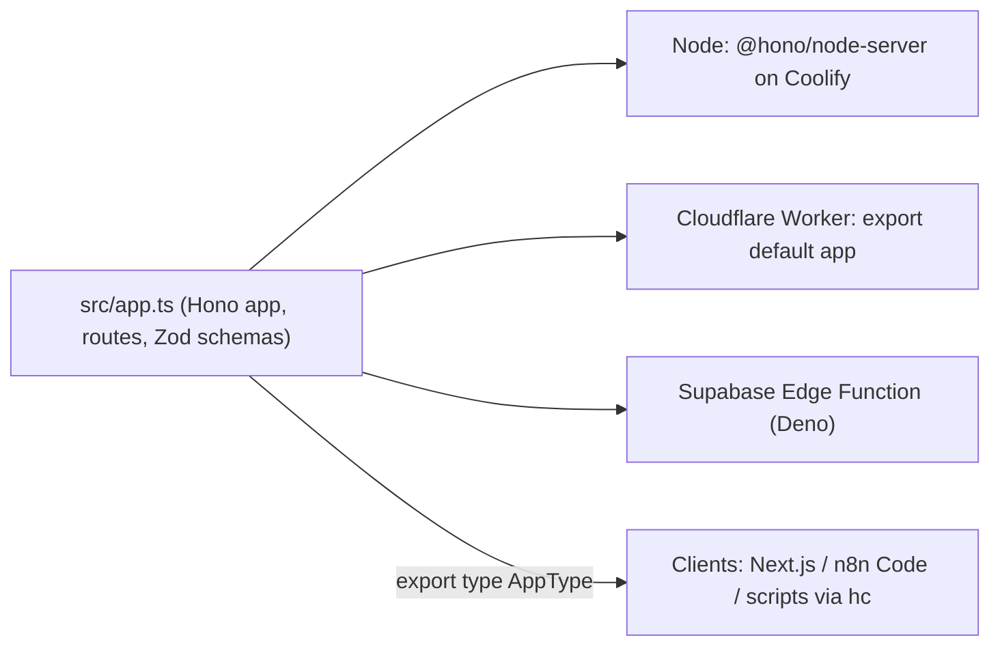

# Node.js - Hono APIs on Node, Bun & Workers

> [!info] Deep dive of [[Node.js]]

> [!abstract] TL;DR
> **Hono** is a small, fast TypeScript web framework built on **Web Standard `Request`/`Response`**. The same app code runs on **Node.js** (`@hono/node-server`), **Bun**, **Deno**, **Cloudflare Workers** and **Supabase Edge Functions**. That makes it a good default for:
> - standalone APIs and webhook receivers next to Next.js;
> - internal services on Coolify;
> - edge APIs on Workers, sharing one codebase.
>
> **Strengths**: tiny footprint, typed routes, Zod validation middleware, a built-in **RPC client (`hc`)** for end-to-end types, and first-class middleware (CORS, JWT, secure headers, rate-limit integrations).
> **When not**: if Next.js route handlers already cover the API inside one app, don't add a separate service. If you need a batteries-included framework (ORM, DI, admin), NestJS/Spring may fit better.

## Concept
| Feature | API | Notes |
|---|---|---|
| Routing | `app.get('/orders/:id', h)` | Fast trie/regexp routers |
| Validation | `zValidator('json', schema)` | Typed `c.req.valid('json')` |
| Middleware | `cors()`, `secureHeaders()`, `jwt()`, `bearerAuth()`, `logger()` | Composable per route group |
| RPC client | `hc<AppType>(baseUrl)` | Typed client from server routes. No codegen |
| OpenAPI | `@hono/zod-openapi` | Generate docs from Zod schemas |
| Runtimes | Node, Bun, Deno, Workers, Lambda, Vercel | Adapter or native |
| Context | `c.env`, `c.var`, `c.json()`, `c.text()` | Bindings/env typed per runtime |

**Framework comparison**:

| Framework | Pick it when… |
|---|---|
| Hono | Multi-runtime APIs, Workers, small services, webhooks |
| Next.js route handlers | API lives inside the Next.js app ([[Next.js - Server Actions, Mutations & Security]]) |
| Fastify | Node-only, high-throughput, plugin ecosystem |
| Express | Legacy codebases. Avoid for new work |
| NestJS | Large teams wanting DI/modules conventions |

## How It Works


## Practical Usage
**App with validation, auth and errors** (`src/app.ts`):
```ts
import { Hono } from "hono";
import { secureHeaders } from "hono/secure-headers";
import { bearerAuth } from "hono/bearer-auth";
import { HTTPException } from "hono/http-exception";
import { zValidator } from "@hono/zod-validator";
import { z } from "zod";

type Bindings = { DATABASE_URL: string; API_TOKEN: string };
const app = new Hono<{ Bindings: Bindings }>();

app.use("*", secureHeaders());
app.use("/v1/*", async (c, next) => bearerAuth({ token: c.env.API_TOKEN })(c, next));

const NewLead = z.object({ name: z.string().min(1), phone: z.string().regex(/^\+?60\d{8,10}$/), source: z.enum(["web", "wa"]) });

const routes = app
  .post("/v1/leads", zValidator("json", NewLead), async (c) => {
    const lead = c.req.valid("json");
    const id = await createLead(c.env.DATABASE_URL, lead);
    return c.json({ id }, 201);
  })
  .get("/v1/leads/:id", async (c) => {
    const lead = await getLead(c.env.DATABASE_URL, c.req.param("id"));
    if (!lead) throw new HTTPException(404, { message: "not_found" });
    return c.json(lead);
  });

app.onError((err, c) =>
  err instanceof HTTPException ? c.json({ error: err.message }, err.status) : c.json({ error: "internal" }, 500));

export type AppType = typeof routes;
export default app;
```
**Run on Node** (Coolify container):
```ts
// src/server.ts
import { serve } from "@hono/node-server";
import app from "./app";
serve({ fetch: (req) => app.fetch(req, process.env as any), port: 3000 });
```
**Run on Cloudflare Workers**: `export default app` with `wrangler.jsonc` vars/secrets bound to `c.env` ([[Cloudflare - Workers for Webhooks & Edge APIs]]).

**Typed client** (Next.js server code or scripts):
```ts
import { hc } from "hono/client";
import type { AppType } from "@acme/api";
const api = hc<AppType>(process.env.API_URL!, { headers: { Authorization: `Bearer ${process.env.API_TOKEN}` } });
const res = await api.v1.leads.$post({ json: { name: "Ali", phone: "+60123456789", source: "wa" } });
const { id } = await res.json();          // typed
```
**Webhook receiver with raw-body signature check**:
```ts
app.post("/webhooks/meta", async (c) => {
  const raw = await c.req.text();
  if (!verifyHmac(raw, c.req.header("x-hub-signature-256"), c.env.META_SECRET)) return c.text("bad sig", 401);
  c.executionCtx?.waitUntil?.(enqueue(JSON.parse(raw)));    // Workers; on Node push to BullMQ instead
  return c.text("ok");
});
```
**Wrong way**:
```text
❌ Node-only APIs (fs, Buffer-heavy libs) in shared app code meant for Workers → runtime errors at the edge
❌ Parsing JSON before verifying webhook signatures                           → signature mismatch / spoofing
❌ Returning raw exceptions to clients                                        → info leakage; use onError
❌ Separate microservice for 3 endpoints that belong in Next.js               → extra deploy and auth surface
```

## Patterns & Anti-patterns
| Pattern | When | Anti-pattern to avoid |
|---|---|---|
| `export type AppType` + `hc` client in a shared package | Monorepos | Hand-written fetch wrappers drifting from routes |
| Zod validation on every input | All routes | Trusting request bodies |
| Runtime-agnostic core + thin adapters | Multi-runtime | Runtime-specific code everywhere |
| Route groups with scoped middleware | Public vs admin APIs | Global auth hacks |
| `@hono/zod-openapi` for partner APIs | External consumers | Undocumented APIs |
| Keep heavy work in queues | Webhooks | Long processing in request handlers |

## Performance & Trade-offs
- **Throughput**: Hono is among the fastest JS routers, but DB and network dominate real latency. Don't pick it for benchmarks alone.
- **Bun vs Node**: Bun can be faster at startup/HTTP, but production compatibility and tooling are more mature on Node 24/26 LTS. Default to Node for client systems ([[Node.js - Performance & Diagnostics]]).
- **Workers**: fast cold starts and global reach, but CPU limits and no long-running work. Pair with queues/Hyperdrive ([[Cloudflare - Hyperdrive & Connecting Workers to Postgres]]).
- **RPC types** can slow the TypeScript server on very large route trees. Split by domain.

## Tips & Reminders
> [!tip] In ZP's stack
> - **Good use**: a "public API" service for clients' partners (POS sync, booking partners) with API keys + rate limits, separate from the Next.js app ([[REST API - Rate Limiting & API Keys for Public APIs]]).
> - **Webhook gateway**: one Hono service (or Worker) receiving Meta/Stripe/payment-gateway webhooks, verifying signatures, and enqueueing to BullMQ/n8n.
> - **Supabase Edge Functions** run Deno. Hono works there too for multi-route functions ([[Supabase - Edge Functions, Cron & Queues]]).

- Use `c.var` with typed middleware for tenant/user context.
- Add request IDs (`hono/request-id`) and structured logs.
- Version routes (`/v1`) from day one for partner APIs ([[REST API - Versioning, Pagination & Error Design]]).
- Health endpoint `/healthz` for Coolify rolling deploys.

## Version Notes
| Version | Change relevant here |
|---|---|
| Hono 3 (2023) | RPC client, Zod validator, broad runtime support |
| Hono 4 (2024) | Static site generation, client components, improved types |
| 2025–26 | Ecosystem growth (OpenAPI, auth adapters). Common choice for Workers and Bun APIs |

> [!warning] Unverified — check before relying on this
> Current Hono minor version, middleware import paths (e.g. `hono/request-id`) and Node adapter options weren't verified this run. Check https://hono.dev/docs before pinning versions.

## Critical Issues & Gotchas
> [!danger] Edge-incompatible dependencies break at runtime
> Code that runs fine on Node (native modules, `fs`, some crypto/Buffer usages, Postgres drivers without pooling) fails on Workers or Deno, often only in production. Keep shared code runtime-agnostic, test each target in CI (Node + wrangler dev), and isolate runtime-specific adapters.

> [!danger] Auth middleware ordering mistakes
> Registering routes before auth middleware, or applying `bearerAuth` to the wrong path pattern, leaves admin endpoints public. Group protected routes under a prefix with middleware applied first, and add tests asserting 401 for unauthenticated calls to every protected route.

- **Body can be read once**: read raw text for signature checks, then parse.
- **CORS** defaults are permissive in examples. Restrict origins for browser-facing APIs.
- **Env typing** differs per runtime (`process.env` vs `c.env`). Normalize in one place.
- **Large uploads** need streaming. Don't buffer multi-MB files in Workers memory.

## Related
- [[Node.js]]
- [[Cloudflare - Workers for Webhooks & Edge APIs]] — Workers deployment target
- [[TypeScript - Runtime Validation with Zod & Type-Safe APIs]] — schemas and validation
- [[REST API - Rate Limiting & API Keys for Public APIs]] — partner API protection
- [[REST API - Versioning, Pagination & Error Design]] — API contract design
- [[Supabase - Edge Functions, Cron & Queues]] — Deno runtime target

## References
- https://hono.dev/docs/
- https://hono.dev/docs/guides/rpc
- https://hono.dev/docs/getting-started/nodejs
- https://github.com/honojs/middleware/tree/main/packages/zod-openapi
- https://hono.dev/docs/getting-started/cloudflare-workers
