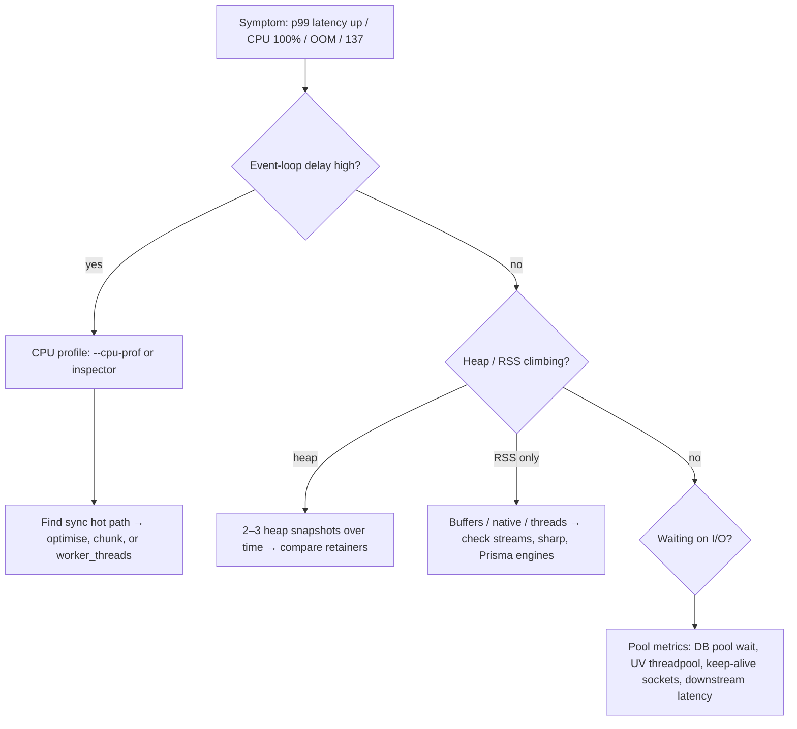

# Node.js - Performance & Diagnostics

> [!info] Deep dive of [[Node.js]]

> [!abstract] TL;DR
> - **Why it matters**: almost every Node.js performance incident comes from one of 3 things:
>   - **the event loop is blocked** (sync CPU work, huge `JSON.parse`, regex backtracking)
>   - **memory grows until OOM** (leaks, unbounded caches, buffering whole streams)
>   - **a downstream pool saturates** (DB connections, libuv threadpool, sockets)
> - **Measure first**: event-loop delay and ELU, heap and RSS, pool waits. Then profile with `--cpu-prof` or heap snapshots, and fix the hot path.
> - **Fix order**: horizontal scaling (more processes or containers) is the fix *after* the code is non-blocking, never instead of it.

## Concept

### The four signals to watch
| Signal | API / metric | Healthy | Meaning when bad |
|---|---|---|---|
| **Event-loop delay** (p99) | `perf_hooks.monitorEventLoopDelay()` | < 20–50 ms | Something sync is hogging the main thread → every request waits |
| **Event-loop utilization (ELU)** | `performance.eventLoopUtilization()` | < 0.7 sustained | Near 1.0 = CPU-bound process. Scale out or move work to workers |
| **Heap used vs limit** | `process.memoryUsage()`, `v8.getHeapStatistics()` | Sawtooth, flat baseline | Rising baseline after GC = leak. Near the limit = GC thrash then OOM |
| **RSS vs container limit** | `process.memoryUsage().rss`, cgroup | < 80% of limit | Off-heap growth (Buffers, native addons, many threads) → OOM-kill (exit 137) |

### Where time goes
- **Main thread**: all JS execution, `JSON.parse/stringify`, regex, template rendering, sync crypto (`crypto.pbkdf2Sync`), `zlib.*Sync`, `fs.*Sync`.
- **libuv threadpool** (default **4** threads, `UV_THREADPOOL_SIZE` up to 1024): `fs.*`, `dns.lookup`, async `crypto` (pbkdf2, scrypt, randomBytes), `zlib` async. A saturated pool stalls file I/O and DNS for the whole process.
- **Kernel async I/O** (epoll): TCP sockets, HTTP and DB drivers. These are not threadpool-bound.
- **Worker threads**: separate V8 isolates for CPU work. Pass data via `postMessage` (structured clone) or `SharedArrayBuffer`.

## How It Works

- **GC**: V8 uses a generational GC. **Scavenge** in the young generation is fast and frequent. **Mark-compact** in the old generation runs mostly concurrently, but its pauses grow with the size of the live heap.
- **Heap limit**: the default heap limit depends on system memory. In containers, set it explicitly with `--max-old-space-size` (MB) at ~75% of the memory limit, leaving headroom for off-heap memory and buffers.
- **Diagnostics plumbing**:
  - `diagnostics_channel` publishes events from core modules (`http`, `undici`, `net`) and libraries. OpenTelemetry instrumentations subscribe to them.
  - The `inspector` protocol (Chrome DevTools) powers CPU and heap profiling.

## Practical Usage

### Built-in profiling flags
```bash
# CPU profile → .cpuprofile (open in Chrome DevTools → Performance, or speedscope.app)
node --cpu-prof --cpu-prof-dir=/tmp/prof dist/server.js

# Heap profile (sampling allocations) → .heapprofile
node --heap-prof dist/server.js

# Heap snapshot on demand (kill -USR2 <pid>) and near OOM
node --heapsnapshot-signal=SIGUSR2 --heapsnapshot-near-heap-limit=2 dist/server.js

# Diagnostic report (JSON: stack, heap, handles, libuv, env) on crash/signal
node --report-on-fatalerror --report-uncaught-exception --report-on-signal --report-directory=/tmp/report dist/server.js

# Attach DevTools to a running container (only via SSH tunnel; never expose 9229)
node --inspect=127.0.0.1:9229 dist/server.js
ssh -L 9229:127.0.0.1:9229 vps-a        # then chrome://inspect
```

### Production metrics (expose to Prometheus/Uptime Kuma)
```ts
import { monitorEventLoopDelay, performance } from "node:perf_hooks";

const h = monitorEventLoopDelay({ resolution: 20 });
h.enable();
let lastElu = performance.eventLoopUtilization();

setInterval(() => {
  const elu = performance.eventLoopUtilization(lastElu);
  lastElu = performance.eventLoopUtilization();
  const m = process.memoryUsage();
  logger.info({
    loopDelayP99Ms: h.percentile(99) / 1e6,
    elu: elu.utilization,
    heapUsedMb: m.heapUsed / 1e6,
    rssMb: m.rss / 1e6,
  }, "runtime");
  h.reset();
}, 10_000).unref();
```

### Fixing a blocked event loop
```ts
// ❌ Blocks every request while hashing / parsing
app.post("/import", (req, res) => {
  const rows = JSON.parse(fs.readFileSync(req.file.path, "utf8")); // sync read + 200 MB parse
  rows.forEach(transform);
  res.json({ ok: true });
});

// ✅ Stream + bounded concurrency; CPU-heavy work in a worker pool (piscina)
import Piscina from "piscina";
const pool = new Piscina({ filename: new URL("./transform.worker.js", import.meta.url).href });

app.post("/import", async (req, res) => {
  const jobId = await queue.add("import", { path: req.file.path }); // BullMQ: return immediately
  res.status(202).json({ jobId });
});
// worker process: stream-json → batch 1000 rows → pool.run(batch) → COPY into Postgres
```
- **Rules of thumb**:
  - Anything over ~10 ms of CPU per request belongs in a queue (BullMQ on [[Redis]]) or a worker pool.
  - Use `await` with `async` APIs only: `fs.promises`, `crypto.scrypt` with a promise wrapper, `zlib` streams.
  - For long loops you can't offload, yield with `await setImmediate()` from `node:timers/promises` every N iterations.

### Hunting a memory leak
1. Confirm the leak: the heap-used baseline (after GC) rises across hours, not just during spikes.
2. Take snapshot A, apply load for 5–10 min, then take snapshots B and C (`kill -USR2`).
3. In DevTools, open **Comparison** view (B vs A) and sort by **# Delta / Retained size**, then follow the **Retainers** path to your code.
4. Usual suspects:
   - module-level `Map`/array caches without a TTL (use `lru-cache` with `max` + `ttl`)
   - event listeners added per request (`MaxListenersExceededWarning`)
   - closures capturing `req`/`res`
   - unbounded promise queues (`Promise.all` over 1M items)
   - `setInterval` without `clearInterval`
   - AsyncLocalStorage stores holding large objects

### HTTP client and server tuning
```ts
// Outbound: reuse sockets (Node ≥ 19: global agent keepAlive is on by default)
import { Agent, setGlobalDispatcher } from "undici";
setGlobalDispatcher(new Agent({ connections: 128, keepAliveTimeout: 10_000, pipelining: 1 }));

// Inbound: keep-alive must outlive the proxy's idle timeout, or the proxy reuses a socket Node closed → sporadic 502
server.keepAliveTimeout = 65_000;   // > Traefik/Cloudflare upstream idle timeout
server.headersTimeout = 66_000;     // must be > keepAliveTimeout
server.requestTimeout = 30_000;     // cap slow-loris style requests
```

## Patterns & Anti-patterns
| Pattern | When | Anti-pattern to avoid |
|---|---|---|
| Alert on event-loop delay p99 + ELU | Every service | Only watching CPU % (a blocked loop can show 25% CPU on a 4-core box) |
| Queue + worker for CPU/long tasks | Imports, PDF/image generation, LLM post-processing | Doing it in the request handler "because it's async" |
| Stream large payloads (`pipeline()`) | Files, CSV, proxying | `await res.text()` / `readFileSync` on 100 MB+ |
| Bounded concurrency (`p-limit`, pool sizes) | Fan-out to APIs/DB | `Promise.all(items.map(fetch))` over thousands of items |
| One process per container, scale replicas | Docker / Coolify | `cluster` inside a container plus Docker replicas (double scheduling, confusing limits) |
| Structured async logger (pino) | Production | `console.log` of large objects on hot paths (sync to TTY/pipes, slow) |
| Explicit `--max-old-space-size` below the container limit | Containers | Default heap + small container → OOM-kill without a heap snapshot |

## Performance & Trade-offs
- **Worker threads vs processes**:
  - Workers start in ~ms, share memory via `SharedArrayBuffer`, and cost ~10+ MB each.
  - Processes and containers give isolation and use every core. They're simpler to operate in [[Docker]].
- **Raising `UV_THREADPOOL_SIZE`** (e.g. 16) helps heavy `fs`/`crypto`/`dns.lookup` workloads. It doesn't help JS CPU work and adds memory per thread.
- **Bigger heap vs more replicas**: a bigger heap means longer major-GC pauses and slower snapshots, so prefer several 512 MB–1 GB processes over one 8 GB process.
- **`JSON` cost** is roughly linear in size and fully blocking: ~100 MB/s for parse and stringify on typical VPS cores. Paginate responses and avoid serialising whole ORM graphs.
- **Overhead of observability**:
  - OpenTelemetry auto-instrumentation adds a few % CPU.
  - `--cpu-prof` adds about 5–10% while enabled, which is fine for short sessions in production.
  - Heap snapshots **pause the process** and need ~2× heap memory, so take them on a drained replica.

## Tips & Reminders
> [!tip]
> - Reproduce under load locally with `autocannon -c 100 -d 30 http://localhost:3000/x` and profile while it runs.
> - Run `node --trace-sync-io` in dev to log sync I/O after the first tick.
> - Check `npm ls` for duplicate heavy deps (multiple `date-fns`/`lodash` copies) when RSS and startup time balloon.
> - Postgres pool size per process × replicas must stay under `max_connections`, or go through a pooler such as Supavisor or PgBouncer ([[PostgreSQL]]).
> - **In ZP's stack**:
>   - **Containers**: Node services in Coolify with memory limits and `NODE_OPTIONS=--max-old-space-size=768` for 1 GB containers. Add `--heapsnapshot-near-heap-limit=1` with a mounted `/tmp`.
>   - **Health checks**: fail the check on event-loop delay p99 > 1 s so Traefik drains stuck replicas.
>   - **n8n**: Code nodes run in the same Node process, so heavy loops there block workers. Move them to sub-workflows or external workers ([[n8n - Queue Mode & Scaling]]).

## Version Notes
| Version | Change |
|---|---|
| 12–15 | `--cpu-prof`, `--heap-prof`, diagnostic report (`--report-*`), `--heapsnapshot-near-heap-limit` |
| 16–18 | `diagnostics_channel` stable path, `perf_hooks.eventLoopUtilization`, undici as `fetch` |
| 19 | Global HTTP agent `keepAlive: true` by default |
| 20 LTS | Permission model (experimental), stable test runner, faster `URL`, `fetch` |
| 22 LTS | `require(esm)`, faster streams/`Buffer`, Maglev JIT enabled |
| 24 LTS (current LTS) | V8 13.x, `AsyncLocalStorage` on `AsyncContextFrame` (cheaper context propagation), undici 7 |
| 26.x (→ LTS Oct 2026) | Streams performance rework (26.6), Perfetto tracing support (26.7) |

> [!warning] Unverified — check before relying on this
> The 26.6/26.7 items come from secondary sources (release roundups), not the official changelog. Check https://github.com/nodejs/node/blob/main/doc/changelogs/ before relying on them.

## Critical Issues & Gotchas
> [!danger] CVE-2025-59466 (Jan 2026): stack overflow kills the process when async_hooks are active
> With `async_hooks` or `AsyncLocalStorage` in use (most APM/OTel agents, Next.js, many frameworks), a `RangeError: Maximum call stack size exceeded` could terminate the process instead of being catchable. Input-controlled recursion (deeply nested JSON, recursive parsers) became a remote DoS. CVSS 7.5. **Fix**: upgrade to the January 2026 security releases or later on 20.x, 22.x, 24.x and 25.x (check the advisory for exact versions), and cap input depth/size regardless. EOL lines (≤ 18) are unpatched.

> [!danger] Silent OOM-kills in containers
> When RSS crosses the container limit, the kernel kills Node with **exit 137**. There's no JS stack, no heap snapshot, no log line. Symptoms are "random restarts". Set `--max-old-space-size` below the limit so V8 throws a catchable heap error first, enable `--heapsnapshot-near-heap-limit`, and alert on restarts in Coolify/Docker (`docker inspect --format '{{.State.OOMKilled}}'`).

> [!warning] Gotchas
> - **ReDoS**: catastrophic-backtracking regex on user input (`/(a+)+$/`) blocks the loop for seconds. Use linear-time patterns, input length caps, or `re2`.
> - `process.nextTick` and promise-microtask loops starve I/O completely. Recursive `nextTick` = hung server with 100% CPU.
> - `Buffer.allocUnsafe` and large `Buffer`s live **off-heap**. A heap snapshot looks fine while RSS explodes.
> - Unhandled promise rejections crash the process (default `--unhandled-rejections=throw` since Node 15). Make sure crashes are restarted *and* logged.
> - `--inspect=0.0.0.0` in production is remote code execution for anyone who can reach port 9229.
> - Benchmarks against `localhost` hide keep-alive and TLS costs, so test through Traefik with realistic payloads.

## Related
- [[Node.js]]
- [[Node.js - Streams & Backpressure]] — stream instead of buffering; backpressure mechanics
- [[JavaScript - Event Loop & Async]] — phases, microtasks, starvation
- [[Docker]] — memory limits, OOM-kill, one process per container
- [[PostgreSQL]] — pool sizing, slow queries (often the real bottleneck)
- [[Redis]] — BullMQ queues to offload CPU work
- [[n8n]] — Node-based workers, Code-node blocking

## References
- Node.js diagnostics guides: https://nodejs.org/en/learn/diagnostics
- Don't block the event loop: https://nodejs.org/en/learn/asynchronous-work/dont-block-the-event-loop
- `perf_hooks`: https://nodejs.org/api/perf_hooks.html
- Diagnostic report: https://nodejs.org/api/report.html
- January 2026 security release: https://nodejs.org/en/blog/vulnerability/january-2026-security-releases
- Node.js release schedule: https://github.com/nodejs/release#release-schedule
