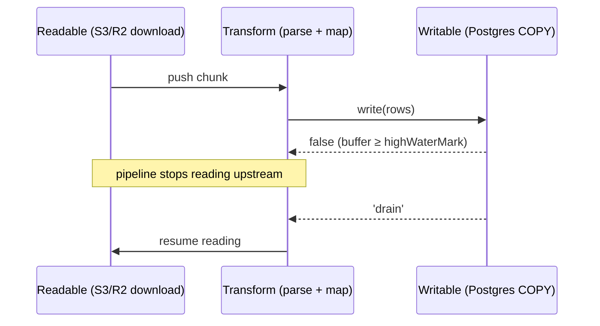

# Node.js - Streams & Backpressure

> [!info] Deep dive of [[Node.js]]

> [!abstract] TL;DR
> Streams let you process data larger than memory in chunks. **Backpressure** is the signal that tells a fast producer to pause until a slow consumer catches up: `write()` returns `false`, you wait for `'drain'`.
> Use `pipeline()` from `node:stream/promises` (or `for await` over a Readable). It handles backpressure, errors and cleanup. Hand-rolled `.on('data')` with `await` inside, or `.pipe()` without error handling, are how Node services leak memory and file descriptors.

## Concept
| Type | Role | Examples |
|---|---|---|
| Readable | Produces chunks | `fs.createReadStream`, HTTP request (server side), `Readable.from(iterable)` |
| Writable | Consumes chunks | `fs.createWriteStream`, HTTP response, `pg-copy-streams` COPY FROM |
| Duplex | Both, independent | TCP socket, WebSocket stream |
| Transform | Duplex where output derives from input | `zlib.createGzip()`, CSV parser, your mappers |

- **Internal buffer + `highWaterMark`**: each stream buffers up to `highWaterMark`. That is bytes for binary streams (default **64 KiB** since Node 22, previously 16 KiB) and object count in `objectMode` (default 16). It is a threshold, not a hard cap: `write()` still accepts data beyond it but returns `false`.
- **Readable modes**: *paused* (pull with `read()` / async iteration) and *flowing* (`'data'` events). Async iteration (`for await`) is pull-based and respects backpressure automatically.
- **Web Streams** (`ReadableStream`, from `fetch()` bodies, Next.js route handlers, Workers) are a separate API with built-in backpressure via `desiredSize`. Convert at the boundary with `Readable.fromWeb()` / `Readable.toWeb()`.

## How It Works

1. When the Writable's buffer passes `highWaterMark`, `write()` returns `false`.
2. `pipeline()` / `.pipe()` stop reading from the source until `'drain'`. For a socket, this propagates into TCP flow control, so the remote sender slows down.
3. On error anywhere, `pipeline()` **destroys every stream** in the chain and rejects once. With raw `.pipe()`, an error in one stream leaves the others open.

## Practical Usage
**File → gzip → R2/S3 upload**, with constant memory:
```ts
import { pipeline } from 'node:stream/promises';
import { createReadStream } from 'node:fs';
import { createGzip } from 'node:zlib';
import { PassThrough } from 'node:stream';
import { Upload } from '@aws-sdk/lib-storage';

const body = new PassThrough();
const upload = new Upload({ client: r2, params: { Bucket: 'backups', Key: 'pg/app.sql.gz', Body: body } });
await Promise.all([
  pipeline(createReadStream('/backups/app.sql'), createGzip(), body),
  upload.done(),                                         // multipart upload consumes the stream
]);
```
**CSV → Postgres COPY** with async-generator transforms (no class boilerplate):
```ts
import { pipeline } from 'node:stream/promises';
import { Readable } from 'node:stream';
import { parse } from 'csv-parse';
import { from as copyFrom } from 'pg-copy-streams';

const client = await pool.connect();
try {
  await pipeline(
    Readable.fromWeb(res.body as any),                  // fetch() body → Node stream
    parse({ columns: true }),                           // objectMode rows
    async function* (rows) {                            // transform as async generator
      for await (const r of rows) {
        if (!r.phone) continue;
        yield `${r.id}\t${normalizePhone(r.phone)}\t${r.name.replace(/\t/g, ' ')}\n`;
      }
    },
    client.query(copyFrom('COPY contacts (id, phone, name) FROM STDIN')),
  );
} finally {
  client.release();
}
```
**Bounded concurrency over a stream** (e.g. send WhatsApp templates without a 10k-promise burst):
```ts
import { Readable } from 'node:stream';

await Readable.from(contacts)
  .map(async (c) => sendTemplate(c), { concurrency: 8 })   // backpressure-aware, at most 8 in flight
  .forEach((r) => log(r));
```
**Streaming an HTTP response** (Next.js route handler → Web stream, e.g. LLM tokens or a big CSV export):
```ts
export async function GET(req: Request) {
  const nodeStream = exportRowsAsCsv(req.signal);          // Node Readable from a DB cursor
  return new Response(Readable.toWeb(nodeStream) as ReadableStream, {
    headers: { 'content-type': 'text/csv', 'content-disposition': 'attachment; filename="orders.csv"' },
  });
}
```
**Manual write loop done right**:
```ts
import { once } from 'node:events';
for (const line of hugeIterable) {
  if (!out.write(line)) await once(out, 'drain');           // respect backpressure
}
out.end();
await once(out, 'finish');
```
**Wrong way**:
```ts
// ❌ 'data' + await: the readable keeps flowing while you await, so the buffer grows unbounded
src.on('data', async (chunk) => { await db.insert(parse(chunk)); });
// ❌ ignoring write()'s return value: fine on fast disks, OOM on slow sockets
for (const row of rows) res.write(JSON.stringify(row));
// ❌ .pipe() chain: an error in gzip leaves the file descriptor and socket open
src.pipe(zlib.createGzip()).pipe(res);
```

## Patterns & Anti-patterns
| Pattern | When | Anti-pattern to avoid |
|---|---|---|
| `pipeline()` from `node:stream/promises` | Any multi-stage flow | `.pipe()` chains, manual `'error'` wiring |
| Async-generator stages in `pipeline` | Mapping, filtering, batching | Custom `Transform` classes for 3-line logic |
| Batch rows (500–5,000) before DB writes | Imports, ETL | One `INSERT` per row inside the stream |
| `Readable.prototype.map({ concurrency })` / `p-limit` | Fan-out to APIs | `Promise.all(items.map(call))` over 10k items |
| DB cursors / `COPY TO STDOUT` for exports | Large reports | `select *` into memory, then `JSON.stringify` |
| Pass `AbortSignal` (client disconnect) into the source | HTTP streaming | Exports keep running after the user closes the tab |

## Performance & Trade-offs
- **`highWaterMark`**: larger values (256 KiB–1 MiB) improve throughput for big sequential I/O at the cost of memory per stream. 100 concurrent streams × 1 MiB is 100 MiB. Leave the default unless profiling shows small-chunk overhead.
- **`objectMode` costs**: each object is a separate chunk with per-chunk overhead. Batch into arrays (`yield batch` of 1,000) for high-volume pipelines. This is often 5–10× faster.
- **zlib and crypto** streams run on the libuv threadpool (default 4 threads). Many concurrent gzip streams queue behind each other, so raise `UV_THREADPOOL_SIZE` or limit concurrency ([[Node.js - Performance & Diagnostics]]).
- **Web ↔ Node conversion** adds a small per-chunk cost. Keep one stream flavour per hot path.
- **Throughput ceiling** is the slowest stage, by design. Measure each stage before tuning; usually it's the DB or the remote API, not Node.

## Tips & Reminders
> [!tip] In ZP's stack
> - **Uploads**: client-side uploads go direct to R2 via presigned URLs ([[Cloudflare - R2 Storage & Presigned Uploads]]). Server-side backups, exports and large file proxies stream through `pipeline()`.
> - **Coolify containers** often have 512 MB–1 GB memory limits, so a buffered 300 MB CSV import OOM-kills the container. Stream it with `COPY`.
> - **n8n**: a Code node handling large binaries should use n8n's filesystem binary mode, not in-memory buffers.

- `stream.finished(stream)` (promise version) detects end *or* error *or* premature close, for streams you don't pipe.
- `'finish'` fires on a Writable when all data is flushed to the underlying system; `'close'` fires when resources are released. Wait for `finish` (or `pipeline` resolution) before reporting success.
- In HTTP handlers, listen for `req.on('close')` or use `req.signal` (Web), and destroy upstream streams on early disconnect.
- For line-by-line text: `readline.createInterface({ input })` with `for await (const line of rl)`.

## Version Notes
| Version | Change |
|---|---|
| 10–12 | Async iteration of Readables, `stream.pipeline` and `finished` |
| 15 | `node:stream/promises` (`pipeline`, `finished`) |
| 16–18 | Web Streams API in core (`node:stream/web`), `Readable.fromWeb` / `toWeb` (experimental → stable over 18–22) |
| 17.4+ | Readable operators `map`, `filter`, `forEach`, `take`, `reduce` (experimental) with `concurrency` |
| 22 | Default `highWaterMark` raised from 16 KiB to 64 KiB. Faster streams/`Buffer` |
| 24 LTS / 26 | No breaking stream changes relevant here. Check the operators' stability flags in your version's docs |

## Critical Issues & Gotchas
> [!danger] Unhandled `'error'` crashes the process
> A stream that emits `'error'` with no listener throws, which crashes the Node process and takes down every in-flight request. `pipeline()` attaches handlers for you; raw streams need `.on('error', …)` or `finished()`.

> [!danger] Buffering by accident
> `await res.text()`, `Buffer.concat(chunks)`, `JSON.parse(await streamToString(s))`, and the AWS SDK's `transformToByteArray()` all load the whole payload into memory. They are fine for KB-sized data and an OOM for GB-sized. Use streaming parsers (`stream-json`, `csv-parse`) for big inputs.

- **Async functions in `Transform._transform`**: forgetting to call `callback` (or calling it twice) stalls or corrupts the stream. Use an async generator stage instead.
- **`Readable.from(string)`** emits the whole string as **one** chunk, not characters or lines. Split explicitly if needed.
- **`res.write()` after `res.end()`** throws `ERR_STREAM_WRITE_AFTER_END`, typically from late async callbacks after a client abort. Check `res.writableEnded` or abort the producer.
- **Proxies buffer streams**: Nginx (`proxy_buffering on`) and some CDNs buffer SSE/streamed responses until complete. Set `X-Accel-Buffering: no` or `proxy_buffering off` for streaming endpoints ([[HTTP & HTTPS]]).

## Related
- [[Node.js]]
- [[Node.js - Performance & Diagnostics]] — memory, threadpool, profiling
- [[JavaScript - Event Loop & Async]] — async iteration, microtasks
- [[Cloudflare - R2 Storage & Presigned Uploads]] — streaming uploads to object storage
- [[PostgreSQL]] — `COPY` and cursors for bulk I/O
- [[WebSocket - Scaling & Reliability]] — backpressure on socket fan-out

## References
- https://nodejs.org/api/stream.html
- https://nodejs.org/en/learn/modules/backpressuring-in-streams
- https://nodejs.org/api/webstreams.html
- https://github.com/brianc/node-pg-copy-streams
