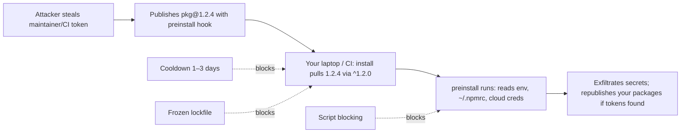

# Node.js - Supply Chain Security & Dependency Hygiene

> [!info] Deep dive of [[Node.js]]

> [!abstract] TL;DR
> The npm ecosystem's main 2025–26 threat is **self-spreading worms** (Shai-Hulud and successors). They steal maintainer and CI tokens, publish poisoned versions with `preinstall` hooks, and harvest secrets from every machine that installs them. In 2026 some poisoned versions even carried **valid provenance**, because attackers abused trusted-publishing flows.
> Defend with:
> - frozen lockfiles;
> - **blocked lifecycle scripts** (pnpm 10 default) with an allow-list;
> - a **release-age cooldown** (don't install versions younger than ~1–3 days);
> - grouped, reviewed updates;
> - no secrets in install environments;
> - minimal dependencies.

## Concept
| Attack | How | Example | Primary control |
|---|---|---|---|
| Maintainer account / token takeover | Phished 2FA, leaked npm/CI tokens → malicious version | Shai-Hulud (2025-09: 180+ pkgs; 2.0 2025-12: ~800 pkgs) | Cooldown, lockfiles, script blocking |
| Worm via lifecycle scripts | `preinstall`/`postinstall` runs on `npm install`, steals env/credentials, republishes | Shai-Hulud family | `ignore-scripts` / pnpm `onlyBuiltDependencies` |
| CI/trusted-publishing abuse | Stolen CI OIDC context → legitimately signed malicious release | Mini Shai-Hulud (2026-05, 172 pkgs across npm + PyPI) | Cooldown; don't treat provenance as "safe" |
| Typosquatting | `expresss`, `react-dom-utils` lookalikes | Ongoing | Review new deps, lock install sources |
| Dependency confusion | Public package shadows an internal name | Internal `@acme/*` resolved from public npm | Scoped registries in `.npmrc` |
| Protestware / maintainer sabotage | Legit maintainer ships destructive code | `node-ipc` (2022) | Pin versions, review diffs of critical deps |
| Compromised GitHub Actions | Tag repointing in CI dependencies | tj-actions (2025) | SHA-pinned actions ([[CI-CD - GitHub Actions Security Hardening]]) |

- **Provenance ≠ safety**: npm provenance (SLSA attestations) proves *where* a package was built, not that the build was legitimate. A hijacked CI run produces valid attestations.

## How It Works

Most poisoned versions are detected and unpublished within hours to a couple of days. A release-age cooldown means you simply never install them.

## Practical Usage
**pnpm workspace defaults** (`pnpm-workspace.yaml`):
```yaml
packages: [apps/*, packages/*]
minimumReleaseAge: 1440               # minutes: don't resolve versions published < 24 h ago
minimumReleaseAgeExclude: ['@acme/*'] # your own packages
onlyBuiltDependencies:                # lifecycle scripts allowed ONLY for these
  - esbuild
  - sharp
  - '@prisma/engines'
```
**`.npmrc`** (scoped registry, no stray scripts for npm users):
```ini
@acme:registry=https://npm.pkg.github.com
ignore-scripts=true
audit-level=high
```
**CI install + checks**:
```yaml
- run: pnpm install --frozen-lockfile                       # fail if the lockfile would change
- run: pnpm audit --audit-level high --prod
- run: npx -y osv-scanner@2 --lockfile=pnpm-lock.yaml
- run: npm audit signatures                                 # verify registry signatures/provenance where available
- run: npx -y @cyclonedx/cyclonedx-npm --output-file sbom.json   # SBOM artifact per release
```
**Renovate with cooldown + grouping** (`renovate.json`):
```json
{
  "extends": ["config:recommended"],
  "minimumReleaseAge": "3 days",
  "packageRules": [
    { "matchUpdateTypes": ["minor", "patch"], "groupName": "non-major deps", "schedule": ["before 9am on monday"] },
    { "matchDepTypes": ["devDependencies"], "automerge": true, "minimumReleaseAge": "7 days" }
  ],
  "vulnerabilityAlerts": { "minimumReleaseAge": null }
}
```
**Secrets out of install steps**: install in a separate job or step **without** deploy or cloud secrets in the environment. Secrets enter only the steps that need them.

**Docker**: install in the build stage, copy only `node_modules`/output into a non-root runtime image without npm/pnpm ([[Docker - Dockerfile & Image Best Practices]]).

**Wrong way**:
```bash
npm install                      # ❌ in CI: may update the lockfile, runs every package's scripts
npx some-random-cli@latest       # ❌ executes the newest version of unknown code with your env
export NPM_TOKEN=… && npm i      # ❌ publish token present during install = worm propagation fuel
```

## Patterns & Anti-patterns
| Pattern | When | Anti-pattern to avoid |
|---|---|---|
| Frozen lockfile installs in CI/Docker | Always | `npm install` in pipelines |
| Script allow-list (pnpm 10) / `ignore-scripts` | Always | Running every dependency's `postinstall` |
| Release-age cooldown (1–3 days; security fixes exempt) | All dependency updates | Auto-merging fresh versions minutes after publish |
| Few, well-maintained dependencies; stdlib first | New code | 20 micro-packages for trivial helpers |
| Scoped private registry config | Internal packages | Unscoped internal names (dependency confusion) |
| Trusted publishing + 2FA + no long-lived tokens | Publishing your own packages | Classic automation tokens in repo secrets |

## Performance & Trade-offs
- **Cooldown vs urgency**: a 24–72 h delay blocks most worm waves but also delays legitimate fixes. Exempt security advisories (Renovate's vulnerability alerts) and review those manually.
- **Script blocking** breaks native packages that need build or download steps. Maintain a short `onlyBuiltDependencies` list, and re-check it when a dependency newly requests scripts (pnpm warns).
- **Scanners** (npm/pnpm audit, OSV, Socket) differ in coverage and noise. Use one advisory scanner in CI and fail only on high/critical in production deps, or it becomes ignored noise.
- **Dependency count**: a typical Next.js app pulls 800–1,500 transitive packages. You can't review them all, so controls on *how* code arrives (lockfile, cooldown, scripts) matter more than reviewing *what* arrives.

## Tips & Reminders
> [!tip] In ZP's stack
> - **pnpm 10+ monorepo defaults**: `minimumReleaseAge: 1440`, an `onlyBuiltDependencies` allow-list (`sharp`, `esbuild`), Renovate with a 3-day cooldown and weekly grouped PRs, and CI installs with no deploy secrets.
> - **Same rules for n8n**: community nodes are npm packages. Keep them disabled unless reviewed ([[n8n - Security, Credentials & Self-Hosting Hardening]]).
> - **Same rules for Python workers**: `uv` with `exclude-newer` ([[Python - Packaging & Tooling with uv]]).

- After a publicized compromise, search your lockfiles (`grep -n "compromised-pkg@1.2.4" pnpm-lock.yaml`). If found, rotate every secret that was present on machines that installed it.
- Use a password manager + hardware key for npm and GitHub accounts. Most takeovers start with phished credentials.
- Prefer `npx pkg@x.y.z` (pinned) or installed devDependencies over `npx pkg@latest` in scripts and docs.
- Keep a dependency inventory (SBOM) per release, so "are we affected?" takes a minute, not a day.

## Version Notes
| Date / version | Change |
|---|---|
| 2018 | `event-stream` compromise (targeted crypto wallets) |
| 2022 | `node-ipc` protestware |
| 2025-09 | **Shai-Hulud** worm: 180+ packages via preinstall hooks, credential theft + self-propagation |
| 2025 | pnpm 10 blocks dependency lifecycle scripts by default. `minimumReleaseAge` in pnpm. GitHub tightens npm publishing (trusted publishing, 2FA, token changes) |
| 2025-12 | Shai-Hulud 2.0 (~800 packages) |
| 2026-05 | **Mini Shai-Hulud** (TeamPCP): 172 packages across npm and PyPI, some with valid SLSA provenance via abused trusted publishing |

> [!warning] Unverified — check before relying on this
> The exact pnpm version introducing `minimumReleaseAge`, npm's current token and publishing policies, and the incident package counts come from secondary sources. Check pnpm docs and the GitHub/npm changelog.

## Critical Issues & Gotchas
> [!danger] Install-time code execution with secrets present
> Any `npm install` that runs lifecycle scripts while `AWS_*`, `SUPABASE_SECRET_KEY`, `NPM_TOKEN` or `GITHUB_TOKEN` (with write scope) are in the environment hands them to whichever package was compromised that day. Separate install from deploy, block scripts, and scope CI tokens to read-only where possible.

> [!danger] "Signed and provenance-verified" can still be malicious
> The 2026 wave showed attackers publishing through hijacked CI with valid attestations. Provenance raises the bar against stolen static tokens, not against compromised pipelines. Keep cooldowns and script blocking even for "verified" packages.

- **Caret ranges + no lockfile** in Dockerfiles (`npm install` without `ci`) pull the newest versions on every build. Commit lockfiles and use `--frozen-lockfile`/`npm ci`.
- **Global CLIs** installed with `npm i -g` on servers run with broad permissions and bypass project lockfiles. Prefer pinned local devDependencies.
- **Unmaintained packages** with known CVEs and no fixes need replacement or vendoring. Track them as tech debt with owners.
- **Postinstall-heavy tools** (Puppeteer, Playwright browsers) download binaries. Pin versions, and fetch from trusted mirrors or cache.

## Related
- [[Node.js]]
- [[CI-CD - GitHub Actions Security Hardening]] — pinned actions, token scopes
- [[Git - Monorepo Workflows with pnpm & Turborepo]] — pnpm settings across workspaces
- [[JavaScript - Modules, ESM-CJS Interop & Bundling]] — fewer, better-structured dependencies
- [[Docker - Dockerfile & Image Best Practices]] — build-stage installs, non-root runtime
- [[Python - Packaging & Tooling with uv]] — the same controls for PyPI

## References
- https://labs.cloudsecurityalliance.org/research/csa-research-note-mini-shai-hulud-npm-supply-chain-20260516/
- https://specterops.io/blog/2026/03/19/graph-the-planet-shai-hulud-2-0/
- https://www.esecurityplanet.com/de/news/wormable-malware-triggers-githubs-push-for-stronger-npm-security/
- https://pnpm.io/settings#minimumreleaseage
- https://docs.npmjs.com/generating-provenance-statements
- https://docs.renovatebot.com/configuration-options/#minimumreleaseage
