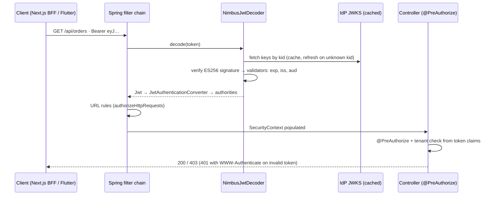

# Spring Boot - Spring Security Resource Server

> [!info] Deep dive of [[Spring Boot]]

> [!abstract] TL;DR
> A Spring Boot API protected by OAuth2 bearer tokens is a **resource server**:
> - **Wiring**: `oauth2ResourceServer(o -> o.jwt(...))`, configured from the issuer's JWKS.
> - **Token checks**: pin the algorithm, and validate `iss`, `aud` and `exp`.
> - **Authorities**: map scopes/roles with a `JwtAuthenticationConverter`.
> - **Enforcement**: URL rules plus `@PreAuthorize` on methods, stateless sessions, CSRF off for bearer-only APIs.
>
> **Spring Security 7** (Boot 4) removed `and()` and `authorizeRequests` and merged Spring Authorization Server. Use the lambda DSL only.

## Concept

### Moving parts
| Component | Role |
|---|---|
| `BearerTokenAuthenticationFilter` | Extracts `Authorization: Bearer …` |
| `JwtDecoder` (`NimbusJwtDecoder`) | Fetches/caches JWKS, verifies signature, runs validators (`exp`/`nbf`, `iss`, custom e.g. `aud`) |
| `JwtAuthenticationConverter` | Turns claims into `GrantedAuthority`s (default: `scope`/`scp` → `SCOPE_x`) |
| `SecurityFilterChain` | URL authorization rules, session policy, CORS, CSRF |
| Method security (`@EnableMethodSecurity`) | `@PreAuthorize("hasAuthority('SCOPE_orders:write')")`, SpEL with `authentication.token.claims` |
| `AuthenticationManagerResolver` | Multi-issuer / multi-tenant token validation |
| Opaque tokens (`opaqueToken()`) | Introspection (RFC 7662) instead of local JWT verification |

### Where to map identity claims
| IdP | Roles/tenant claim | Mapping |
|---|---|---|
| Supabase Auth | `role` (`authenticated`), `app_metadata.tenant_id`, custom claims via access-token hook | Converter reads `app_metadata` |
| Keycloak | `realm_access.roles`, `resource_access.<client>.roles` | Converter flattens to `ROLE_*` |
| Entra ID | `roles` (app roles), `scp` (delegated scopes) | `roles` → `ROLE_*`, `scp` → `SCOPE_*` |
| Auth0 / Okta | `permissions`, `scope`, namespaced custom claims | Choose one source of truth |

## How It Works


## Practical Usage

### `SecurityFilterChain` (Spring Security 7 lambda DSL)
```java
@Configuration
@EnableMethodSecurity
class SecurityConfig {

  @Bean
  SecurityFilterChain api(HttpSecurity http, Converter<Jwt, AbstractAuthenticationToken> jwtConverter) throws Exception {
    http
      .securityMatcher("/api/**")
      .authorizeHttpRequests(a -> a
          .requestMatchers("/api/health").permitAll()
          .requestMatchers(HttpMethod.GET, "/api/orders/**").hasAuthority("SCOPE_orders:read")
          .requestMatchers("/api/admin/**").hasRole("ADMIN")
          .anyRequest().authenticated())
      .oauth2ResourceServer(o -> o.jwt(j -> j.jwtAuthenticationConverter(jwtConverter)))
      .sessionManagement(s -> s.sessionCreationPolicy(SessionCreationPolicy.STATELESS))
      .csrf(c -> c.disable())                        // bearer-only API, no cookies
      .cors(Customizer.withDefaults());
    return http.build();
  }
}
```

### `JwtDecoder` with pinned algorithm + issuer + audience
```java
@Bean
JwtDecoder jwtDecoder(@Value("${app.jwt.jwks-uri}") String jwks,
                      @Value("${app.jwt.issuer}") String issuer,
                      @Value("${app.jwt.audience}") String audience) {
  NimbusJwtDecoder decoder = NimbusJwtDecoder.withJwkSetUri(jwks)
      .jwsAlgorithm(SignatureAlgorithm.ES256)                      // pin: never trust the token's alg
      .build();
  OAuth2TokenValidator<Jwt> iss = JwtValidators.createDefaultWithIssuer(issuer);   // exp/nbf (60s skew) + iss
  OAuth2TokenValidator<Jwt> aud = new JwtClaimValidator<Collection<String>>(
      JwtClaimNames.AUD, a -> a != null && a.contains(audience));
  decoder.setJwtValidator(new DelegatingOAuth2TokenValidator<>(iss, aud));
  return decoder;
}
```
```yaml
# application.yml (Supabase project as issuer)
app:
  jwt:
    issuer: https://abcd1234.supabase.co/auth/v1
    jwks-uri: https://abcd1234.supabase.co/auth/v1/jwks
    audience: authenticated
```
- **Property-only setup**: `spring.security.oauth2.resourceserver.jwt.issuer-uri` (+ `audiences`, `jws-algorithms`) works for simple cases. Use a bean when you need custom validators or claim mapping.

### Map custom claims to authorities (roles + tenant)
```java
@Bean
Converter<Jwt, AbstractAuthenticationToken> jwtConverter() {
  JwtGrantedAuthoritiesConverter scopes = new JwtGrantedAuthoritiesConverter();   // scope/scp → SCOPE_*
  return jwt -> {
    Collection<GrantedAuthority> auth = new ArrayList<>(scopes.convert(jwt));
    Map<String, Object> app = jwt.getClaimAsMap("app_metadata");
    if (app != null && app.get("role") instanceof String role) auth.add(new SimpleGrantedAuthority("ROLE_" + role.toUpperCase()));
    return new JwtAuthenticationToken(jwt, auth, jwt.getSubject());
  };
}
```

### Method security with tenant scoping
```java
@RestController
@RequestMapping("/api/orders")
class OrderController {
  @GetMapping("/{id}")
  @PreAuthorize("hasAuthority('SCOPE_orders:read')")
  OrderDto get(@PathVariable UUID id, @AuthenticationPrincipal Jwt jwt) {
    String tenantId = jwt.<Map<String, Object>>getClaim("app_metadata").get("tenant_id").toString();
    return orders.findForTenant(tenantId, id).orElseThrow(NotFoundException::new);   // 404, not 403, across tenants
  }
}
```

### Testing (MockMvc)
```java
mvc.perform(get("/api/orders/{id}", id)
        .with(jwt().jwt(j -> j.claim("app_metadata", Map.of("tenant_id", "t1", "role", "owner")))
                   .authorities(new SimpleGrantedAuthority("SCOPE_orders:read"))))
   .andExpect(status().isOk());
mvc.perform(get("/api/orders/{id}", id)).andExpect(status().isUnauthorized());     // no token
```

## Patterns & Anti-patterns
| Pattern | When | Anti-pattern to avoid |
|---|---|---|
| Explicit `JwtDecoder` with alg pin + `aud` validator | Every resource server | Issuer-only config accepting tokens minted for other APIs |
| Lambda DSL, `authorizeHttpRequests` | Spring Security 6/7 | Copying `and()`/`authorizeRequests` snippets (removed in 7) |
| `@PreAuthorize` on service/controller methods | Business rules | URL patterns as the only authorization layer |
| Tenant from token claims, enforced in queries | Multi-tenant SaaS | `tenantId` request parameter trusted |
| Stateless + CSRF off **only** for bearer APIs | Pure APIs | Disabling CSRF on cookie-session apps |
| Separate filter chains (`securityMatcher`) for API vs admin UI | Mixed apps | One chain trying to serve sessions and bearer tokens |

## Performance & Trade-offs
- **Local JWT verification**: ~0.1 ms per request with cached JWKS. Nimbus caches keys and refetches on unknown `kid` (rotation-friendly, see [[JWT - Signing Algorithms, Keys & Rotation]]).
- **Opaque token introspection**: gives instant revocation but adds a network call per request, so cache it briefly or use it only for high-risk endpoints.
- **Virtual threads** (Boot 3.2+/4) make blocking JWKS fetches and DB calls cheap. Reactive WebFlux resource servers (`ServerHttpSecurity`) are only worth it if the app is already reactive.
- **Method security** adds proxy overhead per call. That's negligible versus I/O, but keep SpEL expressions simple and testable.

## Tips & Reminders
> [!tip]
> - **Return proper errors**: 401 with `WWW-Authenticate: Bearer error="invalid_token"` for bad tokens, 403 for missing authority, and 404 for other-tenant resources (don't reveal existence).
> - **Log the identity** (`sub`, `client_id`, tenant) in MDC for every request, never the raw token.
> - **Multiple IdPs** (Supabase for customers, Entra for staff): use `JwtIssuerAuthenticationManagerResolver.fromTrustedIssuers(...)` with an explicit allow-list.
> - **Migrating Boot 3.5 → 4**: run OpenRewrite Spring Security 7 recipes, check removed APIs, and retest custom decoder customizers (a Boot 4.0 issue reported customizers disabling `typ` validation being ignored).
> - **In ZP's stack**:
>   - **Inherited Java/Kotlin services** (e.g. enterprise client backends) validate the same Supabase or Keycloak tokens as the Node/Next.js services, via JWKS.
>   - **Consistency**: one issuer, one audience per API, and consistent claim names across languages.

## Version Notes
| Version | Change |
|---|---|
| Spring Security 5.x (Boot 2) | `oauth2ResourceServer()` introduced. `WebSecurityConfigurerAdapter` era |
| 6.0 (Boot 3.0, 2022) | Adapter removed, `authorizeHttpRequests`, `SecurityFilterChain` beans, `requestMatchers` |
| 6.x (Boot 3.x) | Lambda DSL recommended, `and()` deprecated |
| **7.0** (Boot 4.0, 2025-11) | `and()` and `authorizeRequests` **removed**, password grant removed, custom `JwkSource` in `NimbusJwtDecoder`, `NimbusJwtEncoder` builder, **Spring Authorization Server merged into Spring Security** |
| 7.1 (Boot 4.1, 2026) | DPoP / token-exchange support evolving. Check whether DPoP verification needs explicit `.dPoP()` config |

> [!warning] Unverified — check before relying on this
> DPoP defaults in 7.0 vs 7.1, and exact Boot 4 property names for resource-server audiences/algorithms, weren't verified line by line. Check the Spring Security "What's New" page and the Boot 4 migration guide.

## Critical Issues & Gotchas
> [!danger] Missing audience validation
> - **The gap**: `issuer-uri` alone validates `iss`/`exp` but **not `aud`** unless configured. Any token from the same IdP (another app's token, an ID token, a token for a different API) is then accepted.
> - **Why it's common**: for shared IdPs (one Supabase project or Keycloak realm for many services), this is the most frequent resource-server misconfiguration.
> - **Fix**: always add an audience validator and a `typ` check where the IdP sets it.

> [!danger] Over-broad `permitAll` and matcher order
> Rules are evaluated in order, and the first match wins. A broad `requestMatchers("/api/**").permitAll()` placed before specific rules, or path-matching differences (trailing slashes, encoded paths), have caused auth bypasses in real apps. Put specific rules first, end with `anyRequest().authenticated()`, and add tests that unauthenticated calls to every controller return 401.

> [!warning] Gotchas
> - Default authority prefix is `SCOPE_` for scopes and `ROLE_` for `hasRole()`. Mixing them up gives 403s that look like token problems.
> - Clock skew default is 60 s in `JwtTimestampValidator`. Containers with drifting clocks produce intermittent 401s.
> - Supabase legacy HS256 tokens need `NimbusJwtDecoder.withSecretKey(...)`. Migrate to asymmetric signing keys and JWKS instead ([[Supabase]]).
> - CORS must be configured in Spring Security (`.cors()`), not only in MVC, or preflight requests get 401.
> - Actuator endpoints share the chain unless separated. Expose `/actuator/health` only, and protect the rest.

## Related
- [[Spring Boot]]
- [[OAuth 2.0 & OIDC]] — resource-server role, scopes, audiences
- [[JWT]] — validation rules (`alg`, `iss`, `aud`, `exp`)
- [[JWT - Signing Algorithms, Keys & Rotation]] — JWKS caching and rotation
- [[Supabase]] — issuer/JWKS for customer tokens
- [[Java]] / [[Kotlin]] — language context

## References
- Spring Security OAuth2 resource server (JWT): https://docs.spring.io/spring-security/reference/servlet/oauth2/resource-server/jwt.html
- What's new in Spring Security 7.0: https://docs.spring.io/spring-security/reference/whats-new.html
- InfoQ, Spring Security 7 server-side DPoP & token exchange: https://infoq.com/articles/spring-security-7-server-side-dpop-token-exchange
- Spring Boot 4 migration guide: https://github.com/spring-projects/spring-boot/wiki/Spring-Boot-4.0-Migration-Guide
- Spring Boot issue #48301 (JWT decoder customizer in 4.0): https://github.com/spring-projects/spring-boot/issues/48301
