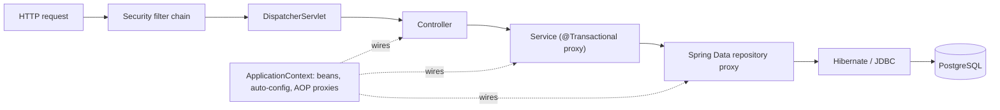

# Spring Boot

> [!abstract] TL;DR
> Spring Boot is the dominant JVM backend framework: opinionated auto-configuration on top of the Spring Framework (DI container, MVC/WebFlux, Data, Security), embedded server, production features (Actuator, Micrometer), and a "starter" dependency model.
> - **Current line**: **4.x** (4.0 2025-11, **4.1 2026-06**) on Spring Framework 7 / Jakarta EE 11, with a Java 17 baseline (21/25 recommended).
> - **Defaults to enable**: virtual threads, plus JSpecify null-safety for [[Kotlin]].
> - **Where it shines**: enterprise integration (banks, telcos, government), large teams, and long-lived services.
> - **Where it doesn't**: for a solo founder's SME product it's usually heavier than [[Node.js]]/TypeScript.

## Introduction
- **History**: Spring Framework (Rod Johnson, 2003) was a lightweight alternative to J2EE EJBs. **Spring Boot** (2014) removed XML/config boilerplate with auto-configuration and embedded Tomcat. Pivotal → VMware → **Broadcom** (2023) now stewards it, with commercial support via Tanzu/Spring Enterprise.
- **Problem**: building production-ready [[Java]] services (HTTP APIs, DB access, security, messaging, observability) consistently, without wiring everything by hand.
- **Where it sits**: microservices and monoliths in enterprises, often with [[PostgreSQL]]/Oracle DB, [[Kafka]]/RabbitMQ, deployed as containers on [[Kubernetes]], or as native images via GraalVM.

## Core Concepts

### Building blocks
| Concept | What it does |
|---|---|
| **IoC container / DI** | `@Component`, `@Service`, `@Repository`, `@Configuration` + `@Bean`. Constructor injection |
| **Auto-configuration** | `@SpringBootApplication` scans the classpath and configures beans conditionally (`@ConditionalOnClass`, `@ConditionalOnMissingBean`) |
| **Starters** | Curated dependency sets: `spring-boot-starter-web`, `-data-jpa`, `-security`, `-actuator`. 4.0 modularized them into smaller pieces |
| **Externalized config** | `application.yml`, profiles (`dev`, `prod`), env vars, `@ConfigurationProperties` records |
| **Spring MVC / WebFlux** | Servlet (blocking, virtual-thread friendly) vs reactive (Netty, Reactor) web stacks |
| **Spring Data** | Repository interfaces → JPA/Hibernate, JDBC, R2DBC, MongoDB, Redis |
| **Spring Security** | Filter chain: authentication, authorization, OAuth2 client/resource server, CSRF, CORS |
| **Actuator + Micrometer** | Health, metrics, info, Prometheus/OTLP export, tracing |

### A typical endpoint (Kotlin)
```kotlin
@ConfigurationProperties("app.payments")
data class PaymentProps(val gatewayUrl: URI, val timeout: Duration = Duration.ofSeconds(5))

@RestController
@RequestMapping("/api/orders")
class OrderController(private val orders: OrderService) {           // constructor injection

    @GetMapping("/{id}")
    fun get(@PathVariable id: Long): OrderDto = orders.find(id) ?: throw ResponseStatusException(HttpStatus.NOT_FOUND)

    @PostMapping
    @ResponseStatus(HttpStatus.CREATED)
    fun create(@Valid @RequestBody req: CreateOrderRequest, @AuthenticationPrincipal jwt: Jwt): OrderDto =
        orders.create(req, tenantId = jwt.getClaimAsString("tenant_id"))
}

@Service
class OrderService(private val repo: OrderRepository) {
    @Transactional
    fun create(req: CreateOrderRequest, tenantId: String): OrderDto = repo.save(Order.from(req, tenantId)).toDto()
    fun find(id: Long): OrderDto? = repo.findByIdOrNull(id)?.toDto()
}
```
```yaml
# application.yml
spring:
  threads.virtual.enabled: true                  # Tomcat + @Async on virtual threads
  datasource.url: jdbc:postgresql://db:5432/app
  jpa.open-in-view: false                        # avoid lazy-loading in views (N+1, long connections)
  security.oauth2.resourceserver.jwt.jwk-set-uri: https://<project>.supabase.co/auth/v1/.well-known/jwks.json
management:
  endpoints.web.exposure.include: health,info,prometheus
  endpoint.health.probes.enabled: true           # /actuator/health/liveness|readiness for K8s
```

## Architecture / How It Works

- **Startup**: the classpath scan + auto-configuration conditions create the `ApplicationContext`, the embedded Tomcat/Jetty/Netty starts, and `ApplicationReadyEvent` fires. Typical JVM startup is 1–5 s. **AOT processing** + GraalVM native image gives ~50–100 ms startup and lower RSS, at the cost of longer builds and reflection limits.
- **Proxies/AOP**: `@Transactional`, `@Cacheable`, `@Async` and security annotations work through proxies, so **self-invocation bypasses them**.
- **Transactions**: thread-bound by default (works with virtual threads). Propagation and isolation are configurable per method.
- **Observability**: the Micrometer Observation API gives metrics + tracing (OpenTelemetry) from one instrumentation.

## Project Structure
```text
orders/
├── build.gradle.kts             # plugins: org.springframework.boot, io.spring.dependency-management, kotlin("plugin.spring")
├── src/main/kotlin/my/rarticle/orders/
│   ├── OrdersApplication.kt     # @SpringBootApplication
│   ├── api/                     # controllers, DTOs, exception handlers (@RestControllerAdvice)
│   ├── domain/                  # entities, services
│   ├── infra/                   # repositories, clients (HTTP interface @HttpExchange)
│   └── config/SecurityConfig.kt
├── src/main/resources/
│   ├── application.yml
│   └── db/migration/V1__init.sql   # Flyway
└── src/test/kotlin/...          # @SpringBootTest, @WebMvcTest, Testcontainers
```
```bash
curl https://start.spring.io/starter.zip -d type=gradle-project-kotlin -d language=kotlin \
  -d bootVersion=4.1.0 -d javaVersion=25 -d dependencies=web,data-jpa,postgresql,security,oauth2-resource-server,actuator,flyway,validation -o orders.zip
./gradlew bootBuildImage            # OCI image via Cloud Native Buildpacks (no Dockerfile)
./gradlew nativeCompile             # GraalVM native image
```

## Use Cases
| Use case | Why it fits |
|---|---|
| Enterprise/banking APIs and integrations | Mature security, transactions, connectors, vendor familiarity |
| Microservices on Kubernetes | Actuator probes, config, Micrometer, Spring Cloud |
| Event-driven systems | Spring for Apache Kafka, Spring Cloud Stream, RabbitMQ |
| Batch processing (payroll, reconciliation) | Spring Batch: chunking, restartability |
| Client mandates Java/JVM | Industry default, easy to hand over to client teams |
| Small SME SaaS by a solo founder | **Weaker fit**. [[Node.js]]/[[Supabase]] ships faster with less infra |

## Pros & Cons
| Pros | Cons |
|---|---|
| Batteries included: security, data, messaging, observability | Heavy: memory (200–500 MB typical JVM service), startup time |
| Huge ecosystem, documentation, hiring pool | "Magic" auto-configuration and proxies make debugging harder |
| Stable, long support windows + commercial support | Upgrades across majors (2 → 3 → 4) require real migration work |
| Virtual threads make blocking code scale | JPA/Hibernate pitfalls (N+1, lazy loading, dirty checking surprises) |
| Native image option for fast startup | Native image builds are slow and break on reflection-heavy libraries |
| First-class [[Kotlin]] support | Broadcom stewardship: commercial focus on paid support for old versions |

## Alternatives & Peers
| Alternative | Strength vs Spring Boot | Weakness vs Spring Boot | Pick it when… |
|---|---|---|---|
| Quarkus | Fast startup, low memory, native-first, dev mode | Smaller ecosystem | Kubernetes/serverless JVM with tight resources |
| Micronaut | Compile-time DI, fast startup | Smaller community | Similar to Quarkus |
| Ktor | Lightweight Kotlin-native, coroutines | Fewer integrations, more DIY | Small Kotlin services |
| [[Node.js]] (NestJS/Fastify) | Same language as the frontend, fast iteration | Weaker for CPU-heavy work, less enterprise tooling | Startups, SME SaaS (ZP's default) |
| [[Go]] (stdlib/chi/Echo) | Tiny binaries, fast startup, simple | Less built-in enterprise plumbing | Infra services, high-throughput APIs |
| ASP.NET Core | Comparable maturity and performance | .NET ecosystem | Microsoft shops |

## Tips & Reminders
> [!tip]
> - Generate projects from start.spring.io, and keep the Boot plugin managing dependency versions (don't override managed versions casually).
> - Constructor injection only. `spring.jpa.open-in-view=false`. Use DTOs at the API boundary, not entities.
> - Enable virtual threads (`spring.threads.virtual.enabled=true`) before considering WebFlux. Reactive adds complexity you rarely need now.
> - Expose only `health,info,prometheus` actuator endpoints, on a separate management port not exposed publicly.
> - Test slices: `@WebMvcTest`, `@DataJpaTest` + Testcontainers ([[PostgreSQL]]), `@SpringBootTest` sparingly. Enable `spring.main.lazy-initialization` only for dev.
> - **In ZP's stack**: use Spring Boot only when a client requires JVM or integrates with Java-based bank/enterprise systems. Then go [[Kotlin]] + Boot 4.1 + Java 25, validate [[Supabase]] JWTs via `oauth2-resource-server` (JWKS URI), migrate with Flyway, and ship as a buildpack image to [[Coolify]] with `MaxRAMPercentage=75`.

## Versions & Breaking Changes
| Version | Released | Key changes | Breaking / migration notes |
|---|---|---|---|
| 2.7 | 2022-05 | Last 2.x | OSS support ended 2023-11 |
| **3.0** | 2022-11 | Java 17 baseline, **Jakarta EE 9+ (`javax.*` → `jakarta.*`)**, AOT/native, Micrometer Observation | Package rename across code + libraries. Spring Security 6 config changes |
| 3.2 | 2023-11 | Virtual threads, `RestClient`, JdbcClient | — |
| 3.5 | 2025-05 | Last 3.x | OSS support window ends in 2026 (verify) |
| **4.0** | 2025-11 | Spring Framework 7, Jakarta EE 11, **JSpecify null-safety**, modular starters, API versioning, HTTP service clients, Jackson 3, Kotlin 2.2 baseline | Starter renames/splits, Jackson 3 package changes (`tools.jackson`), deprecated APIs removed. Use the migration guide + OpenRewrite recipes |
| **4.1** | 2026-06-10 | gRPC auto-configuration, HTTP client SSRF mitigation, Kotlin 2.3, lazy datasource connections, `@Async` context propagation, better OpenTelemetry | Incremental. jOOQ 3.20 support needs Java 21 |

> [!warning] Unverified — check before relying on this
> OSS support end dates for 3.5/4.0 weren't confirmed. Check https://spring.io/projects/spring-boot#support.

## Critical Issues & Gotchas
> [!danger] Exposed Actuator endpoints
> `/actuator/env`, `/heapdump`, `/configprops`, `/jolokia` and `/gateway` endpoints have leaked credentials (heap dumps contain secrets), and in older versions enabled RCE. Internet scanners look for them constantly. Expose only health/info/metrics, put management on a separate internal port, and secure it with Spring Security.

> [!danger] Framework-level vulnerabilities
> - **Spring4Shell** (CVE-2022-22965): data-binding RCE on JDK 9+ with WAR deployments.
> - **Spring Cloud Function** SpEL RCE (CVE-2022-22963).
> - Recurring Spring Security authorization-bypass advisories (e.g. 2025 annotation-detection issues with generic superclass methods).
>
> Stay on supported Boot versions: OSS support for old lines ends, and fixes then require Broadcom's commercial support. Track https://spring.io/security.

> [!warning] Gotchas
> - `@Transactional` on private methods or self-invoked methods does nothing (proxy-based).
> - JPA N+1 queries from lazy associations. Use fetch joins/entity graphs, and log SQL in dev.
> - `ddl-auto=update` in production can silently mutate schemas. Use Flyway/Liquibase.
> - Kotlin classes are final by default. The `kotlin-spring`/`kotlin-jpa` plugins (allopen/noarg) are required for proxies and entities.
> - Circular dependencies are forbidden by default (since 2.6). Restructure instead of enabling them.
> - Jackson 3 in Boot 4 changes package names and some defaults. Custom serializers need updates.

## Deep Dives
N/A — no deep dives planned yet. Candidates: Spring Security (OAuth2/JWT resource server), JPA/Hibernate performance.

## Related
- [[Java]] · [[Kotlin]] — languages
- [[PostgreSQL]] — primary datastore
- [[Kafka]] — Spring for Apache Kafka
- [[Node.js]] — ZP's default backend runtime, for comparison
- [[OAuth 2.0 & OIDC]] · [[JWT]] — resource server security
- [[Docker]] · [[Kubernetes]] — packaging, probes

## References
- Spring Boot reference: https://docs.spring.io/spring-boot/
- Spring Boot 4.1 release: https://spring.io/blog/2026/06/10/spring-boot-4/
- InfoQ on Boot 4.1: https://infoq.com/news/2026/06/spring-boot-4-1
- Migration guide 3 → 4: https://github.com/spring-projects/spring-boot/wiki
- Support policy: https://spring.io/projects/spring-boot#support
- Spring security advisories: https://spring.io/security
