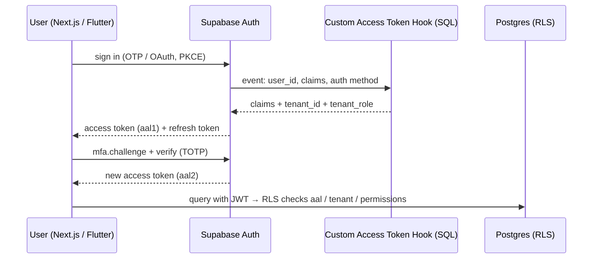

# Supabase - Auth Flows, MFA & Custom Claims

> [!info] Deep dive of [[Supabase]]

> [!abstract] TL;DR
> - **Flows**: email OTP / magic link or OAuth (Google, Apple) for most B2C/SME apps. Phone OTP over WhatsApp/SMS only with strict rate limits, because you pay per message.
> - **PKCE** for SSR (Next.js) and mobile.
> - **MFA**: TOTP (+ phone) raises the session to **AAL2**. Enforce it in RLS with restrictive policies on sensitive tables.
> - **Custom Access Token Hook**: put the *active tenant and role* into the JWT, but re-check revocable permissions in tables, since claims stay valid until the token expires (~1 h).
> - **Server verification**: `getClaims()` (local JWKS with asymmetric keys) or `getUser()`. Never trust `getSession()` alone.

## Concept
| Flow | UX | Cost / risk | Pick it when… |
|---|---|---|---|
| Email OTP / magic link | Passwordless | Needs reliable SMTP (custom, not built-in) | Default for SME dashboards |
| OAuth (Google, Apple, Facebook) | One tap | Provider config, redirect allowlists | Consumer apps. iOS apps offering social login also need an acceptable privacy-focused option per App Store rules |
| Email + password | Familiar | Password resets, credential stuffing | Legacy expectations |
| Phone OTP (SMS / WhatsApp) | Strong for Malaysia (WhatsApp ubiquity) | **Per-message cost**, OTP pumping, SIM swap | Phone-first customers. Cap and monitor |
| Anonymous sign-in → link identity | Try before signup | Abuse (create many users) | Carts, onboarding; add CAPTCHA |
| SAML SSO | Enterprise | Plan add-on | B2B clients with Entra/Google Workspace |
| Passkeys | Phishing-resistant | Check current support level | Future default ([[Authentication & Authorization - Passkeys & WebAuthn]]) |

**Assurance levels**: `aal1` = one factor. `aal2` = a second factor verified in this session. The access token's `aal` and `amr` claims say which.

| Claim source | Freshness | Use for |
|---|---|---|
| JWT claims (incl. Custom Access Token Hook) | Until token expiry (default 1 h) | Active tenant, coarse role, `aal` |
| Membership/permission tables via RLS helpers | Immediate | Revocable permissions, sensitive actions |
| `app_metadata` | Server-set, copied into JWT | Static flags (plan tier) |
| `user_metadata` | **User-editable** | Display name only, never authorization |

## How It Works


## Practical Usage
**Custom Access Token Hook** (adds active tenant + role; registered in Dashboard → Auth → Hooks):
```sql
create or replace function public.custom_access_token_hook(event jsonb)
returns jsonb language plpgsql stable security definer set search_path = '' as $$
declare
  claims jsonb := event->'claims';
  m record;
begin
  select tenant_id, role into m
  from public.memberships
  where user_id = (event->>'user_id')::uuid
  order by last_active_at desc nulls last
  limit 1;

  if m.tenant_id is not null then
    claims := jsonb_set(claims, '{tenant_id}', to_jsonb(m.tenant_id::text));
    claims := jsonb_set(claims, '{tenant_role}', to_jsonb(m.role));
  end if;
  return jsonb_set(event, '{claims}', claims);
end $$;

grant usage on schema public to supabase_auth_admin;
grant execute on function public.custom_access_token_hook to supabase_auth_admin;
revoke execute on function public.custom_access_token_hook from authenticated, anon, public;
grant select on public.memberships to supabase_auth_admin;
```
**Require AAL2 for sensitive tables** (restrictive policy, AND-ed with the normal ones):
```sql
create policy "payouts require mfa" on public.payouts as restrictive for all to authenticated
using ((select auth.jwt() ->> 'aal') = 'aal2');
```
**TOTP enrollment + step-up** (supabase-js):
```ts
const { data: enroll } = await supabase.auth.mfa.enroll({ factorType: 'totp', friendlyName: 'Authenticator' });
// show enroll.totp.qr_code; then verify the first code:
const { data: ch } = await supabase.auth.mfa.challenge({ factorId: enroll!.id });
await supabase.auth.mfa.verify({ factorId: enroll!.id, challengeId: ch!.id, code });

// step-up before a sensitive page:
const { data: aal } = await supabase.auth.mfa.getAuthenticatorAssuranceLevel();
if (aal?.nextLevel === 'aal2' && aal.currentLevel !== 'aal2') router.push('/mfa/challenge');
```
**Server-side verification** (Next.js route handler / Server Action):
```ts
const { data, error } = await supabase.auth.getClaims();      // verifies the JWT signature locally via JWKS
if (error || !data) return new Response('unauthorized', { status: 401 });
const { sub, tenant_id, aal } = data.claims;
```
**WhatsApp OTP via the Send SMS Hook** (HTTP hook → Edge Function → Meta authentication template):
```ts
// Verify the hook signature (Standard Webhooks secret from the dashboard) before sending
const payload = await verifyStandardWebhook(req, Deno.env.get('SEND_SMS_HOOK_SECRET')!);
const { user, sms } = payload;                                       // sms.otp, user.phone
await limitOrThrow(`otp:${user.phone}`, 3, 3600);                    // cost + pumping guard
await sendWhatsAppAuthTemplate(user.phone, sms.otp);                 // Meta Cloud API "authentication" template
return new Response(JSON.stringify({}), { headers: { 'content-type': 'application/json' } });
```
**Wrong way**:
```ts
const { data: { session } } = await supabase.auth.getSession();   // ❌ on the server: reads the cookie, doesn't verify it
if (session?.user.user_metadata.role === 'admin') { /* … */ }      // ❌ user_metadata is user-editable
```

## Patterns & Anti-patterns
| Pattern | When | Anti-pattern to avoid |
|---|---|---|
| Custom SMTP (Resend/SES/Postmark) with SPF/DKIM | Any email flow | Built-in SMTP in production (tight rate limits, poor deliverability) |
| Active tenant in claims + permissions in tables | Multi-tenant SaaS | Full permission lists in the JWT |
| Restrictive AAL2 policies on money/PII tables | Payouts, exports, settings | MFA only enforced in the UI |
| OTP rate limits per phone/IP + Turnstile on request | Phone/WhatsApp OTP | Unlimited "send code" endpoint |
| Redirect URL allowlist per environment | OAuth / magic links | Wildcard redirects (open redirect, token theft) |
| Anonymous users + CAPTCHA + cleanup job | Guest checkout | Millions of abandoned anonymous users |

## Performance & Trade-offs
- **`getClaims()` vs `getUser()`**: with asymmetric signing keys, `getClaims()` verifies locally (no network). `getUser()` round-trips to Auth and reflects bans and deletions immediately. Use `getClaims()` for most requests and `getUser()` for sensitive actions.
- **Hook latency**: the Custom Access Token Hook runs on every token issue and refresh. Keep it to one indexed query (`memberships(user_id)`).
- **Token lifetime**: shorter access tokens (e.g. 15 min) shrink the stale-claims window but increase refresh traffic. One hour is fine when sensitive checks hit tables.
- **WhatsApp vs SMS OTP**: WhatsApp authentication templates are usually cheaper and more reliable in Malaysia than SMS, but depend on Meta account health. Keep an SMS fallback for business continuity.

## Tips & Reminders
> [!tip] In ZP's stack
> - **Staff dashboards** (Next.js): email OTP + mandatory TOTP for owners/admins (AAL2 restrictive policies on payouts, exports, user management).
> - **Customer apps** (Flutter): Google/Apple OAuth or WhatsApp OTP, with deep-link redirect URLs registered per flavour.
> - **Tenant switching**: update `memberships.last_active_at`, then `supabase.auth.refreshSession()` so the hook issues the new tenant claim.

- Run the Supabase Security Advisor after auth changes. It flags exposed `security definer` functions and missing RLS.
- Configure Auth rate limits (emails/hour, OTPs, verifications) and attack protection (CAPTCHA) in the dashboard. Defaults are tuned for small projects.
- On user deletion, decide FK behaviour (`on delete cascade` vs anonymize) for PDPA erasure requests, and document it.
- Store MFA recovery procedures (admin-assisted factor reset with identity checks). Lost authenticators are your most common support ticket.

## Version Notes
| Date | Change |
|---|---|
| 2023–24 | Auth Hooks (Custom Access Token, Send SMS/Email, MFA verification attempt). PKCE default in SSR helpers. Anonymous sign-ins |
| 2024 | Phone MFA (SMS/WhatsApp) alongside TOTP. Third-party auth (Auth0, Cognito, Firebase, Clerk) |
| 2025-07 | Asymmetric JWT signing keys (JWKS) and `getClaims()`. New publishable/secret API keys |
| 2026 | Legacy `anon`/`service_role` keys being removed (late 2026). Migrate clients and hooks |

> [!warning] Unverified — check before relying on this
> Whether asymmetric signing keys are now the default for new projects, native recovery codes for MFA, and current passkey support weren't confirmed this run. See https://supabase.com/docs/guides/auth.

## Critical Issues & Gotchas
> [!danger] Stale claims after revocation
> Removing someone from a tenant doesn't change their existing access token. The `tenant_role` claim stays valid until expiry. For sensitive operations, check membership tables in RLS (`has_permission()`), and revoke sessions (`auth.admin.signOut(userId)`) when offboarding staff ([[JWT - Refresh Tokens, Revocation & Storage]]).

> [!danger] OTP pumping and cost blowups
> Phone/WhatsApp OTP endpoints are prime abuse targets. Bots trigger thousands of messages to numbers they profit from. Enforce per-number and per-IP limits, Turnstile on the request form, country allowlists, and provider spend caps ([[OWASP Top 10 - API Security Top 10 in Practice]]).

- **Hook failures block login**: an error or slow query in the Custom Access Token Hook fails token issuance for everyone. Test it with SQL before enabling, and monitor Auth logs.
- **Email enumeration**: distinct "user not found" vs "wrong password" responses leak which emails exist. Keep responses uniform.
- **Redirect URLs**: magic links and OAuth callbacks to an unlisted URL fail, while overly broad wildcards enable token theft. Register exact URLs per environment and per app scheme.
- **Anonymous → permanent linking**: linking an identity already used by another account errors out. Handle the merge UX explicitly.

## Related
- [[Supabase]]
- [[Supabase - Row Level Security]] — `auth.jwt()`, restrictive policies
- [[Authentication & Authorization - Multi-Tenant Authorization with RLS]] — permission tables + helpers
- [[JWT - Refresh Tokens, Revocation & Storage]] — token lifetimes, revocation
- [[Next.js - Middleware, Auth & Multi-Tenant Routing]] — session refresh in `proxy.ts`
- [[Authentication & Authorization - Passkeys & WebAuthn]] — phishing-resistant factors

## References
- https://supabase.com/docs/guides/auth/auth-hooks/custom-access-token-hook
- https://supabase.com/docs/guides/auth/auth-mfa/phone
- https://supabase.com/docs/guides/auth/auth-mfa
- https://supabase.com/docs/guides/self-hosting/self-hosted-auth-hooks
- https://supabase.com/blog/third-party-auth-mfa-phone-send-hooks
