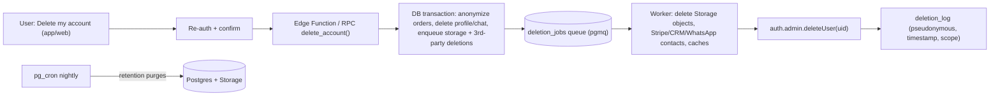

# Supabase - Data Retention, PDPA & Account Deletion

> [!info] Deep dive of [[Supabase]]

> [!abstract] TL;DR
> Under Malaysia's **PDPA (as amended 2024)**, your client is the **data controller** and you (developer/host) are typically a **data processor**, now directly regulated for security obligations. For a Supabase app that means:
> 1. **Retention schedule**: what's kept, for how long, why (tax records ~7 years, chat logs maybe 12 months, OTP logs days).
> 2. **Automated purging** via `pg_cron` (rows, Storage objects, logs).
> 3. **Account deletion** that removes or **anonymizes** personal data across tables, Storage, third parties and caches. App Store and Google Play also require in-app deletion.
> 4. **Data access/portability exports**.
> 5. **Breach response**: notify the Commissioner within **72 hours**, and affected users without undue delay when significant harm is likely.
>
> Backups expire on their own schedule, so document that deleted data persists in backups until rotation.

## Concept
| Obligation (PDPA 2010 + 2024 amendments) | Engineering translation |
|---|---|
| Purpose limitation, notice & consent | Store consent version/time. Collect only needed fields |
| Retention principle (no longer than necessary) | Retention schedule + scheduled purge jobs |
| Security principle (controllers **and processors**) | RLS, encryption, access logs, least privilege, DPA with client |
| Access & correction rights | Self-service profile edit + export endpoint |
| Data portability (amendment) | Machine-readable export (JSON/CSV) on request |
| Data breach notification (amendment) | Detect → assess → notify Commissioner within 72 h → notify users when significant harm |
| Data Protection Officer (amendment, thresholds apply) | Client appoints a DPO. You provide technical input |
| Cross-border transfer (amendment relaxed whitelist) | Document Supabase region (e.g. Singapore) and safeguards in the DPA |

**Delete vs anonymize vs retain**:

| Data | Typical action on account deletion | Why |
|---|---|---|
| Auth user, profile, preferences | Hard delete | No purpose left |
| Orders, invoices, e-invoices | Retain, detach/anonymize personal fields | Tax/accounting records (~7 years) |
| Chat/WhatsApp transcripts | Delete or anonymize after the retention period | Support history vs privacy |
| Uploaded files (IC, photos) | Hard delete objects | High sensitivity |
| Audit logs | Retain with pseudonymous IDs, redact PII | Security/accountability |
| Analytics/events | Aggregate or delete user-level rows | Minimization |
| Backups | Expire by rotation (document period) | Practical limit of erasure |

## How It Works


## Practical Usage
**Retention schedule as data** (reviewable by the client and their DPO):
```sql
create table public.retention_rules (
  table_name text primary key,
  keep_for interval not null,
  date_column text not null,
  action text not null check (action in ('delete','anonymize')),
  reason text not null
);
insert into public.retention_rules values
  ('otp_attempts',      '7 days',   'created_at', 'delete',    'fraud investigation window'),
  ('chat_messages',     '12 months','created_at', 'delete',    'support history'),
  ('webhook_events',    '30 days',  'received_at','delete',    'debugging'),
  ('orders',            '7 years',  'created_at', 'anonymize', 'tax records (ITA/MyInvois)');
```
**Nightly purge job**:
```sql
select cron.schedule('retention-purge', '30 18 * * *', $$      -- 02:30 MYT
  delete from public.otp_attempts where created_at < now() - interval '7 days';
  delete from public.chat_messages where created_at < now() - interval '12 months';
  delete from public.webhook_events where received_at < now() - interval '30 days';
$$);
```
**Account deletion RPC** (runs as the user, anonymizes what must be retained):
```sql
create or replace function public.delete_my_account() returns void
language plpgsql security definer set search_path = '' as $$
declare v_uid uuid := auth.uid();
begin
  if v_uid is null then raise exception 'not authenticated'; end if;
  update public.orders set customer_name = 'Deleted user', customer_phone = null,
         customer_email = null, delivery_address = null, customer_id = null
   where customer_id = v_uid;                                   -- keep amounts/dates for tax
  delete from public.chat_messages where user_id = v_uid;
  delete from public.profiles where id = v_uid;
  perform pgmq.send('deletions', jsonb_build_object('uid', v_uid, 'requested_at', now()));
  insert into public.deletion_log (subject_hash, requested_at)
  values (encode(extensions.digest(v_uid::text || 'salt', 'sha256'), 'hex'), now());
end $$;
```
**Worker** (Edge Function or Node, service role, server-side only):
```ts
const { data: files } = await admin.storage.from("user-uploads").list(`${uid}`, { limit: 1000 });
if (files?.length) await admin.storage.from("user-uploads").remove(files.map((f) => `${uid}/${f.name}`));
await stripe.customers.del(stripeCustomerId).catch(() => {});      // third parties
await admin.auth.admin.deleteUser(uid);                            // last: removes auth identity
```
**Export for access/portability requests**:
```sql
select jsonb_build_object(
  'profile', (select to_jsonb(p) from public.profiles p where id = $1),
  'orders',  (select jsonb_agg(o) from public.orders o where customer_id = $1),
  'consents',(select jsonb_agg(c) from public.consents c where user_id = $1)
);
```
**Wrong way**:
```text
❌ "Soft delete" flag only (deleted_at) forever     → personal data retained with no purpose
❌ Deleting orders on account deletion              → breaks tax/accounting records
❌ Deleting auth user first                          → FK cascades/orphans, can't find related data anymore
❌ No record of deletion requests                    → can't prove compliance in a complaint
```

## Patterns & Anti-patterns
| Pattern | When | Anti-pattern to avoid |
|---|---|---|
| Retention rules table + scheduled purge | Every client project | Keeping everything "just in case" |
| Anonymize retained business records | Orders, invoices | Hard-deleting legally required records |
| Queue-based multi-system deletion | Storage + third parties | Partial deletes when one API fails |
| Deletion log with pseudonymous ID | Accountability | Logging the deleted personal data |
| In-app delete (mobile store requirement) | Apps with accounts | "Email us to delete" only |
| Incident response runbook with 72 h timeline | All production apps | Figuring it out during a breach |
| DPA (data processing agreement) with each client | Agencies | Undefined controller/processor roles |

## Performance & Trade-offs
- **Anonymization vs deletion**: anonymization keeps analytics and accounting intact, but must be real. Remove direct identifiers and rare quasi-identifiers (exact address + timestamp).
- **Purge jobs on large tables**: delete in batches (`limit` loops) or drop time partitions to avoid long locks and WAL spikes ([[PostgreSQL - Partitioning & Large Table Maintenance]]).
- **Backups**: Supabase PITR/daily backups and your restic snapshots keep deleted data until expiry. Shorter backup retention means better privacy but a weaker recovery window ([[Linux Essentials - Backups with restic & Off-Site Storage]]).
- **Audit logs vs erasure**: keep security logs with pseudonymous IDs, and redact PII fields ([[PostgreSQL - Audit Logging & Change History]]).

## Tips & Reminders
> [!tip] In ZP's stack
> - **Contracts**: sign a DPA naming the client as controller and Rarticle as processor, listing sub-processors (Supabase, Cloudflare, Meta WhatsApp, OpenAI/Anthropic, Hostinger) and data locations. This is now a direct legal exposure for processors.
> - **Deliverables**: retention schedule, deletion flow, export endpoint and breach runbook are sellable "PDPA readiness" add-ons for SME clients.
> - **Mobile apps**: Apple and Google require in-app account deletion for apps with account creation ([[Flutter - Supabase Integration, Auth & Realtime]]).

- Store consent with version and timestamp. Re-prompt on material policy changes.
- Include LLM providers' retention (API data retention/zero-retention options) in the privacy notice.
- Test deletion end-to-end in staging, then verify no rows remain for the test user.
- Keep the breach runbook short: who decides, who notifies, templates, timeline.

## Version Notes
| Date | Change relevant here |
|---|---|
| 2013-11 | PDPA 2010 in force |
| 2024-10 | PDPA (Amendment) Act 2024 gazetted |
| 2025-01-01 (phase) | "Data user" → "data controller". Processors subject to security principle. Higher penalties. Whitelist regime replaced |
| 2025-06-01 (phase) | Mandatory breach notification, DPO appointment, data portability right |
| 2025–26 | Commissioner guidelines on breach notification, DPO, cross-border transfers |

> [!warning] Unverified — check before relying on this
> The exact commencement dates per amendment, breach-notification timelines (72 h to Commissioner, 7 days to data subjects per guideline) and DPO thresholds weren't re-verified this run. Check https://www.pdp.gov.my and get legal advice for client contracts. This note is engineering guidance, not legal advice.

## Critical Issues & Gotchas
> [!danger] Deletion that misses copies
> Personal data lives beyond the main tables: Storage objects, audit logs, chat transcripts, n8n execution data, Redis caches, vector embeddings of documents, third-party CRMs, WhatsApp contact lists, email marketing tools and backups. A "deleted" user whose IC scan remains in a bucket is a compliance failure and a breach risk. Map every store in a data inventory and include it in the deletion workflow.

> [!danger] Breach discovered late, notified later
> Without logging and alerting, a leaked service-role key or open bucket may be found weeks later, past the 72-hour notification window, with no evidence of scope. Enable audit logs, alert on unusual access (mass exports, new admin users), keep the incident runbook ready, and rotate keys immediately on suspicion.

- **n8n execution data** stores payloads, including personal data. Set pruning and exclude sensitive nodes' data where possible.
- **Embeddings** of personal documents are personal data. Delete vectors with their source.
- **Logs** (Traefik, Cloudflare, app logs) contain IPs and phone numbers. Apply retention there too.
- **"Deleted user" placeholders** must not be re-identifiable via remaining fields (unique address, phone).

## Related
- [[Supabase]]
- [[PostgreSQL - Audit Logging & Change History]] — audit trails with redaction
- [[Supabase - Storage, Uploads & Image Transformations]] — deleting objects and private buckets
- [[Linux Essentials - Backups with restic & Off-Site Storage]] — backup retention and erasure limits
- [[Supabase - Edge Functions, Cron & Queues]] — pg_cron and pgmq for purge and deletion jobs
- [[Authentication & Authorization - Session Management & Account Recovery]] — re-auth before deletion

## References
- https://www.pdp.gov.my/
- https://supabase.com/docs/reference/javascript/auth-admin-deleteuser
- https://supabase.com/docs/guides/database/postgres/cron
- https://developer.apple.com/support/offering-account-deletion-in-your-app/
- https://support.google.com/googleplay/android-developer/answer/13327111
