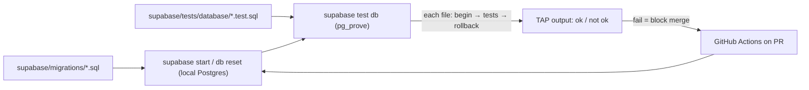

# Supabase - Database Testing with pgTAP & Policy Tests

> [!info] Deep dive of [[Supabase]]

> [!abstract] TL;DR
> In a Supabase app, security and business rules live in SQL: RLS policies, RPCs, triggers and constraints. Test them **in the database** with **pgTAP**, run by `supabase test db` against the local stack, in CI on every migration.
> - **Policy tests**: impersonate users (`set local role authenticated` + JWT claims), and assert they see/modify **only their tenant's rows**, including **negative tests** (cross-tenant reads return 0 rows, writes throw).
> - **Schema tests**: every public table has RLS enabled, no policy uses `true` for writes, and functions use a fixed `search_path`.
> - **RPC/trigger tests**: business invariants (stock never negative, audit row written, status transitions).
>
> Each test file runs in a transaction and rolls back, so it's fast and isolated.

## Concept
| Test type | What it catches | Example assertion |
|---|---|---|
| RLS isolation | Cross-tenant leaks (the costliest bug class) | User A selecting tenant B's orders → 0 rows |
| RLS write rules | Privilege escalation | Member can't `update role = 'owner'` |
| Schema guards | Forgotten RLS, unsafe functions | `rowsecurity = true` for all `public` tables |
| RPC behaviour | Business logic errors | `place_order()` decrements stock, rejects negative |
| Trigger effects | Missing side effects | Audit row inserted on update |
| Constraints | Data integrity | Duplicate `(tenant_id, slug)` throws `23505` |
| Grants | Over-exposed objects | `anon` has no `select` on `invoices` |

**pgTAP essentials**:

| Function | Use |
|---|---|
| `plan(n)` / `finish()` | Declare and close a test file |
| `ok(bool, desc)`, `is(got, want, desc)` | Basic assertions |
| `results_eq(sql, sql/array, desc)` | Compare query results |
| `is_empty(sql, desc)` | No rows visible |
| `throws_ok(sql, errcode, msg, desc)` | Expected errors (`42501` RLS violation, `23505` unique) |
| `lives_ok(sql, desc)` | Statement succeeds |
| `has_table`, `has_column`, `policies_are`, `table_privs_are` | Schema/privilege checks |

## How It Works


## Practical Usage
**Layout and run**:
```bash
supabase/
  migrations/…
  tests/database/
    000-setup-helpers.test.sql
    010-rls-orders.test.sql
    020-rpc-place-order.test.sql
    900-schema-guards.test.sql

supabase start && supabase db reset    # apply migrations + seed
supabase test db                       # runs all *.test.sql with pg_prove
```
**Impersonation helpers** (plain SQL, no extension needed). The `000-` file runs first and deliberately **commits** (no `begin … rollback`), so later files can use the helpers on the local/CI database:
```sql
-- 000-setup-helpers.test.sql
create extension if not exists pgtap with schema extensions;
create schema if not exists tests;
create or replace function tests.authenticate_as(p_user uuid, p_tenant uuid) returns void
language plpgsql as $$
begin
  perform set_config('role', 'authenticated', true);
  perform set_config('request.jwt.claims',
    json_build_object('sub', p_user, 'role', 'authenticated',
                      'app_metadata', json_build_object('tenant_id', p_tenant))::text, true);
end $$;
create or replace function tests.clear_auth() returns void language sql as $$
  select set_config('role', 'postgres', true), set_config('request.jwt.claims', null, true);
$$;
select plan(1); select ok(true, 'helpers installed'); select * from finish();
```
**RLS isolation test** (`010-rls-orders.test.sql`):
```sql
begin;
select plan(5);

-- arrange (as postgres): two tenants, two users, one order each
insert into auth.users (id, email) values
  ('00000000-0000-0000-0000-00000000000a', 'a@test.my'),
  ('00000000-0000-0000-0000-00000000000b', 'b@test.my');
insert into public.tenants (id, name) values
  ('10000000-0000-0000-0000-00000000000a', 'Tenant A'), ('10000000-0000-0000-0000-00000000000b', 'Tenant B');
insert into public.memberships (user_id, tenant_id, role) values
  ('00000000-0000-0000-0000-00000000000a', '10000000-0000-0000-0000-00000000000a', 'member'),
  ('00000000-0000-0000-0000-00000000000b', '10000000-0000-0000-0000-00000000000b', 'member');
insert into public.orders (id, tenant_id, total_cents) values
  (1, '10000000-0000-0000-0000-00000000000a', 1000), (2, '10000000-0000-0000-0000-00000000000b', 2000);

-- act + assert as user A
select tests.authenticate_as('00000000-0000-0000-0000-00000000000a', '10000000-0000-0000-0000-00000000000a');
select results_eq('select id from public.orders order by id', array[1::bigint], 'A sees only own tenant orders');
select is_empty($$ select 1 from public.orders where id = 2 $$, 'A cannot read B''s order by id');
select throws_ok(
  $$ insert into public.orders (tenant_id, total_cents) values ('10000000-0000-0000-0000-00000000000b', 1) $$,
  '42501', null, 'A cannot insert into tenant B');
update public.orders set total_cents = 1 where id = 2;      -- RLS silently filters: 0 rows updated
select tests.clear_auth();
select is((select total_cents from public.orders where id = 2), 2000, 'B''s order unchanged by A');

-- anon sees nothing
set local role anon;
select is_empty('select 1 from public.orders', 'anon sees no orders');

select * from finish();
rollback;
```
**Schema guard test** (catches the "forgot to enable RLS" migration):
```sql
begin;
select plan(2);
select is_empty($$
  select tablename from pg_tables where schemaname = 'public' and not rowsecurity
$$, 'every public table has RLS enabled');
select is_empty($$
  select p.proname from pg_proc p join pg_namespace n on n.oid = p.pronamespace
  where n.nspname = 'public' and p.prosecdef
    and not exists (select 1 from unnest(p.proconfig) c where c like 'search_path=%')
$$, 'security definer functions pin search_path');
select * from finish();
rollback;
```
**CI job** (GitHub Actions):
```yaml
- uses: supabase/setup-cli@v1
  with: { version: latest }
- run: supabase start -x studio,imgproxy,inbucket,edge-runtime   # trim services for speed
- run: supabase db reset && supabase test db
```
**Wrong way**:
```text
❌ Testing RLS only through the app with an admin/service-role client → policies never exercised
❌ Only positive tests ("A sees A")                                  → leaks to B go unnoticed
❌ Assuming UPDATE through RLS throws                                → it silently affects 0 rows; assert data unchanged
❌ Tests depending on seed.sql data shared across files              → order-dependent, flaky
```

## Patterns & Anti-patterns
| Pattern | When | Anti-pattern to avoid |
|---|---|---|
| Two tenants + negative assertions per table | Every multi-tenant table | Single-tenant fixtures |
| Schema guard tests for RLS and `search_path` | Always | Relying on Security Advisor alone |
| `begin … rollback` per file | Isolation | Shared mutable fixtures |
| Test RPCs as the calling role | Business logic | Testing as `postgres` only (bypasses RLS) |
| Run in CI before `supabase db push` | Every PR | Testing after deploying to prod |
| One test file per table/feature | Maintainability | One giant test file |
| Fixed UUIDs in fixtures | Readable failures | Random IDs in assertions |

## Performance & Trade-offs
- **Speed**: pgTAP files run in milliseconds. `supabase start` in CI costs 1–3 minutes, so trim unused services.
- **Coverage vs effort**: prioritize tables with personal or financial data and every RPC that writes. Trivial lookup tables need only the schema guard.
- **pgTAP vs app integration tests**: pgTAP proves the database contract. Integration tests (Testcontainers/Vitest) prove the app uses it correctly. Keep both, but RLS belongs in pgTAP ([[Testing Strategy - Integration Testing with Testcontainers & Supabase]]).
- **Maintenance**: policy changes require test updates, which is the point. Treat failing policy tests as a security review trigger.

## Tips & Reminders
> [!tip] In ZP's stack
> - **Deliverable for clients**: "RLS isolation tests for all tenant tables, run in CI" is concrete evidence of due diligence. Mention it in SOWs and handover docs.
> - **Next.js + Flutter share policies**, so one pgTAP suite covers both clients ([[Authentication & Authorization - Multi-Tenant Authorization with RLS]]).
> - **Claude/AI-assisted migrations**: require a matching test file in the same PR. It catches generated policies that are `using (true)`.

- Use `throws_ok(..., '42501', ...)` for RLS insert/delete violations, and check data unchanged for updates.
- Add a test for each bug found in production (regression tests).
- Keep test helpers in a schema that isn't exposed via the Data API.
- Run `supabase db lint` alongside tests for function errors.

## Version Notes
| Version | Change relevant here |
|---|---|
| Supabase CLI 1.x (2023) | `supabase test db` with pgTAP/pg_prove |
| pgTAP 1.3 | Current major line. `policies_are`, `policy_roles_are`, privilege assertions |
| Supabase CLI 2.x (2025–26) | Branching/preview DBs where tests can run per PR ([[Supabase - Migrations, Branching & Local Development]]) |

> [!warning] Unverified — check before relying on this
> Current pgTAP and Supabase CLI versions, and whether the `-x` exclude list names still match the CLI's service names, weren't verified this run. Check `supabase start --help` and https://supabase.com/docs/guides/database/testing.

## Critical Issues & Gotchas
> [!danger] Tests that run as a superuser prove nothing
> Default SQL editor and test connections are `postgres`, which **bypasses RLS**. If you forget to switch to `authenticated`/`anon` with JWT claims, every isolation test passes while production leaks. Always set role and claims, and include an assertion that fails if RLS is off (e.g. user A must not see B's row).

> [!danger] Silent RLS filtering on UPDATE/DELETE
> RLS doesn't raise errors for rows filtered by `USING`. An update from the wrong tenant "succeeds" with 0 rows affected. Tests that only check "no exception" miss real authorization bugs. Assert row counts or unchanged data, and use `throws_ok` only for `WITH CHECK` violations on insert/update.

- **`auth.uid()`** reads `request.jwt.claims` (or the older `request.jwt.claim.sub`). Set the claim format your policies actually use.
- **Inserting into `auth.users`** in tests needs only the columns your triggers need. Triggers on signup (profile creation) run too.
- **Seed data** in `seed.sql` runs on `db reset`. Don't let tests depend on it implicitly.
- **Extensions** (pgTAP) must be enabled in local/CI only. Don't add pgTAP to production migrations unless intended.

## Related
- [[Supabase]]
- [[Supabase - Row Level Security]] — the policies under test
- [[Supabase - Migrations, Branching & Local Development]] — local stack and CI workflow
- [[Testing Strategy - Integration Testing with Testcontainers & Supabase]] — app-level integration tests
- [[Authentication & Authorization - Multi-Tenant Authorization with RLS]] — tenancy model
- [[Supabase - Database Functions, Triggers & RPC]] — RPCs and triggers to test

## References
- https://supabase.com/docs/guides/database/testing
- https://supabase.com/docs/guides/local-development/testing/pgtap-extended
- https://pgtap.org/documentation.html
- https://github.com/usebasejump/supabase-test-helpers
- https://supabase.com/docs/reference/cli/supabase-test-db
