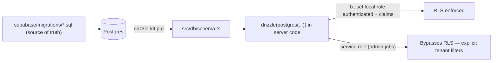

# Supabase - Drizzle ORM & Typed SQL

> [!info] Deep dive of [[Supabase]]

> [!abstract] TL;DR
> **supabase-js** (PostgREST) is great for user-scoped CRUD with RLS from browsers/mobile. **Drizzle** is a lightweight, SQL-shaped TypeScript ORM for **server-side** code (Server Actions, workers, Hono APIs) that needs joins, transactions, CTEs and full SQL control with types.
> The two big decisions:
> 1. **One migration source of truth**: either Supabase SQL migrations (then `drizzle-kit pull` to generate the TS schema), or Drizzle schema + `drizzle-kit generate` producing SQL that you commit into `supabase/migrations`. Never both editing independently.
> 2. **RLS**: Drizzle connects as a database role (often `postgres`) that **bypasses RLS**. For user-scoped queries, run inside a transaction that sets `role authenticated` + JWT claims, or enforce tenant filters explicitly in a data-access layer.
>
> **Connection**: use Supavisor transaction mode (6543) with `prepare: false` for serverless, or session mode/direct connection for long-lived workers.

## Concept
| Concern | supabase-js (PostgREST) | Drizzle (direct SQL) |
|---|---|---|
| Where | Browser, mobile, server | Server only |
| Auth/RLS | Automatic via user JWT | Manual (role + claims) or app-level checks |
| Query power | Filters, embeds, RPC | Full SQL: joins, CTEs, window functions, transactions |
| Types | Generated from DB | Defined in TS schema (or pulled from DB) |
| Transactions | Via RPC functions | Native `db.transaction()` |
| Pick it when… | Client apps, simple CRUD | Complex server logic, workers, reports |

**Migration strategies**:

| Strategy | Flow | Pick it when… |
|---|---|---|
| SQL-first (recommended with Supabase) | Write SQL migrations (RLS, functions, triggers) → `drizzle-kit pull` → TS schema | Heavy use of RLS/functions/policies |
| Drizzle-first | Edit TS schema → `drizzle-kit generate` → review SQL → commit to `supabase/migrations` | Mostly tables/columns, team prefers TS |

## How It Works


## Practical Usage
**Client setup** (serverless-friendly):
```ts
import { drizzle } from "drizzle-orm/postgres-js";
import postgres from "postgres";
import * as schema from "./schema";

const client = postgres(process.env.DATABASE_URL!, { prepare: false, max: 5 });   // Supavisor transaction mode
export const db = drizzle(client, { schema });
```
**Schema excerpt** (pulled or hand-written):
```ts
import { pgTable, uuid, text, integer, timestamp, index } from "drizzle-orm/pg-core";
export const orders = pgTable("orders", {
  id: uuid("id").primaryKey().defaultRandom(),
  tenantId: uuid("tenant_id").notNull(),
  status: text("status").notNull().default("pending"),
  totalCents: integer("total_cents").notNull(),
  createdAt: timestamp("created_at", { withTimezone: true }).notNull().defaultNow(),
}, (t) => [index("orders_tenant_created_idx").on(t.tenantId, t.createdAt)]);
```
**RLS-respecting queries** (run as the user inside a transaction):
```ts
import { sql } from "drizzle-orm";

export async function asUser<T>(claims: { sub: string; role: "authenticated" }, fn: (tx: typeof db) => Promise<T>) {
  return db.transaction(async (tx) => {
    await tx.execute(sql`select set_config('request.jwt.claims', ${JSON.stringify(claims)}, true)`);
    await tx.execute(sql`set local role authenticated`);
    return fn(tx as unknown as typeof db);
  });
}

// usage in a Server Action (claims from verified Supabase session)
const recent = await asUser({ sub: user.id, role: "authenticated" }, (tx) =>
  tx.select().from(orders).orderBy(desc(orders.createdAt)).limit(20));
```
**Complex query with typed results** (report in a worker, explicit tenant filter):
```ts
const rows = await db
  .select({ day: sql<string>`date_trunc('day', ${orders.createdAt} at time zone 'Asia/Kuala_Lumpur')`,
            revenue: sql<number>`sum(${orders.totalCents})::int` })
  .from(orders)
  .where(and(eq(orders.tenantId, tenantId), eq(orders.status, "paid")))
  .groupBy(sql`1`).orderBy(sql`1`);
```
**drizzle-kit config**:
```ts
// drizzle.config.ts
export default {
  schema: "./src/db/schema.ts",
  out: "./supabase/migrations",          // Drizzle-first: generated SQL lands with Supabase migrations
  dialect: "postgresql",
  dbCredentials: { url: process.env.DIRECT_DATABASE_URL! },
  schemaFilter: ["public"],
};
```
**Wrong way**:
```text
❌ Drizzle with postgres superuser in user-facing Server Actions → RLS bypassed; one missing where = data leak
❌ drizzle-kit push to production                             → unreviewed schema changes, no migration history
❌ Prepared statements through transaction pooler              → "prepared statement already exists" errors
❌ Editing schema in both Supabase Studio and Drizzle          → drift, conflicting migrations
```

## Patterns & Anti-patterns
| Pattern | When | Anti-pattern to avoid |
|---|---|---|
| SQL-first migrations + `drizzle-kit pull` | RLS-heavy Supabase apps | Two competing migration systems |
| `asUser` transaction wrapper for user queries | Server-side user data | Superuser queries with ad-hoc filters |
| Data-access layer enforcing tenant filters for admin role | Workers/reports | Scattered raw queries |
| supabase-js on clients, Drizzle on servers | Mixed stacks | Drizzle in browsers (impossible) / service key in clients |
| Review generated SQL before commit | Drizzle-first | Blind `generate` + deploy |
| pgTAP tests still cover RLS | Always | Assuming ORM enforces security ([[Supabase - Database Testing with pgTAP & Policy Tests]]) |

## Performance & Trade-offs
- **Drizzle** is thin (SQL builder + types). Performance is close to raw SQL, unlike heavier ORMs. Prisma offers richer tooling but a heavier runtime and query engine.
- **Connections**: serverless functions should use the transaction pooler with `prepare: false`, and long-running workers can use session mode for prepared statements ([[PostgreSQL - Connection Pooling with Supavisor & PgBouncer]]).
- **RLS via `set local`** adds two statements per transaction. That's negligible, but it requires transactions for every user query.
- **Types**: Drizzle schema types vs Supabase generated types are two sources. Pick Drizzle types for server code, and generated types for supabase-js clients ([[TypeScript - Supabase Generated Types & Typed Queries]]).

## Tips & Reminders
> [!tip] In ZP's stack
> - **Default split**: supabase-js with RLS for Flutter/Next.js client reads and writes. Drizzle in BullMQ workers, Hono APIs and complex Server Actions (transactions across tables, reports) ([[Next.js - Server Actions, Mutations & Security]]).
> - **Keep Supabase SQL migrations as truth** (policies, functions, triggers live there), and run `drizzle-kit pull` after each migration in CI ([[Supabase - Migrations, Branching & Local Development]]).
> - **Admin connections** (workers) use a dedicated role with limited grants, not `postgres`, where possible.

- Use `DIRECT_DATABASE_URL` (session/direct) for drizzle-kit, and the pooled URL at runtime.
- Name indexes explicitly in schema to avoid churn.
- Wrap multi-table writes in `db.transaction`. Retry on `40001`/`40P01` ([[PostgreSQL - Locking, Deadlocks & Concurrency Control]]).
- Log slow queries via Postgres (`pg_stat_statements`) rather than ORM logging in production.

## Version Notes
| Date | Change relevant here |
|---|---|
| 2023 | Drizzle gains popularity with serverless/edge drivers |
| 2024 | drizzle-kit `pull`/`generate`/`migrate` workflow. `pgPolicy`/RLS definitions in schema |
| 2025–26 | Drizzle 1.0 roadmap/beta work. Supabase docs include Drizzle guides |

> [!warning] Unverified — check before relying on this
> Current drizzle-orm/drizzle-kit versions (0.4x vs 1.0), RLS helper APIs (`pgPolicy`, Supabase-specific helpers), and the index definition syntax in the latest release weren't verified this run. Check https://orm.drizzle.team/docs.

## Critical Issues & Gotchas
> [!danger] Bypassing RLS by accident
> Server-side Drizzle typically connects with a privileged role, and RLS doesn't apply. A Server Action that forgets `where tenant_id = …`, or a route that trusts a client-supplied tenant ID, exposes other tenants' data. That's the most common multi-tenant breach pattern. Use an `asUser` wrapper (role + claims) for user-facing queries, a reviewed data-access layer for admin queries, and RLS tests.

> [!danger] Migration drift between Drizzle and Supabase
> Changes made in Studio, in SQL migrations, and in Drizzle schema diverge. `drizzle-kit generate` then produces destructive diffs (dropping columns/policies it doesn't know about). Choose one source of truth, regenerate the other side automatically, and review every generated migration for `DROP` statements before applying.

- **Pooler + prepared statements**: transaction mode needs `prepare: false`.
- **`set local role` requires a transaction**. Outside one, it either errors or leaks to the pooled session.
- **Timestamps**: use `withTimezone: true` (`timestamptz`), and convert to MYT in queries.
- **Generated columns/enums/policies** may not round-trip perfectly through `pull`. Keep them in SQL.

## Related
- [[Supabase]]
- [[TypeScript - Supabase Generated Types & Typed Queries]] — supabase-js typing
- [[Supabase - Row Level Security]] — policies Drizzle must respect
- [[Supabase - Migrations, Branching & Local Development]] — migration source of truth
- [[PostgreSQL - Connection Pooling with Supavisor & PgBouncer]] — pool modes and prepared statements
- [[Supabase - Database Testing with pgTAP & Policy Tests]] — testing RLS regardless of ORM

## References
- https://orm.drizzle.team/docs/overview
- https://orm.drizzle.team/docs/connect-supabase
- https://orm.drizzle.team/docs/rls
- https://supabase.com/docs/guides/database/drizzle
- https://github.com/porsager/postgres
