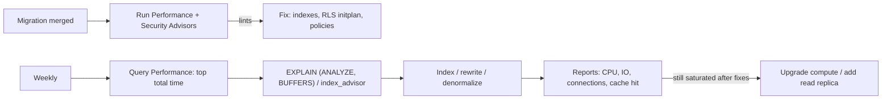

# Supabase - Performance Tuning & Advisors

> [!info] Deep dive of [[Supabase]]

> [!abstract] TL;DR
> Most slow Supabase apps have the same few causes:
> - **RLS policies calling `auth.uid()`/`auth.jwt()` per row**: wrap them as `(select auth.uid())`.
> - **Missing indexes** on `tenant_id`, foreign keys and filter/sort columns.
> - **Over-fetching** through PostgREST (`select=*`, exact counts, deep embeds, offset pagination).
> - **Undersized compute** hitting connection or **disk IO** limits.
>
> Run the **Performance and Security Advisors** after every migration, read **Query Performance** (pg_stat_statements) weekly, use `index_advisor`/`EXPLAIN` on the top queries, and only then pay for bigger compute.

## Concept
| Tool | Shows | Act on |
|---|---|---|
| Performance Advisor (lints) | `auth_rls_initplan`, unindexed foreign keys, multiple permissive policies, duplicate/unused indexes, missing primary keys | Fix in migrations, then re-run |
| Security Advisor | RLS disabled on exposed tables, mutable `search_path`, security definer views/functions, exposed `auth.users` | Treat as release blockers |
| Query Performance report | Top queries by total time, calls, mean time (pg_stat_statements) | Optimize the top 5 by **total** time |
| `index_advisor` extension | Suggested indexes for a given query | Validate with `EXPLAIN ANALYZE` before creating |
| Observability / reports | CPU, memory, connections, disk IO, cache hit rate | Decide on compute upgrade vs query fixes |
| `EXPLAIN` from the client (`.explain()`) | Plan for a PostgREST query | Dev only (exposes plans) |

**Typical bottlenecks by symptom**:

| Symptom | Likely cause | Fix |
|---|---|---|
| Simple list query slow only for `authenticated` | RLS function per row, no index on policy column | `(select auth.uid())`, index `tenant_id`, definer helper |
| Latency spikes, "too many connections" | Direct connections from serverless/many replicas | Transaction pooler 6543, smaller pools |
| Everything slow at certain times, IO graph flat-topped | Disk IO budget exhausted (small compute) | Fix heavy scans, upgrade compute or disk throughput |
| Count queries slow | `count=exact` on large tables | `count=estimated`/`planned`, or skip totals |
| Page 500 slow | `offset` pagination | Keyset pagination (`gt('created_at', cursor)`) |
| Realtime lag | Postgres Changes on hot tables with RLS checks per subscriber | Broadcast from DB / triggers, narrower subscriptions |

## How It Works


## Practical Usage
**RLS initplan fix** (the single most common advisor warning):
```sql
-- before: auth.uid() evaluated per row
create policy "own orders" on orders for select using (customer_id = auth.uid());
-- after: evaluated once per statement (initplan)
drop policy "own orders" on orders;
create policy "own orders" on orders for select to authenticated using (customer_id = (select auth.uid()));

-- tenant policies: index the column they filter on
create index concurrently if not exists orders_tenant_created on public.orders (tenant_id, created_at desc);
```
**Find heavy queries** (same data as the Query Performance report):
```sql
select calls, round(total_exec_time) as total_ms, round(mean_exec_time, 1) as mean_ms, rows,
       left(query, 120) as query
from extensions.pg_stat_statements
order by total_exec_time desc limit 10;

select * from extensions.index_advisor(
  $$select * from public.orders where tenant_id = '6c1e…' and status = 'pending' order by created_at desc limit 20$$);
```
**Lean PostgREST queries** (supabase-js):
```ts
// select only what the screen needs, keyset pagination, cheap counts
const { data, count } = await supabase
  .from('orders')
  .select('id, status, total_cents, created_at, customer:customers(name)', { count: 'estimated' })
  .eq('status', 'pending')
  .lt('created_at', cursor)                    // keyset: last row's created_at from the previous page
  .order('created_at', { ascending: false })
  .limit(20);
```
**Per-role timeouts** (protect the DB from runaway queries):
```sql
alter role authenticated set statement_timeout = '8s';
alter role anon set statement_timeout = '3s';
```
**Wrong way**:
```ts
await supabase.from('orders').select('*, items(*, product(*, images(*)))', { count: 'exact' }).range(4000, 4019);
// ❌ deep embeds + exact count + offset 4000 on a large tenant: seconds per page, heavy IO
```
```sql
create policy p on orders using (tenant_id in (select tenant_id from memberships where user_id = auth.uid()));
-- ❌ subquery + auth.uid() per row, no index on memberships(user_id) → scans on every request
```

## Patterns & Anti-patterns
| Pattern | When | Anti-pattern to avoid |
|---|---|---|
| `(select auth.uid())` / `(select auth.jwt())` in policies | Every RLS policy | Bare function calls per row |
| Tenant claim in JWT + index on `tenant_id` | Multi-tenant | Membership subqueries in every policy |
| Index every foreign key used in joins/deletes | Relational schemas | Unindexed FKs (slow cascades, joins) |
| One permissive policy per action, or restrictive policies deliberately | RLS design | Several overlapping permissive policies evaluated per row |
| Keyset pagination + estimated counts | Lists/feeds | Offset + exact counts |
| RPC for multi-table reads/writes | Complex screens | 6 PostgREST calls per screen from mobile |
| Advisors in the PR checklist | Every migration | Checking advisors only after complaints |

## Performance & Trade-offs
- **Fix queries before buying compute**: an index or RLS fix often gives 10–100× on the affected query. A compute upgrade gives ~2× at 2× cost.
- **Small compute tiers** have limited baseline disk throughput/IOPS, plus burst budgets. Sequential scans on big tables drain them, and then everything slows. Watch the IO report.
- **Indexes cost writes and storage**: remove unused/duplicate ones the advisor flags, and use partial indexes for hot subsets (`where status = 'pending'`) ([[PostgreSQL - Indexing]]).
- **Read replicas** (paid) offload analytics/reporting reads, with replication lag. Don't read-your-writes from them.
- **Realtime Postgres Changes** with RLS checks each change per subscriber, so it scales poorly on hot tables. Broadcast from the database scales better ([[Supabase - Realtime, Presence & Broadcast]]).

## Tips & Reminders
> [!tip] In ZP's stack
> - **Per client project, monthly**: advisors clean, top-10 queries reviewed, IO/CPU headroom > 30%, `pg_stat_statements` reset after big releases to see fresh data.
> - **Dashboards for SME owners** (sales by day, top products): use materialized views refreshed by pg_cron, or nightly batch tables, not live aggregates over raw orders on every page load.
> - **Next.js server components**: use the transaction pooler and cache public queries ([[PostgreSQL - Connection Pooling with Supavisor & PgBouncer]], [[Next.js - Caching]]).

- Name policies and indexes descriptively. Advisor output then maps to code quickly.
- Use `EXPLAIN (ANALYZE, BUFFERS)` as the `authenticated` role with JWT claims set to see RLS costs realistically ([[PostgreSQL - Query Planning & EXPLAIN]]).
- Keep `statement_timeout` per role, and longer timeouts only for specific RPCs via `set local`.
- Archive or partition large log-like tables ([[PostgreSQL - Partitioning & Large Table Maintenance]]).

## Version Notes
| Date | Change |
|---|---|
| 2024 | Performance/Security Advisors (splinter lints) in the dashboard. `index_advisor` extension |
| 2024–25 | Supavisor pooler, dedicated pooler option, Query Performance report improvements |
| 2025–26 | New API keys / JWT signing keys. Advisors keep adding lints (check after platform updates) ([[Supabase]]) |

> [!warning] Unverified — check before relying on this
> Current compute tiers, connection limits and disk IO budgets per tier weren't re-checked. Check https://supabase.com/docs/guides/platform/compute-and-disk and the advisors docs before sizing.

## Critical Issues & Gotchas
> [!danger] Performance "fixes" that disable security
> Under load, teams sometimes switch to the service-role key, disable RLS or add `security definer` to slow functions "temporarily". That removes tenant isolation and is how cross-tenant leaks happen. Fix the policy (initplan wrapping, indexes, JWT claims) instead, and keep the Security Advisor clean ([[Supabase - Row Level Security]]).

> [!danger] Runaway queries take the whole project down
> One unbounded query (no limit, no index, exact count on millions of rows) or an infinite client retry loop can saturate CPU/IO for every tenant on the project. Set per-role `statement_timeout`, enforce limits in RPCs, rate-limit expensive endpoints, and alert on CPU/IO saturation.

- **`count: 'exact'`** looks harmless in dev and becomes the slowest part of every list in production.
- **Advisor false sense**: lints catch patterns, not your actual slow queries. Always pair them with Query Performance data.
- **`pg_stat_statements` normalizes queries**: one PostgREST query shape may represent many tenants. Test plans with a large tenant's parameters.
- **Index creation on live tables**: use `create index concurrently` in its own migration ([[Supabase - Migrations, Branching & Local Development]]).

## Related
- [[Supabase]]
- [[Supabase - Row Level Security]] — policy patterns that perform
- [[PostgreSQL - Query Planning & EXPLAIN]] — reading plans and buffers
- [[PostgreSQL - Indexing]] — composite, partial and covering indexes
- [[PostgreSQL - Connection Pooling with Supavisor & PgBouncer]] — connection limits and pool sizing
- [[Supabase - Database Functions, Triggers & RPC]] — moving chatty access into RPCs

## References
- https://supabase.com/docs/guides/database/database-advisors
- https://supabase.com/docs/guides/database/postgres/row-level-security#rls-performance-recommendations
- https://supabase.com/docs/guides/database/extensions/index_advisor
- https://supabase.com/docs/guides/platform/performance
- https://supabase.com/docs/guides/platform/compute-and-disk
