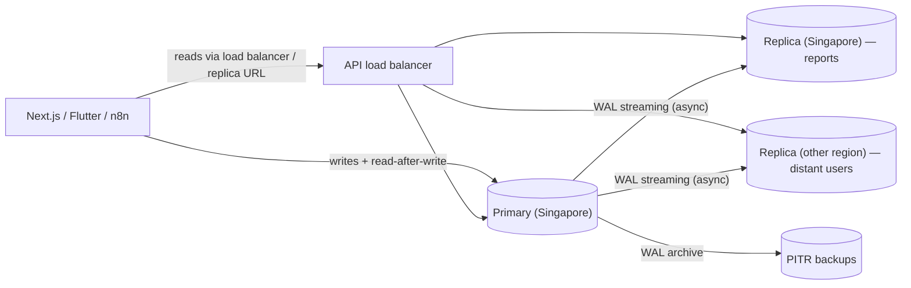

# Supabase - Read Replicas, High Availability & Multi-Region

> [!info] Deep dive of [[Supabase]]

> [!abstract] TL;DR
> - **Read Replicas** (paid plans) add read-only Postgres copies, in the same or another region, via physical streaming replication. Each is billed as extra compute.
>   - Supabase can route Data API reads through a **load balancer endpoint**.
>   - Writes always go to the primary.
>   - Replicas are **eventually consistent** (lag of ms to seconds), so read-after-write paths must hit the primary.
> - **High availability** (automatic failover to a standby) and multi-region failover depend on plan/tier. Don't assume your Pro project survives a zone outage automatically. Treat **PITR + tested restores** as the baseline DR for SME clients.
> - **Region choice matters most**: for Malaysian users, **Singapore (ap-southeast-1)** gives low latency. Put Edge Functions, Coolify servers and n8n close to the database, not just close to users.
> - Add replicas for **read scaling, reporting isolation or regional latency**, not as a backup substitute.

## Concept
| Capability | What it gives | What it doesn't |
|---|---|---|
| Read replica (same region) | Offload heavy reads/reports | Write scaling, automatic failover |
| Read replica (other region) | Lower read latency for distant users | Lower write latency |
| API load balancer endpoint | Spread GET/RPC-read traffic across primary + replicas | Read-your-writes consistency |
| PITR | Restore to any second within retention | Instant failover (restore takes time) |
| Daily backups | Coarse restore points | Recent data (up to 24 h loss) |
| HA standby (tier-dependent) | Automatic failover on primary failure | Protection from logical errors (bad DELETE) |

**Choosing for a client**:

| Need | Recommendation |
|---|---|
| SME app, Malaysian users | Singapore primary, PITR, documented restore drill |
| Heavy dashboards slowing the app | One same-region replica for reporting queries |
| Regional users (e.g. EU customers) | Regional read replica + CDN. Writes still to primary |
| Strict uptime SLA (99.95%+) | Higher tier with HA, or self-managed Postgres HA, priced accordingly |

## How It Works


## Practical Usage
**Route reads explicitly** (dedicated client for replica-tolerant queries):
```ts
// primary: default project URL; replica/load-balancer URL from dashboard (Database → Replicas)
export const primary = createClient<Database>(process.env.SUPABASE_URL!, KEY);
export const reads   = createClient<Database>(process.env.SUPABASE_READ_URL!, KEY);   // replica or LB endpoint

// dashboard aggregates tolerate seconds of lag
const { data } = await reads.rpc("tenant_sales_summary", { p_tenant: tenantId });

// right after checkout, read from primary to see the new order
const { data: order } = await primary.from("orders").select("*").eq("id", newOrderId).single();
```
**Direct SQL connections** (workers, BI tools):
```text
Primary:  postgresql://postgres.[ref]:…@aws-0-ap-southeast-1.pooler.supabase.com:6543/postgres
Replica:  connection string from the replica's settings (read-only role usage recommended)
```
**Measure replication lag** (on primary):
```sql
select application_name, client_addr, state,
       pg_size_pretty(pg_wal_lsn_diff(pg_current_wal_lsn(), replay_lsn)) as replay_lag_bytes,
       replay_lag
from pg_stat_replication;
```
**Read-after-write with PG19 (when available on the platform)**:
```sql
wait for lsn '0/3A1B2C40' timeout 1000;   -- on replica session; fall back to primary on timeout
```
**DR runbook skeleton** (per client):
```text
RPO: PITR (seconds) | RTO target: 2–4 h
1. Detect: uptime monitor + Supabase status page
2. Decide: wait for platform recovery vs restore to new project (PITR to timestamp)
3. Restore: new project from PITR/backup → update env vars (Coolify, Vercel, Flutter remote config)
4. Verify: smoke tests, row counts, latest orders
5. Communicate: client + users; post-incident note
```
**Wrong way**:
```text
❌ Treating a read replica as a backup         → a bad DELETE replicates instantly
❌ Reading from a replica right after a write   → "my order disappeared" (lag)
❌ Primary in Singapore, n8n/Coolify server in Europe → every query crosses continents
❌ Promising 99.99% uptime on a single-region Pro project → SLA you can't meet
```

## Patterns & Anti-patterns
| Pattern | When | Anti-pattern to avoid |
|---|---|---|
| Separate `reads` client for lag-tolerant queries | Dashboards, lists, search | Random replica use for everything |
| Primary for read-after-write flows | Checkout, profile updates | Load balancer for all reads |
| Co-locate compute with the DB region | Always | Cross-region app servers |
| PITR + quarterly restore drill | SME DR baseline | Untested backups ([[PostgreSQL - Backups, PITR & Restore Drills]]) |
| SLA matched to architecture and price | Contracts | Over-promising uptime |
| Replica for reporting/BI tools | Heavy analytics | BI tools hammering the primary |

## Performance & Trade-offs
- **Cost**: each replica adds compute (and possibly storage/egress). A small same-region replica can be cheaper than upsizing the primary for read-heavy loads ([[Supabase - Usage, Cost Control & Plan Limits]]).
- **Lag**: usually sub-second in-region, and higher cross-region and under heavy write bursts. Large transactions and long queries on replicas can increase lag or cause query cancellations (`hot_standby_feedback` trade-offs).
- **Realtime and Auth** run against the primary. Replicas don't scale writes, Auth, or Realtime fan-out.
- **Self-managed alternative**: Postgres + Patroni/CloudNativePG gives HA control, but on-call and ops become yours. That's rarely worth it for a solo agency.

## Tips & Reminders
> [!tip] In ZP's stack
> - **Default architecture for Malaysian SME clients**: Supabase Singapore + PITR + Coolify servers (Next.js, n8n) in Singapore or nearby, plus an honest SLA (e.g. 99.5% with documented RTO/RPO) ([[Coolify - Server Migration & Disaster Recovery]]).
> - **When the owner dashboard slows checkout**: move reporting RPCs to a replica before upsizing the primary ([[PostgreSQL - Reporting Queries, Window Functions & Materialized Views]]).
> - **Hostinger KVM region**: pick the Asia (Singapore/Malaysia) location for servers that talk to Supabase, since latency per query adds up in n8n workflows.

- Show "data may be a few seconds old" on replica-backed dashboards where it matters.
- Monitor replica lag and alert above a threshold.
- Document region and replica locations in the DPA (cross-border transfers under PDPA).
- Re-test failover/restore after major platform upgrades ([[PostgreSQL - Version 19 New Features & Upgrade Planning]]).

## Version Notes
| Date | Change relevant here |
|---|---|
| 2023–24 | Supabase Read Replicas (initially beta) for paid plans |
| 2024–25 | API load balancer endpoint for distributing reads. Supavisor pooler |
| 2025–26 | Ongoing replica/region expansion. HA/failover options vary by tier |
| PG19 (2026-11) | `WAIT FOR LSN` enables read-your-writes on replicas once platforms offer 19 |

> [!warning] Unverified — check before relying on this
> Which Supabase plans include automatic HA failover, replica pricing, supported replica regions, and the current load balancer behaviour (which operations it routes) weren't verified this run. Check https://supabase.com/docs/guides/platform/read-replicas and plan pages.

## Critical Issues & Gotchas
> [!danger] Replicas don't protect against data loss
> Logical mistakes (accidental `DELETE`, buggy migration, compromised key wiping tables) replicate to every replica within milliseconds. Only PITR/backups restore you. Keep PITR enabled for production clients, and rehearse restoring to a new project.

> [!danger] Stale reads cause business errors
> Routing all reads through replicas makes freshly created orders, payments or stock changes invisible for a moment. Users retry (duplicate orders) or staff act on stale stock. Keep transactional reads on the primary, and use replicas only for lag-tolerant views.

- **Long queries on replicas** can be cancelled due to conflicts with replication. Retry or tune settings.
- **Extensions and schema changes** propagate from the primary. Replicas are read-only, so no writes, temp tables or `pg_cron` there.
- **Connection strings** for replicas differ. Misconfigured env vars send writes to a read-only endpoint (errors).
- **Region outages**: single-region projects are down during regional incidents. Communicate this in SLAs.

## Related
- [[Supabase]]
- [[PostgreSQL - Backups, PITR & Restore Drills]] — the real DR safety net
- [[PostgreSQL - Version 19 New Features & Upgrade Planning]] — WAIT FOR LSN
- [[Supabase - Usage, Cost Control & Plan Limits]] — replica costs
- [[Supabase - Performance Tuning & Advisors]] — tune before scaling out
- [[Coolify - Server Migration & Disaster Recovery]] — app-side DR

## References
- https://supabase.com/docs/guides/platform/read-replicas
- https://supabase.com/docs/guides/platform/backups
- https://supabase.com/docs/guides/platform/regions
- https://www.postgresql.org/docs/current/warm-standby.html
- https://www.postgresql.org/docs/current/hot-standby.html
