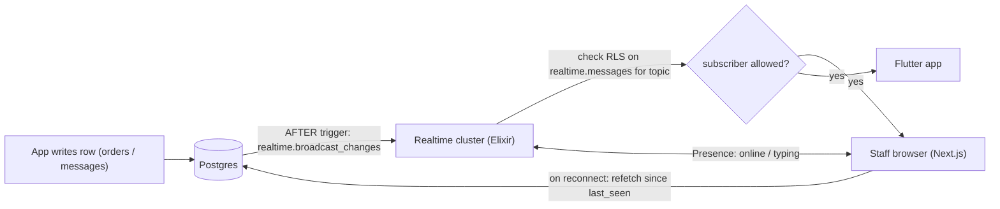

# Supabase - Realtime, Presence & Broadcast

> [!info] Deep dive of [[Supabase]]

> [!abstract] TL;DR
> Supabase Realtime offers three channel features over one WebSocket:
> - **Broadcast**: low-latency pub/sub. Clients send directly, or the database sends via `realtime.broadcast_changes` / `realtime.send` triggers.
> - **Presence**: synced "who's online / typing" state.
> - **Postgres Changes**: WAL-based row change feed, with RLS checked per subscriber per change.
>
> Prefer **database-triggered Broadcast on private channels** (authorized by RLS on `realtime.messages`) over Postgres Changes for anything with many subscribers. Realtime is **best-effort**, so refetch from the DB on (re)connect to fill gaps.

## Concept
| Feature | Source of messages | Authorization | Scales with | Use for |
|---|---|---|---|---|
| **Broadcast** (client) | Clients `channel.send()` | Private channel + RLS `INSERT` on `realtime.messages` | Messages × subscribers | Typing indicators, cursors, ephemeral UI events |
| **Broadcast from DB** | Triggers: `realtime.broadcast_changes()` / `realtime.send()` | Private channel + RLS `SELECT` on `realtime.messages` | Messages × subscribers | Live order boards, inbox updates, notifications |
| **Presence** | Clients `channel.track()` | Private channel policies | Joins/leaves × subscribers | Online agents, "who's viewing this ticket" |
| **Postgres Changes** | Logical replication of table WAL | Table RLS evaluated **for each subscriber, for each change** | Changes × subscribers (costly) | Low-traffic admin views, prototypes |

- **Topics** are strings you design: `tenant:<id>:orders`, `conversation:<id>`. Policies on `realtime.messages` use `realtime.topic()` to authorize per topic.
- **Delivery semantics**: at-most-once to connected clients. No replay of missed messages while disconnected. The database stays the source of truth.

## How It Works


## Practical Usage
**Authorize private topics** (RLS on `realtime.messages`):
```sql
-- receive: members of the tenant in the topic name "tenant:<uuid>:orders"
create policy "tenant members can receive" on realtime.messages for select to authenticated
using (
  realtime.topic() like 'tenant:%:orders'
  and (select private.has_permission(split_part(realtime.topic(), ':', 2)::uuid, 'order.read'))
);
-- send (client broadcast / presence) only within your tenant
create policy "tenant members can send" on realtime.messages for insert to authenticated
with check (
  realtime.topic() like 'tenant:%'
  and (select private.has_permission(split_part(realtime.topic(), ':', 2)::uuid, 'order.read'))
);
```
**Broadcast row changes from the database**:
```sql
create or replace function public.orders_broadcast() returns trigger
language plpgsql security definer set search_path = '' as $$
begin
  perform realtime.broadcast_changes(
    'tenant:' || coalesce(new.tenant_id, old.tenant_id)::text || ':orders',   -- topic
    tg_op, tg_op, tg_table_name, tg_table_schema, new, old);
  return null;
end $$;

create trigger orders_broadcast after insert or update or delete on public.orders
for each row execute function public.orders_broadcast();
```
**Custom event payloads** (not tied to a table) with `realtime.send`:
```sql
select realtime.send(jsonb_build_object('order_id', $1, 'status', 'ready'), 'order_ready', 'tenant:' || $2 || ':orders', true);
```
**Client subscribe** (supabase-js, private channel):
```ts
await supabase.realtime.setAuth();                                    // use the user's JWT for RLS
const channel = supabase.channel(`tenant:${tenantId}:orders`, { config: { private: true } })
  .on('broadcast', { event: 'INSERT' }, ({ payload }) => upsertOrder(payload.record))
  .on('broadcast', { event: 'UPDATE' }, ({ payload }) => upsertOrder(payload.record))
  .subscribe(async (status) => {
    if (status === 'SUBSCRIBED') await refetchOrdersSince(lastSeenAt);   // fill gaps after (re)connect
  });
```
**Presence** (online agents in an inbox):
```ts
const room = supabase.channel(`tenant:${tenantId}:inbox`, { config: { private: true, presence: { key: userId } } });
room.on('presence', { event: 'sync' }, () => setOnline(Object.keys(room.presenceState())))
    .subscribe(async (s) => { if (s === 'SUBSCRIBED') await room.track({ name, status: 'available' }); });
```
**Flutter** (`supabase_flutter`):
```dart
final channel = supabase.channel('tenant:$tenantId:orders', opts: const RealtimeChannelConfig(private: true))
  ..onBroadcast(event: 'UPDATE', callback: (payload) => ref.read(ordersProvider.notifier).upsert(payload['record']))
  ..subscribe((status, _) { if (status == RealtimeSubscribeStatus.subscribed) ref.invalidate(ordersSinceProvider); });
```
**Wrong way**:
```ts
supabase.channel('orders').on('postgres_changes', { event: '*', schema: 'public', table: 'orders' }, handler).subscribe();
// ❌ public, unfiltered Postgres Changes for every staff device: RLS evaluated per change × per subscriber, no tenant topic
```

## Patterns & Anti-patterns
| Pattern | When | Anti-pattern to avoid |
|---|---|---|
| DB trigger → Broadcast on tenant/conversation topics | Live boards, inboxes | Postgres Changes on hot tables with many subscribers |
| Private channels + `realtime.messages` policies | Anything multi-tenant | Public channels with guessable topic names |
| Refetch on `SUBSCRIBED` with a `since` cursor | Every live view | Assuming no message was missed |
| Small payloads (ids + changed fields), fetch details on demand | Large rows | Broadcasting full documents and images |
| Presence for ephemeral state only | Online/typing | Persisting business state in presence |
| Throttle client broadcasts (cursors, typing) to ~5–10/s | High-frequency UI | Sending every keystroke |

## Performance & Trade-offs
- **Postgres Changes cost**: each change is checked against RLS for every subscriber, so throughput drops as subscribers grow. Broadcast authorizes **once at join** (policy check per topic), then fans out cheaply.
- **Triggers add write latency**: `broadcast_changes` writes to `realtime.messages` inside your transaction. That's negligible per row, but bulk updates of 100k rows produce 100k messages. Batch, or skip broadcasting for backfills (`if current_setting('app.bulk', true) = 'on'`).
- **Connection limits** are per plan (concurrent clients, messages/second, payload size). Kitchen displays and staff tablets that stay connected all day count continuously. Check plan quotas before selling "live" features to large tenants.
- **Self-hosting**: Realtime is an Elixir service in the self-hosted Supabase stack. It works on Coolify, but it's another stateful component to monitor ([[WebSocket - Scaling & Reliability]]).

## Tips & Reminders
> [!tip] In ZP's stack
> - **Chatwoot-replacement inbox**: messages land via Meta webhook → Edge Function → `insert into messages` → trigger broadcasts to `conversation:<id>` and `tenant:<id>:inbox`.
> - **Agent UX**: Presence for "agent online / typing". Next.js staff UI and the Flutter agent app subscribe to the same topics.
> - **Durability**: offline agents get missed messages by refetching on reconnect.

- Name topics hierarchically and consistently (`tenant:<uuid>:<resource>[:<id>]`), so RLS policies can parse them with `split_part`.
- Call `supabase.realtime.setAuth()` after token refresh, or private channels stop receiving when the JWT expires.
- Unsubscribe channels on screen dispose (Flutter) or component unmount (React) to avoid leaking connections and duplicate handlers.
- Log channel status changes (`CHANNEL_ERROR`, `TIMED_OUT`, `CLOSED`) to your telemetry. They explain "live view stopped updating" reports.

## Version Notes
| Date | Change |
|---|---|
| 2021–23 | Realtime rewritten in Elixir. Broadcast + Presence added alongside Postgres Changes |
| 2024 | **Realtime Authorization**: private channels with RLS on `realtime.messages` |
| 2025 | **Broadcast from Database** (`realtime.broadcast_changes`, `realtime.send`) recommended over Postgres Changes for scale |
| 2026 | New API keys (publishable/secret). Clients must pass user JWTs (`setAuth`) for private channels |

> [!warning] Unverified — check before relying on this
> Plan quotas (concurrent connections, messages/sec, payload size) and exact client API names (Flutter `RealtimeChannelConfig`, `onBroadcast`) weren't verified this run. Check https://supabase.com/docs/guides/realtime and https://supabase.com/pricing.

## Critical Issues & Gotchas
> [!danger] Public channels leak across tenants
> Non-private channels have no authorization: anyone with the publishable key who guesses `tenant:<id>:orders` receives the stream. Use `private: true` and RLS policies on `realtime.messages` for every business topic.

> [!danger] Realtime is not a message queue
> No persistence, no acks, no replay. A WhatsApp message broadcast while an agent's phone was offline is simply missed by that client. Store everything in tables first, broadcast second, and refetch on reconnect. Use queues ([[Supabase - Edge Functions, Cron & Queues]]) for work that must happen.

- **`security definer` trigger functions** must set `search_path = ''` and only broadcast what subscribers may see. The trigger runs with elevated rights.
- **Payload includes the whole row** with `broadcast_changes`. Exclude sensitive columns (cost prices, internal notes) by broadcasting a trimmed record via `realtime.send` instead.
- **Duplicate handlers** after hot reload or re-render cause double inserts in the UI. Dedupe by row ID client-side.
- **Mobile background limits**: iOS/Android suspend WebSockets in the background. Use push notifications for alerts, and Realtime only while the app is foreground.

## Related
- [[Supabase]]
- [[Supabase - Row Level Security]] — policies on `realtime.messages` follow the same rules
- [[WebSocket - Scaling & Reliability]] — reconnection, heartbeats, fan-out
- [[Supabase - Edge Functions, Cron & Queues]] — durable work alongside live updates
- [[Flutter - State Management]] — wiring channel events into providers
- [[Authentication & Authorization - Multi-Tenant Authorization with RLS]] — `has_permission()` reused in channel policies

## References
- https://supabase.com/docs/guides/realtime/getting_started
- https://supabase.com/docs/guides/realtime/authorization
- https://supabase.com/docs/guides/realtime/broadcast
- https://supabase.com/docs/guides/getting-started/ai-prompts/use-realtime
- https://www.issoh.co.jp/tech/details/17058/
