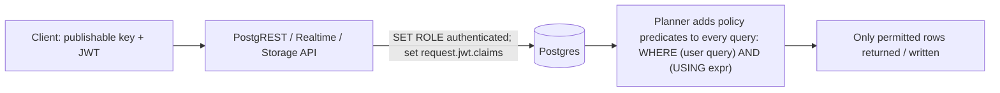

# Supabase - Row Level Security

> [!info] Deep dive of [[Supabase]]

> [!abstract] TL;DR
> With Supabase, clients query [[PostgreSQL]] directly through PostgREST/Realtime/Storage using a publishable key + the user's JWT. **Row Level Security policies are the only thing standing between users and every row.**
> - Enable RLS on every exposed table.
> - Write **per-command policies** (`select` / `insert` / `update` / `delete`) with `USING` (which rows are visible/targetable) and `WITH CHECK` (which new or updated rows are allowed).
> - Base tenant and role checks on trusted claims (`app_metadata` or membership tables), never on `user_metadata`.
> - Wrap `auth.*()` calls in `(select …)` and index policy columns for performance.
> - Test policies as real roles.

## Concept

### Roles and keys
| Request comes with | Postgres role | RLS applies? |
|---|---|---|
| Publishable key, no user session | `anon` | Yes |
| Publishable key + user access token | `authenticated` (JWT claims available) | Yes |
| Secret key (`sb_secret_…`) / legacy `service_role` | `service_role` | **No: bypasses RLS** (server-only) |
| Direct DB connection as `postgres` / table owner | Owner/superuser | Bypasses (unless `FORCE ROW LEVEL SECURITY` for owners) |

### Policy anatomy
```sql
create policy "policy name" on public.orders
  as permissive                  -- default; multiple permissive policies are OR-ed
  for update                     -- select | insert | update | delete | all
  to authenticated               -- target roles (always specify)
  using ( ... )                  -- rows the user may see/target (select, update, delete)
  with check ( ... );            -- rows the user may write (insert, update new row)
```
- **No policy = no access** once RLS is enabled (deny by default).
- **Permissive** policies are combined with OR. **Restrictive** policies (`as restrictive`) are AND-ed on top. Use them for global guards like "account not suspended" or "MFA level aal2".
- `UPDATE` needs a `SELECT` policy too (rows must be visible to be updated).

### Helper functions
| Function | Returns |
|---|---|
| `auth.uid()` | `sub` claim (user UUID) |
| `auth.jwt()` | Full claims JSON (`app_metadata`, `aal`, `role`, custom claims) |
| `auth.role()` | Legacy helper for the role claim. Prefer `TO role` in policies |

## How It Works

- PostgREST verifies the JWT, switches to the role in the token, and exposes claims through `request.jwt.claims`. Policies are **predicates appended to every query**, so their cost is paid on every row scanned.
- `(select auth.uid())` is evaluated once per statement (an InitPlan) instead of per row. On large tables that's the difference between ms and seconds. Supabase's performance advisor flags `auth_rls_initplan` when it's missing.
- **Views** run with the owner's privileges by default (bypassing RLS). Use `with (security_invoker = true)` (Postgres 15+).
- **`security definer` functions** run as their owner (often bypassing RLS). Use them deliberately for helper lookups, in a non-exposed schema, with `set search_path = ''`.

## Practical Usage

### Multi-tenant schema with a membership table
```sql
create table public.memberships (
  user_id uuid references auth.users on delete cascade,
  tenant_id uuid not null,
  role text not null check (role in ('owner','manager','staff')),
  primary key (user_id, tenant_id)
);
create index on public.memberships (user_id);
alter table public.memberships enable row level security;          -- exposed table: lock it down too
create policy "read own memberships" on public.memberships for select to authenticated
  using ( user_id = (select auth.uid()) );

-- Helper in a private schema: avoids recursive RLS on memberships and caches per statement
create schema if not exists private;
create or replace function private.user_tenants(roles text[] default null) returns setof uuid
  language sql stable security definer set search_path = '' as $$
  select tenant_id from public.memberships
  where user_id = (select auth.uid()) and (roles is null or role = any(roles))
$$;
revoke all on function private.user_tenants(text[]) from public;
grant usage on schema private to authenticated;                    -- 'private' is NOT in the API's exposed schemas
grant execute on function private.user_tenants(text[]) to authenticated;

alter table public.orders enable row level security;
create index on public.orders (tenant_id);

create policy "members read orders" on public.orders for select to authenticated
  using ( tenant_id in (select private.user_tenants()) );

create policy "members create orders" on public.orders for insert to authenticated
  with check ( tenant_id in (select private.user_tenants()) );

create policy "managers update orders" on public.orders for update to authenticated
  using ( tenant_id in (select private.user_tenants(array['owner','manager'])) )
  with check ( tenant_id in (select private.user_tenants()) );   -- can't move a row to another tenant

-- Global guard: require MFA (aal2) for writes on sensitive tables
create policy "require mfa for payouts" on public.payouts as restrictive for all to authenticated
  using ( (select auth.jwt() ->> 'aal') = 'aal2' );
```

### Claims-based variant (Custom Access Token Hook)
```sql
-- Hook adds tenant_id/role into the JWT's app_metadata at token issue time → no join per query
using ( tenant_id = (select (auth.jwt() -> 'app_metadata' ->> 'tenant_id')::uuid) )
-- Trade-off: claims are stale until the token refreshes (role changes take up to the JWT expiry)
```

### Storage policies (files per tenant folder)
```sql
create policy "tenant files read" on storage.objects for select to authenticated
  using ( bucket_id = 'invoices'
          and (storage.foldername(name))[1]::uuid in (select private.user_tenants()) );
```

### Testing policies as real users
```sql
begin;
  set local role authenticated;
  set local request.jwt.claims = '{"sub":"11111111-1111-1111-1111-111111111111","role":"authenticated"}';
  select count(*) from public.orders;                        -- should only count tenant A's rows
  insert into public.orders (tenant_id, total_sen) values ('<tenant-B-id>', 100);   -- must fail
rollback;
```
Automate this with pgTAP (`supabase test db`) in [[CI-CD]], including negative cases.

## Patterns & Anti-patterns
| Pattern | When | Anti-pattern to avoid |
|---|---|---|
| RLS enabled on **every** table in exposed schemas | Always | Tables created via SQL editor/migrations without RLS (public via the publishable key) |
| `(select auth.uid())` wrappers + indexes on `tenant_id`/`user_id` | All policies | Bare `auth.uid()` evaluated per row on million-row tables |
| Tenant/role from `app_metadata` or membership tables | Authorization | `user_metadata` (users can edit it via `updateUser`) |
| Separate `USING` and `WITH CHECK` for updates | Updates | `USING` only, letting users move rows to tenants they don't belong to |
| `security definer` helpers in a private schema with `search_path = ''` | Membership lookups | Definer functions in `public` (exposed as RPC, callable by anyone) |
| `security_invoker` views | Reporting views | Views that silently bypass RLS |

## Performance & Trade-offs
- Policies run per row scanned, so policy columns need indexes (B-tree on `tenant_id`, `user_id`), and planner-friendly forms (`in (select …)`) beat correlated `exists` joins in many cases. Check with `EXPLAIN ANALYZE` ([[PostgreSQL - Query Planning & EXPLAIN]]).
- Claims in the JWT (hook) avoid joins but go stale. Membership tables are always fresh but cost a lookup. Hybrid: tenant in claims, role from the table for sensitive writes.
- Complex policies (several ORs, functions calling functions) make every query slower and harder to reason about. Simplify the schema instead (a `tenant_id` column on every tenant-owned table).
- Supabase's **Security and Performance Advisors** (dashboard / `supabase db lint`) catch missing RLS, exposed definer functions and per-row auth calls. Run them in CI.

## Tips & Reminders
> [!tip]
> - Add `alter table … enable row level security;` in the same migration that creates the table. Make it part of a migration template.
> - Name policies descriptively. Keep one policy per command and audience for readability.
> - Never ship secret/`service_role` keys to clients (Flutter apps, Next.js client bundles, n8n workflows shared with clients). Server code using them must implement its own authorization.
> - For admin dashboards, prefer a role claim + policies over using the secret key in the backend for everything.
> - **In ZP's stack**: every client project uses `tenant_id` on tenant-owned tables, a `memberships` table, and private-schema helpers. pgTAP RLS tests run in GitHub Actions. Edge Functions/n8n use secret keys only for server-side jobs, with explicit tenant filters in their queries.

## Version Notes
| Change | Date | Impact |
|---|---|---|
| PostgreSQL RLS | 9.5 (2016) | Core feature Supabase builds on |
| Postgres 15 `security_invoker` views | 2022 | Views can respect RLS |
| Supabase Security/Performance Advisors | 2024 | Lints for missing RLS, `auth_rls_initplan`, exposed definer functions |
| Custom Access Token Hook | 2024 | Custom JWT claims (tenant, role) |
| Publishable/secret API keys, asymmetric JWT signing keys | 2025–2026 | Replace legacy `anon`/`service_role` keys (legacy removal late 2026) |

> [!warning] Unverified — check before relying on this
> A 2026 Supabase change reportedly stops auto-exposing new `public` tables to the Data API (requiring explicit grants), with enforcement on existing projects from late October 2026. This wasn't confirmed from Supabase's changelog. Check https://supabase.com/changelog and verify grants plus RLS on new tables.

## Critical Issues & Gotchas
> [!danger] RLS disabled = public database
> Supabase projects have repeatedly leaked data because a table in `public` had RLS disabled or a `using (true)` policy. The publishable key is in every client bundle, so anyone can query `/rest/v1/table?select=*`. Security researchers regularly scan apps built on Supabase (including AI-generated "vibe-coded" apps) and find exposed user tables. Enable RLS everywhere, avoid `true` policies on sensitive tables, and run the security advisor before every launch.

> [!danger] Trusting user-editable claims
> `raw_user_meta_data` / `user_metadata` can be changed by the user (`supabase.auth.updateUser({ data: { role: 'admin' } })`). Policies reading role or tenant from it are privilege-escalation bugs. Use `app_metadata` (set only server-side), membership tables, or the access-token hook.

> [!warning] Gotchas
> - `UPDATE` without a matching `SELECT` policy silently updates 0 rows. No error is raised, which looks like a bug in the app.
> - `INSERT … RETURNING` (supabase-js `.insert().select()`) also needs a `SELECT` policy for the new row.
> - Realtime Postgres Changes apply RLS per subscriber, which costs a lot at scale. Use Broadcast from the server for high-fan-out channels.
> - Policies referencing the same table (e.g. a memberships policy querying memberships) can recurse infinitely. Use definer helpers.
> - Functions exposed in `public` are callable via RPC by `anon` unless you revoke `execute`. Review grants.

## Related
- [[Supabase]]
- [[PostgreSQL]] — RLS engine, indexes, planner
- [[Authentication & Authorization]] — RBAC/ABAC, multi-tenancy, sessions
- [[Authentication & Authorization - Multi-Tenant Authorization with RLS]] — permission model on top of these mechanics
- [[JWT]] — claims, signing keys, expiry
- [[Testing Strategy]] — pgTAP and authorization matrices
- [[OWASP Top 10]] — A01 Broken Access Control

## References
- Supabase RLS guide: https://supabase.com/docs/guides/database/postgres/row-level-security
- RLS performance recommendations: https://supabase.com/docs/guides/troubleshooting/rls-performance-and-best-practices-Z5Jjwv
- Custom Access Token Hook: https://supabase.com/docs/guides/auth/auth-hooks/custom-access-token-hook
- Database testing with pgTAP: https://supabase.com/docs/guides/database/testing
- PostgreSQL row security policies: https://www.postgresql.org/docs/current/ddl-rowsecurity.html
- Supabase API keys: https://supabase.com/docs/guides/api/api-keys
