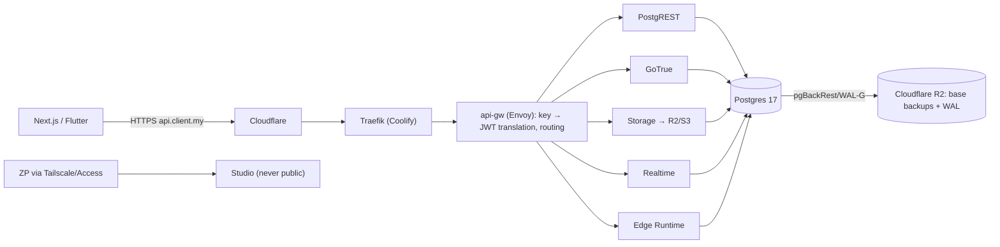

# Supabase - Self-Hosting with Docker & Coolify

> [!info] Deep dive of [[Supabase]]

> [!abstract] TL;DR
> Self-hosted Supabase is the official Docker Compose stack, deployable via Coolify's template:
> - Postgres, **Envoy** API gateway (default since Aug 2026, Kong optional), Auth (GoTrue), PostgREST, Realtime, Storage + imgproxy, Edge Runtime, Studio, Supavisor, optional analytics.
>
> It's one project per stack, and **you own** secrets, TLS, backups (no managed PITR), upgrades, monitoring and security patches. There's no branching, and the dashboard features are fewer.
> Choose it for **data residency, cost at scale, or offline/on-prem clients**. Otherwise Supabase Cloud (Singapore region) is usually cheaper once your time is counted.

## Concept
| Component (service) | Role | Self-hosting notes |
|---|---|---|
| `db` (Postgres 17 image with Supabase extensions) | Data, auth/storage schemas | Size RAM; WAL archiving for PITR is DIY |
| `api-gw` (Envoy) | Routes `/rest`, `/auth`, `/storage`, `/realtime`, `/functions`. Translates opaque keys → JWTs | Replaced Kong (Aug 2026). TLS terminated by Caddy/Nginx override or your proxy (Traefik) |
| `auth` (GoTrue) | Users, sessions, OAuth, OTP | Needs SMTP, site URL, redirect allowlist |
| `rest` (PostgREST) | Auto REST API | Exposed schemas config |
| `realtime` | Broadcast, presence, Postgres changes | Memory-hungry with many connections |
| `storage` + `imgproxy` | Object storage API + transforms | File backend (local volume) or S3/R2 backend |
| `functions` (Edge Runtime) | Deno functions | Deploy by copying function folders |
| `studio` + `meta` | Dashboard + Postgres metadata API | **Must not be public**. Protect behind Access/Tailscale |
| `supavisor` | Connection pooler | Transaction/session modes like Cloud |
| `analytics` (Logflare) + `vector` | Logs | Heavy. Many small deployments disable it |

**Cloud vs self-hosted**:

| Capability | Cloud | Self-hosted |
|---|---|---|
| Backups / PITR | Managed (plan-dependent) | DIY (pgBackRest/WAL-G to R2) |
| Branching, advisors UI, usage reports | ✅ | Partial / none |
| Upgrades | Managed (with windows) | You pull images, run migrations, test |
| Multiple projects | Org with many projects | One stack per project (more RAM) |
| Data location | Supabase regions (e.g. Singapore) | Anywhere (client's server, Malaysia DC) |
| Cost at scale | Usage-based | VPS cost + **your ops time** |

## How It Works


## Practical Usage
**Bootstrap the official stack** (on a dedicated VPS, or as a Coolify Compose resource):
```bash
git clone --depth 1 https://github.com/supabase/supabase && cp -r supabase/docker ./supabase-project && cd supabase-project
cp .env.example .env
sh ./utils/generate-keys.sh          # JWT secret, legacy anon/service keys, dashboard creds (check script output)
sh ./utils/add-new-auth-keys.sh      # opaque sb_publishable/sb_secret keys + ES256 JWT_KEYS (per community guides; verify)
docker compose pull && docker compose up -d
docker compose ps                     # all healthy before exposing anything
```
**Key `.env` settings to review**:
```bash
POSTGRES_PASSWORD=<generated>              # never reuse across clients
SITE_URL=https://app.client.my
ADDITIONAL_REDIRECT_URLS=https://app.client.my/**,myapp://login-callback
API_EXTERNAL_URL=https://api.client.my
SMTP_HOST=smtp.resend.com  SMTP_PORT=587  SMTP_USER=resend  SMTP_PASS=<secret>  SMTP_ADMIN_EMAIL=noreply@client.my
DASHBOARD_USERNAME=<unique>  DASHBOARD_PASSWORD=<long random>     # plus network restriction, not just basic auth
STORAGE_BACKEND=s3  GLOBAL_S3_BUCKET=client-storage  # R2 endpoint + keys for durable object storage
ENABLE_PHONE_SIGNUP=false                   # enable only with captcha + rate limits
```
**Expose only the API via Traefik; keep Studio private** (Coolify labels/domains):
```text
api.client.my     → api-gw:8000   (public, Cloudflare proxied, WAF + rate limits)
studio.internal   → studio:3000   (no public domain; reach via Tailscale or Cloudflare Access)
Postgres 5432     → not published (Supavisor/DB only on the Docker network or tailnet IP)
```
**Backups with WAL archiving** (sketch; pgBackRest in a sidecar):
```ini
# pgbackrest.conf
[global]
repo1-type=s3
repo1-s3-endpoint=<account>.r2.cloudflarestorage.com
repo1-s3-bucket=client-pg-backups
repo1-s3-region=auto
repo1-retention-full=4
[main]
pg1-path=/var/lib/postgresql/data
```
```bash
pgbackrest --stanza=main --type=full backup     # weekly full; archive_command ships WAL continuously
pgbackrest --stanza=main --type=diff backup     # daily diff
```
**Wrong way**:
```text
❌ Studio on a public domain with default/weak dashboard creds → full database admin for the internet
❌ Using .env.example demo JWT secret/keys                      → anyone can mint service_role tokens
❌ Storage on the container's local volume without backups      → one disk failure loses all uploads
❌ Pulling :latest images on a whim                             → gateway switch (Kong → Envoy) breaks routing scripts
```

## Patterns & Anti-patterns
| Pattern | When | Anti-pattern to avoid |
|---|---|---|
| Dedicated VPS per production stack (8–16 GB RAM) | Client production | Co-hosting with n8n, Chatwoot and 10 apps on 8 GB |
| Pin image versions, upgrade via staging copy | All self-hosted stacks | `docker compose pull` in production directly |
| Storage on R2/S3, DB backups to R2 with WAL | Durability | Local-volume-only storage |
| Studio/meta behind Tailscale or Cloudflare Access | Always | Public dashboard |
| Disable analytics/Logflare if unused | Small servers | Running every optional service by default |
| Same migrations repo as Cloud (`supabase db push --db-url`) | Mixed Cloud/self-hosted | Manual schema edits in Studio |
| Restore drills to a scratch VPS quarterly | Production | Assuming backups work |

## Performance & Trade-offs
- **Resource footprint**: the full stack idles at ~2–4 GB RAM (more with analytics). Postgres needs the rest, so 8 GB is a practical minimum for production with real data, and 16 GB is comfortable.
- **Ops time**: patching (Postgres, GoTrue, PostgREST, Envoy, Studio), cert renewals, backups, monitoring and incident response. Budget several hours a month per stack, and price it into the client retainer.
- **Cost crossover**: Cloud Pro + compute often beats self-hosting until egress, compute size or data-residency rules dominate. Calculate with your hourly rate, not just VPS prices.
- **Feature lag**: some Cloud features (branching, advisors UI, log explorer) are missing or behind in self-hosted. Check before promising them.

## Tips & Reminders
> [!tip] In ZP's stack
> - **Default for SME clients is Supabase Cloud (Singapore)**. Self-host only when the client requires data on their own servers, wants a fixed cost at scale, or needs an on-prem/offline deployment.
> - **On Coolify**: use the Supabase service template or the upstream compose as a Compose resource, check which gateway (Envoy vs Kong) and versions it deploys, put API domains on Traefik, and keep everything else private ([[Coolify - One-Click Services & Compose Deployments]]).
> - **SOW**: state clearly who owns backups, upgrades, uptime and security patches for a self-hosted stack. This is a liability boundary.

- Store all generated secrets in your secrets manager per client ([[CI-CD - Secrets Management with SOPS & Infisical]]).
- Monitor Postgres disk, connections and WAL archive lag, and alert to Telegram ([[Docker - Logging, Metrics & Resource Limits on a VPS]]).
- Keep a runbook for rotating JWT/opaque keys, and test client app behaviour after rotation.
- Follow Supabase's self-hosting changelog. Breaking changes (like the gateway switch) land in the compose files on `master`.

## Version Notes
| Date | Change |
|---|---|
| 2024–25 | Supavisor replaces PgBouncer in the stack. Postgres 17 image for new installs |
| 2025–26 | Opaque API keys (`sb_publishable_*`, `sb_secret_*`) and asymmetric (ES256) session JWTs supported self-hosted via `JWT_KEYS` |
| Week of 2026-08-09 | **Envoy becomes the default gateway** (`api-gw`, container `supabase-envoy`). Kong is an optional override. Kong's 8443 HTTPS listener isn't in the Envoy default, so terminate TLS with the Caddy/Nginx override or your proxy |

> [!warning] Unverified — check before relying on this
> Coolify's Supabase template version/gateway, exact env variable names in the current compose file, and the helper script names come from community guides. Check https://supabase.com/docs/guides/self-hosting/docker and the repo's `docker/` folder before deploying.

## Critical Issues & Gotchas
> [!danger] Default or leaked secrets = total compromise
> The JWT secret (or signing keys) lets anyone mint `service_role` tokens that bypass RLS. Demo values from `.env.example`, secrets committed to git, or a public Studio expose every table and file. Generate unique secrets per stack, store them in a secrets manager, rotate them on staff/vendor changes, and never expose Studio or Postgres publicly.

> [!danger] Self-hosted without tested backups
> There's no managed PITR. If WAL archiving isn't configured or verified, a disk failure, a bad migration or ransomware means losing everything since the last dump. Configure pgBackRest/WAL-G to R2, monitor archive lag, and restore to a scratch server regularly ([[PostgreSQL - Backups, PITR & Restore Drills]]).

- **Gateway switch breakage**: scripts or Traefik labels referencing `kong`/`supabase-kong` stop working after pulling the Envoy default. Update routing, or pin the Kong override deliberately.
- **Opaque key translation** is enabled only when all four new key variables are set, otherwise Envoy accepts legacy HS256 keys only. Mixed setups confuse clients.
- **SMTP**: without proper SMTP, auth emails fail silently. Set SPF/DKIM for the sending domain ([[Cloudflare - DNS, Email Authentication & Domain Ops]]).
- **Upgrading Postgres major versions** in the stack needs `pg_upgrade` or dump/restore, not just a new image tag ([[PostgreSQL - Major Version Upgrades & Migrations]]).

## Related
- [[Supabase]]
- [[Coolify - One-Click Services & Compose Deployments]] — deploying the stack as a Coolify service
- [[PostgreSQL - Backups, PITR & Restore Drills]] — WAL archiving and restore drills
- [[Supabase - Migrations, Branching & Local Development]] — same migrations for Cloud and self-hosted
- [[Docker - Compose Patterns for Production]] — compose hygiene, limits, healthchecks
- [[Linux Essentials - Networking, Firewalls & Tailscale]] — keeping Studio and Postgres private

## References
- https://supabase.com/docs/guides/self-hosting/docker
- https://supabase.com/docs/guides/self-hosting/self-hosted-envoy
- https://supabase.com/docs/guides/self-hosting/self-hosted-auth-keys
- https://supabase.com/changelog/48048-self-hosted-supabase-envoy-becomes-the-default-api-gateway-b
- https://www.issoh.co.jp/tech/details/17074/
