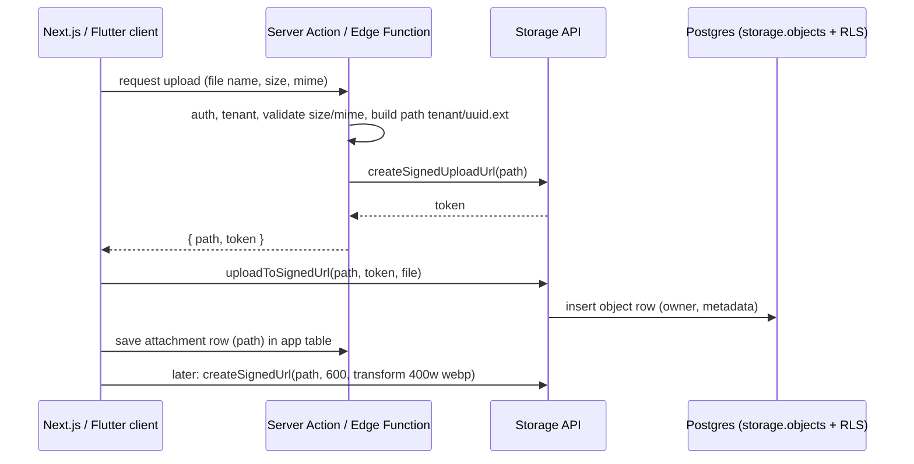

# Supabase - Storage, Uploads & Image Transformations

> [!info] Deep dive of [[Supabase]]

> [!abstract] TL;DR
> Supabase Storage is S3-compatible object storage whose metadata lives in Postgres (`storage.objects`), so **RLS policies decide who can upload, read, overwrite and delete**.
> - Use **private buckets** with path conventions (`{tenant_id}/{user_id}/…`) and policies on `storage.foldername(name)`.
> - Upload from the client directly (standard upload ≤ 6 MB, **TUS resumable** above), or via a **signed upload URL** minted on the server.
> - Serve via short-lived **signed URLs**, with on-the-fly **image transformations** (Pro+) baked into the token.
> - Large public assets, backups and heavy egress fit [[Cloudflare - R2 Storage & Presigned Uploads|R2]] better.

## Concept
| Piece | What it is | Key facts |
|---|---|---|
| Bucket | Container with `public`, `file_size_limit`, `allowed_mime_types` | Private by default. Public = anyone with the URL can read (RLS still guards writes) |
| `storage.objects` | One row per object: `bucket_id`, `name` (path), `owner`, `metadata` | RLS here is the access control. Helpers: `storage.foldername()`, `storage.filename()`, `storage.extension()` |
| Standard upload | Single POST | Best ≤ 6 MB. Max file size per project setting (Free 50 MB) |
| Resumable upload (TUS) | `/storage/v1/upload/resumable`, 6 MB chunks | Large files, flaky mobile networks. Resumes after drops |
| Signed upload URL | `createSignedUploadUrl(path)` → token valid ~2 h | Server decides the path. Client uploads without needing an insert policy |
| Signed URL | `createSignedUrl(path, expiresIn, { transform })` | Read access for private objects. Transform options are fixed inside the token |
| Image transformations | Resize/quality/format on read (`width`, `height`, `resize`, `quality`, WebP auto) | Pro+. 1–2500 px, source ≤ 25 MB, ≤ 50 MP |
| S3 protocol | S3 endpoint with access keys or session token | Access keys **bypass RLS** (server/tools only) |

**Which RLS operation each API call needs**:

| Client action | Policy needed on `storage.objects` |
|---|---|
| `upload` | `INSERT` |
| `upload` with `upsert: true` | `INSERT` + `SELECT` + `UPDATE` |
| `download`, `createSignedUrl`, `list` | `SELECT` |
| `move`, `copy` | `SELECT` + `UPDATE` (move) / `INSERT` (copy) |
| `remove` | `SELECT` + `DELETE` |

## How It Works


## Practical Usage
**Private bucket with limits** (SQL migration):
```sql
insert into storage.buckets (id, name, public, file_size_limit, allowed_mime_types)
values ('receipts', 'receipts', false, 10485760, array['image/jpeg','image/png','image/webp','application/pdf'])
on conflict (id) do nothing;
```
**Tenant-scoped policies** (path = `{tenant_id}/{object}`; tenant from the JWT claim):
```sql
create policy "tenant members read receipts" on storage.objects for select to authenticated
using (bucket_id = 'receipts' and (storage.foldername(name))[1] = (auth.jwt() ->> 'tenant_id'));

create policy "tenant members upload receipts" on storage.objects for insert to authenticated
with check (bucket_id = 'receipts' and (storage.foldername(name))[1] = (auth.jwt() ->> 'tenant_id'));

create policy "owners delete own receipts" on storage.objects for delete to authenticated
using (bucket_id = 'receipts' and owner_id = (select auth.uid()::text));
```
**Server-minted signed upload** (Next.js Server Action; path decided server-side):
```ts
'use server';
export const startReceiptUpload = authedAction(
  z.object({ mime: z.enum(['image/jpeg', 'image/png', 'image/webp', 'application/pdf']), size: z.number().max(10 * 1024 * 1024) }),
  {},
  async ({ mime }, { tenantId }) => {
    const path = `${tenantId}/${crypto.randomUUID()}.${mime.split('/')[1]}`;
    const { data, error } = await supabaseServer().storage.from('receipts').createSignedUploadUrl(path);
    if (error) throw error;
    return { path, token: data.token };
  },
);
// client
await supabase.storage.from('receipts').uploadToSignedUrl(path, token, file, { contentType: file.type });
```
**Resumable upload from Flutter** (large videos/PDFs; TUS client against the resumable endpoint):
```dart
// package: tus_client_dart (API differs slightly between versions)
final client = TusClient(file, store: TusMemoryStore());
await client.upload(
  uri: Uri.parse('$supabaseUrl/storage/v1/upload/resumable'),
  headers: {'Authorization': 'Bearer ${session.accessToken}', 'x-upsert': 'false'},
  metadata: {'bucketName': 'media', 'objectName': '$tenantId/$id.mp4', 'contentType': 'video/mp4'},
  onProgress: (p, _) => setState(() => progress = p),
);
```
**Thumbnails on read** (signed URL with transform):
```ts
const { data } = await supabase.storage.from('products').createSignedUrl(path, 600, {
  transform: { width: 400, height: 400, resize: 'cover', quality: 70 },   // WebP served automatically if supported
});
```
**Wrong way**:
```sql
delete from storage.objects where bucket_id = 'receipts';        -- ❌ orphans files in the backing store; use the Storage API
create policy "all" on storage.objects for all using (true);     -- ❌ any signed-in user reads/overwrites every tenant's files
```
```ts
supabase.storage.from('receipts').upload(`${form.tenantId}/${form.name}`, file);   // ❌ client-chosen tenant + filename (overwrite, traversal-ish names)
```

## Patterns & Anti-patterns
| Pattern | When | Anti-pattern to avoid |
|---|---|---|
| Private bucket + tenant folder + RLS on `foldername()[1]` | Multi-tenant SaaS | One public bucket for everything |
| Server-chosen object keys (UUID) | All uploads | User-supplied file names as keys |
| Bucket `file_size_limit` + `allowed_mime_types` | Every bucket | Validating only in the UI |
| App table row referencing the path (FK-like) | Attachments, receipts | Listing buckets to find "the user's files" |
| Signed URLs with short expiry (5–60 min) | Private documents | Long-lived signed URLs shared in WhatsApp messages |
| Compress/resize on the client before upload | Phone photos (5–12 MB) | Uploading originals then transforming every view |
| R2 for large public media and backups | High egress | Paying Supabase egress for marketing videos |

## Performance & Trade-offs
- **Transformations cost money per origin image transformed** (a secondary source reports 100 free/month, then about $5 per 1,000, so check the pricing page). Use a fixed set of sizes (thumb/card/full) so the CDN caches them, instead of arbitrary widths.
- **CDN caching**: `cacheControl` on upload (default 3600 s). Smart CDN (Pro+) invalidates on overwrite. Without it, use new keys on change (`{id}-{version}.webp`).
- **Egress**: Supabase bills storage egress beyond the plan quota. [[Cloudflare]] R2 has zero egress, so it's cheaper for heavy public media.
- **RLS cost**: policies run per object row. Keep them index-friendly (`bucket_id` + path prefix) and avoid joins per row. Put membership in JWT claims ([[Supabase - Auth Flows, MFA & Custom Claims]]).
- **Mobile**: TUS chunks (6 MB) survive network switches. Standard uploads restart from zero.

## Tips & Reminders
> [!tip] In ZP's stack
> - **SME apps** (receipts, product photos, IC/document uploads for KYC-like flows): private buckets per data class, path `tenant/uuid`, signed upload from a Server Action, an attachment table row, and signed read URLs.
> - **Public marketing assets** go to R2 behind Cloudflare. **DB backups** go to R2 too, never into the project's own Storage.
> - **Flutter**: compress with `flutter_image_compress` (≈ 1600 px, quality 75) before upload, and use TUS for files > 6 MB ([[Flutter - Offline Storage & Sync]] for queued uploads).

- Store `content_type` and size in your table, and re-check them with a trigger or the bucket limits.
- Generate thumbnails once (Edge Function or worker) if you exceed transformation budgets.
- Clean up orphaned objects with a nightly job: objects without a referencing row, older than 24 h ([[Supabase - Edge Functions, Cron & Queues]]).
- For documents with personal data (IC, bank statements), set a retention period and delete via the Storage API when it expires (PDPA).

## Version Notes
| Date | Change |
|---|---|
| 2022–23 | Storage v3: resumable uploads (TUS), image transformations, Smart CDN |
| 2024 | S3 protocol compatibility (access keys + session tokens) |
| 2025–26 | New publishable/secret API keys. Legacy `anon`/`service_role` keys removed late 2026, so update server code that signs URLs ([[Supabase]]) |

> [!warning] Unverified — check before relying on this
> Transformation pricing, egress quotas and the signed-upload token lifetime (~2 h) weren't confirmed on the official pricing/docs pages this run. Check https://supabase.com/docs/guides/storage and https://supabase.com/pricing.

## Critical Issues & Gotchas
> [!danger] Public buckets are public forever
> Anything in a public bucket is readable by anyone who guesses or receives the URL, and caches/CDNs keep copies after deletion. Never put IC scans, receipts or contracts in a public bucket. Moving files to private later doesn't recall copies already shared.

> [!danger] S3 access keys and the service key bypass RLS
> S3 access keys and the secret key ignore every storage policy. Keep them on the server or in backup tooling only, scope them per project, and rotate them if they leak (n8n credentials, CI logs).

- **`upsert` needs SELECT + UPDATE policies**: without them uploads fail with an RLS error that looks like a permissions bug in the bucket.
- **Deleting rows via SQL** leaves files behind (and is blocked or discouraged on the platform). Always call `remove()`.
- **Transform limits**: images over 25 MB or 50 MP fail to transform, so phone panoramas break thumbnails. Resize on the client.
- **Signed URL expiry is not revocation**: a leaked 7-day URL stays valid for 7 days. Keep expiries short and re-issue on demand.
- **MIME spoofing**: `allowed_mime_types` trusts the declared type. For risky formats, verify magic bytes in a worker before marking the file as accepted.

## Related
- [[Supabase]]
- [[Supabase - Row Level Security]] — policy patterns reused on `storage.objects`
- [[Cloudflare - R2 Storage & Presigned Uploads]] — zero-egress alternative for public media and backups
- [[Supabase - Auth Flows, MFA & Custom Claims]] — tenant claims used in storage policies
- [[Next.js - Server Actions, Mutations & Security]] — minting signed upload URLs safely
- [[Flutter - Offline Storage & Sync]] — queued uploads from mobile

## References
- https://supabase.com/docs/guides/storage
- https://supabase.com/docs/guides/storage/security/access-control
- https://supabase.com/docs/guides/storage/uploads/resumable-uploads
- https://supabase.com/docs/guides/storage/serving/image-transformations
- https://eastondev.com/blog/en/posts/dev/20260409-supabase-storage/
