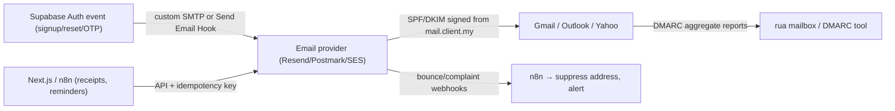

# Supabase - Transactional Email, Auth SMTP & Deliverability

> [!info] Deep dive of [[Supabase]]

> [!abstract] TL;DR
> - **Supabase's built-in email** is for development only: it sends only to your project team's addresses and has a very low hourly rate limit.
> - **Production** must configure **custom SMTP** (Resend, Postmark, Amazon SES, Brevo, Mailgun) or a **Send Email Hook** that calls your provider's API.
> - **Deliverability basics**:
>   - send from a subdomain you control (`mail.client.my`);
>   - **SPF + DKIM + DMARC** aligned;
>   - separate transactional from marketing streams;
>   - handle bounces and complaints.
>
>   Gmail/Yahoo enforce authentication, and for bulk senders, one-click unsubscribe and low spam rates.
> - **Magic links get "clicked" by email security scanners**, which consume one-time tokens. Prefer **OTP codes**, or a confirmation page where the user clicks a button (POST) to verify the `token_hash`.

## Concept
| Email type | Examples | Sender/stream |
|---|---|---|
| Auth | Confirm signup, magic link/OTP, password reset, email change, invite | Supabase Auth via custom SMTP / hook |
| Transactional | Order confirmation, receipts, booking reminders, invoices | Your app/n8n via provider API |
| Notifications | Weekly summary, alerts | Transactional stream, with preferences |
| Marketing | Promotions, newsletters | Separate provider/stream + unsubscribe + consent |

**Provider comparison** (pick one per client, client-owned account):

| Provider | Strength | Watch out |
|---|---|---|
| Resend | Great DX, React Email, simple API | Newer. Check regional deliverability |
| Postmark | Excellent transactional deliverability, separate streams | Strict on marketing content |
| Amazon SES | Cheapest at volume | Sandbox approval, more setup, reputation management on you |
| Brevo / Mailgun | Transactional + marketing in one | Shared IP reputation varies |

## How It Works


## Practical Usage
**DNS records** (Cloudflare zone, example for Resend/Postmark-style setup):
```text
mail.client.my        TXT   "v=spf1 include:amazonses.com ~all"          # provider-specific include
resend._domainkey.mail.client.my  TXT  "p=MIGfMA0GCSq..."                 # DKIM key from provider
_dmarc.client.my      TXT   "v=DMARC1; p=quarantine; rua=mailto:dmarc@client.my; adkim=s; aspf=r; pct=100"
```
**Supabase custom SMTP** (Dashboard → Authentication → Emails/SMTP settings):
```text
Host: smtp.resend.com   Port: 465   User: resend   Password: <API key>
Sender: "Kedai ABC" <no-reply@mail.client.my>
Then raise Auth email rate limits to match expected signups (Auth → Rate Limits)
```
**OTP instead of magic link** (scanner-proof):
```ts
await supabase.auth.signInWithOtp({ email, options: { shouldCreateUser: true } });   // template shows {{ .Token }}
const { error } = await supabase.auth.verifyOtp({ email, token: code, type: "email" });
```
**Confirmation page pattern for links** (email links to your page, user clicks to verify):
```html
<!-- Supabase email template (Confirm signup) -->
<a href="{{ .SiteURL }}/auth/confirm?token_hash={{ .TokenHash }}&type=email&next=/welcome">Confirm your email</a>
```
```ts
// app/auth/confirm/page.tsx renders a button; the POST handler does:
await supabase.auth.verifyOtp({ token_hash, type: "email" });     // scanners doing GET don't consume the token
```
**Transactional email from a worker** (idempotent):
```ts
await resend.emails.send(
  { from: "Kedai ABC <orders@mail.client.my>", to: order.email, subject: `Order #${order.code} confirmed`,
    react: OrderConfirmation({ order }) },
  { idempotencyKey: `order-confirm-${order.id}` }
);
```
**Wrong way**:
```text
❌ Going live on Supabase's default SMTP          → signups never get confirmation emails
❌ Sending from @gmail.com or the client's root domain without DKIM → spam folder / rejected
❌ Marketing blasts from the transactional domain  → complaints damage auth email deliverability
❌ Magic link single-use GET consumed by scanners  → "link expired" support tickets
```

## Patterns & Anti-patterns
| Pattern | When | Anti-pattern to avoid |
|---|---|---|
| Dedicated sending subdomain (`mail.`) | All clients | Sending from root domain with existing SPF chaos |
| SPF + DKIM + DMARC (start `p=none`, move to `quarantine`) | Always | No DMARC |
| Separate transactional and marketing streams/domains | Mixed email | One stream for everything |
| OTP codes or POST-confirm links | Auth emails | Raw magic links consumed by scanners |
| Bounce/complaint webhooks → suppression list | Always | Retrying hard bounces forever |
| Client-owned provider account | Handover | Your account sending for all clients |
| Templates in BM/EN with plain-text part | Malaysian audiences | HTML-only, English-only |

## Performance & Trade-offs
- **Custom SMTP vs Send Email Hook**: SMTP is simple and works with dashboard templates. The hook (Edge Function/HTTP) gives full control (React Email, localization, logging) but more code ([[Supabase - Auth Flows, MFA & Custom Claims]]).
- **Shared vs dedicated IPs**: low volume (most SMEs) belongs on shared IPs of a reputable provider. Dedicated IPs need consistent volume to warm up.
- **Latency**: auth emails should arrive within seconds. Queue transactional emails, but don't batch OTPs.
- **Cost**: most providers' free/low tiers cover SME volumes. SES is cheapest but carries more ops.

## Tips & Reminders
> [!tip] In ZP's stack
> - **Per client**: provider account in the client's name, DNS in their Cloudflare zone, Supabase SMTP configured, DMARC reports to an address they own. Include it in the handover checklist ([[Cloudflare - DNS, Email Authentication & Domain Ops]]).
> - **WhatsApp vs email**: Malaysian customers often prefer WhatsApp for receipts and reminders. Use email for auth, invoices and formal records, and WhatsApp for real-time notifications.
> - **Inbound replies** to no-reply addresses: route via Cloudflare Email Routing to a shared inbox or n8n ([[Cloudflare - Email Routing & Email Workers]]).

- Test with mail-tester.com / Gmail "Show original" (SPF/DKIM/DMARC = PASS).
- Keep subject lines clear and non-promotional for auth mails.
- Set `Site URL` and redirect allow-list correctly, or links point to localhost or production incorrectly.
- Monitor provider dashboards for bounce rate (< 2%) and complaint rate (< 0.1%).

## Version Notes
| Date | Change relevant here |
|---|---|
| 2024-02 | Gmail/Yahoo sender requirements: authentication for all, DMARC + one-click unsubscribe + spam-rate thresholds for bulk senders |
| 2024 | Supabase restricts built-in SMTP to project team addresses with low rate limits. Custom SMTP required for production |
| 2024–25 | Supabase Auth Hooks (Send Email Hook, Send SMS Hook) |
| 2025–26 | Microsoft (Outlook.com) enforces similar bulk-sender authentication rules |

> [!warning] Unverified — check before relying on this
> Current Supabase built-in email limits, the exact template variable names (`{{ .TokenHash }}`), and Microsoft's enforcement timeline weren't verified this run. Check Supabase Auth email docs and provider DNS instructions.

## Critical Issues & Gotchas
> [!danger] Launching without custom SMTP
> On the default Supabase mailer, real users never receive confirmation or reset emails (restricted recipients, tiny rate limits). Launches look "broken", and signups drop silently. Configure custom SMTP, raise rate limits, and test with a non-team address before go-live.

> [!danger] Spoofing and phishing in the client's name
> Without DMARC enforcement, attackers can send emails appearing to come from the client's domain (fake invoices, payment requests). That's a real risk for SMEs handling payments. Publish DMARC, move to `p=quarantine`/`reject` after monitoring, and align SPF/DKIM for every legitimate sender (Google Workspace, provider, CRM).

- **SPF 10-lookup limit**: many `include:`s (Workspace + provider + CRM) break SPF. Use a subdomain per sender.
- **Email change flows** send to both old and new addresses. Configure "Secure email change".
- **Rate limits** on Auth emails (per hour) can block bulk invites. Plan invites in batches.
- **Localization**: dashboard templates are single-language. Use the Send Email Hook for BM/EN/ZH variants.

## Related
- [[Supabase]]
- [[Cloudflare - DNS, Email Authentication & Domain Ops]] — SPF/DKIM/DMARC records
- [[Supabase - Auth Flows, MFA & Custom Claims]] — Auth hooks and flows
- [[Supabase - Edge Functions, Cron & Queues]] — hook implementation, queued sends
- [[Authentication & Authorization - Session Management & Account Recovery]] — reset flows
- [[Cloudflare - Email Routing & Email Workers]] — inbound email handling

## References
- https://supabase.com/docs/guides/auth/auth-smtp
- https://supabase.com/docs/guides/auth/auth-email-templates
- https://supabase.com/docs/guides/auth/auth-hooks/send-email-hook
- https://support.google.com/a/answer/81126
- https://dmarc.org/overview/
