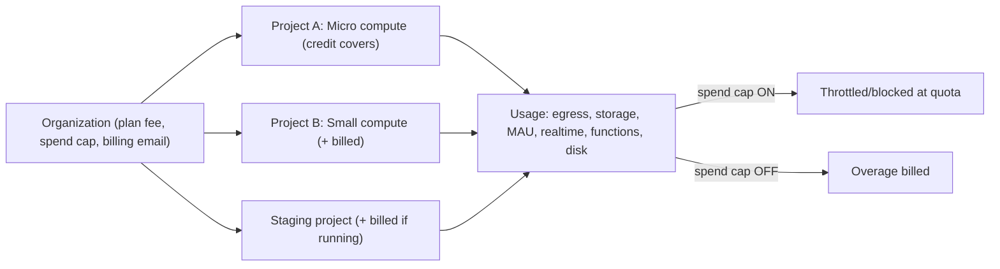

# Supabase - Usage, Cost Control & Plan Limits

> [!info] Deep dive of [[Supabase]]

> [!abstract] TL;DR
> Supabase bills **per organization** (plan fee) plus **per project** (compute size) plus **usage** (egress, storage, MAU, Realtime, Edge Function invocations, disk).
> - **Pro**: US$25/org/month with a **US$10 compute credit** (≈ one Micro instance). Each extra project adds its own compute (~US$10+/month), so ten small client projects in one org don't cost US$25.
> - **Spend cap** (on by default) blocks overage-billable usage at quota. Turning it off uncaps egress/MAU bills.
> - **Biggest surprises**: egress (images, large JSON, Realtime fanout), disk auto-growth, many projects per org, Branching compute, and PITR/IPv4 add-ons.
>
> For SME clients, put each client in **their own organization on their own card**, or bill pass-through with a margin and clear limits in the contract.

## Concept
| Cost driver | Unit | Typical surprise | Control |
|---|---|---|---|
| Plan | Per org/month | Paying Pro per client org | Decide org structure early |
| Compute | Per project, hourly by instance size | Unused staging projects running 24/7 | Pause/delete idle projects. Right-size |
| Database disk | GB provisioned (auto-grows) | Disk grows with bloat/logs and doesn't shrink automatically | Vacuum, prune logs/executions, archive |
| Egress | GB out (DB, Storage, Realtime, Functions) | Unoptimized images, `select *` APIs, mobile polling | CDN in front of Storage, select columns, cache |
| Storage | GB stored + transformations | Raw phone photos (5–10 MB each) | Client-side compression, size limits |
| MAU | Monthly active auth users | Public app with anonymous sign-ins | Anonymous users count. Gate sign-in |
| Realtime | Messages + peak connections | Postgres Changes fanout to many clients | Broadcast, filter, throttle |
| Edge Functions | Invocations | Cron every minute × many tenants | Batch, longer intervals |
| Add-ons | PITR, IPv4, custom domain, log drains | Enabled "just in case" per project | Enable per need |

**Plans at a glance** (verify on the pricing page):

| | Free | Pro | Team | Enterprise |
|---|---|---|---|---|
| Price | US$0 | US$25/org + compute | US$599/org + compute | Custom |
| Projects | 2 active, **pause on inactivity** | No pausing | Same as Pro + SSO, SOC2 reports, longer logs | — |
| Use for | Prototypes, demos | Production client apps | Agencies needing compliance features | Large orgs |

## How It Works


## Practical Usage
**Find what's eating disk and egress** (SQL editor):
```sql
-- largest tables (incl. indexes/toast)
select relname, pg_size_pretty(pg_total_relation_size(relid)) as total
from pg_catalog.pg_statio_user_tables order by pg_total_relation_size(relid) desc limit 15;

-- dead tuples piling up (bloat → disk growth)
select relname, n_dead_tup, last_autovacuum from pg_stat_user_tables order by n_dead_tup desc limit 10;

-- heaviest queries by total time (often also the heaviest egress)
select calls, round(total_exec_time) as ms, rows, left(query, 120)
from extensions.pg_stat_statements order by total_exec_time desc limit 10;
```
**Cut egress on images**: serve Storage through a CDN with long cache, and resize on upload.
```ts
// Next.js: request a transformed, cached variant instead of the original
const { data } = supabase.storage.from("products").getPublicUrl(path, {
  transform: { width: 640, quality: 70, resize: "contain" },
});
```
**Prune log-style tables on a schedule** (pg_cron):
```sql
select cron.schedule('prune-events', '15 3 * * *',
  $$ delete from public.webhook_events where created_at < now() - interval '30 days' $$);
```
**Budget alert outside Supabase** (n8n weekly): call the Management API for org usage, or check the billing page export, and post a Telegram summary per client with usage vs plan quota.

**Wrong way**:
```text
❌ One "agency" org with 12 client projects on Pro       → 12 × compute, unclear who pays, one card for everything
❌ Spend cap off with public file downloads              → a viral/hotlinked file = surprise egress bill
❌ Staging + preview branches left running all month     → compute billed per hour each
❌ Storing raw 8 MB phone photos and serving them as-is  → storage + egress both explode
```

## Patterns & Anti-patterns
| Pattern | When | Anti-pattern to avoid |
|---|---|---|
| Org per client, client's card, you as member | Client production apps | Your card paying for clients indefinitely |
| Shared multi-tenant project for your own SaaS | Many small tenants | Project per tenant (compute × N) |
| Spend cap ON until usage is understood | New launches | Cap off "to avoid downtime" with no alerts |
| CDN (Cloudflare) + transformed images | Image-heavy apps | Serving originals directly |
| Select columns, paginate, cache read-heavy endpoints | APIs/mobile | `select *` with nested relations |
| Monthly usage review in retainer | Maintenance contracts | Discovering overages from the invoice |
| Self-host only with a real ops budget | Cost-sensitive, steady load | Self-hosting to save US$25 ([[Supabase - Self-Hosting with Docker & Coolify]]) |

## Performance & Trade-offs
- **Compute size vs connections**: Micro/Small instances have low connection limits and RAM. Use the pooler (transaction mode) before upsizing ([[Supabase - Performance Tuning & Advisors]]).
- **Egress vs CDN**: Cloudflare in front of public Storage cuts egress and latency for Malaysian users. Signed URLs for private files limit cacheability ([[Cloudflare - Caching Rules, CDN & Cache Purging]]).
- **Realtime cost** scales with subscribers × changes. Broadcast from a server or polling every 30–60 s can be cheaper for dashboards.
- **Self-hosted vs Cloud**: a ~RM 50–100/month VPS beats Cloud on raw price, but backups, upgrades, Auth email, monitoring and security patches are now your unpaid hours.

## Tips & Reminders
> [!tip] In ZP's stack
> - **Quote structure**: separate "infrastructure (pass-through, est. US$25–40/month on Pro)" from your retainer, and state that usage beyond plan quotas is billed at cost. That protects you from overage disputes.
> - **Client ownership**: create the org under the client's email (or transfer it at handover), and add yourself as a developer member. It avoids lock-in complaints and PDPA data-controller confusion.
> - **Your own SaaS**: one multi-tenant project with RLS keeps compute flat as tenants grow ([[System Design - Multi-Tenant SaaS Architecture]]).

- Convert USD costs to RM in proposals with a buffer (exchange rate risk), e.g. quote at RM 4.8/USD.
- Delete Free projects you no longer need. Paused projects can be lost or deprecated over time.
- Check add-ons per project quarterly: PITR, IPv4, custom domains, log drains.
- Track MAU if you enable anonymous sign-ins. They count as users.

## Version Notes
| Date | Change relevant here |
|---|---|
| 2023–24 | Org-based billing, compute credits, spend cap |
| 2024 | Supavisor pooler. IPv4 add-on for direct connections |
| 2025 | New API keys, JWT signing keys. Branching 2.0 (branch compute billed) |
| 2026 | Pro still US$25/org + US$10 compute credit (third-party 2026 guides) |

> [!warning] Unverified — check before relying on this
> All prices and quotas above (MAU, egress, overage rates, Team price, Free pause window) come mainly from third-party 2026 guides. Confirm at https://supabase.com/pricing and the billing docs before quoting clients.

## Critical Issues & Gotchas
> [!danger] Spend cap off + public assets = unbounded bill
> With the spend cap disabled, hotlinked images, a scraping bot hammering a public API, or a Realtime loop can generate large egress overages in days. Keep the cap on until you have usage alerts. Put public assets behind a CDN with rate limiting ([[Network Security - Cloudflare WAF & Rate Limiting Rules]]).

> [!danger] Free-tier production for paying clients
> Free projects pause after inactivity and have tight quotas and no SLA. A client's low-traffic booking app "disappears" after a quiet week, which is reputational damage you'll absorb. Never run paying-client production on Free.

- **Disk doesn't shrink automatically** after deletes. Reclaiming space needs `VACUUM FULL`/repack or a support request.
- **Org transfer** moves billing, but check integrations (GitHub, Vercel, Coolify env vars) still point to the right keys.
- **Exchange-rate exposure**: USD billing on a fixed RM retainer squeezes margins when the ringgit weakens.
- **Realtime connection limits** per plan can silently drop clients at peak.

## Related
- [[Supabase]]
- [[Supabase - Performance Tuning & Advisors]] — right-size compute and queries
- [[Supabase - Self-Hosting with Docker & Coolify]] — the cost alternative and its ops price
- [[Supabase - Storage, Uploads & Image Transformations]] — storage and egress controls
- [[Supabase - Realtime, Presence & Broadcast]] — message/connection costs
- [[Cloudflare - Caching Rules, CDN & Cache Purging]] — egress offload

## References
- https://supabase.com/pricing
- https://supabase.com/docs/guides/platform/billing-on-supabase
- https://supabase.com/docs/guides/platform/cost-control
- https://www.jetadmin.io/blog/supabase-pricing-2026-guide-to-plans-limits-and-real-world-costs/
- https://makerkit.dev/blog/saas/supabase-pricing
