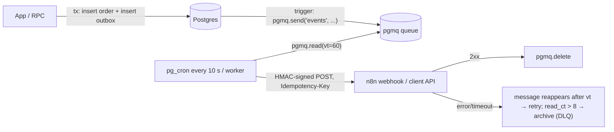

# Supabase - Webhooks, pg_net & External Integrations

> [!info] Deep dive of [[Supabase]]

> [!abstract] TL;DR
> Three ways to get data out of Supabase to other systems ([[n8n]], CRMs, WhatsApp senders):
> 1. **Database Webhooks**: a trigger calls `supabase_functions.http_request` → `pg_net` → URL. Easiest, but **fire-and-forget**: no retries, no ordering, response kept a few hours.
> 2. **`pg_net` directly** (`net.http_post`) from triggers/functions/cron, for custom payloads and headers. Same best-effort semantics.
> 3. **Outbox table + queue (pgmq) + relay worker**: written in the same transaction, retried with backoff, signed and idempotent. Use it for anything a client would notice if lost.
>
> Inbound integrations (Stripe, Meta, payment gateways) land on an **Edge Function or n8n webhook** that verifies the signature, dedupes by event ID and writes via a scoped role.

## Concept
| Mechanism | Delivery | Retries | Ordering | Payload control | Pick it when… |
|---|---|---|---|---|---|
| Database Webhook (dashboard) | After commit, async via pg_net | ❌ | ❌ | Fixed (`type`, `table`, `record`, `old_record`) | Notifications, cache busting, non-critical syncs |
| `net.http_post` in a trigger | After commit, async | ❌ (you build them) | ❌ | Full (custom JSON, headers) | Custom payloads to Edge Functions |
| Outbox + pgmq + relay | At-least-once | ✅ visibility timeout | Per key if designed | Full, versioned events | Orders, payments, CRM sync, WhatsApp sends |
| Realtime (Postgres Changes) | Push to connected clients | ❌ | Mostly | Row changes | UI updates, not server integrations |
| Logical replication / CDC | Stream with slots | ✅ (slot holds position) | ✅ per table | Row changes | Analytics/search sync at volume ([[PostgreSQL - Logical Replication & Change Data Capture]]) |

**`pg_net` internals worth knowing**:

| Item | Detail |
|---|---|
| Queue | `net.http_request_queue`, drained by a background worker after commit |
| Responses | `net._http_response` (status, body, error), TTL ~6 h (`pg_net.ttl`) |
| Throughput | Batches per tick (`pg_net.batch_size`). Bursts queue up |
| Timeout | `timeout_milliseconds` param (default ~5 s) |
| Failure mode | Errors recorded in `_http_response`, then nothing happens |

## How It Works


## Practical Usage
**Database Webhook equivalent in SQL** (versioned in migrations, not clicked in the dashboard):
```sql
create trigger leads_to_n8n
after insert on public.leads
for each row execute function supabase_functions.http_request(
  'https://n8n.internal.example.my/webhook/new-lead', 'POST',
  '{"Content-Type":"application/json"}', '{}', '5000'
);
```
**Custom `pg_net` call with a secret from Vault**:
```sql
create or replace function public.notify_edge(p_event text, p_payload jsonb)
returns bigint language plpgsql security definer set search_path = '' as $$
declare v_key text;
begin
  select decrypted_secret into v_key from vault.decrypted_secrets where name = 'edge_fn_key';
  return net.http_post(
    url := 'https://<project>.supabase.co/functions/v1/events',
    headers := jsonb_build_object('Authorization', 'Bearer ' || v_key, 'Content-Type', 'application/json'),
    body := jsonb_build_object('event', p_event, 'data', p_payload),
    timeout_milliseconds := 3000
  );
end $$;
```
**Inspect failures** (before they expire):
```sql
select id, status_code, error_msg, created
from net._http_response
where status_code is null or status_code >= 400
order by created desc limit 50;
```
**Reliable path: outbox via pgmq + relay**:
```sql
select pgmq.create('events');

create or replace function public.enqueue_order_event() returns trigger
language plpgsql security definer set search_path = '' as $$
begin
  perform pgmq.send('events', jsonb_build_object(
    'id', gen_random_uuid(), 'type', 'order.paid', 'version', 1,
    'tenant_id', new.tenant_id, 'order_id', new.id, 'occurred_at', now()));
  return new;
end $$;

create trigger order_paid_event after update of status on public.orders
for each row when (new.status = 'paid' and old.status is distinct from 'paid')
execute function public.enqueue_order_event();
```
```ts
// Relay (Edge Function on cron, or a Node worker): read → sign → POST → delete/archive
const { data: msgs } = await admin.schema("pgmq_public").rpc("read", { queue_name: "events", sleep_seconds: 0, n: 20 });
for (const m of msgs ?? []) {
  const body = JSON.stringify(m.message);
  const sig = await hmacSha256Hex(SIGNING_SECRET, `${m.message.id}.${body}`);
  const res = await fetch(N8N_URL, { method: "POST", body, signal: AbortSignal.timeout(5000),
    headers: { "content-type": "application/json", "x-signature": sig, "idempotency-key": m.message.id } });
  if (res.ok) await admin.schema("pgmq_public").rpc("delete", { queue_name: "events", message_id: m.msg_id });
  else if (m.read_ct >= 8) await admin.schema("pgmq_public").rpc("archive", { queue_name: "events", message_id: m.msg_id });
}
```
**Wrong way**:
```text
❌ Database Webhook → n8n for paid orders           → n8n restart = lost events, nobody notices
❌ Hard-coded API keys inside trigger SQL            → leaked via pg_dump, migrations, git
❌ Sync HTTP (http extension) inside the transaction → slow third party blocks writes, holds locks
❌ No signature on outbound webhooks                 → anyone who finds the n8n URL can inject events
```

## Patterns & Anti-patterns
| Pattern | When | Anti-pattern to avoid |
|---|---|---|
| Outbox/pgmq for business events | Payments, orders, messaging | Database Webhooks for critical flows |
| Event envelope `{id, type, version, occurred_at, data}` | All outbound events | Raw row dumps as the contract |
| HMAC signature + timestamp + idempotency key | Outbound webhooks | Unsigned URLs as the only secret |
| Secrets in Vault, read in `security definer` functions | pg_net calls | Keys in trigger definitions |
| Webhooks defined in migrations | Every environment | Dashboard-only config (lost in branching/self-host) |
| Inbound: verify → dedupe (`unique(event_id)`) → ack fast | Stripe/Meta/gateways | Long processing before returning 200 |
| Archive after N attempts + alert | Relays | Infinite retries or silent drops |

## Performance & Trade-offs
- **pg_net is non-blocking**: the trigger only queues a row, so writes stay fast. But bursts (bulk imports) can create thousands of requests that hammer n8n. Disable the trigger or batch during imports.
- **pgmq** is Postgres tables: durable and transactional, with no extra infra. At very high volume, vacuum and table bloat need attention ([[Supabase - Edge Functions, Cron & Queues]]).
- **Relay cadence**: pg_cron every 5–10 s gives near-real-time delivery. True push needs a long-running worker (Node on Coolify) using `pgmq.read_with_poll`.
- **Database Webhooks vs n8n Supabase Trigger polling**: webhooks are instant but lossy. Polling is reliable with a cursor (`updated_at`, id) but delayed.

## Tips & Reminders
> [!tip] In ZP's stack
> - **Supabase → n8n**: use outbox + relay for anything billable or customer-facing (order confirmations, WhatsApp template sends). Plain Database Webhooks are fine for internal Slack/Telegram pings.
> - **n8n side**: verify the HMAC in the first node, dedupe by `idempotency-key` (Redis/Data Table), and use [[n8n - Error Handling & Workflow Patterns]] for retries downstream.
> - **Self-hosted Supabase**: confirm `pg_net`/`pgmq` extensions and the webhook trigger function exist after upgrades ([[Supabase - Self-Hosting with Docker & Coolify]]).

- Use internal URLs (Docker network or tailnet) for n8n targets where Supabase is self-hosted. Cloud Supabase needs a public HTTPS endpoint, so protect it with the signature plus a Cloudflare WAF rule.
- Log `net.http_post` request IDs in an audit table if you need delivery evidence beyond the response TTL.
- Version event types (`order.paid.v1`). Consumers break silently when payloads change.
- Review `net._http_response` errors weekly, or alert on them via a cron query.

## Version Notes
| Date / version | Change relevant here |
|---|---|
| 2022 | Database Webhooks (pg_net based) GA |
| 2024-12 | Supabase Queues (pgmq) and Cron (pg_cron UI) launched |
| 2025 | Queues GA. `pgmq_public` schema exposes queue RPCs over the Data API |
| pg_net 0.x | `ttl`, `batch_size` settings. Still best-effort with no built-in retries |

> [!warning] Unverified — check before relying on this
> Current pg_net defaults (TTL, batch size, default timeout), the exact `pgmq_public` RPC names, and whether Database Webhooks gained retry options weren't verified this run. Check https://supabase.com/docs/guides/database/extensions/pg_net and the Queues docs.

## Critical Issues & Gotchas
> [!danger] Silent event loss with Database Webhooks and pg_net
> If the target is down, slow (> timeout) or returns 5xx, the request is recorded in `net._http_response` and then **deleted after the TTL**. There's no retry and no alert. Clients discover missing orders/leads days later. Use an outbox/queue for critical events, and alert on failed responses.

> [!danger] Secrets and PII leaking through webhook payloads
> Database Webhooks send the **entire row** (and `old_record`), including phone numbers, IC numbers and internal notes, to the target. That's often a third-party automation tool or logs. Send minimal envelopes (IDs + needed fields), and fetch details server-side with scoped credentials. Document destinations for PDPA.

- **Triggers fire per row**: an `update` of 50k rows queues 50k requests. Guard with `when (...)` conditions.
- **Recursive loops**: n8n writing back to the same table can re-trigger the webhook. Filter by changed columns or a `source` field.
- **Ordering**: pg_net and relays don't guarantee order. Include `occurred_at`/version and make consumers tolerate reordering.
- **Branching/local dev**: dashboard-created webhooks don't exist in migrations, so preview branches and new environments silently lack them ([[Supabase - Migrations, Branching & Local Development]]).

## Related
- [[Supabase]]
- [[Supabase - Edge Functions, Cron & Queues]] — pgmq, pg_cron, Edge Function receivers
- [[Supabase - Database Functions, Triggers & RPC]] — trigger and `security definer` patterns
- [[REST API - Webhooks & Idempotency]] — signing, retries and dedupe on both ends
- [[System Design - Event-Driven Architecture & Outbox Pattern]] — the outbox design
- [[n8n]] — common webhook consumer

## References
- https://supabase.com/docs/guides/database/webhooks
- https://supabase.com/docs/guides/database/extensions/pg_net
- https://supabase.com/docs/guides/queues
- https://supabase.com/docs/guides/database/vault
- https://github.com/supabase/pg_net
