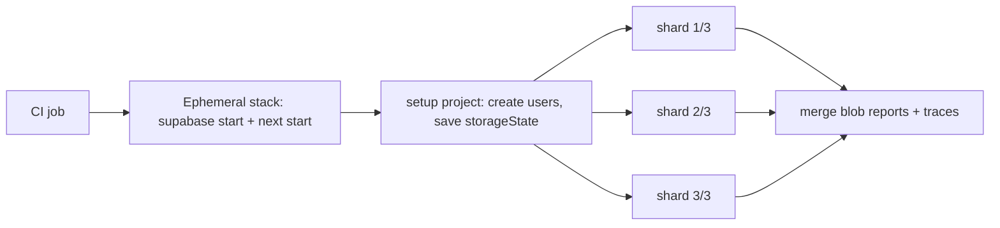

# Testing Strategy - E2E Testing with Playwright

> [!info] Deep dive of [[Testing Strategy]]

> [!abstract] TL;DR
> Keep a **small** E2E suite: 5–20 tests covering the journeys that lose money or trust (signup, login, checkout, the core workflow). Run it on every PR against an ephemeral stack and as a smoke test after each deploy.
> The Playwright fundamentals:
> - locate by role, use web-first assertions, and never sleep;
> - authenticate once with `storageState`;
> - create per-test data through APIs, not the UI;
> - mock third parties at the network layer;
> - capture traces on retry.
>
> Flakiness is a bug to fix, not something to retry around.

## Concept
- **What E2E is for**: proving the deployed system is wired correctly (routing, auth cookies, RLS, env vars, migrations), through the browser. Business-rule permutations belong in unit and integration tests ([[Testing Strategy - Integration Testing with Testcontainers & Supabase]]).
- **Playwright model**: one browser process, a fresh **browser context** per test (isolated cookies and storage, effectively an incognito profile), parallel workers, and auto-waiting actions.
- **Key building blocks**:

| Feature | Use |
|---|---|
| `getByRole` / `getByLabel` / `getByTestId` locators | Resilient selectors tied to accessibility, not CSS |
| Web-first assertions (`await expect(locator).toHaveText()`) | Retry until true or timeout. Replaces sleeps |
| Projects + `dependencies` | Setup project (auth) before browser projects; Chromium/WebKit/mobile viewports |
| `storageState` | Reuse a logged-in session across tests |
| Fixtures (`test.extend`) | Per-test tenant/user/data with automatic teardown |
| `page.route()` | Mock or block third-party calls (payment gateways, Meta, analytics) |
| Trace Viewer | DOM snapshots, network, console and actions per step for failed tests |
| `request` fixture | API calls for seeding and assertions without the UI |

## How It Works


## Practical Usage
**`playwright.config.ts`**:
```ts
import { defineConfig, devices } from '@playwright/test';

export default defineConfig({
  testDir: 'e2e',
  fullyParallel: true,
  forbidOnly: !!process.env.CI,
  retries: process.env.CI ? 1 : 0,
  workers: process.env.CI ? 4 : undefined,
  reporter: process.env.CI ? [ ['blob'], ['github'] ] : 'html',
  use: {
    baseURL: process.env.BASE_URL ?? 'http://localhost:3000',
    trace: 'on-first-retry',
    screenshot: 'only-on-failure',
    locale: 'en-MY',
    timezoneId: 'Asia/Kuala_Lumpur',
  },
  projects: [
    { name: 'setup', testMatch: /.*\.setup\.ts/ },
    { name: 'chromium', use: { ...devices['Desktop Chrome'], storageState: 'e2e/.auth/owner.json' }, dependencies: ['setup'] },
    { name: 'mobile', use: { ...devices['Pixel 7'], storageState: 'e2e/.auth/owner.json' }, dependencies: ['setup'] },
  ],
  webServer: process.env.BASE_URL ? undefined : {
    command: 'pnpm build && pnpm start', url: 'http://localhost:3000', reuseExistingServer: !process.env.CI, timeout: 180_000,
  },
});
```
**Auth setup**: create the user through the admin API, log in once through the UI, and save the state.
```ts
// e2e/auth.setup.ts
import { test as setup, expect } from '@playwright/test';
import { admin } from './support/supabase-admin';             // service-role client, test env only

setup('owner session', async ({ page }) => {
  const email = `owner+${Date.now()}@test.local`;
  await admin.auth.admin.createUser({ email, password: 'Test1234!', email_confirm: true });   // no email rate limits
  await page.goto('/login');
  await page.getByLabel('Email').fill(email);
  await page.getByLabel('Password').fill('Test1234!');
  await page.getByRole('button', { name: 'Sign in' }).click();
  await expect(page.getByRole('heading', { name: 'Dashboard' })).toBeVisible();
  await page.context().storageState({ path: 'e2e/.auth/owner.json' });
});
```
**Per-test data fixture**, isolated from parallel workers:
```ts
// e2e/support/fixtures.ts
export const test = base.extend<{ product: { id: string; name: string } }>({
  product: async ({}, use, testInfo) => {
    const name = `Kopi ${testInfo.workerIndex}-${Date.now()}`;
    const { data } = await admin.from('products').insert({ name, price_myr: 12.5, tenant_id: TEST_TENANT }).select().single();
    await use(data!);
    await admin.from('products').delete().eq('id', data!.id);   // teardown even on failure
  },
});
```
**A money-path test**, with the payment gateway mocked:
```ts
import { test } from './support/fixtures';
import { expect } from '@playwright/test';

test('customer checks out with FPX', async ({ page, product }) => {
  await page.route('**/api.billplz.com/**', (route) =>
    route.fulfill({ status: 200, json: { id: 'bill_test', url: '/pay/mock-success' } }));

  await page.goto(`/shop/${product.id}`);
  await page.getByRole('button', { name: 'Add to cart' }).click();
  await page.getByRole('link', { name: 'Checkout' }).click();
  await page.getByRole('button', { name: /pay with fpx/i }).click();

  await expect(page).toHaveURL(/\/orders\/[0-9a-f-]+$/);
  await expect(page.getByRole('status')).toHaveText('Paid');
  await expect(page.getByRole('main')).toMatchAriaSnapshot(`
    - heading "Order confirmed"
    - text: /RM 12\\.50/
  `);
});
```
**CI with shards** (GitHub Actions excerpt):
```yaml
jobs:
  e2e:
    strategy: { matrix: { shard: [1, 2, 3] } }
    steps:
      - uses: actions/checkout@v4
      - run: pnpm install --frozen-lockfile && npx playwright install --with-deps chromium
      - run: npx supabase start && npx supabase db reset
      - run: npx playwright test --shard=${{ matrix.shard }}/3
      - uses: actions/upload-artifact@v4
        if: ${{ !cancelled() }}
        with: { name: blob-${{ matrix.shard }}, path: blob-report }
```
Merge the shard reports in a final job with `npx playwright merge-reports --reporter html ./all-blob-reports`.

**Wrong way**:
```ts
await page.click('.btn-primary >> nth=2');            // ❌ brittle CSS/position selector
await page.waitForTimeout(3000);                       // ❌ sleep: slow when passing, flaky when failing
expect(await page.textContent('#status')).toBe('Paid'); // ❌ one-shot read, no retry
await page.goto('/signup'); /* … */                    // ❌ every test signs up via UI → slow + email rate limits
```

## Patterns & Anti-patterns
| Pattern | When | Anti-pattern to avoid |
|---|---|---|
| Role/label locators + `data-testid` as fallback | Always | CSS chains, XPath, `nth=` |
| `storageState` per role (owner, staff, customer) | Authenticated suites | Logging in through the UI in every test |
| API/DB seeding in fixtures with teardown | Test data | Tests depending on order or on data from other tests |
| Mock third parties with `page.route` on PR runs | Payments, WhatsApp, maps | Hitting real sandboxes on every PR (rate limits, outages) |
| A few un-mocked smoke tests on staging after deploy | Wiring verification | Running the full mocked suite only, so you never prove real integration |
| `trace: 'on-first-retry'` + `retries: 1` | CI | `retries: 3` hiding flakiness |
| Tag tests (`@smoke`, `@slow`) + `--grep` | Split PR vs nightly | One monolithic suite for every trigger |

## Performance & Trade-offs
- **Budget**: aim for an E2E stage under ~5–8 min. Each test should take 5–30 s. Beyond ~50 tests, look for journeys that should be integration tests instead.
- **Parallelism**: `fullyParallel` + workers ≈ CPU cores, plus `--shard` across CI machines. Parallel tests need isolated data (per-worker tenant or unique names).
- **Browsers**: run Chromium on every PR, and WebKit + mobile viewport nightly. WebKit catches Safari/iOS issues common with Malaysian iPhone users, but is slower.
- **Mocking trade-off**: mocks make PR runs fast and deterministic but can drift from the real API. Pair them with contract tests or a nightly un-mocked run against sandboxes.
- **Ephemeral stack cost**: `supabase start` in CI takes ~1–2 min (Docker pulls; cache images). Alternatively, run against a Coolify preview deployment per PR.

## Tips & Reminders
> [!tip] In ZP's stack
> - **PR runs**: Next.js + local Supabase in CI (`supabase start`, `db reset` with seed SQL) for the full suite.
> - **After a Coolify deploy**: run `@smoke` tests against staging with `BASE_URL`.
> - **Mocks**: Billplz/ToyyibPay/Stripe and Meta Cloud API are mocked via `page.route`; webhook handling is covered in integration tests.
> - **Flutter**: use `integration_test` / Patrol ([[Flutter - Testing]]). Playwright only covers Flutter web, and poorly (canvas rendering, few accessible roles).

- Run `npx playwright codegen <url>` to bootstrap locators, then clean up. `--ui` mode gives a time-travel debugger locally.
- Assert on accessible output (`toHaveAccessibleName`, ARIA snapshots), which doubles as a basic accessibility check.
- Keep test users and tenants in a separate `TEST_TENANT` and never run E2E against production data. For prod synthetic checks, use a dedicated monitoring account with read-only flows.
- Store `e2e/.auth/` in `.gitignore`. It contains session cookies.
- The Playwright MCP server lets coding agents (Claude Code, Cursor) drive a browser to reproduce bugs or draft tests ([[Model Context Protocol]]). Review generated tests like any other code.

## Version Notes
| Version | Change relevant here |
|---|---|
| 1.45 (2024) | Clock API (`page.clock`) for time-dependent UI |
| 1.49 (2024) | ARIA snapshots (`toMatchAriaSnapshot`) |
| 1.5x (2025) | Test agents (planner / generator / healer) preview, MCP server ecosystem |
| 1.58 (2026) | `playwright-cli`. Removed `_react` / `_vue` selectors and the `devtools` launch option |
| 1.59–1.60 (2026-04/05) | Screencast API, `browser.bind()`. Test agents reported production-ready in 1.60 |

> [!warning] Unverified — check before relying on this
> The 1.58–1.60 details came from third-party release summaries. Check https://playwright.dev/docs/release-notes before upgrading.

## Critical Issues & Gotchas
> [!danger] Expired `storageState` sessions
> Supabase access tokens expire (default 1 h). A `storageState` saved by a long-running or cached setup can expire mid-suite and cause random redirects to `/login` that look like flakiness. Regenerate auth per CI run, and don't commit or cache auth files across runs.

> [!danger] Service-role keys in E2E helpers
> Seeding fixtures use the Supabase service-role key. Keep it in CI secrets for the **test project only**. If it points at production, one bad teardown query deletes real data.

- **Shared mutable data across workers**: two parallel tests editing the same product or tenant produce order-dependent failures. Namespace by `testInfo.workerIndex` or create fresh data per test.
- **`networkidle`** waits are discouraged. Apps with polling, Realtime or analytics never go idle. Wait for a UI state instead.
- **Time zones and locale**: CI runs in UTC; your users are in UTC+8. Set `timezoneId` and `locale` in the config, or date assertions fail around midnight.
- **Auth email rate limits**: signing up via UI in CI hits Supabase Auth email limits quickly. Create users with `auth.admin.createUser({ email_confirm: true })`.
- **Animations and toasts** cause intermittent click interception. Use `reducedMotion: 'reduce'` in `use`, and assert on the toast instead of clicking through it.

## Related
- [[Testing Strategy]]
- [[Testing Strategy - Integration Testing with Testcontainers & Supabase]] — where business-rule permutations belong
- [[Next.js]] — app under test, build/start in `webServer`
- [[Supabase]] — local stack, admin API for seeding
- [[CI-CD]] — sharded pipelines, deploy-gated smoke tests
- [[Flutter - Testing]] — mobile E2E counterpart

## References
- https://playwright.dev/docs/best-practices
- https://playwright.dev/docs/auth
- https://playwright.dev/docs/test-sharding
- https://playwright.dev/docs/release-notes
- https://testdino.com/blog/playwright-2026-new-features/
- https://qaskills.sh/blog/playwright-1-60-release-guide-2026
