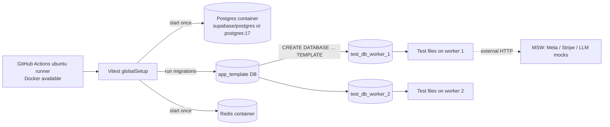

# Testing Strategy - Integration Testing with Testcontainers & Supabase

> [!info] Deep dive of [[Testing Strategy]]

> [!abstract] TL;DR
> Test against **real Postgres with real migrations**, because mocks can't catch RLS gaps, constraint violations, transaction bugs or SQL typos. There are two complementary tools:
> - **Testcontainers** (a throwaway Postgres/Redis per test run, seconds to start) for app-level integration tests.
> - **Supabase CLI local stack** (`supabase start` + `supabase test db` with **pgTAP**) for RLS policies, functions and auth-dependent behaviour.
>
> Isolate tests with **template databases or transactions**, mock only third-party HTTP (MSW), and run everything in CI on every PR.

## Concept

### What each layer catches
| Bug class | Unit test + mocks | Testcontainers Postgres | Supabase local + pgTAP |
|---|---|---|---|
| SQL typo / wrong join | ❌ | ✅ | ✅ |
| Constraint / unique violation (idempotency) | ❌ | ✅ | ✅ |
| Migration breaks on real data shape | ❌ | ✅ (with seed) | ✅ |
| **RLS policy leak** (tenant A reads B) | ❌ | ⚠️ only if you emulate roles + JWT claims | **✅ native** |
| `auth.uid()` / `auth.jwt()` logic, triggers on `auth.users` | ❌ | ⚠️ needs Supabase image + stubs | ✅ |
| PostgREST/RPC exposure (what `anon` can call) | ❌ | ❌ | ✅ (via `supabase-js` against local API) |
| Queue semantics (BullMQ retries, dedupe) | ❌ | ✅ (Redis container) | — |

### Isolation strategies
| Strategy | Speed | Fidelity | Use when |
|---|---|---|---|
| **Transaction per test, rollback** | Fastest | Can't test commits, `SKIP LOCKED` across connections, triggers after commit | Pure repository/query tests |
| **Template DB clone per test file/worker** (`CREATE DATABASE … TEMPLATE`) | Fast (~50–200 ms) | Full | **Default**: migrations applied once to a template |
| `TRUNCATE … RESTART IDENTITY CASCADE` between tests | Medium | Full | Small schemas, serial tests |
| Container per test file | Slow (seconds) | Full | Tests needing different extensions/configs |

## How It Works

- **Testcontainers** starts containers via the Docker API, waits for readiness (log/port/health wait strategies), maps random host ports, and cleans up via the **Ryuk** reaper container even if the test process crashes.
- **Supabase CLI** `supabase start` runs the local stack: Postgres, Auth, PostgREST, Storage, Realtime, Studio and Edge Runtime. `supabase db reset` re-applies `supabase/migrations/*` and `seed.sql`, and `supabase test db` runs pgTAP files in `supabase/tests/`.

## Practical Usage

### Vitest globalSetup: one container, template DB, per-worker databases
```ts
// test/global-setup.ts
import { PostgreSqlContainer } from "@testcontainers/postgresql";
import { RedisContainer } from "@testcontainers/redis";
import type { TestProject } from "vitest/node";
import { migrate } from "../src/db/migrate";

export default async function setup(project: TestProject) {
  const pg = await new PostgreSqlContainer("postgres:17-alpine").withDatabase("app_template").start();
  await migrate(pg.getConnectionUri());                         // real migrations, once; must close its pool (templates can't have connections)
  const redis = await new RedisContainer("redis:8-alpine").start();
  project.provide("pgAdminUri", pg.getConnectionUri().replace("/app_template", "/postgres"));
  project.provide("redisUrl", redis.getConnectionUrl());
  return async () => { await redis.stop(); await pg.stop(); };
}

declare module "vitest" {
  export interface ProvidedContext { pgAdminUri: string; redisUrl: string }
}
```
```ts
// test/db.ts: fresh database cloned from the template for each test file
import { inject, beforeAll, afterAll } from "vitest";
import postgres from "postgres";

export function useTestDb() {
  const name = `t_${process.env.VITEST_POOL_ID}_${Date.now()}`;
  const admin = postgres(inject("pgAdminUri"), { max: 1 });
  let sql: postgres.Sql;
  beforeAll(async () => {
    await admin.unsafe(`create database "${name}" template app_template`);
    sql = postgres(inject("pgAdminUri").replace("/postgres", `/${name}`));
  });
  afterAll(async () => { await sql.end(); await admin.unsafe(`drop database "${name}" with (force)`); await admin.end(); });
  return () => sql;
}
```

### Emulating Supabase RLS in plain Postgres
```sql
-- test bootstrap (only for Testcontainers runs; real Supabase already has these)
create role anon nologin; create role authenticated nologin;
create schema if not exists auth;
create or replace function auth.uid() returns uuid language sql stable as
$$ select nullif(current_setting('request.jwt.claims', true)::jsonb ->> 'sub', '')::uuid $$;
create or replace function auth.jwt() returns jsonb language sql stable as
$$ select coalesce(current_setting('request.jwt.claims', true), '{}')::jsonb $$;
```
```ts
// Run a query exactly as a logged-in user of tenant t1 would via PostgREST
async function asUser<T>(sql: postgres.Sql, claims: { sub: string; tenant_id: string }, fn: (tx: postgres.TransactionSql) => Promise<T>) {
  return sql.begin(async (tx) => {
    await tx`select set_config('request.jwt.claims', ${JSON.stringify({ ...claims, role: "authenticated" })}, true)`;
    await tx`set local role authenticated`;
    return fn(tx);
  });
}

test("tenant isolation on orders", async () => {
  const sql = db();
  const rows = await asUser(sql, { sub: USER_T1, tenant_id: "t1" }, (tx) => tx`select tenant_id from orders`);
  expect(rows.every((r) => r.tenant_id === "t1")).toBe(true);
  const leaked = await asUser(sql, { sub: USER_T1, tenant_id: "t1" }, (tx) => tx`select * from orders where tenant_id = 't2'`);
  expect(leaked).toHaveLength(0);
});
```
- Prefer the `supabase/postgres` image over `postgres:17` when your migrations use Supabase-specific extensions, roles or functions. Pin the same version your project runs.

### pgTAP with the Supabase CLI
```sql
-- supabase/tests/rls_orders.test.sql
begin;
select plan(3);

select tests.create_supabase_user('alice', 'alice@t1.my');       -- helper from supabase-test-helpers (basejump)
select tests.authenticate_as('alice');

select results_eq($$ select count(*)::int from orders where tenant_id = 't2' $$, $$ values (0) $$, 'alice cannot see t2 orders');
select is_empty($$ update orders set total_sen = 1 where tenant_id = 't2' returning id $$, 'no cross-tenant updates');
select policies_are('public', 'orders', array['orders_select_own_tenant', 'orders_update_own_tenant']);

select * from finish();
rollback;
```
```bash
supabase start            # local stack (Docker)
supabase db reset         # migrations + seed from scratch
supabase test db          # runs supabase/tests/*.sql via pg_prove
```
- An `UPDATE` blocked by RLS affects **0 rows silently** rather than throwing, hence `is_empty(… returning id)`. Use `throws_ok` only when a `WITH CHECK` violation is expected.

### CI (GitHub Actions)
```yaml
jobs:
  integration:
    runs-on: ubuntu-24.04               # Docker preinstalled; Testcontainers works out of the box
    permissions: { contents: read }
    steps:
      - uses: actions/checkout@<sha>    # pin SHAs (see CI-CD hardening note)
      - uses: actions/setup-node@<sha>
        with: { node-version: 24, cache: npm }
      - run: npm ci
      - run: npx vitest run --project integration
  rls:
    runs-on: ubuntu-24.04
    steps:
      - uses: actions/checkout@<sha>
      - uses: supabase/setup-cli@<sha>
      - run: supabase start -x studio,imgproxy,realtime,storage-api,edge-runtime   # exclude unneeded services for speed
      - run: supabase db reset && supabase test db
```

## Patterns & Anti-patterns
| Pattern | When | Anti-pattern to avoid |
|---|---|---|
| Real migrations in tests | Always | Hand-written test schema that drifts from production |
| Template DB per worker | Parallel Vitest | One shared DB with random test order → flaky |
| RLS tests as `authenticated` with JWT claims | Every table with policies | Testing with the service-role key (bypasses RLS: green tests, leaky prod) |
| Authorization matrix (role × tenant × action) | Multi-tenant SaaS | 1–2 happy-path permission tests |
| MSW for third-party HTTP, real DB/Redis | Integration layer | Mocking your own DB layer in "integration" tests |
| Seed builders/factories (`makeOrder({...})`) | Readable tests | Giant shared `seed.sql` every test depends on |
| Pin image versions = production versions | Containers | `postgres:latest` in tests, 15 in prod |

## Performance & Trade-offs
- **Startup**: a Postgres container takes ~2–5 s and a full `supabase start` ~30–90 s on CI (image pulls dominate), so cache images or exclude services. Locally, use Testcontainers `withReuse()` with `TESTCONTAINERS_REUSE_ENABLE=true` to keep containers between runs.
- **Template cloning** is far faster than re-running 200 migrations per file. Rebuild the template only when migrations change (hash `supabase/migrations`).
- **Parallelism**: one database per Vitest worker scales linearly with cores. Watch `max_connections`: workers × pool size must stay below it.
- **Fidelity vs speed**: Testcontainers with RLS emulation covers most app logic fast. Keep a smaller pgTAP suite on the real Supabase stack for auth/RLS/RPC exposure. Both run in under ~5 min on CI.

## Tips & Reminders
> [!tip]
> - **Name files `*.int.test.ts`** and use a separate Vitest project, so unit tests stay instant in watch mode.
> - **Freeze time** (`vi.useFakeTimers()` or a `now()` parameter in SQL functions) for expiry and scheduling logic. Never sleep in tests.
> - **Test migrations both ways** on a copy of anonymised production data before risky releases (`pg_dump` → restore into a container → migrate).
> - **Webhooks**: feed recorded provider payloads (Meta, Stripe) through the real handler with valid HMAC signatures, and assert idempotency on replay ([[REST API - Webhooks & Idempotency]]).
> - **In ZP's stack**:
>   - **Per client project**: Vitest + Testcontainers for Next.js server code and BullMQ workers, a pgTAP RLS suite via `supabase test db`, and both as required checks on PRs.
>   - **Contracts**: offer "RLS test report" as a deliverable in client SOWs, since it's evidence for PDPA-minded clients.

## Version Notes
| Tool | Note |
|---|---|
| Testcontainers for Node 10–11 | Module packages (`@testcontainers/postgresql`, `/redis`), `getConnectionUri()`, reuse support. 11.x current (11.9 seen) |
| Vitest 2+ | `provide`/`inject` for globalSetup values. Vitest 3–4 project config (`projects`) replaces workspaces |
| Supabase CLI | `supabase test db` (pgTAP via pg_prove), `supabase db reset`, `-x` to exclude services. Local stack versions follow hosted Postgres |
| pgTAP | `policies_are`, `results_eq`, `is_empty`, `throws_ok`. Community helpers: `supabase-test-helpers` |

> [!warning] Unverified — check before relying on this
> Supabase CLI flags and the bundled pgTAP/test-helpers setup weren't re-verified for 2026. Check `supabase --help` and the Supabase testing docs, and pin the CLI version in CI.

## Critical Issues & Gotchas
> [!danger] Green tests, leaky production: testing with the service role
> Supabase's `service_role` key and the `postgres` superuser **bypass RLS**. A suite that connects as either proves nothing about tenant isolation, and this is the most common way RLS bugs ship. Every policy needs a test that runs as `authenticated` (and `anon`) with realistic claims, including a negative case for another tenant ([[Supabase - Row Level Security]]).

> [!danger] Tests that pass only in order
> Shared databases, leftover rows and fixed IDs make tests pass locally and fail on CI shards (or vice versa). Then the team starts ignoring red builds. Isolate per file or worker, generate unique IDs, and run CI with `--sequence.shuffle` occasionally to surface coupling.

> [!warning] Gotchas
> - Docker-in-Docker or rootless setups (some self-hosted runners, Colima/Podman locally) need `DOCKER_HOST`/`TESTCONTAINERS_RYUK_DISABLED` tweaks. GitHub-hosted Ubuntu runners just work.
> - `set local role` only lasts inside a transaction. Outside `begin`, it silently does nothing and queries run as superuser.
> - `request.jwt.claims` must be a JSON **string**. Set it with `set_config(..., true)` so it resets per transaction.
> - Extensions (`pgvector`, `pg_cron`, `pgmq`) must exist in the test image. Use `supabase/postgres` or a custom image when migrations need them.
> - `drop database` fails while connections remain. Use `WITH (FORCE)` (PG 13+) and close pools in `afterAll`.

## Related
- [[Testing Strategy]]
- [[Supabase - Row Level Security]] — policies these tests must prove
- [[Supabase]] — local stack, CLI, roles
- [[PostgreSQL]] — templates, transactions, roles
- [[Docker]] — container runtime for Testcontainers
- [[CI-CD]] — running integration suites on every PR

## References
- Testcontainers for Node.js: https://node.testcontainers.org/
- Testcontainers Postgres module: https://node.testcontainers.org/modules/postgresql/
- Vitest globalSetup + provide/inject: https://vitest.dev/config/#globalsetup
- Supabase testing overview: https://supabase.com/docs/guides/local-development/testing/overview
- pgTAP: https://pgtap.org/documentation.html
- supabase-test-helpers: https://github.com/usebasejump/supabase-test-helpers
