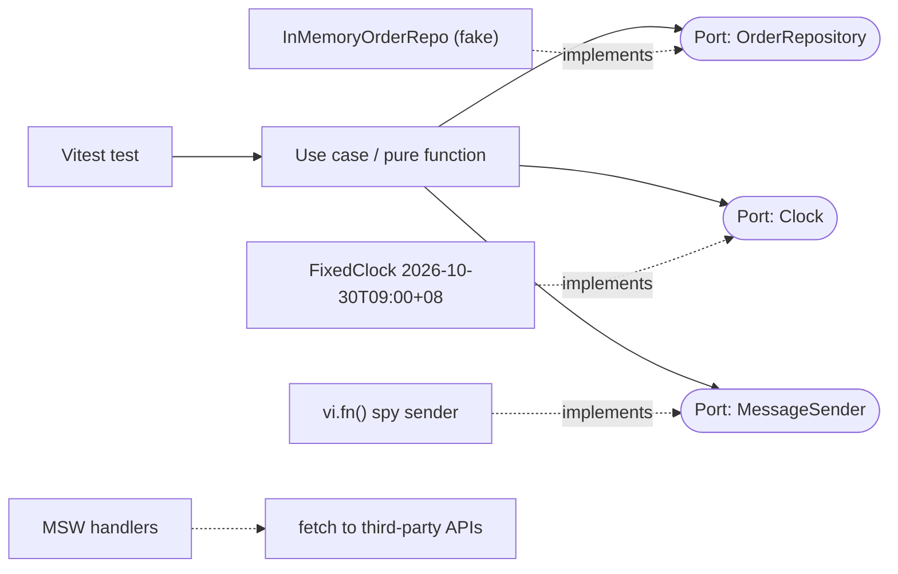

# Testing Strategy - Unit Testing with Vitest & Mocking Boundaries

> [!info] Deep dive of [[Testing Strategy]]

> [!abstract] TL;DR
> Unit-test **logic that can be wrong quietly**: pricing and tax (SST) math, date/time rules in MYT, state machines, validators, mappers, reducers. Use **Vitest** (ESM-native, fast, Jest-compatible API).
> Mock only at **boundaries you own** (ports: repositories, clocks, message senders), preferably with small **fakes**. Use **MSW** for HTTP. Don't mock modules deep inside your own code.
> If a test needs five mocks, the code needs a port, or the behaviour belongs in an integration test against a real Postgres.

## Concept
| Test double | What it is | Use for |
|---|---|---|
| **Fake** | Working lightweight implementation (in-memory repo, fixed clock) | Default for ports |
| **Stub** | Returns canned answers | Simple dependencies |
| **Mock / spy** (`vi.fn`, `vi.spyOn`) | Records calls; asserts interactions | Verifying a side effect was requested (send WhatsApp once) |
| **Module mock** (`vi.mock`) | Replaces an imported module | Last resort for un-injectable third-party modules |
| **Network mock** (MSW) | Intercepts HTTP at the fetch layer | Third-party APIs (Meta, Billplz, LLM APIs) |

**What belongs where**:

| Layer | Unit (Vitest) | Integration (Testcontainers/Supabase) | E2E (Playwright) |
|---|---|---|---|
| Money/tax/date rules, state machines | ✅ | — | — |
| SQL, RLS policies, triggers | ❌ (mocks lie) | ✅ | — |
| Server Action wiring + auth | Partly (call directly) | ✅ | Smoke |
| Full user journey | — | — | ✅ |

## How It Works

Vitest runs tests in worker threads (or forks) with Vite's transform pipeline, so TS/ESM work without separate compilation. **Projects** let one config run Node unit tests and browser component tests side by side.

## Practical Usage
**`vitest.config.ts`** (projects: node unit + browser components):
```ts
import { defineConfig } from 'vitest/config';
import { playwright } from '@vitest/browser-playwright';

export default defineConfig({
  test: {
    restoreMocks: true,                 // reset spies/mocks between tests
    coverage: { provider: 'v8', include: ['src/**'], thresholds: { lines: 70 } },
    projects: [
      { test: { name: 'unit', environment: 'node', include: ['src/**/*.test.ts'] } },
      { test: { name: 'browser', include: ['src/**/*.browser.test.tsx'],
                browser: { enabled: true, provider: playwright(), instances: [{ browser: 'chromium' }] } } },
    ],
  },
});
```
**Use case with fakes** (no module mocks):
```ts
import { describe, it, expect, vi } from 'vitest';
import { confirmOrder } from './confirm-order';

class InMemoryOrders implements OrderRepository {
  constructor(private rows = new Map<string, Order>()) {}
  async byId(id: string) { return this.rows.get(id) ?? null; }
  async save(o: Order) { this.rows.set(o.id, o); }
}

describe('confirmOrder', () => {
  it('confirms a pending order and sends one WhatsApp template', async () => {
    const orders = new InMemoryOrders(new Map([ ['o1', Order.rehydrate({ id: 'o1', phone: '+60123456789', status: 'pending' })] ]));
    const messages = { sendTemplate: vi.fn().mockResolvedValue(undefined) };
    await confirmOrder({ orders, messages })('o1' as OrderId);
    expect((await orders.byId('o1'))?.status).toBe('confirmed');
    expect(messages.sendTemplate).toHaveBeenCalledExactlyOnceWith('+60123456789', 'order_confirmed', ['o1']);
  });
  it('rejects double confirmation', async () => {
    const orders = new InMemoryOrders(new Map([ ['o1', Order.rehydrate({ id: 'o1', phone: '+60…', status: 'confirmed' })] ]));
    await expect(confirmOrder({ orders, messages: { sendTemplate: vi.fn() } })('o1' as OrderId)).rejects.toThrow(OrderAlreadyConfirmed);
  });
});
```
**Time-dependent rules** (MYT business hours, cut-offs):
```ts
it('next-day delivery after 4pm Kuching time', () => {
  vi.useFakeTimers();
  vi.setSystemTime(new Date('2026-10-30T16:05:00+08:00'));
  expect(deliveryDate()).toBe('2026-10-31');
  vi.useRealTimers();
});
```
**HTTP boundary with MSW**:
```ts
import { setupServer } from 'msw/node';
import { http, HttpResponse } from 'msw';
const server = setupServer(
  http.get('https://www.billplz.com/api/v3/bills/:id', () => HttpResponse.json({ id: 'b1', paid: true, amount: 1250 })),
);
beforeAll(() => server.listen({ onUnhandledRequest: 'error' }));   // fail on unexpected network calls
afterAll(() => server.close());
```
**Property-based tests** for money math (fast-check):
```ts
import fc from 'fast-check';
it('SST split always sums to the total', () => {
  fc.assert(fc.property(fc.integer({ min: 0, max: 10_000_000 }), (totalSen) => {
    const { net, sst } = splitSst(totalSen, 0.06);
    return net + sst === totalSen && net >= 0 && sst >= 0;
  }));
});
```
**Wrong way**:
```ts
vi.mock('../db');                                  // ❌ mocking your own data layer → tests pass while SQL/RLS are broken
vi.mock('./utils', () => ({ calc: () => 42 }));     // ❌ mocking the unit under test's internals
expect(component).toMatchSnapshot();                // ❌ giant snapshots nobody reviews; break on every markup tweak
```

## Patterns & Anti-patterns
| Pattern | When | Anti-pattern to avoid |
|---|---|---|
| Fakes for ports you own | Use cases, services | `vi.mock` chains of Supabase query builders |
| MSW with `onUnhandledRequest: 'error'` | Code calling third-party HTTP | Real network calls in unit tests |
| Fixed clock / fake timers + explicit TZ | Date logic | Tests that fail at midnight or in UTC CI |
| Property-based tests for invariants | Money, parsers, serializers | Five hand-picked examples for arithmetic |
| One behaviour per test, named as a sentence | Readability | `it('works')` with ten assertions |
| Integration tests for SQL/RLS | Data access | Unit tests "covering" queries via mocks |

## Performance & Trade-offs
- **Speed**: a suite of a few hundred pure unit tests runs in seconds with Vitest's watch mode. Keep it that way: no network, no real DB, no sleeps.
- **Isolation modes**: `pool: 'threads'` is fastest. `forks` gives better isolation for native modules. `isolate: false` speeds up big suites but risks state leaking between files.
- **Browser mode** (stable in 4.0) runs component tests in real Chromium via Playwright. It's more faithful than jsdom for layout/events, but slower. Use it for components where jsdom lies (focus, layout, Web APIs).
- **Coverage targets**: aim for high coverage on domain logic, not on glue code. A 70% global threshold with 90%+ on `domain/` is a pragmatic split.

## Tips & Reminders
> [!tip] In ZP's stack
> - **Unit tests for**: `packages/schemas` (Zod edge cases), pricing/SST/discount rules, order state machines, WhatsApp message builders and Manglish normalizers.
> - **Integration tests for**: RLS and Supabase interactions ([[Testing Strategy - Integration Testing with Testcontainers & Supabase]]).
> - **Playwright for**: money paths ([[Testing Strategy - E2E Testing with Playwright]]).
> - **Flutter**: the equivalent is `flutter test` with fakes behind Riverpod overrides ([[Flutter - Testing]]).

- Set `TZ=UTC` in CI explicitly and pass offsets in tests, so Malaysia-time logic is tested deliberately, not accidentally.
- Use `vi.hoisted()` for values referenced inside `vi.mock` factories (mocks are hoisted above imports).
- Test Server Actions by calling them directly with a constructed `FormData`, with auth and repo dependencies injected or faked ([[React - Forms, Actions & Optimistic UI]]).
- Run `vitest --changed` locally for fast feedback, and the full suite in CI.

## Version Notes
| Version | Released | Key changes | Breaking / migration notes |
|---|---|---|---|
| Vitest 1–2 | 2023–24 | Workspaces, browser mode (experimental), stable API | — |
| Vitest 3 | 2025 | Projects config, improved reporters, browser mode beta | `workspace` → `projects` |
| **Vitest 4.0** | 2025-10-22 | **Browser mode stable**. Provider packages (`@vitest/browser-playwright`…). Visual regression `toMatchScreenshot`. Playwright traces | Import context from `vitest/browser`. Install a provider package. Check the migration guide |
| 4.0.x | 2025–26 | `vi.mockObject` spy option, `vi.mocked` and class-spy typing fixes | — |

## Critical Issues & Gotchas
> [!danger] Mocks that hide real failures
> Mocking Supabase/Postgres calls in unit tests makes suites green while RLS policies, constraints and SQL are wrong, which is where multi-tenant bugs live. Keep data-access tests on a real database. Unit tests cover logic above the ports.

> [!danger] Leaking global state between tests
> Fake timers not restored, mocked modules carried across tests, or a global `fetch` override make results depend on order. Run with `restoreMocks: true`, call `vi.useRealTimers()` in `afterEach`, and randomize order occasionally (`--sequence.shuffle`).

- **ESM mock specifiers** must match how the module is imported (path aliases vs relative). A mismatched path silently mocks nothing.
- **Async fake timers**: use `vi.advanceTimersByTimeAsync` with promise-based code. The sync variant can deadlock awaiting microtasks.
- **Random data without seeds** produces flaky failures you can't reproduce. Seed fast-check (`seed` from the failure output) and faker.
- **Testing implementation details** (internal state, private calls) makes refactors painful. Assert observable behaviour: outputs, saved state, requested side effects.

## Related
- [[Testing Strategy]]
- [[Testing Strategy - Integration Testing with Testcontainers & Supabase]] — real Postgres/RLS tests
- [[Testing Strategy - E2E Testing with Playwright]] — journeys and smoke tests
- [[Design Patterns - Hexagonal Architecture in TypeScript & Dart]] — ports make fakes easy
- [[TypeScript - Runtime Validation with Zod & Type-Safe APIs]] — schema tests
- [[Flutter - Testing]] — the Dart-side counterpart

## References
- https://vitest.dev/guide/
- https://main.vitest.dev/blog/vitest-4
- https://voidzero.dev/posts/announcing-vitest-4
- https://mswjs.io/docs/
- https://fast-check.dev/
- https://www.infoq.com/news/2025/12/vitest-4-browser-mode
