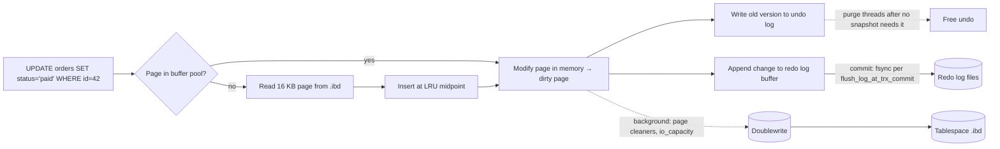

# MySQL - InnoDB Internals & Tuning

> [!info] Deep dive of [[MySQL]]

> [!abstract] TL;DR
> InnoDB stores each table as a **B+tree clustered on the primary key**. Secondary indexes point to the PK, the **buffer pool** caches pages, and the **redo log + doublewrite** make it crash-safe.
> - **Tuning, in order**:
>   1. size the buffer pool (~60–75% RAM on a dedicated host, far less on shared VPSs with PHP)
>   2. fix queries and indexes (slow log + `EXPLAIN ANALYZE`)
>   3. size the redo log
>   4. keep transactions short (purge/history list)
>   5. leave most other knobs at the **8.4 defaults**, which are now production-grade
> - **WordPress hosts**: `wp_options` autoload bloat and missing `wp_postmeta` indexes are the usual culprits.

## Concept

### InnoDB building blocks
| Component | What it does | Tuning lever |
|---|---|---|
| **Clustered index** | Rows stored in PK order inside the B+tree leaf pages (16 KB pages) | Short, monotonic PKs (`BIGINT AUTO_INCREMENT` or UUIDv7 as `BINARY(16)`) |
| Secondary indexes | Leaf entries = indexed columns + **PK** | Long PKs bloat every index. Covering indexes avoid PK lookups |
| **Buffer pool** | Page cache with LRU (young/old midpoint insertion) | `innodb_buffer_pool_size`. Hit rate > 99% |
| **Redo log** | WAL for crash recovery | `innodb_redo_log_capacity` (8.0.30+). Too small → checkpoint stalls |
| Doublewrite buffer | Protects against torn pages | Keep on unless the FS/storage guarantees atomic 16 KB writes |
| **Undo log + purge** | MVCC old versions, rollbacks | Long transactions → growing **history list length** → slowdowns |
| Change buffer | Deferred secondary-index updates | **Off by default in 8.4** (`innodb_change_buffering=none`) |
| Adaptive hash index | In-memory hash over hot B+tree lookups | **Off by default in 8.4**. Enable only if measured |
| Binlog (server layer) | Replication, PITR, CDC | `sync_binlog=1` with `innodb_flush_log_at_trx_commit=1` for full durability |

### Durability knobs
| `innodb_flush_log_at_trx_commit` | `sync_binlog` | Crash loss window | Use |
|---|---|---|---|
| **1** | **1** | None (fsync per commit) | **Production default**: orders, payments |
| 2 | 0/1000 | ~1 s on OS crash | Bulk imports, replicas, analytics |
| 0 | 0 | ~1 s even on mysqld crash | Disposable/staging only |

### Isolation and locking
- The default is **REPEATABLE READ**. Consistent reads use MVCC snapshots, while locking reads and writes use **next-key locks** (record + gap), which prevent phantoms but cause unexpected blocking on range updates.
- `READ COMMITTED` reduces gap locking (common for high-concurrency OLTP and many frameworks). Test before switching.
- Deadlocks are normal under concurrency: InnoDB picks a victim. Apps must **retry** the transaction. Inspect with `SHOW ENGINE INNODB STATUS` (`LATEST DETECTED DEADLOCK`).

## How It Works

- **Commit = redo fsync**, not data-page write. Dirty pages flush later (checkpointing). If the redo log is too small, the checkpoint age hits its limit and foreground writes stall ("furious flushing").
- **Purge** removes old row versions only when no open transaction can still see them. One idle `BEGIN` in a forgotten session keeps all history alive.

## Practical Usage

### Baseline config for small VPS roles (MySQL 8.4)
```ini
# /etc/mysql/conf.d/tuning.cnf — 4 GB VPS shared with PHP-FPM/WordPress (DB gets ~1.5 GB)
[mysqld]
innodb_buffer_pool_size        = 1536M      # dedicated 8 GB DB host: ~5–6G
innodb_redo_log_capacity       = 1G         # ≈ 1 h of peak redo writes; check Innodb_redo_log_current_lsn deltas
innodb_flush_log_at_trx_commit = 1
sync_binlog                    = 1
innodb_flush_method            = O_DIRECT   # avoid double caching with OS page cache (Linux)
max_connections                = 150        # per-connection buffers × connections must fit RAM
tmp_table_size                 = 64M
max_heap_table_size            = 64M
slow_query_log                 = ON
long_query_time                = 0.5
log_queries_not_using_indexes  = OFF        # noisy; enable briefly when hunting
binlog_expire_logs_seconds     = 604800     # 7 days
character_set_server           = utf8mb4
collation_server               = utf8mb4_0900_ai_ci
```
- **8.4 already defaults to** `innodb_io_capacity=10000`, AHI off and change buffering off. Don't copy 2015-era tuning blogs that undo these.
- **Docker**: set the container memory limit above the buffer pool plus ~30% (per-thread buffers, temp tables, performance_schema), or the OOM killer will take MySQL down mid-write ([[Docker]]).

### Find what's slow
```sql
-- Top statements by total time (sys schema, performance_schema on by default)
select query, exec_count, total_latency, avg_latency, rows_examined_avg
from sys.statement_analysis order by total_latency desc limit 10;

-- Tables doing full scans
select * from sys.schema_tables_with_full_table_scans order by rows_full_scanned desc limit 10;

-- Unused / redundant indexes (drop carefully; check replicas too)
select * from sys.schema_unused_indexes;
select * from sys.schema_redundant_indexes;

-- Buffer pool hit ratio & dirty pages
select (1 - (select variable_value from performance_schema.global_status where variable_name='Innodb_buffer_pool_reads')
          / (select variable_value from performance_schema.global_status where variable_name='Innodb_buffer_pool_read_requests')) as hit_ratio;

-- Long transactions blocking purge
select trx_id, trx_started, timestampdiff(second, trx_started, now()) as age_s, trx_mysql_thread_id
from information_schema.innodb_trx order by trx_started limit 5;
```
```sql
EXPLAIN ANALYZE
SELECT p.ID, p.post_title FROM wp_posts p
JOIN wp_postmeta m ON m.post_id = p.ID AND m.meta_key = '_price'
WHERE p.post_type = 'product' AND p.post_status = 'publish'
ORDER BY CAST(m.meta_value AS DECIMAL(10,2)) LIMIT 20;   -- meta_value sort can't use an index → consider WooCommerce lookup tables
```

### WordPress / WooCommerce specifics
```sql
-- Autoloaded options loaded on EVERY request; keep total < ~1 MB
select option_name, length(option_value) as bytes from wp_options
where autoload in ('yes','on','auto-on','auto') order by bytes desc limit 20;

-- Classic missing index on postmeta lookups by key+value prefix
alter table wp_postmeta add index meta_key_value (meta_key(191), meta_value(32)), algorithm=inplace, lock=none;
```
- Enable WooCommerce **HPOS** (custom order tables) to move orders out of `wp_posts`/`wp_postmeta`. That's a big write and lookup win ([[PHP - WordPress Hardening & Maintenance SOP]]).

### Online schema changes
```sql
alter table orders add column channel varchar(20) not null default 'web', algorithm=instant;   -- metadata-only (8.0.12+/8.0.29+ for more cases)
alter table orders add index idx_tenant_created (tenant_id, created_at), algorithm=inplace, lock=none;
-- Large tables with restrictive ALTERs: gh-ost or pt-online-schema-change
```

## Patterns & Anti-patterns
| Pattern | When | Anti-pattern to avoid |
|---|---|---|
| Monotonic short PK (`BIGINT`, UUIDv7 `BINARY(16)`) | All tables | Random UUIDv4 `CHAR(36)` PKs → page splits, 4× bigger secondary indexes |
| Composite indexes matching `WHERE` + `ORDER BY` (leftmost prefix) | Hot queries | One index per column hoping MySQL merges them |
| Short transactions, batch large deletes (`LIMIT 5000` loops) | Maintenance jobs | `DELETE FROM logs WHERE created_at < …` on 50M rows in one transaction |
| Retry on deadlock (`1213`) and lock wait timeout (`1205`) | App code | Surfacing deadlocks as 500s to users |
| 8.4 defaults + measured changes | Config | Copy-pasted `my.cnf` from old blogs (`innodb_change_buffering=all`, tiny redo logs) |
| `--single-transaction` logical dumps or XtraBackup/MySQL Shell dumps | Backups | `mysqldump` without `--single-transaction` on live InnoDB (locks or inconsistent dump) |

## Performance & Trade-offs
- **Buffer pool size vs PHP workers**: on a shared VPS, each PHP-FPM worker takes 40–100 MB. Over-sizing the pool causes swap, which is far worse than a lower hit rate. Measure `free -m` under load ([[Linux Essentials]]).
- **Redo log size**: bigger gives smoother writes but longer crash recovery. 1–4 GB suits most SME workloads.
- **REPEATABLE READ vs READ COMMITTED**: RC means fewer gap locks and higher concurrency, but phantom reads become possible in long transactions. Many apps (and PostgreSQL's default) live happily with RC ([[PostgreSQL - Transactions & MVCC]]).
- **Doublewrite** costs write I/O (8.4 changed page defaults, and a bug report flagged write regressions). Keep it on for safety unless storage guarantees atomic writes.

## Tips & Reminders
> [!tip]
> - **Turn on the slow log permanently** at 0.5–1 s, rotate it, and review weekly with `pt-query-digest`.
> - **Watch `Threads_running`**, history list length (`SHOW ENGINE INNODB STATUS`), buffer pool hit rate and replication lag. Alert on spikes.
> - **MariaDB**: its InnoDB fork diverged (different defaults and features: no `innodb_redo_log_capacity`, instead `innodb_log_file_size`). Use MariaDB docs for MariaDB hosts.
> - **In ZP's stack**:
>   - **Client WordPress/WooCommerce sites**: MySQL 8.4 or MariaDB 11 in Docker on Coolify, with the config above, nightly `mysqldump --single-transaction` to R2, and monthly `sys.statement_analysis` reviews in the care-plan report.
>   - **New SaaS**: Postgres/Supabase instead.

## Version Notes
| Version | InnoDB-relevant changes |
|---|---|
| 8.0.30 (2022) | `innodb_redo_log_capacity` (dynamic redo resizing) replaces `innodb_log_file_size`/`files_in_group` |
| 8.0.29+ | More `ALGORITHM=INSTANT` cases (add/drop columns anywhere) |
| **8.4 LTS** (2024-04) | New defaults: `innodb_adaptive_hash_index=OFF`, `innodb_change_buffering=none`, `innodb_io_capacity=10000`, new buffer pool instance/log buffer/doublewrite page defaults. `innodb_dedicated_server` stays OFF but computes redo capacity from CPUs |
| 8.0 EOL (2026-04) | Upgrade to 8.4/9.7. Check removed options (`default_authentication_plugin`, `mysql_native_password` disabled by default in 8.4) |
| **9.7 LTS** (2026-04) | Second LTS line. Innovation-release features consolidated |

> [!warning] Unverified — check before relying on this
> Exact 8.4 default values for `innodb_buffer_pool_instances`, `innodb_doublewrite_pages` and `innodb_log_buffer_size` vary by hardware and point release. Check the "What Is New in MySQL 8.4" table (dev.mysql.com/doc/refman/8.4/en/mysql-nutshell.html).

## Critical Issues & Gotchas
> [!danger] Long-running transactions silently degrade everything
> - **The mechanism**: one open transaction (an idle `mysql` CLI session after `BEGIN`, an ORM leaving autocommit off, a hung job) blocks purge.
> - **The symptoms**: the history list grows to millions, undo tablespace balloons, and every query slows as it walks old versions.
> - **Fix**: alert on `information_schema.innodb_trx` age > 5 min, set `wait_timeout` sensibly, and kill offenders.

> [!danger] Over-allocated memory → OOM kill → crash recovery under load
> - **The cause**: buffer pool plus per-connection buffers (`sort_buffer_size`, `join_buffer_size` × connections) plus temp tables exceeding RAM or the container limit gets mysqld OOM-killed.
> - **The impact**: InnoDB recovers via redo, but restarts take minutes on large buffer pools, and repeated kills risk corruption on bad storage.
> - **Fix**: size conservatively, cap `max_connections`, and don't raise per-thread buffers globally.

> [!warning] Gotchas
> - `utf8` in MySQL means 3-byte `utf8mb3`, which can't store emojis and some CJK characters. Use `utf8mb4` everywhere, including connection charset.
> - `ALTER TABLE` without `ALGORITHM`/`LOCK` may fall back to a table copy with locks. Specify them so it fails fast instead of locking prod.
> - Index prefix limits (3072 bytes) with utf8mb4 mean long `VARCHAR` indexes need prefixes (`meta_key(191)`).
> - Implicit type conversion (`WHERE phone = 60123456789` on a `VARCHAR`) disables index use. Match types.
> - Replicas with `innodb_flush_log_at_trx_commit=2` are fine, but failing over to them can lose the last second of transactions.

## Related
- [[MySQL]]
- [[PostgreSQL - Transactions & MVCC]] — MVCC comparison
- [[PHP - WordPress Hardening & Maintenance SOP]] — WordPress DB maintenance
- [[Docker]] — memory limits for DB containers
- [[Linux Essentials]] — memory, swap, I/O triage
- [[Data Structures]] — B+trees and hash indexes

## References
- MySQL 8.4 InnoDB configuration: https://dev.mysql.com/doc/refman/8.4/en/innodb-configuration.html
- What is new in MySQL 8.4 (defaults table): https://dev.mysql.com/doc/refman/8.4/en/mysql-nutshell.html
- lefred, MySQL 8.4 LTS new InnoDB defaults: https://lefred.be/content/mysql-8-4-lts-new-production-ready-defaults-for-innodb/
- sys schema reference: https://dev.mysql.com/doc/refman/8.4/en/sys-schema.html
- Percona Toolkit (pt-query-digest, pt-osc): https://docs.percona.com/percona-toolkit/
