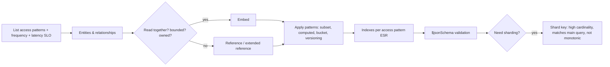

# NoSQL - MongoDB Data Modeling

> [!info] Deep dive of [[NoSQL]]

> [!abstract] TL;DR
> In MongoDB you model for **access patterns**, not entities. Data read together lives together:
> - **Embed** bounded, owned, co-read data.
> - **Reference** unbounded or independently changing data.
> - **Never grow arrays without bound** (16 MB document limit, write amplification).
>
> Index with the **ESR rule** (Equality → Sort → Range), enforce shape with `$jsonSchema` validation, and pick a shard key with high cardinality that matches your main query. If your data is relational and transactional, [[PostgreSQL]] + JSONB is often the better choice.

## Concept

### Embed vs reference
| Relationship | Default | Why |
|---|---|---|
| One-to-few, owned (order → line items, user → addresses) | **Embed** | One read, atomic single-document update |
| One-to-many, bounded and co-read (product → 20 variants) | Embed (or subset) | Same |
| One-to-many, unbounded (customer → messages, device → readings) | **Reference** (child holds parent ID) or **bucket** | Avoid huge, ever-growing documents |
| Many-to-many (students ↔ courses) | Reference arrays on the smaller side, or a link collection | Bounded arrays only |
| Data changing independently with many readers (product price shown in orders) | Reference + **extended reference** (copy the few fields needed) | Avoid joins on hot paths, accept controlled duplication |

### Schema design patterns
| Pattern | Problem it solves | Example |
|---|---|---|
| **Subset** | Large doc, only part frequently read | Product doc holds 10 latest reviews, rest in `reviews` |
| **Extended reference** | Avoid `$lookup` for common fields | Order embeds `{customerId, name, phone}` snapshot |
| **Computed** | Repeated expensive aggregations | Store `totalSen`, `itemCount` on write |
| **Bucket** | Many small time-series records | One doc per sensor/hour with readings array (or native time-series collections) |
| **Outlier** | A few huge entities break the model | Flag `hasOverflow: true` + overflow docs for celebrity accounts |
| **Attribute** | Many sparse, similar fields to search | `attrs: [{k: "color", v: "red"}]` + index on `attrs.k, attrs.v` |
| **Polymorphic** | Different shapes in one collection | `type: "sms" \| "whatsapp" \| "email"` with type-specific fields |
| **Schema versioning** | Evolving documents without downtime | `schemaVersion: 3`, migrate lazily on read/write |
| **Archive** | Old data slowing hot collection | Move to `orders_archive` or Atlas Online Archive |

### Index rules
- **ESR**: the compound index order is **E**quality fields, then **S**ort fields, then **R**ange fields. For example `{ tenantId: 1, status: 1, createdAt: -1 }` serves `find({tenantId, status}).sort({createdAt: -1})`.
- **Multikey** (arrays) indexes one entry per element. At most one array field per compound index.
- **Partial** (`partialFilterExpression`) indexes only active rows, which keeps indexes small. **TTL** indexes expire sessions and logs.
- **Covered queries**: a projection of only indexed fields avoids fetching documents.

## How It Works

- **Atomicity is per document**: embedding gives atomic updates without transactions. Multi-document transactions exist (replica sets/sharded) but cost latency and lock contention, so design so most writes touch one document.
- **WiredTiger** stores documents in B-trees with document-level concurrency. Rewriting a large document on every small change costs I/O and cache.

## Practical Usage

### Example: WhatsApp CRM (multi-tenant)
```js
// contacts: one doc per contact; bounded embedded data + extended reference to latest conversation
{
  _id: ObjectId(), tenantId: "t42", phone: "+60123456789", name: "Aisyah",
  tags: ["vip", "kuching"],                                   // bounded (≤ 50)
  lastMessage: { at: ISODate("2026-10-20T03:10:00Z"), preview: "boleh hantar esok?", direction: "in" },
  stats: { messages: 214, orders: 7, lifetimeSen: 186000 },   // computed pattern
  schemaVersion: 2
}

// messages: unbounded → separate collection, referenced by contactId
{ _id: ObjectId(), tenantId: "t42", contactId: ObjectId(), waId: "wamid.HBgM…", direction: "in",
  body: "boleh hantar esok?", at: ISODate("2026-10-20T03:10:00Z") }
```
```js
db.messages.createIndex({ tenantId: 1, contactId: 1, at: -1 });          // conversation view (E, E, S)
db.messages.createIndex({ tenantId: 1, waId: 1 }, { unique: true });     // webhook idempotency
db.contacts.createIndex({ tenantId: 1, phone: 1 }, { unique: true });
db.contacts.createIndex({ tenantId: 1, tags: 1, "lastMessage.at": -1 }); // multikey + sort
db.sessions.createIndex({ expiresAt: 1 }, { expireAfterSeconds: 0 });   // TTL
```

### Enforce shape with validation
```js
db.runCommand({
  collMod: "contacts",
  validator: { $jsonSchema: {
    bsonType: "object",
    required: ["tenantId", "phone", "schemaVersion"],
    properties: {
      tenantId: { bsonType: "string" },
      phone: { bsonType: "string", pattern: "^\\+[0-9]{8,15}$" },
      tags: { bsonType: "array", maxItems: 50, items: { bsonType: "string" } },
      schemaVersion: { bsonType: "int", minimum: 1 }
    }
  }},
  validationLevel: "moderate", validationAction: "error"     // moderate: existing invalid docs can still be updated
});
```

### Bucket pattern vs time-series collections
```js
// Native time-series (MongoDB 5.0+): automatic bucketing + compression
db.createCollection("readings", { timeseries: { timeField: "ts", metaField: "device", granularity: "minutes" },
                                   expireAfterSeconds: 60 * 60 * 24 * 90 });
```

### Updating denormalised copies
```js
// Extended reference: customer renamed → update the snapshot asynchronously (change stream / queue worker)
db.orders.updateMany({ tenantId: "t42", "customer.id": cid }, { $set: { "customer.name": "Aisyah Binti Ali" } });
```
- Decide per field whether a snapshot should stay **historical** (the order shows the name at purchase time) or stay **current** (update it). Write that decision down.

## Patterns & Anti-patterns
| Pattern | When | Anti-pattern to avoid |
|---|---|---|
| Embed bounded, co-read data | Orders + items, users + settings | Normalising everything into 12 collections and `$lookup` on every read |
| Reference/bucket unbounded growth | Messages, logs, events | `customer.messages: [...]` growing forever (16 MB limit, slow rewrites) |
| ESR compound indexes per access pattern | Every hot query | One single-field index per field |
| `tenantId` first in indexes and shard keys | Multi-tenant SaaS | Global indexes without tenant prefix → cross-tenant scans and leakage risk |
| `$jsonSchema` validation + `schemaVersion` | Long-lived products | "Schemaless" meaning every doc has a different shape |
| Hashed or compound shard key (`{tenantId, _id}`) | Sharding | Monotonic shard key (`createdAt`, ObjectId alone) → one hot shard |

## Performance & Trade-offs
- **Duplication vs consistency**: extended references remove joins, but every copy must be updated (or intentionally frozen). That's fine for rarely changing fields, painful for volatile ones.
- **`$lookup`**: works (including on sharded collections in newer versions), but repeated lookups on hot paths signal a relational model. Consider Postgres.
- **Working set**: indexes plus hot documents should fit in the WiredTiger cache (default ~50% of RAM − 1 GB). Large embedded arrays bloat the working set.
- **MongoDB vs Postgres JSONB**:
  - **MongoDB**: horizontal sharding, flexible documents, change streams, Atlas features (Search, Vector Search).
  - **Postgres + JSONB**: relational integrity, SQL joins, RLS, one database for everything ([[Supabase]]).
  - **SME default**: Postgres, unless documents genuinely dominate.

## Tips & Reminders
> [!tip]
> - **Write the access-pattern table first**: query, frequency, latency target and filter/sort fields. The schema and indexes fall out of it.
> - **Check `explain("executionStats")`**: look for `IXSCAN` vs `COLLSCAN`, `totalDocsExamined` ≈ `nReturned`, and no in-memory `SORT` stage on hot queries.
> - **Use majority write concern** (`w: "majority"`) for business data, and retryable writes in drivers for transient failovers.
> - **Licence**: MongoDB Community is **SSPL**. Fine for self-hosting your app, problematic if you offer MongoDB itself as a service. FerretDB (Postgres-backed, Apache-2.0) is an alternative for Mongo-API compatibility.
> - **In ZP's stack**: Supabase/Postgres is the default. Only maintain MongoDB when inheriting client systems, or for Atlas-specific needs. Keep it on Atlas or a patched self-hosted replica set, never exposed publicly.

## Version Notes
| Version | Modelling-relevant changes |
|---|---|
| 4.0 / 4.2 (2018–19) | Multi-document transactions (replica sets, then sharded) |
| 5.0 (2021) | Native time-series collections, live resharding |
| 6.0 / 7.0 (2022–23) | Queryable Encryption (GA in 7.0), compound wildcard indexes, `$lookup` on sharded collections improvements |
| **8.0** (2024-10) | Major performance gains, Queryable Encryption range queries, faster resharding |
| 8.x (2025–26) | Point releases. Patches for **MongoBleed** (CVE-2025-14847, Dec 2025) |

> [!warning] Unverified — check before relying on this
> MongoDB 8.2+/9.0 feature details and the exact fixed versions for CVE-2025-14847 weren't confirmed this run. Check the MongoDB release notes and security advisory before upgrading.

## Critical Issues & Gotchas
> [!danger] Exposed MongoDB instances & MongoBleed
> - **Exposure**: internet-reachable MongoDB has a long history of mass ransom wipes (2017 onwards), from no auth or weak auth on `0.0.0.0:27017`.
> - **MongoBleed** (CVE-2025-14847, Dec 2025): an unauthenticated heap memory leak in network message handling (zlib compression path), exploited in the wild. Attackers could read fragments of server memory (credentials, data) without logging in.
> - **Fix**: patch, bind to private networks only, enable auth/TLS, and disable zlib network compression if patching is delayed.

> [!danger] Unbounded documents and arrays
> Documents that grow forever (chat history in the contact doc, event logs in the user doc) eventually hit the **16 MB** limit and fail writes. Before that, they make every update rewrite megabytes and evict the cache. Cap arrays (`$push` with `$slice`), or move growth into separate collections or buckets.

> [!warning] Gotchas
> - Schemaless drift: typos (`phoneNumber` vs `phone`) silently create new fields. Validation plus TypeScript types (Mongoose/Zod) prevent it.
> - Case-sensitive string matching by default. Use collations or normalised fields for case-insensitive lookups.
> - Large `$in` lists and unanchored regexes (`/abc/`) can't use indexes efficiently.
> - Transactions have a default 60 s lifetime and abort on write conflicts. Retry with driver helpers (`withTransaction`).
> - `ObjectId` timestamps reveal creation time. Don't treat them as secret or unguessable.

## Related
- [[NoSQL]]
- [[PostgreSQL]] — JSONB alternative with relational integrity
- [[System Design - Multi-Tenant SaaS Architecture]] — tenant prefixes, isolation
- [[Vector Databases]] — Atlas Vector Search vs pgvector
- [[Data Structures]] — B-trees, indexes
- [[Docker]] — local replica sets for development

## References
- MongoDB data modeling: https://www.mongodb.com/docs/manual/data-modeling/
- Building with Patterns (MongoDB blog series): https://www.mongodb.com/blog/post/building-with-patterns-a-summary
- ESR rule: https://www.mongodb.com/docs/manual/tutorial/equality-sort-range-rule/
- Schema validation: https://www.mongodb.com/docs/manual/core/schema-validation/
- Unit 42 on MongoBleed (CVE-2025-14847): https://unit42.paloaltonetworks.com/mongobleed-cve-2025-14847/
