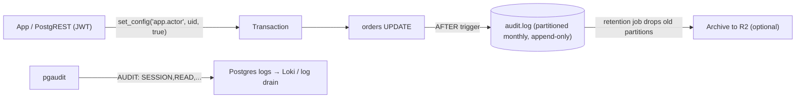

# PostgreSQL - Audit Logging & Change History

> [!info] Deep dive of [[PostgreSQL]]

> [!abstract] TL;DR
> Three different needs that people all call "audit":
> 1. **Row change history** (what changed, old → new, by whom): a **generic trigger** writing JSONB diffs to an append-only, partitioned `audit.log` table. This is the default choice.
> 2. **Statement/session auditing** (who ran which SQL, including reads and DDL): the **pgaudit** extension → server logs → log pipeline. For compliance and DBA access.
> 3. **Business events** ("order refunded by staff X"): explicit **application-level audit entries**, which carry intent the triggers can't see.
>
> Capture the **actor** (`auth.uid()`, or `set_config('app.actor', ...)`), make the log **append-only** (no UPDATE/DELETE grants), partition by month, and define **retention** (PDPA: keep only as long as needed).

## Concept
| Approach | Captures | Pros | Cons | Pick it when… |
|---|---|---|---|---|
| Generic audit trigger → JSONB | INSERT/UPDATE/DELETE row images/diffs | Simple, in-DB, queryable | Write overhead. No SELECT auditing | "Who changed this record?" |
| Per-table history tables | Full previous versions | Typed columns, easy "as of" queries | Schema duplication per table | Few critical tables (prices, contracts) |
| Temporal/versioned rows (`valid_from/valid_to`) | Business-time history | Point-in-time queries | App logic changes | Pricing, policies, rates over time |
| pgaudit | Statements (READ, WRITE, DDL, ROLE) | Compliance-grade, covers reads | Log volume, logs not tables | Regulated data, DBA access audit |
| App-level events | Intent + context (IP, reason) | Business meaning | Developers must remember | Refunds, approvals, exports |
| CDC (logical decoding) | All changes to a stream | No triggers, off-box | Infra + slot risks | High volume, external audit store ([[PostgreSQL - Logical Replication & Change Data Capture]]) |

## How It Works


## Practical Usage
**Audit schema and append-only table** (partitioned):
```sql
create schema if not exists audit;
create table audit.log (
  id         bigint generated always as identity,
  at         timestamptz not null default now(),
  actor      uuid,                         -- auth.uid() or app user id
  actor_role text default current_user,
  table_name text not null,
  op         text not null check (op in ('INSERT','UPDATE','DELETE')),
  row_pk     text not null,
  old_data   jsonb,
  new_data   jsonb,
  changed    jsonb,                        -- only changed keys for UPDATE
  txid       bigint default txid_current(),
  primary key (id, at)
) partition by range (at);
create table audit.log_2026_11 partition of audit.log for values from ('2026-11-01') to ('2026-12-01');
create index on audit.log (table_name, row_pk, at desc);

revoke all on audit.log from public, anon, authenticated;   -- nobody updates/deletes audit rows
```
**Generic trigger function**:
```sql
create or replace function audit.capture() returns trigger
language plpgsql security definer set search_path = '' as $$
declare
  v_actor uuid := coalesce(
    nullif(current_setting('request.jwt.claim.sub', true), '')::uuid,     -- PostgREST / Supabase
    nullif(current_setting('app.actor', true), '')::uuid);                -- workers, n8n, scripts
  v_old jsonb := case when tg_op <> 'INSERT' then to_jsonb(old) - array['password_hash','ic_number'] end;   -- redact first
  v_new jsonb := case when tg_op <> 'DELETE' then to_jsonb(new) - array['password_hash','ic_number'] end;
begin
  insert into audit.log (actor, table_name, op, row_pk, old_data, new_data, changed)
  values (v_actor, tg_table_name, tg_op, coalesce(v_new->>'id', v_old->>'id'),
          v_old, v_new,
          case when tg_op = 'UPDATE' then
            (select jsonb_object_agg(k, v_new->k) from jsonb_object_keys(v_new) k
             where v_new->k is distinct from v_old->k) end);
  return null;
end $$;

create trigger audit_orders after insert or update or delete on public.orders
for each row execute function audit.capture();
```
**Actor from background workers / n8n** (same transaction):
```sql
begin;
select set_config('app.actor', '0b3c…-uuid-of-service-user', true);   -- true = local to transaction
update public.orders set status = 'shipped' where id = 42;
commit;
```
**Record history query**:
```sql
select at, actor, op, changed from audit.log
where table_name = 'orders' and row_pk = '42' order by at desc;
```
**pgaudit for statement-level auditing** (self-hosted or where enabled):
```sql
-- postgresql.conf: shared_preload_libraries = 'pgaudit'
create extension pgaudit;
alter role dba_user set pgaudit.log = 'read, write, ddl, role';   -- audit humans with direct access
alter system set pgaudit.log = 'ddl, role';                         -- cluster-wide baseline
```
**Wrong way**:
```text
❌ Audit table writable by the app role            → attacker or bug erases the trail
❌ Logging full rows with IC numbers and passwords  → audit log becomes the biggest PII leak
❌ One unpartitioned audit table forever            → 100M rows, slow inserts, impossible cleanup
❌ pgaudit 'all' on the whole cluster               → log volume floods disk on a small VPS
```

## Patterns & Anti-patterns
| Pattern | When | Anti-pattern to avoid |
|---|---|---|
| Trigger audit on business tables only | Orders, payments, users, permissions | Auditing high-churn tables (sessions, counters) |
| Store diffs (`changed`) + optional full images | Space-conscious | Full rows for every tiny update |
| Monthly partitions + drop-by-partition retention | Any volume | `DELETE` of millions of old rows |
| Redact or hash sensitive fields | PII columns | Copying ICs/phones into audit |
| Actor via JWT claim or `app.actor` | Supabase + workers | `current_user` only (always the pooler/service role) |
| App-level events for intent | Refunds, exports, admin actions | Reconstructing intent from row diffs |
| Ship pgaudit logs off-box | Compliance | Logs on the same disk as the DB |

## Performance & Trade-offs
- **Write amplification**: each audited write adds one insert plus JSONB building. Typically 10–30% overhead on audited tables, negligible for SME volumes but noticeable on bulk imports. Disable triggers deliberately during migrations (`alter table … disable trigger audit_orders`) and document it.
- **Storage**: diffs plus monthly partitions keep growth predictable. Compress archived partitions to R2 as CSV/Parquet.
- **Query patterns**: index `(table_name, row_pk, at desc)` for record history, and `(actor, at)` for "what did this user do".
- **pgaudit** costs log I/O, not table writes. Scope it to roles and object classes.

## Tips & Reminders
> [!tip] In ZP's stack
> - **Supabase**: `supa_audit` offers a ready-made trigger-based audit (`audit.enable_tracking('public.orders')`). The custom trigger above gives more control over redaction and actor capture ([[Supabase - Database Functions, Triggers & RPC]]).
> - **Client disputes** ("who changed the price / deleted this booking?") are where an audit trail pays for itself. Include it in SOWs for admin dashboards.
> - **n8n writes**: set `app.actor` to a dedicated service-user UUID per workflow group, so automation changes are distinguishable from staff edits.

- Expose audit history to admins via a `security definer` RPC with tenant checks, not direct table access.
- Retention: e.g. 12–24 months online, then archive or delete per the client's retention policy (PDPA retention principle).
- Add `ip`/`user_agent` in app-level events where legal or security investigations need them.
- Test the trigger with a migration test: update a row, then assert one audit row with the correct actor.

## Version Notes
| Version | Change relevant here |
|---|---|
| 9.5+ | pgaudit available for all supported versions |
| 10–11 | Declarative partitioning matured (good for audit tables) |
| 13+ | Logical decoding improvements for CDC-based audit |
| 18 (2025-09) | Temporal constraints `WITHOUT OVERLAPS`/`PERIOD` for valid-time tables. `OLD/NEW` in `RETURNING` |
| 19 (GA planned 2026-11-19) | Check release notes for audit-relevant changes ([[PostgreSQL]]) |

> [!warning] Unverified — check before relying on this
> Whether pgaudit is available on Supabase Cloud for customer configuration, and current `supa_audit` maintenance status, weren't verified this run. Check the Supabase extensions list.

## Critical Issues & Gotchas
> [!danger] The audit log as a PII honeypot
> Full row images duplicate every personal field (IC numbers, phone numbers, addresses, medical notes) into a table that's rarely access-controlled or purged. A leak of the audit table leaks all historical values, including data customers asked to delete. Redact sensitive columns, restrict access, and apply the same retention and deletion rules as the source data (PDPA data subject requests).

> [!danger] Actor always shows the service role
> With poolers, PostgREST and service-role workers, `current_user` is `authenticator`/`postgres`/`service_role` for everyone, so the trail says nothing about who did it. Capture the actor from JWT claims (`request.jwt.claim.sub`) or a transaction-local `app.actor` setting, and reject audited writes with no actor where accountability matters.

- **`security definer` trigger functions** need `set search_path = ''` and schema-qualified names, or they're hijackable.
- **Truncate** bypasses row triggers. Add a statement-level `TRUNCATE` trigger or revoke `TRUNCATE`.
- **Partition creation** must be automated (pg_partman or a cron job), or inserts fail at month boundaries ([[PostgreSQL - Partitioning & Large Table Maintenance]]).
- **Restores**: audit partitions must be included in backups, or history disappears after PITR to a new instance.

## Related
- [[PostgreSQL]]
- [[PostgreSQL - Roles, Privileges & Least-Privilege Access]] — append-only grants
- [[PostgreSQL - Partitioning & Large Table Maintenance]] — monthly partitions and retention
- [[PostgreSQL - JSONB Patterns & Full-Text Search]] — diffs and querying JSONB
- [[Supabase - Database Functions, Triggers & RPC]] — trigger and `security definer` patterns
- [[System Design - Event-Driven Architecture & Outbox Pattern]] — business events vs row audit

## References
- https://github.com/pgaudit/pgaudit
- https://github.com/supabase/supa_audit
- https://www.postgresql.org/docs/current/plpgsql-trigger.html
- https://www.postgresql.org/docs/current/ddl-partitioning.html
- https://wiki.postgresql.org/wiki/Audit_trigger_91plus
