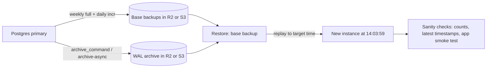

# PostgreSQL - Backups, PITR & Restore Drills

> [!info] Deep dive of [[PostgreSQL]]

> [!abstract] TL;DR
> - **Agree RPO/RTO first** (e.g. RPO 5 min, RTO 1 h). Then pick the mechanism:
>   - **logical dumps** (`pg_dump`): portable, slow to restore, no PITR;
>   - **physical base backups + continuous WAL archiving** (pgBackRest / WAL-G → R2/S3): **point-in-time recovery** to any second.
> - Replicas are not backups: a `DROP TABLE` replicates instantly.
> - A backup that hasn't been **restored on a schedule** is a hope, not a backup. Automate a monthly restore drill with sanity checks and a measured RTO.

## Concept
| Method | What you get | RPO | Restore speed | Use for |
|---|---|---|---|---|
| `pg_dump -Fc` (logical) | One database, schema + data, version-portable | Time since last dump (e.g. 24 h) | Slow (re-inserts, re-indexes) | Small DBs, migrations between versions/providers, per-tenant exports |
| `pg_dumpall --globals-only` | Roles, tablespaces | — | — | Always alongside `pg_dump` |
| Base backup + WAL archive (PITR) | Whole cluster at any point in time | Seconds–minutes (archive lag) | Fast (file copy + WAL replay) | Production primaries |
| Incremental base backups (PG17 native / pgBackRest diff+incr) | Smaller, faster periodic backups | Same as PITR | Combine + replay | Large clusters |
| Streaming replica | Hot standby for failover | ~0 for hardware loss | Seconds (promote) | **HA, not backup**: logical errors replicate |
| Provider snapshots (VPS disk) | Crash-consistent disk image | Snapshot interval | Medium | Extra layer only. Not app-consistent without care |

- **PITR mechanics**: a base backup is restored, then WAL segments are replayed up to `recovery_target_time` (or LSN/xid/name), e.g. just before the bad `DELETE`.
- **3-2-1**: 3 copies, 2 media/providers, 1 off-site. For a solo setup: local DB + R2 bucket + a second provider or a periodic offline export.

## How It Works


## Practical Usage
**Logical dumps** (scheduled, e.g. Coolify scheduled backup or a systemd timer):
```bash
pg_dump "$DATABASE_URL" -Fc --no-owner --no-privileges -f /backups/app-$(date +%F).dump
pg_dumpall --globals-only -d "$ADMIN_URL" > /backups/globals-$(date +%F).sql
aws s3 cp /backups/ s3://db-backups/app/ --recursive --endpoint-url "https://$R2_ACCOUNT.r2.cloudflarestorage.com"
# restore (into an empty DB): parallel jobs speed it up
pg_restore -d "$RESTORE_URL" -j 4 --no-owner /backups/app-2026-10-28.dump
```
**pgBackRest → R2** (`/etc/pgbackrest/pgbackrest.conf`):
```ini
[global]
repo1-type=s3
repo1-s3-endpoint=<account>.r2.cloudflarestorage.com
repo1-s3-bucket=pg-backups
repo1-s3-region=auto
repo1-s3-uri-style=path
repo1-path=/main
repo1-retention-full=4                       # keep 4 full backups (+ their WAL)
repo1-cipher-type=aes-256-cbc                # client-side encryption
repo1-cipher-pass=<long random secret, stored in a password manager>
process-max=4
archive-async=y
compress-type=zst
start-fast=y

[main]
pg1-path=/var/lib/postgresql/18/main
```
```ini
# postgresql.conf
archive_mode = on
archive_command = 'pgbackrest --stanza=main archive-push %p'
archive_timeout = 60          # force a WAL switch at least every 60 s → RPO ≈ 1 min on quiet DBs
wal_level = replica
```
```bash
pgbackrest --stanza=main stanza-create && pgbackrest --stanza=main check
pgbackrest --stanza=main --type=full backup      # weekly (timer)
pgbackrest --stanza=main --type=incr backup      # daily (timer)
# PITR restore to just before the incident (Malaysia time)
pgbackrest --stanza=main --delta --type=time --target="2026-10-28 14:03:59+08" --target-action=promote restore
```
**PostgreSQL 17+ native incremental** (no extra tool; needs `summarize_wal = on`):
```bash
pg_basebackup -D /bk/full -c fast
pg_basebackup -D /bk/incr1 --incremental=/bk/full/backup_manifest
pg_combinebackup /bk/full /bk/incr1 -o /restore/data      # synthesize a full data dir for restore
```
**Automated restore drill** (monthly, on a scratch server or container):
```bash
#!/usr/bin/env bash
set -euo pipefail
start=$(date +%s)
pgbackrest --stanza=main --pg1-path=/scratch/pg --type=time --target="$(date -d '1 hour ago' -Is)" restore
pg_ctl -D /scratch/pg -o "-p 5499" start -w
psql -p 5499 -d app -Atc "select count(*) from orders"                       # > 0
psql -p 5499 -d app -Atc "select max(created_at) > now() - interval '2 hours' from orders"   # t
echo "RTO_SECONDS=$(( $(date +%s) - start ))" | tee -a /var/log/restore-drill.log
pg_ctl -D /scratch/pg stop
```
**Wrong way**:
```text
❌ Only a streaming replica ("we have HA")                → DELETE without WHERE replicates in milliseconds
❌ pg_dump to the same disk as the database              → disk failure or ransomware takes both
❌ Backups never restored; credentials only on the server → you discover gaps during the incident
```

## Patterns & Anti-patterns
| Pattern | When | Anti-pattern to avoid |
|---|---|---|
| PITR (pgBackRest/WAL-G) for production + weekly `pg_dump` for portability | Self-hosted prod | Daily dumps only, so up to 24 h data loss |
| Encrypted repo + **separate, write-only** bucket credentials | Off-site backups | Same R2 token for app uploads and backups |
| Monitor archive lag and last successful backup age; alert | Always | Silent `archive_command` failures filling `pg_wal` |
| Monthly automated restore drill with recorded RTO | Always | "We'll test it when we need it" |
| Retention aligned with contracts/PDPA (e.g. 35 days) | Client data | Indefinite backups of personal data |
| Runbook with exact restore commands + where secrets live | Solo ops | Knowledge only in your head |

## Performance & Trade-offs
- **RPO vs cost**: continuous archiving with `archive_timeout = 60` keeps RPO around a minute, at the cost of more WAL objects (cheap on R2: no egress, small ops fees). Daily dumps cost less effort but risk a day's orders.
- **RTO drivers**: restore throughput (network from R2, `process-max`), WAL volume to replay since the last base backup, and index rebuilds (logical restores). Frequent incremental backups shorten replay time.
- **Backup load**: base backups read the whole data directory. Schedule them off-peak (Malaysia night) and use `start-fast` sparingly on busy primaries. Backing up from a standby offloads the primary.
- **Managed (Supabase)**: daily backups are included by plan, with **PITR as an add-on** (paid) and restores into the same or a new project. It's easiest, but keep your own periodic `pg_dump` for provider exit and audits.

## Tips & Reminders
> [!tip] In ZP's stack
> - **Supabase-hosted clients**: enable PITR for paid production tenants, plus a weekly `pg_dump` (Supabase CLI `db dump` or `pg_dump` via the pooler's session mode) to R2 via a GitHub Actions or n8n schedule.
> - **Self-hosted Postgres on Coolify**: Coolify scheduled dumps to R2 at minimum. For revenue-critical DBs, a Postgres image with pgBackRest/WAL-G archiving to a separate R2 bucket ([[Coolify - Operations, Backups & Hardening]]).
> - **Contracts**: put the backup frequency, retention and tested RTO in client contracts and SLAs, and only promise what the drill log proves.

- Store the pgBackRest cipher passphrase and R2 credentials **outside** the server (password manager). A dead server must not take the decryption key with it.
- Alert on: last backup age > 26 h, WAL archive failures (`pg_stat_archiver.failed_count` increasing), and `pg_wal` directory size.
- Test restoring **one table or tenant** (restore to scratch, then `COPY` the rows back). It's the most common real request ("customer deleted their menu").
- Keep the restore Postgres major version and extensions identical (pgvector, pg_trgm), or physical restores fail.

## Version Notes
| Version / tool | Released | Key changes | Breaking / migration notes |
|---|---|---|---|
| PostgreSQL 15 | 2022 | Server-side compression for `pg_basebackup` (lz4/zstd), `archive_library` modules | Exclusive backup mode removed |
| PostgreSQL 17 | 2024-09 | **Native incremental backups** (`pg_basebackup --incremental`, `pg_combinebackup`, `summarize_wal`) | Needs WAL summarization enabled before the first incremental |
| PostgreSQL 18.x | 2025–26 | Security fixes incl. `pg_basebackup`/`pg_rewind` path traversal (18.4+). Run current minors | Patch before restoring untrusted backups |
| pgBackRest 2.58 | 2026 (current stable per mirrors) | S3/R2 repos, encryption, diff/incr, async archiving | Check release notes before upgrading repos |

> [!warning] Unverified — check before relying on this
> The pgBackRest version and the R2-specific settings (`uri-style=path`, `region=auto`) were not re-verified against official docs this run, and nor was the Supabase PITR plan/add-on pricing. Check https://pgbackrest.org/release.html and Supabase's backup docs.

## Critical Issues & Gotchas
> [!danger] Silent archive failure
> If `archive_command` fails (expired R2 token, full bucket, network), Postgres keeps WAL in `pg_wal` until the disk fills and the database **stops**. Meanwhile your PITR window silently ends at the last successful archive. Monitor `pg_stat_archiver` and disk, and test with `pgbackrest check` after any credential rotation.

> [!danger] Backups as a breach vector
> Backups contain every customer's personal data. An unencrypted dump in a public or over-permissioned bucket is a PDPA-reportable breach. Encrypt client-side, use private buckets with scoped write-only tokens, and log access.

- **Logical dumps aren't consistent across databases**: each `pg_dump` is a snapshot of one DB. Multi-DB apps need coordinated timing, or PITR.
- **Extensions and roles**: restores fail or lose permissions without `pg_dumpall --globals-only` and the same extensions installed.
- **Time zones in PITR targets**: specify an explicit offset (`+08`). An ambiguous local time restores to the wrong moment.
- **Ransomware / account takeover**: an attacker with your cloud credentials can delete backups too. Keep one copy under different credentials, or with object-lock/retention where the storage supports it.

## Related
- [[PostgreSQL]]
- [[PostgreSQL - Transactions & MVCC]] — WAL, checkpoints, vacuum
- [[Coolify - Operations, Backups & Hardening]] — scheduled dumps, instance backups
- [[Cloudflare - R2 Storage & Presigned Uploads]] — bucket and token scoping
- [[Supabase]] — managed backups and PITR add-on
- [[Linux Essentials - systemd, Logs & Troubleshooting]] — timers for backup jobs and drills

## References
- https://www.postgresql.org/docs/current/continuous-archiving.html
- https://www.postgresql.org/docs/current/app-pgcombinebackup.html
- https://pgbackrest.org/user-guide.html
- https://github.com/wal-g/wal-g
- https://supabase.com/docs/guides/platform/backups
- https://oneuptime.com/blog/post/2026-01-30-postgresql-incremental-backups/view
