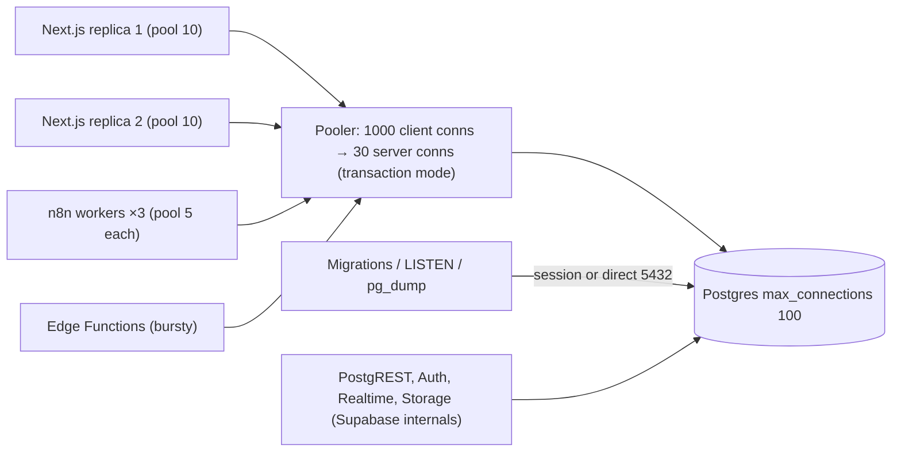

# PostgreSQL - Connection Pooling with Supavisor & PgBouncer

> [!info] Deep dive of [[PostgreSQL]]

> [!abstract] TL;DR
> Postgres forks one process per connection (~5–10 MB+ each), so connections are a scarce resource. A pooler multiplexes many client connections onto a few server connections.
> - **Transaction mode** (Supabase **6543**, PgBouncer `pool_mode=transaction`) for web/serverless/short queries. Session state doesn't survive between transactions.
> - **Session mode / direct (5432)** for migrations, `LISTEN/NOTIFY`, session advisory locks, long-lived workers.
>
> Size pools top-down: `replicas × per-process pool ≤ pooler pool ≤ max_connections − reserved`. Patch PgBouncer to **1.25.x** (CVE-2025-12819).

## Concept
| Mode | Server connection held for | Breaks | Use for |
|---|---|---|---|
| **Session** | Whole client connection | Nothing (same as direct) | Migrations, admin, `LISTEN`, long-lived workers, IPv4 path to Supabase |
| **Transaction** | One transaction | Session `SET`, session advisory locks, `LISTEN/NOTIFY`, temp tables across txns, `WITH HOLD` cursors, SQL-level `PREPARE` | Web requests, serverless, Next.js, Edge Functions |
| Statement | One statement | Multi-statement transactions | Rare (simple read APIs) |

**Supabase connection strings**:

| Path | Host / port | Mode | Notes |
|---|---|---|---|
| Direct | `db.<ref>.supabase.co:5432` | Direct | IPv6 by default (IPv4 is a paid add-on). Migrations, pg_dump |
| Supavisor session | `<region>.pooler.supabase.com:5432` | Session | IPv4-friendly persistent clients. User `postgres.<ref>` |
| Supavisor transaction | `<region>.pooler.supabase.com:6543` | Transaction | Serverless/short-lived. Disable client-side prepared statements |
| Dedicated pooler (paid plans) | Co-located PgBouncer | Transaction | Lower latency than the shared pooler |

**Poolers compared**:

| Pooler | Strength | Pick it when… |
|---|---|---|
| PgBouncer | Tiny, battle-tested, single-threaded C | Self-hosted Postgres on a VPS (default choice) |
| Supavisor | Elixir, multi-tenant, cluster-aware | You're on Supabase (it's built in) |
| pgcat / PgDog | Rust, multi-threaded, load balancing/sharding | Read replicas, very high connection counts |
| App-side pool only | No extra hop | Few long-lived app processes, total ≤ ~50 connections |

## How It Works


## Practical Usage
**Self-hosted PgBouncer** (`pgbouncer.ini`, next to Postgres on the same Docker network):
```ini
[databases]
app = host=postgres port=5432 dbname=app

[pgbouncer]
listen_addr = 0.0.0.0
listen_port = 6432
auth_type = scram-sha-256
auth_user = pgbouncer_auth
auth_query = SELECT usename, passwd FROM pgbouncer.get_auth($1)
pool_mode = transaction
max_client_conn = 1000
default_pool_size = 25          ; server connections per db/user pair
reserve_pool_size = 5
reserve_pool_timeout = 3
max_prepared_statements = 200   ; protocol-level prepared statement tracking (default in 1.25)
server_idle_timeout = 300
query_wait_timeout = 30         ; fail fast instead of queueing forever
```
**Clients in transaction mode**:
```ts
// postgres.js (Drizzle): no protocol-level prepared statements through 6543
import postgres from 'postgres';
export const sql = postgres(process.env.DATABASE_URL!, { max: 10, prepare: false, idle_timeout: 20 });

// node-postgres
import { Pool } from 'pg';
export const pool = new Pool({ connectionString: process.env.DATABASE_URL, max: 10, idleTimeoutMillis: 10_000, connectionTimeoutMillis: 5_000 });
```
```bash
# Prisma: pooled URL for the app, direct URL for migrations
DATABASE_URL="postgresql://postgres.<ref>:…@aws-0-ap-southeast-1.pooler.supabase.com:6543/postgres?pgbouncer=true&connection_limit=5"
DIRECT_URL="postgresql://postgres:…@db.<ref>.supabase.co:5432/postgres"
```
**Transaction-mode-safe SQL**:
```sql
begin;
set local statement_timeout = '5s';                          -- SET LOCAL, not SET
set local app.tenant_id = '6c1e…';                           -- read via current_setting() in RLS
select pg_advisory_xact_lock(hashtext('invoice:' || $1));     -- xact lock, not pg_advisory_lock
commit;
```
**Diagnose exhaustion**:
```sql
select usename, application_name, state, count(*)
from pg_stat_activity group by 1,2,3 order by 4 desc;       -- who holds connections, idle in transaction?
show max_connections;
```
```bash
psql -p 6432 -U pgbouncer pgbouncer -c "SHOW POOLS;"   # cl_waiting > 0 = pool too small or slow queries
```
**Wrong way**:
```text
❌ 4 Next.js replicas × Prisma default pool (cores×2+1) + 3 n8n workers direct → "too many connections" at peak
❌ SET search_path / SET role in transaction mode → leaks to the next client's transaction or silently lost
❌ LISTEN/NOTIFY or pg_advisory_lock through 6543 → notifications missed, locks released at random
❌ Running migrations through the transaction pooler → prepared-statement errors, partial DDL sessions
```

## Patterns & Anti-patterns
| Pattern | When | Anti-pattern to avoid |
|---|---|---|
| Transaction pooler for request-scoped work | Web, serverless, Edge Functions | Direct connections from every serverless instance |
| Session/direct for migrations, `LISTEN`, dumps | Ops paths | One connection string for everything |
| Budget: replicas × pool ≤ pooler pool ≤ `max_connections` − reserved | Capacity planning | Default pool sizes multiplied by replicas |
| `SET LOCAL` / `set_config(..., true)` inside transactions | RLS context, timeouts | Session-level `SET` behind a pooler |
| Short transactions, no external calls inside | Everything | HTTP/LLM calls while holding a transaction |
| `idle_in_transaction_session_timeout` + `query_wait_timeout` | Protection | Leaked transactions pinning server connections |
| Separate DB roles per app (web, n8n, workers) | Observability | Everyone as `postgres` (can't see who holds what) |

## Performance & Trade-offs
- **Fewer server connections is faster** past a point: Postgres throughput peaks around a few × CPU cores of *active* connections. 20–50 server connections often beat 300.
- **Extra hop**: a pooler adds ~0.1–1 ms on the same host. The shared Supavisor across regions adds network RTT, so pick the region next to your Coolify VPS (Singapore for Malaysia).
- **Prepared statements**: PgBouncer ≥ 1.21 tracks protocol-level prepared statements in transaction mode (`max_prepared_statements`). Supavisor transaction mode: disable them client-side. Without tracking you get "prepared statement does not exist" errors.
- **Waiting clients** (`cl_waiting`) mean slow queries or long transactions more often than a small pool. Fix the queries before raising pool sizes ([[PostgreSQL - Query Planning & EXPLAIN]]).

## Tips & Reminders
> [!tip] In ZP's stack
> - **Next.js on Coolify → Supabase**: transaction pooler 6543, `prepare: false`, pool 5–10 per replica ([[Next.js - Self-Hosting, Standalone Builds & ISR on Coolify]]).
> - **n8n's own database** (queue mode): session/direct connection with `DB_POSTGRESDB_POOL_SIZE` sized for main + workers. Client data workflows go through the transaction pooler with a dedicated role ([[n8n - Queue Mode & Scaling]]).
> - **Supabase internals** (PostgREST, Auth, Realtime, Storage) also use connections. Check the project's connection usage report before raising your own pools.
> - **Self-hosted Postgres on a KVM**: PgBouncer in the same Compose stack, Postgres not published, apps connect to PgBouncer only.

- Set `application_name` per service so `pg_stat_activity` shows which app leaks connections.
- Keep worker pools small: a BullMQ worker with concurrency 10 needs ~10 connections at most, often fewer.
- After upgrading compute (more `max_connections`), re-check the pooler's pool size. It doesn't scale automatically everywhere.

## Version Notes
| Version / date | Change relevant here |
|---|---|
| PgBouncer 1.21 (2023-10) | Protocol-level prepared statements in transaction mode (`max_prepared_statements`) |
| 2024 | Supabase replaces PgBouncer with Supavisor (6543 txn, 5432 session on the pooler host) |
| 2025 | Supabase dedicated (co-located) PgBouncer for paid plans |
| PgBouncer 1.25.x | CVE-2025-12819 fix (unauthenticated SQL via malicious `search_path` in StartupMessage). Prepared statement tracking on by default (200) |
| PostgreSQL 18–19 | No built-in pooler. Async I/O doesn't change connection economics ([[PostgreSQL]]) |

> [!warning] Unverified — check before relying on this
> The exact PgBouncer version that turned prepared-statement tracking on by default, and Supabase's dedicated-pooler availability per plan, weren't confirmed. Check https://www.pgbouncer.org/changelog.html and Supabase's connection docs.

## Critical Issues & Gotchas
> [!danger] CVE-2025-12819: unauthenticated SQL in PgBouncer
> Before the 1.25.x fix, an attacker who could reach PgBouncer's port could run SQL during authentication via a crafted `search_path`. Upgrade, never expose the pooler port publicly, and restrict it to the Docker network/VPN ([[Linux Essentials - Networking, Firewalls & Tailscale]]).

> [!danger] Session state leaking across tenants
> In transaction mode, a session-level `SET app.tenant_id` or `SET ROLE` can persist on a server connection and be inherited by another client's transaction, so RLS evaluates with the wrong tenant. Always use `SET LOCAL` or `set_config(..., true)` inside the transaction, and test with two tenants under concurrency ([[Supabase - Row Level Security]]).

- **"Prepared statement does not exist" / "bind message has N result formats"**: client prepared statements through a transaction pooler. Disable them client-side or enable tracking in PgBouncer (users reported such errors on 1.25.1 too, so test).
- **Idle in transaction** sessions (a crashed worker mid-transaction) pin server connections and block vacuum. Set `idle_in_transaction_session_timeout = '60s'`.
- **IPv6-only direct connections** fail from IPv4-only hosts. Use the session pooler, or the IPv4 add-on.
- **Serverless bursts**: thousands of cold starts each opening connections exhaust even the pooler's client limit. Use the HTTP data API (PostgREST) or keep `connection_limit=1` per instance.

## Related
- [[PostgreSQL]]
- [[Supabase]] — Supavisor endpoints and internal connection consumers
- [[PostgreSQL - Transactions & MVCC]] — short transactions, idle-in-transaction effects
- [[Node.js - Performance & Diagnostics]] — app-side pool sizing
- [[n8n - Queue Mode & Scaling]] — worker counts and DB pool sizing
- [[Supabase - Edge Functions, Cron & Queues]] — serverless connection patterns

## References
- https://www.pgbouncer.org/config.html
- https://www.pgbouncer.org/changelog.html
- https://supabase.com/docs/guides/database/connecting-to-postgres
- https://pganalyze.com/blog/5mins-postgres-pgbouncer-prepared-statements-transaction-mode
- https://www.postgresql.org/message-id/ZRAP278MB020501725B91B175D8300AC0C46CA%40ZRAP278MB0205.CHEP278.PROD.OUTLOOK.COM
