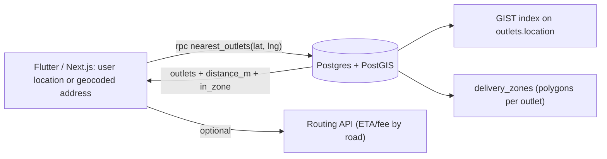

# PostgreSQL - Geospatial with PostGIS for Delivery & Outlets

> [!info] Deep dive of [[PostgreSQL]]

> [!abstract] TL;DR
> **PostGIS** adds spatial types, functions and indexes to Postgres. It's enough for nearly all SME location features:
> - **nearest outlet** (KNN `<->`);
> - **within X km** (`ST_DWithin`);
> - **delivery zones** (polygon `ST_Contains`/`ST_Covers`);
> - **distance-based fees**;
> - **heatmaps of orders**.
>
> Rules:
> - store points as **`geography(Point, 4326)`** for metres-based distance on Earth;
> - remember **longitude first** (`ST_MakePoint(lng, lat)`);
> - add **GIST indexes**;
> - expose queries via **RPC functions** (Supabase).
>
> Straight-line distance ≠ travel time. Use a routing API (Google/OSRM) for ETAs and fees that must reflect roads, rivers and traffic.

## Concept
| Concept | Meaning | Note |
|---|---|---|
| SRID 4326 | WGS84 lat/lng (GPS) | What phones and Google Maps use |
| `geography` | Spherical calculations, metres | Simpler for distances. Fewer functions than geometry |
| `geometry` | Planar, units of SRID | Faster. Use a projected SRID for accurate local metres |
| GIST index | Spatial index | Required for performance |
| `<->` operator | KNN distance ordering | Nearest-N queries with index support |
| `ST_DWithin(a, b, m)` | Within distance (index-aware) | Prefer over `ST_Distance(...) < m` |
| `ST_Covers(zone, point)` | Point in polygon (incl. boundary) | Delivery zones |

**Common features**:

| Feature | Query |
|---|---|
| Nearest 3 outlets | `order by location <-> point limit 3` |
| Outlets within 10 km | `where ST_DWithin(location, point, 10000)` |
| Is address in delivery zone? | `where ST_Covers(zone, point)` |
| Distance-based fee | `ST_Distance(outlet.location, customer)` → tier |
| Riders near a pickup | KNN on latest rider positions |

## How It Works


## Practical Usage
**Enable and model** (Supabase: enable `postgis` extension):
```sql
create extension if not exists postgis with schema extensions;

create table public.outlets (
  id uuid primary key default gen_random_uuid(),
  tenant_id uuid not null,
  name text not null,
  location extensions.geography(Point, 4326) not null
);
create index outlets_location_gix on public.outlets using gist (location);

insert into public.outlets (tenant_id, name, location)
values ($1, 'Kuching Central', extensions.ST_SetSRID(extensions.ST_MakePoint(110.3442, 1.5535), 4326)::extensions.geography);  -- lng, lat
```
**Nearest outlets RPC** (security invoker so RLS applies):
```sql
create or replace function public.nearest_outlets(p_lat double precision, p_lng double precision, p_limit int default 3)
returns table (id uuid, name text, distance_m double precision)
language sql stable security invoker set search_path = '' as $$
  select o.id, o.name,
         extensions.ST_Distance(o.location, extensions.ST_MakePoint(p_lng, p_lat)::extensions.geography) as distance_m
  from public.outlets o
  order by o.location operator(extensions.<->) extensions.ST_MakePoint(p_lng, p_lat)::extensions.geography
  limit least(p_limit, 10);
$$;
```
```dart
final rows = await supabase.rpc('nearest_outlets', params: {'p_lat': pos.latitude, 'p_lng': pos.longitude});
```
**Delivery zones and fees**:
```sql
create table public.delivery_zones (
  id uuid primary key default gen_random_uuid(),
  outlet_id uuid references public.outlets on delete cascade,
  name text, fee_cents int not null,
  zone extensions.geography(Polygon, 4326) not null
);
create index delivery_zones_gix on public.delivery_zones using gist (zone);

-- which zone (and fee) covers the customer?
select z.outlet_id, z.name, z.fee_cents
from public.delivery_zones z
where extensions.ST_Covers(z.zone, extensions.ST_MakePoint($2, $1)::extensions.geography)
order by z.fee_cents limit 1;
```
**Radius check with index**:
```sql
select count(*) from public.outlets
where extensions.ST_DWithin(location, extensions.ST_MakePoint($2, $1)::extensions.geography, 10000);   -- 10 km
```
**Order heatmap aggregation** (grid buckets for a dashboard):
```sql
select extensions.ST_AsGeoJSON(extensions.ST_SnapToGrid(delivery_point::extensions.geometry, 0.01)) as cell, count(*)
from public.orders where tenant_id = $1 and created_at > now() - interval '30 days'
group by 1;
```
**Wrong way**:
```sql
-- ❌ lat/lng swapped → points land in the ocean off Somalia instead of Kuching
select ST_MakePoint(1.5535, 110.3442);
-- ❌ non-sargable distance filter (scans every row)
where ST_Distance(location, p) < 10000
-- ❌ storing lat/lng as two numeric columns and computing haversine in app code for every query
```

## Patterns & Anti-patterns
| Pattern | When | Anti-pattern to avoid |
|---|---|---|
| `geography(Point,4326)` + GIST | Distances in metres | Plain lat/lng columns |
| `ST_DWithin` for radius filters | "Within X km" | `ST_Distance < X` |
| KNN `<->` with `limit` | Nearest-N | Sorting all rows by distance |
| Polygons for delivery areas | Irregular coverage (rivers, highways) | Circles that cross the river |
| RPC functions with limits | Supabase clients | Arbitrary spatial queries from clients |
| Routing API only for final ETA/fee | Delivery quotes | Routing API for every list item |
| Validate coordinates (lat ±90, lng ±180, Malaysia bounds) | Inputs | Trusting raw client values |

## Performance & Trade-offs
- **geography vs geometry**: geography is easier (metres, global) but slower and supports fewer functions. For heavy city-level analytics, transform to a projected SRID (e.g. a suitable UTM zone for Malaysia) and use geometry.
- **KNN with filters** (e.g. tenant + open now) can reduce index efficiency. Combine `where tenant_id = …` with GIST, or partial/compound indexes, and check `EXPLAIN` ([[PostgreSQL - Query Planning & EXPLAIN]]).
- **Polygon complexity**: very detailed polygons slow containment checks. Simplify (`ST_Simplify`) for delivery zones.
- **Routing APIs** cost per request. Cache distance matrices for fixed outlet ↔ zone pairs.

## Tips & Reminders
> [!tip] In ZP's stack
> - **Common SME features**: "nearest outlet" for multi-branch F&B/salons, delivery zone fees, rider dispatch radius, and an order heatmap in the owner dashboard. All doable in Supabase with PostGIS + RPC ([[Supabase - Database Functions, Triggers & RPC]]).
> - **Flutter**: get location via geolocator, call the RPC, and show results on the map. Handle permission-denied by letting users pick an area ([[Flutter - Maps, Location & Geofencing]]).
> - **Kuching/Sarawak specifics**: rivers and bridges make straight-line distance misleading. Use polygons and road routing for fees.

- Store addresses + geocoded points, and keep the geocoder's place ID for re-geocoding.
- Snap/round coordinates in logs (privacy). Precise home locations are personal data (PDPA).
- Use `ST_AsGeoJSON` to send shapes to map clients.
- Test with real addresses across outlets before launch.

## Version Notes
| Version | Change relevant here |
|---|---|
| PostGIS 2.x | geography type, KNN operators |
| PostGIS 3.0 (2019) | Raster split into separate extension, performance improvements |
| PostGIS 3.4–3.5 (2023–25) | Performance and function updates. Postgres 16–18 support |
| 2026 | Check PostGIS release for PG19 support before upgrading ([[PostgreSQL - Version 19 New Features & Upgrade Planning]]) |

> [!warning] Unverified — check before relying on this
> The current PostGIS version on Supabase, PG19 support status, and whether `operator(extensions.<->)` syntax is needed with your search_path setup weren't verified this run. Test the RPC on your project.

## Critical Issues & Gotchas
> [!danger] Swapped coordinates and wrong SRIDs
> `ST_MakePoint` takes **longitude, latitude**. Swapping them, or mixing SRIDs (4326 vs projected), silently produces nonsense distances and points thousands of km away. That gives wrong delivery fees, "no outlets nearby" errors, and bad analytics. Centralize point construction in one function, validate Malaysian bounds, and test with known coordinates.

> [!danger] Location data is personal data
> Customer home coordinates and rider live locations reveal where people live and move. Leaking them via public RPCs, logs or analytics creates privacy and safety risks. Restrict access with RLS, return only what's needed (distance, not exact coordinates of other users), round coordinates in logs, and define retention ([[Supabase - Row Level Security]]).

- **Extension schema**: on Supabase, PostGIS lives in `extensions`. Qualify functions/types or set `search_path` carefully in `security definer` functions.
- **Dateline/poles** aren't an issue in Malaysia, but generic code should handle edge cases.
- **Geocoding accuracy** for rural addresses can be poor. Allow manual pin adjustment.
- **Index not used** when casting columns in the predicate. Cast the parameter, not the column.

## Related
- [[PostgreSQL]]
- [[Flutter - Maps, Location & Geofencing]] — client-side location and maps
- [[PostgreSQL - Indexing]] — GIST and other index types
- [[Supabase - Database Functions, Triggers & RPC]] — exposing spatial queries safely
- [[PostgreSQL - Query Planning & EXPLAIN]] — verifying index use
- [[Supabase - Row Level Security]] — protecting location data

## References
- https://postgis.net/docs/manual-3.5/
- https://postgis.net/workshops/postgis-intro/knn.html
- https://supabase.com/docs/guides/database/extensions/postgis
- https://postgis.net/docs/ST_DWithin.html
- https://postgis.net/docs/using_postgis_dbmanagement.html#PostGIS_Geography
