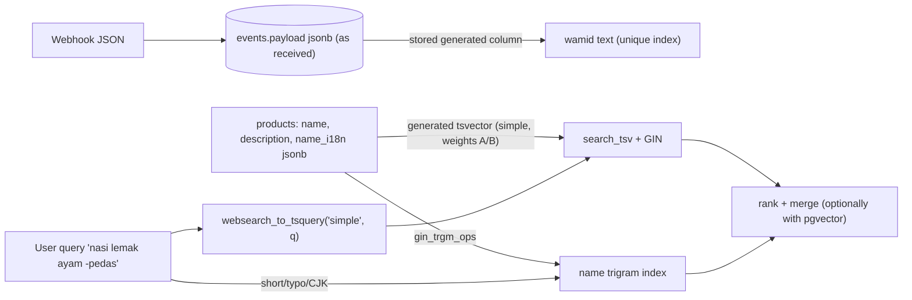

# PostgreSQL - JSONB Patterns & Full-Text Search

> [!info] Deep dive of [[PostgreSQL]]

> [!abstract] TL;DR
> - **JSONB** is for genuinely variable or external data: webhook payloads, per-tenant custom fields, translations, settings. Promote anything you filter, join, aggregate or enforce to **real columns** (or **stored generated columns**).
> - **Index JSONB** with GIN `jsonb_path_ops` for `@>` containment, or expression B-tree indexes for specific keys. Validate shape with CHECK constraints or `pg_jsonschema`.
> - **Full-text search**: a generated `tsvector` column + GIN index + `websearch_to_tsquery`, with the **`simple` config for Malay** (no Malay stemmer) and **`pg_trgm`** for typos, partial words and Chinese.
> - Combine both with pgvector for hybrid search.

## Concept
| Store as | When | Example |
|---|---|---|
| Column | Filtered, joined, constrained, frequently read | `status`, `tenant_id`, `total` |
| JSONB | Variable shape, rarely filtered, read as a whole | Raw WhatsApp webhook, per-tenant custom fields |
| JSONB + stored generated column | Mostly JSON, but one key is hot | `payload ->> 'wamid'` as an indexed column |
| Separate table | Repeating structured items | Order items, not `items jsonb[]` you query into |

**JSONB operators and index support**:

| Operator / function | Meaning | Index |
|---|---|---|
| `@>` | Contains (`'{"status":"paid"}'`) | GIN `jsonb_path_ops` (smaller) or `jsonb_ops` |
| `?`, `?|`, `?&` | Key exists | GIN `jsonb_ops` only |
| `->`, `->>`, `#>>` | Extract (json / text) | Expression B-tree on `(col ->> 'key')` |
| `@?`, `@@` | jsonpath exists/match | GIN (both opclasses, partial support) |
| `JSON_TABLE`, `JSON_VALUE` (17+) | SQL/JSON standard extraction | Same as underlying expressions |
| `jsonb_set`, `||`, `-` | Update, merge, delete keys | (writes rewrite the whole value) |

**Full-text search building blocks**:

| Piece | Role |
|---|---|
| `tsvector` | Normalized lexemes with positions (`to_tsvector('simple', …)`) |
| `tsquery` | Query (`websearch_to_tsquery` accepts Google-like syntax: quotes, `-`, `or`) |
| Text search config | `english` (stemming), `simple` (lowercase only, safe for Malay/mixed), custom with `unaccent` |
| `ts_rank` / `ts_rank_cd` | Relevance scoring |
| `pg_trgm` | Similarity / `ILIKE '%x%'` acceleration via GIN/GiST trigram indexes. Typo tolerance, CJK substrings |

## How It Works


## Practical Usage
**Raw payload + promoted keys**:
```sql
create table public.wa_events (
  id bigint generated always as identity primary key,
  tenant_id uuid not null,
  payload jsonb not null,
  wamid text generated always as (payload #>> '{entry,0,changes,0,value,messages,0,id}') stored,
  received_at timestamptz not null default now(),
  constraint payload_is_object check (jsonb_typeof(payload) = 'object')
);
create unique index on public.wa_events (wamid) where wamid is not null;
create index wa_events_payload_gin on public.wa_events using gin (payload jsonb_path_ops);

select id from wa_events where payload @> '{"entry":[{"changes":[{"field":"messages"}]}]}';
```
**Per-tenant custom fields with validation** (Supabase has `pg_jsonschema`):
```sql
alter table public.customers add column custom jsonb not null default '{}'::jsonb
  check (extensions.jsonb_matches_schema(
    '{"type":"object","properties":{"membership_tier":{"enum":["silver","gold"]},"birthday":{"type":"string","format":"date"}},"additionalProperties":true}',
    custom));
create index customers_tier on public.customers ((custom ->> 'membership_tier')) where custom ? 'membership_tier';
```
**SQL/JSON extraction** (PostgreSQL 17+):
```sql
select o.id, jt.*
from orders o,
     json_table(o.raw_payload, '$.items[*]'
       columns (sku text path '$.sku', qty int path '$.qty', price numeric path '$.price')) as jt
where o.tenant_id = $1;
```
**Full-text search for a multilingual SME catalog**:
```sql
create extension if not exists pg_trgm with schema extensions;
create extension if not exists unaccent with schema extensions;

alter table public.products add column search_tsv tsvector generated always as (
  setweight(to_tsvector('simple', coalesce(name, '')), 'A') ||
  setweight(to_tsvector('simple', coalesce(name_i18n ->> 'en', '') || ' ' || coalesce(name_i18n ->> 'ms', '')), 'A') ||
  setweight(to_tsvector('simple', coalesce(description, '')), 'B')
) stored;
create index products_search on public.products using gin (search_tsv);
create index products_name_trgm on public.products using gin (name extensions.gin_trgm_ops);

-- query: words first, trigram fallback for typos/partials/Chinese
select id, name, ts_rank_cd(search_tsv, q) as rank
from public.products, websearch_to_tsquery('simple', $2) q
where tenant_id = $1 and search_tsv @@ q
order by rank desc limit 20;

select id, name, similarity(name, $2) as sim
from public.products
where tenant_id = $1 and name % $2             -- trigram similarity threshold (pg_trgm.similarity_threshold)
order by sim desc limit 20;
```
```ts
// supabase-js
await supabase.from('products').select('id,name').textSearch('search_tsv', q, { type: 'websearch', config: 'simple' });
```
**Wrong way**:
```sql
select * from orders where data ->> 'status' = 'paid';           -- ❌ no index on the expression, hot key buried in JSON
update profiles set settings = jsonb_set(settings, '{theme}', '"dark"');  -- fine once; ❌ in a loop on 5 MB JSONB = full rewrite each time
where name ilike '%' || $1 || '%'                                 -- ❌ seq scan without a trigram index
to_tsvector('english', 'ayam goreng')                             -- ❌ English stemmer mangles Malay words
```

## Patterns & Anti-patterns
| Pattern | When | Anti-pattern to avoid |
|---|---|---|
| Store raw external payloads as JSONB + promote keys | Webhooks, integrations | Parsing everything into columns upfront and losing the original |
| Stored generated columns for hot keys | Filter/unique on JSON fields | Repeating `->>` expressions everywhere |
| `jsonb_path_ops` GIN for containment | `@>` filters | `jsonb_ops` when you never use `?` (bigger index) |
| Validate JSON shape in the DB (CHECK / pg_jsonschema) + Zod in the app | Custom fields | "Schemaless" fields that drift per client |
| Generated `tsvector` + GIN, `simple` config for BM/mixed | Catalog/FAQ search | `english` config on Malay text |
| `pg_trgm` for typos, prefixes and CJK substrings | Short names, Chinese | `ILIKE '%…%'` without an index |
| Hybrid FTS + vector with RRF | Semantic + exact matches | Vector-only search missing SKUs and codes |

## Performance & Trade-offs
- **JSONB writes rewrite the whole value** (TOAST). Large documents updated frequently cause bloat and WAL churn, so split hot, mutable parts into columns or rows.
- **Planner statistics** on JSONB keys are weak (default selectivity guesses). Promoted columns get real statistics, which means better plans ([[PostgreSQL - Query Planning & EXPLAIN]]).
- **GIN indexes** are large and slow down writes (pending list with `fastupdate`). Index only what queries need, and use partial indexes for sparse keys ([[PostgreSQL - Indexing]]).
- **FTS vs a search engine**: Postgres FTS handles hundreds of thousands to low millions of rows per tenant well. Add Meilisearch/Typesense only when you need typo-tolerant instant search at scale or faceting UX beyond SQL.
- **Ranking cost**: `ts_rank` on very broad queries scores every match. Limit candidates first (tenant filter, `limit` on a subquery).

## Tips & Reminders
> [!tip] In ZP's stack
> - **WhatsApp/payment webhooks**: keep the raw JSONB for audits and replays, and promote `wamid`/`event_id` to unique generated columns for idempotency ([[n8n - WhatsApp Cloud API Workflows & Template Messaging]]).
> - **Menu/product search for Malaysian SMEs**: `simple` config + trigram index on names. Chinese product names rely on trigram (or `pg_bigm` if available), and English descriptions can add a weighted `english` vector.
> - **Translations**: `name_i18n jsonb` (`{"ms":…, "en":…, "zh":…}`), which is fine as JSONB because it's read as a whole ([[Flutter - Internationalization & Localization]]).

- Prefer `jsonb` over `json` (binary, indexable, deduplicated keys). `json` only preserves formatting and key order.
- Use `coalesce` in generated tsvectors, because one null nulls the whole concatenation.
- Expose search through an RPC that applies the tenant filter and limits, rather than letting clients build arbitrary FTS queries ([[Supabase - Database Functions, Triggers & RPC]]).
- Test search quality with real customer queries (Manglish spellings: "kopi o ais", "teh tarik kurang manis").

## Version Notes
| Version | Change relevant here |
|---|---|
| 9.4 | `jsonb` type, GIN opclasses |
| 12 | jsonpath (`@?`, `@@`, `jsonb_path_query`). Stored generated columns |
| 14 | JSONB subscripting (`data['key']`) |
| 16 | SQL/JSON constructors (`JSON_OBJECT`, `JSON_ARRAY`), `IS JSON` |
| 17 | `JSON_TABLE`, `JSON_VALUE`, `JSON_QUERY`, `JSON_EXISTS` |
| 18 | Virtual generated columns (default kind). Use `STORED` when you need to index the column |

## Critical Issues & Gotchas
> [!danger] JSONB as an excuse to skip data modeling
> Putting core business fields (amounts, status, tenant) into JSONB removes type checks, foreign keys, NOT NULL and good statistics. Silent bad data follows ("amount": "45.00" as a string, "Status" vs "status"), and reports break. Keep business-critical data relational, and use JSONB at the edges.

> [!danger] Search queries as an injection or DoS path
> Building `to_tsquery` from raw user input throws syntax errors on special characters, and huge OR-queries or `%`-trigram scans over all tenants can saturate CPU. Use `websearch_to_tsquery` (tolerant parser), always filter by tenant first, cap query length and result counts, and rate-limit search endpoints.

- **Key naming drift** across clients/versions (`phoneNumber` vs `phone_number`). Document JSON contracts and validate on write ([[TypeScript - Runtime Validation with Zod & Type-Safe APIs]]).
- **`->>` returns text**: numeric comparisons need casts, and `'10' < '9'` as text is true.
- **Stemming surprises**: the English config turns "running" into "run" and stop-words drop "the"/"a". Fine for English content, wrong for names and codes. Index SKUs separately, without FTS.
- **Generated column changes** require rewriting the table. Plan migrations on large tables ([[PostgreSQL - Partitioning & Large Table Maintenance]]).

## Related
- [[PostgreSQL]]
- [[PostgreSQL - Indexing]] — GIN, partial and expression indexes
- [[PostgreSQL - Query Planning & EXPLAIN]] — verifying index use for JSONB/FTS queries
- [[Vector Databases - pgvector Tuning & Hybrid Search]] — combining FTS with vectors (RRF)
- [[Supabase - Database Functions, Triggers & RPC]] — search RPCs with tenant filters
- [[NoSQL]] — when a document store is really warranted

## References
- https://www.postgresql.org/docs/current/datatype-json.html
- https://www.postgresql.org/docs/current/functions-json.html
- https://www.postgresql.org/docs/current/textsearch.html
- https://www.postgresql.org/docs/current/pgtrgm.html
- https://supabase.com/docs/guides/database/extensions/pg_jsonschema
