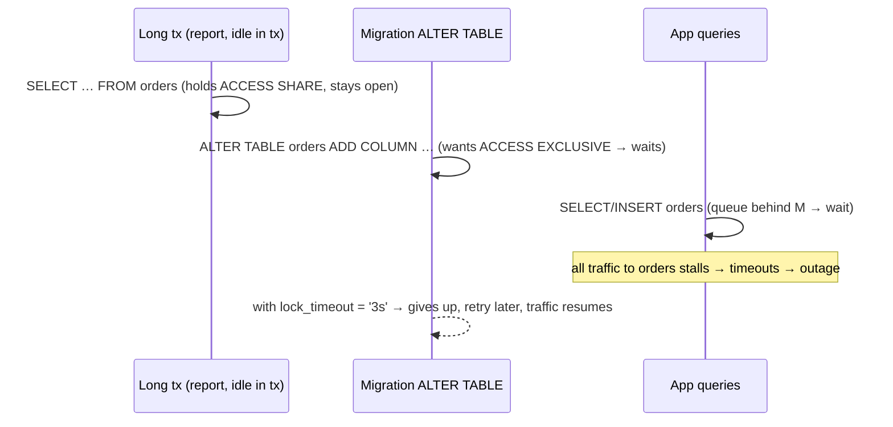

# PostgreSQL - Locking, Deadlocks & Concurrency Control

> [!info] Deep dive of [[PostgreSQL]]

> [!abstract] TL;DR
> MVCC means **readers don't block writers**, but locks still decide correctness and outages:
> - **Row locks** (`FOR UPDATE`, `FOR NO KEY UPDATE`, `FOR SHARE`) serialize competing writes. **`SKIP LOCKED`** builds job queues, and **`NOWAIT`** fails fast.
> - **Table locks** from DDL (`ALTER TABLE`, `CREATE INDEX` without `CONCURRENTLY`) take strong modes. An `ACCESS EXCLUSIVE` waiting behind a long transaction **blocks every new query** on that table (the lock queue).
> - **Deadlocks** come from inconsistent lock ordering. Postgres detects them after `deadlock_timeout` (1 s) and aborts one transaction. Fix the ordering, and retry `40P01`.
> - **Advisory locks** are app-defined mutexes for "only one worker does X".
> - **Defaults to set**: `lock_timeout` for migrations, `idle_in_transaction_session_timeout`, `statement_timeout` per role.
>
> For money and stock, use **atomic conditional updates** or `FOR UPDATE`, never read-then-write in app code.

## Concept
**Row-level lock modes** (strongest → weakest):

| Mode | Taken by | Blocks |
|---|---|---|
| `FOR UPDATE` | `DELETE`, `UPDATE` of key columns, explicit | All other row locks |
| `FOR NO KEY UPDATE` | Plain `UPDATE` (non-key columns), explicit | `FOR UPDATE`, `FOR NO KEY UPDATE`, `FOR SHARE` |
| `FOR SHARE` | Explicit | Updates/deletes |
| `FOR KEY SHARE` | FK checks on child insert | `FOR UPDATE` (key changes, deletes) |

**Table-level locks that matter in practice**:

| Lock | Taken by | Conflicts with |
|---|---|---|
| `ACCESS SHARE` | `SELECT` | Only `ACCESS EXCLUSIVE` |
| `ROW EXCLUSIVE` | `INSERT/UPDATE/DELETE` | `SHARE` and stronger |
| `SHARE UPDATE EXCLUSIVE` | `VACUUM`, `CREATE INDEX CONCURRENTLY`, `ANALYZE` | Itself and stronger |
| `SHARE` | `CREATE INDEX` (non-concurrent) | Writes |
| `ACCESS EXCLUSIVE` | Most `ALTER TABLE`, `DROP`, `TRUNCATE`, `VACUUM FULL` | **Everything**, including `SELECT` |

**Strategies for concurrent updates**:

| Strategy | How | Pick it when… |
|---|---|---|
| Atomic conditional UPDATE | `update … set stock = stock - 1 where id = $1 and stock >= 1` | Counters, stock, balances |
| Pessimistic | `select … for update` then update in the same tx | Multi-step logic on one row |
| Optimistic | `version` column, `where version = $old` | Low contention, user edits (forms) |
| Serializable isolation | `set transaction isolation level serializable` + retry `40001` | Complex invariants across rows |
| Advisory lock | `pg_advisory_xact_lock(hash)` | Singleton jobs, per-tenant critical sections |
| Constraint | Unique/exclusion constraint | Double bookings, duplicates (best when possible) |

## How It Works


## Practical Usage
**Prevent overselling with an atomic update**:
```sql
update public.products
set stock = stock - $2
where id = $1 and stock >= $2
returning stock;                      -- 0 rows returned = insufficient stock → reject order
```
**Job queue with `SKIP LOCKED`** (many workers, no double-processing):
```sql
with next as (
  select id from public.jobs
  where status = 'queued' and run_at <= now()
  order by run_at
  for update skip locked
  limit 10
)
update public.jobs j set status = 'running', locked_at = now()
from next where j.id = next.id
returning j.*;
```
**Consistent lock ordering to avoid deadlocks** (transfer between two wallets):
```sql
begin;
select id from wallets where id in ($1, $2) order by id for update;   -- always lock lower id first
update wallets set balance = balance - $3 where id = $1;
update wallets set balance = balance + $3 where id = $2;
commit;
```
**Advisory lock for a per-tenant singleton job**:
```sql
select pg_try_advisory_xact_lock(hashtextextended('sync:' || $1::text, 0)) as acquired;
-- false → another worker is syncing this tenant; skip. Lock auto-releases at commit/rollback.
```
**Safe migrations**:
```sql
set lock_timeout = '3s';              -- fail fast instead of queueing everything behind us
set statement_timeout = '15min';
alter table orders add column notes text;                       -- fast (metadata only)
create index concurrently idx_orders_tenant_created on orders (tenant_id, created_at desc);  -- outside a tx block
alter table orders add constraint orders_total_pos check (total_cents >= 0) not valid;
alter table orders validate constraint orders_total_pos;        -- weaker lock, scans without blocking writes
```
**Who is blocking whom**:
```sql
select a.pid, a.state, now() - a.xact_start as tx_age, a.wait_event_type, left(a.query, 80) as query,
       pg_blocking_pids(a.pid) as blocked_by
from pg_stat_activity a
where a.datname = current_database() and (cardinality(pg_blocking_pids(a.pid)) > 0 or a.state = 'idle in transaction')
order by tx_age desc nulls last;

select pg_cancel_backend(12345);      -- cancel the query; pg_terminate_backend to kill the session
```
**Role-level guardrails**:
```sql
alter role authenticated set statement_timeout = '8s';
alter database app set idle_in_transaction_session_timeout = '60s';
alter system set log_lock_waits = on;      -- log waits longer than deadlock_timeout
```
**Wrong way**:
```text
❌ read stock in app → if stock > 0 → update stock = stock - 1   → oversell under concurrency (lost update)
❌ ALTER TABLE on a hot table without lock_timeout              → lock queue outage
❌ BEGIN in app, call external API, then COMMIT                  → locks held for seconds; idle-in-transaction pile-up
❌ Retrying deadlocks without fixing lock order                  → recurring 40P01 errors under load
```

## Patterns & Anti-patterns
| Pattern | When | Anti-pattern to avoid |
|---|---|---|
| Atomic `UPDATE … WHERE condition RETURNING` | Stock, quotas, balances | Read-modify-write in app code |
| Exclusion constraints for time ranges | Bookings/appointments | App-level overlap checks only |
| `SKIP LOCKED` queues | Postgres-backed jobs | `SELECT … LIMIT 1` + update (double pick) |
| `lock_timeout` + retry in migrations | Every DDL in prod | Unbounded waits |
| `CREATE INDEX CONCURRENTLY` | Live tables | Plain `CREATE INDEX` on big tables |
| Short transactions, no network I/O inside | Always | Holding locks across HTTP calls |
| Retry on `40P01` / `40001` with jitter | Serializable/deadlock-prone paths | Surfacing raw errors to users |

## Performance & Trade-offs
- **Pessimistic locking** reduces throughput on hot rows (one popular product). Use atomic updates or split counters (sharded rows) for very hot keys.
- **Serializable** gives the strongest correctness with less reasoning, at the cost of more aborts under contention. Wrap transactions in retry loops.
- **`FOR UPDATE` on joins** locks rows in all joined tables unless you use `FOR UPDATE OF t`. Be explicit.
- **Poolers in transaction mode**: session-level advisory locks (`pg_advisory_lock`) leak across clients. Use `_xact_` variants ([[PostgreSQL - Connection Pooling with Supavisor & PgBouncer]]).

## Tips & Reminders
> [!tip] In ZP's stack
> - **Bookings (salons, clinics)**: an exclusion constraint `exclude using gist (resource_id with =, tstzrange(starts_at, ends_at) with &&)` makes double-booking impossible regardless of app bugs.
> - **Supabase migrations**: start each migration with `set lock_timeout = '3s'`, and use `concurrently` for indexes in separate migration files (no transaction wrapper) ([[Supabase - Migrations, Branching & Local Development]]).
> - **n8n + Postgres**: concurrent executions updating the same record need atomic SQL or advisory locks. n8n doesn't serialize executions for you.

- Enable `log_lock_waits` and review logs weekly on busy apps.
- Alert on `idle in transaction` sessions older than 1 minute.
- For distributed locks across services, Postgres advisory locks are often enough before reaching for Redis ([[Redis - Rate Limiting & Distributed Locks]]).
- Test concurrency with parallel scripts (`pgbench -f` custom scripts) before launch promos.

## Version Notes
| Version | Change relevant here |
|---|---|
| 9.4 | `FOR NO KEY UPDATE` / `FOR KEY SHARE` (fewer FK lock conflicts) |
| 9.5 | `SKIP LOCKED` |
| 9.6 | `idle_in_transaction_session_timeout` |
| 11 | `ADD COLUMN … DEFAULT` without table rewrite |
| 14 | `REINDEX CONCURRENTLY` improvements. `idle_session_timeout` |
| 18–19 | No fundamental lock-mode changes. Check 19 notes for `REPACK` locking behaviour ([[PostgreSQL]]) |

> [!warning] Unverified — check before relying on this
> Lock levels of specific `ALTER TABLE` subcommands vary by version. Check the "Explicit Locking" and `ALTER TABLE` docs for your exact version before running DDL on hot tables.

## Critical Issues & Gotchas
> [!danger] The lock queue outage
> A migration waiting for `ACCESS EXCLUSIVE` (even one that would finish in milliseconds) queues **behind** a long-running transaction and **in front of** all new queries. Every read and write to that table stalls until timeouts cascade into a full outage. Always set `lock_timeout`, kill or avoid long transactions before DDL, and deploy migrations off-peak ([[PostgreSQL - Major Version Upgrades & Migrations]]).

> [!danger] Lost updates in read-modify-write code
> Two requests read `stock = 1`, both decide to sell, and both write `stock = 0`, so two orders ship one item. Isolation level Read Committed (the default) doesn't prevent this. Use atomic conditional updates, `FOR UPDATE`, optimistic versioning, or serializable with retries for every money/stock path.

- **Deadlock detection** only triggers after `deadlock_timeout`. Until then, both sessions wait. High values hide problems, very low values waste CPU.
- **FK checks** take `FOR KEY SHARE` on parent rows. Bulk child inserts can block parent deletes/key updates.
- **`TRUNCATE`** takes `ACCESS EXCLUSIVE`. Never run it casually on live tables.
- **Session advisory locks** survive until disconnect. With pooling, they can be held by the wrong client indefinitely.

## Related
- [[PostgreSQL]]
- [[PostgreSQL - Transactions & MVCC]] — isolation levels and visibility
- [[PostgreSQL - Major Version Upgrades & Migrations]] — safe DDL rollout
- [[PostgreSQL - Partitioning & Large Table Maintenance]] — maintenance locks
- [[PostgreSQL - Connection Pooling with Supavisor & PgBouncer]] — advisory locks and poolers
- [[Redis - Rate Limiting & Distributed Locks]] — when Redis locks fit better

## References
- https://www.postgresql.org/docs/current/explicit-locking.html
- https://www.postgresql.org/docs/current/sql-select.html#SQL-FOR-UPDATE-SHARE
- https://www.postgresql.org/docs/current/functions-admin.html#FUNCTIONS-ADVISORY-LOCKS
- https://www.postgresql.org/docs/current/runtime-config-client.html
- https://www.postgresql.org/docs/current/sql-altertable.html
