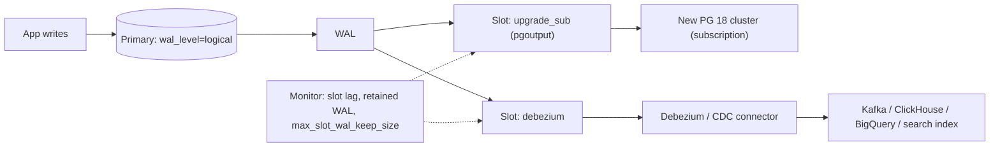

# PostgreSQL - Logical Replication & Change Data Capture

> [!info] Deep dive of [[PostgreSQL]]

> [!abstract] TL;DR
> **Logical replication** streams row-level changes (`INSERT/UPDATE/DELETE`) from **publications** to **subscriptions** via **replication slots** and the `pgoutput` plugin.
> **Uses**:
> - near-zero-downtime upgrades and migrations;
> - feeding analytics/search (CDC with Debezium or Supabase replication tools);
> - selective table sync between services.
>
> **What it doesn't replicate**: DDL, sequences, large objects (and tables without a replica identity can't replicate updates/deletes).
> **The #1 operational risk**: an abandoned or lagging **slot retains WAL until the disk fills**. Monitor slot lag and set `max_slot_wal_keep_size`.
> For app-level events, an **outbox table** is usually simpler and more explicit than raw CDC.

## Concept
| Piece | Role | Notes |
|---|---|---|
| `wal_level = logical` | Adds logical info to WAL | Restart required (Supabase: already on) |
| Publication | Which tables/columns/rows to publish | `FOR TABLE … (cols) WHERE (…)` row filters (15+) |
| Replication slot | Remembers consumer position, retains WAL | Survives restarts. Unconsumed = disk growth |
| Subscription | Postgres-to-Postgres consumer | Initial copy + streaming apply |
| Output plugin | `pgoutput` (native), `wal2json`, `test_decoding` | Debezium uses `pgoutput` |
| Replica identity | How updates/deletes identify rows | PK by default. `FULL` sends whole old row (costly) |

**Physical vs logical**:

| | Physical (streaming) replication | Logical replication |
|---|---|---|
| Granularity | Whole cluster, byte-level | Per table/row/column |
| Versions | Same major version | **Across major versions** |
| Writable target | No (read-only standby) | Yes (but beware conflicts) |
| Use | HA, read replicas, PITR | Upgrades, CDC, selective sync |

## How It Works


## Practical Usage
**Publish selected tables, columns and rows** (publisher):
```sql
alter system set wal_level = 'logical';            -- self-hosted; restart required
alter system set max_slot_wal_keep_size = '20GB';  -- cap WAL retained by lagging slots
create publication analytics_pub
  for table public.orders (id, tenant_id, status, total_cents, created_at, updated_at),
  public.order_items;
-- row filters (WHERE) on tables publishing UPDATE/DELETE may only use replica-identity columns (usually the PK)
```
**Postgres subscriber** (another cluster, e.g. analytics or upgrade target):
```sql
-- schema must exist on the subscriber first (pg_dump --schema-only | psql)
create subscription analytics_sub
  connection 'host=10.0.0.5 port=5432 dbname=app user=repl password=… sslmode=require'
  publication analytics_pub
  with (copy_data = true, streaming = on);
```
**Monitor slots and lag** (publisher):
```sql
select slot_name, plugin, active, wal_status,
       pg_size_pretty(pg_wal_lsn_diff(pg_current_wal_lsn(), confirmed_flush_lsn)) as lag
from pg_replication_slots;

select subname, received_lsn, latest_end_lsn, last_msg_receipt_time from pg_stat_subscription;   -- subscriber side
```
**Drop an abandoned slot** (after confirming the consumer is gone):
```sql
select pg_drop_replication_slot('debezium_old');
```
**Wrong way**:
```text
❌ Creating a slot for a "test" Debezium connector and forgetting it → WAL piles up for weeks; disk full; primary stops
❌ Expecting ALTER TABLE to replicate                               → subscriber apply fails on schema mismatch
❌ Replicating tables without primary keys                           → UPDATE/DELETE fail to replicate (or REPLICA IDENTITY FULL overhead)
❌ Writing to the same rows on both sides                           → conflicts stop the subscription
```

## Patterns & Anti-patterns
| Pattern | When | Anti-pattern to avoid |
|---|---|---|
| Outbox table for business events, CDC only of the outbox | Event-driven apps | CDC of every internal table as an API contract |
| Column lists + row filters to minimize data (and PII) | Analytics feeds | Publishing whole schemas with personal data |
| `max_slot_wal_keep_size` + lag alerts | Every slot | Unbounded WAL retention |
| Schema changes coordinated: subscriber first (add), publisher later (drop) | Ongoing CDC | DDL on the publisher only |
| Primary keys on all replicated tables | Always | `REPLICA IDENTITY FULL` everywhere |
| Logical replication for major-version upgrades | Large DBs, tight downtime | Multi-hour dump/restore windows ([[PostgreSQL - Major Version Upgrades & Migrations]]) |
| Dedicated replication role with least privilege | Security | Using superuser credentials for consumers |

## Performance & Trade-offs
- **Publisher overhead**: logical decoding costs CPU on the primary. Many slots multiply it, so consolidate consumers where possible.
- **Initial copy**: `copy_data = true` copies tables (heavy I/O). For large tables, copy off-hours or seed from a snapshot.
- **Large transactions**: big batch updates are decoded and sent as huge changes. `streaming = on` (14+) streams in-progress transactions to reduce subscriber memory/lag.
- **CDC vs outbox**: CDC captures everything without app changes, but couples consumers to your table schema. An outbox gives explicit, versioned events at the cost of writing them ([[System Design - Event-Driven Architecture & Outbox Pattern]]).
- **Failover**: before 17, logical slots didn't survive failover to a physical standby. 17's failover slots (`sync_replication_slots`) address this.

## Tips & Reminders
> [!tip] In ZP's stack
> - **Most SME needs** (dashboards, reports) are served by read-only roles, materialized views or nightly exports, with no CDC needed. Use CDC when a client's analytics team or a search index needs near-real-time data.
> - **Supabase**: publications and replication slots work on Cloud (Realtime uses replication internally). Check plan limits on slots, and prefer Supabase's own replication/ETL features where offered over self-managed slots.
> - **Upgrades of self-hosted Postgres** with low downtime: logical replication to the new major version, then cut over during a short window.

- Use `sslmode=require` and a tailnet/private network for replication connections ([[Linux Essentials - Networking, Firewalls & Tailscale]]).
- Sync sequences manually before cutover (`setval` to max IDs). They're not replicated.
- Alert when any slot's retained WAL exceeds a threshold, or `active = false` for > 1 hour.
- Treat CDC sinks as personal-data processors (PDPA): filter columns, and document destinations.

## Version Notes
| Version | Change relevant here |
|---|---|
| 10 | Built-in logical replication (publications/subscriptions) |
| 13 | `max_slot_wal_keep_size` to cap WAL retained by slots |
| 14 | Streaming of large in-progress transactions |
| 15 | Row filters and column lists in publications. `ALTER SUBSCRIPTION … SKIP` |
| 16 | Logical decoding from standbys. Parallel apply of large transactions |
| 17 | Failover slots (sync to standbys). `pg_createsubscriber` (convert physical standby to logical) |
| 18–19 | Ongoing improvements. 19 GA planned 2026-11-19 ([[PostgreSQL]]) |

> [!warning] Unverified — check before relying on this
> Supabase's current replication/ETL product offerings and slot limits per plan, and any PostgreSQL 19 logical replication additions (e.g. sequence sync), weren't verified this run. Check the PostgreSQL 19 release notes and Supabase docs.

## Critical Issues & Gotchas
> [!danger] Inactive replication slots fill the disk
> A slot whose consumer stopped (crashed connector, decommissioned test, broken subscription) keeps every WAL segment since its position. On a small VPS this fills the disk within days and stops the primary, taking every app down. Set `max_slot_wal_keep_size`, alert on slot lag and inactivity, and drop slots you don't own ([[PostgreSQL - Backups, PITR & Restore Drills]]).

> [!danger] Subscription stuck on a conflict
> Unique violations, missing tables/columns, or rows modified on the subscriber stop apply, and lag then grows silently. Monitor `pg_stat_subscription` and logs, fix the conflicting row or skip the transaction deliberately (`ALTER SUBSCRIPTION … SKIP`), and never write to replicated tables on the subscriber unless designed for it.

- **DDL drift**: add columns on the subscriber before the publisher starts sending them, and remove them in the opposite order.
- **Row filters vs replica identity**: when a publication includes UPDATE/DELETE, its `WHERE` filter may reference only replica-identity columns, so filtering on `status` fails unless you publish inserts only or change the replica identity.
- **TRUNCATE** is replicated (configurable in the publication). A truncate on the source wipes the target too.
- **Personal data leakage**: CDC streams can carry IC numbers, phones and addresses into third-party warehouses. Use column lists and row filters.
- **Partitioned tables**: use `publish_via_partition_root = true` so consumers see one logical table ([[PostgreSQL - Partitioning & Large Table Maintenance]]).

## Related
- [[PostgreSQL]]
- [[PostgreSQL - Major Version Upgrades & Migrations]] — logical replication for low-downtime upgrades
- [[System Design - Event-Driven Architecture & Outbox Pattern]] — outbox vs CDC
- [[Kafka - KRaft, Redpanda & Small-Infra Trade-offs]] — Debezium/Kafka CDC pipelines
- [[PostgreSQL - Backups, PITR & Restore Drills]] — WAL management and disk safety
- [[Supabase - Realtime, Presence & Broadcast]] — Realtime built on replication

## References
- https://www.postgresql.org/docs/current/logical-replication.html
- https://www.postgresql.org/docs/current/logical-replication-row-filter.html
- https://www.postgresql.org/docs/current/runtime-config-replication.html#GUC-MAX-SLOT-WAL-KEEP-SIZE
- https://debezium.io/documentation/reference/stable/connectors/postgresql.html
- https://supabase.com/docs/guides/database/postgres/setup-replication-external
