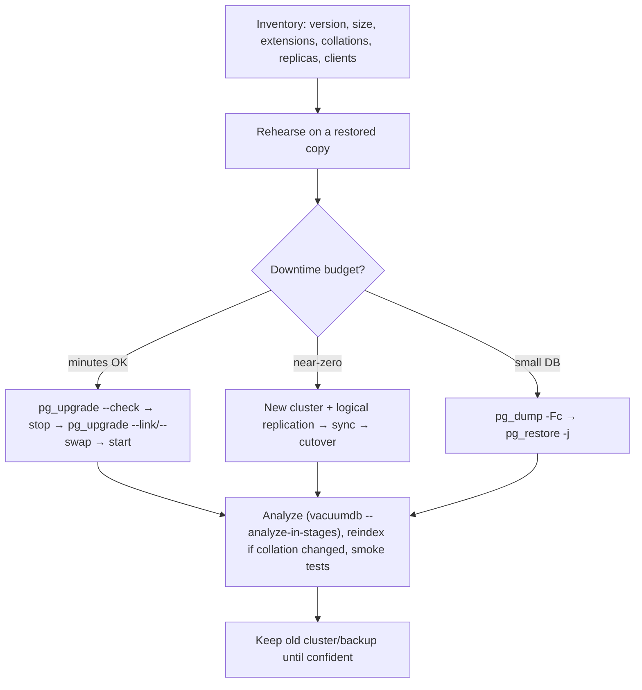

# PostgreSQL - Major Version Upgrades & Migrations

> [!info] Deep dive of [[PostgreSQL]]

> [!abstract] TL;DR
> - **Minor releases** (18.5 → 18.6) are binary-compatible: just restart on the new binaries, quarterly.
> - **Major versions** (16 → 18/19) need one of:
>   - **`pg_upgrade`** (minutes, with `--link`/`--clone`/`--swap`, downtime);
>   - **dump/restore** (simple, slow, for small DBs);
>   - **logical replication** to a new cluster (near-zero downtime).
> - Check extensions (pgvector, PostGIS, pg_cron, TimescaleDB) and collations, rehearse on a copy, take a verified backup, then analyze afterwards.
> - **PostgreSQL 14 reached EOL with its final release on 2026-11-12**, and **19 is planned for 2026-11-19**. Move EOL clusters now, but wait for 19.1–19.2 before upgrading production to 19.

## Concept
| Method | Downtime | Effort | Best for | Watch out |
|---|---|---|---|---|
| `pg_upgrade --link` | Minutes (independent of size) | Medium | Self-hosted, same machine | Old cluster unusable after start with link mode |
| `pg_upgrade --clone` / `--swap` (18) | Minutes | Medium | Filesystems with reflinks / fast swap | FS support, version support |
| `pg_dump` + `pg_restore` | Proportional to size (hours for 100s of GB) | Low | < ~20–50 GB, cross-architecture moves | Long window. Roles/globals via `pg_dumpall --globals-only` |
| Logical replication (old → new) | Seconds (cutover) | High | Large DBs, strict uptime | No DDL/sequence replication. Large objects, PK requirements |
| Managed upgrade (Supabase/RDS) | Minutes–hours window | Low | Managed DBs | Provider-specific steps, extension versions |

**Support lifecycle**: each major version gets 5 years of fixes. Minor releases ship roughly quarterly (Feb/May/Aug/Nov).

| Version | Released | Final release / EOL |
|---|---|---|
| 14 | 2021-09 | **2026-11-12** |
| 15 | 2022-10 | ~2027-11 |
| 16 | 2023-09 | ~2028-11 |
| 17 | 2024-09 | ~2029-11 |
| 18 | 2025-09 | ~2030-11 |
| 19 | GA planned 2026-11-19 | ~2031-11 |

## How It Works


## Practical Usage
**Pre-flight checks**:
```sql
select version();
select extname, extversion from pg_extension order by 1;           -- confirm availability on the target version
select datname, datcollate, datctype, datlocprovider from pg_database;
select count(*) from pg_stat_activity;                              -- clients to coordinate
```
**pg_upgrade on a self-hosted server**:
```bash
# install new binaries alongside (e.g. /usr/lib/postgresql/18), init the new cluster with SAME locale/encoding
/usr/lib/postgresql/18/bin/initdb -D /var/lib/postgresql/18/main --locale-provider=icu --icu-locale=en-US

sudo -u postgres /usr/lib/postgresql/18/bin/pg_upgrade \
  -b /usr/lib/postgresql/16/bin -B /usr/lib/postgresql/18/bin \
  -d /var/lib/postgresql/16/main -D /var/lib/postgresql/18/main --check      # dry run: fix all reported issues

systemctl stop postgresql@16-main
sudo -u postgres /usr/lib/postgresql/18/bin/pg_upgrade ... --link            # or --clone / --swap where supported
systemctl start postgresql@18-main
sudo -u postgres /usr/lib/postgresql/18/bin/vacuumdb --all --analyze-in-stages   # 18 keeps most stats; still analyze
```
**Docker: dump/restore into a new major** (small/medium DBs):
```bash
docker exec pg16 pg_dumpall --globals-only -U postgres > globals.sql
docker exec pg16 pg_dump -U postgres -Fc -d app > app.dump
docker compose up -d pg18                                            # new volume, new image tag
docker exec -i pg18 psql -U postgres < globals.sql
docker exec -i pg18 pg_restore -U postgres -d app -j 4 --no-owner < app.dump
```
**Near-zero downtime with logical replication**:
```sql
-- old (publisher)
create publication upgrade_pub for all tables;
-- new (subscriber): schema first (pg_dump --schema-only), then
create subscription upgrade_sub connection 'host=old dbname=app user=repl password=…' publication upgrade_pub;
-- after catch-up: stop writes on old, wait for lag 0, sync sequences, switch app DATABASE_URL, drop subscription
select setval('orders_id_seq', (select max(id) from orders));         -- sequences aren't replicated
```
**Wrong way**:
```text
❌ Changing the Docker image tag 16 → 18 on the same data volume  → server refuses to start (or worse, you "fix" by deleting data)
❌ Upgrading production the day a new major is released          → first-minor bugs, extensions not yet packaged
❌ No rehearsal on a copy                                          → extension/collation surprises during the outage window
❌ Skipping ANALYZE after dump/restore                             → terrible plans, slow app right after "successful" upgrade
```

## Patterns & Anti-patterns
| Pattern | When | Anti-pattern to avoid |
|---|---|---|
| Rehearse on a restored backup, time each step | Every major upgrade | First attempt in production |
| Verified backup/PITR immediately before | Always | Relying on last week's dump |
| Wait for x.1/x.2 for production majors | New major release | Day-0 upgrades |
| `pg_upgrade --check` until clean | pg_upgrade | Running without check |
| Logical replication for large, uptime-critical DBs | > ~100 GB, strict SLA | Multi-hour dump/restore windows |
| Same locale/ICU settings, reindex on collation library changes | OS or libc changes | Silent index corruption from glibc collation changes |
| Keep the old cluster/volume until verified | Rollback path | Deleting old data immediately |

## Performance & Trade-offs
- **pg_upgrade link mode** is fast because it hard-links data files instead of copying. Rollback after starting the new cluster isn't possible without a backup, so `--clone`/copy mode keeps a rollback option at the cost of time or space.
- **Statistics**: older versions lose planner stats on upgrade (run `--analyze-in-stages`). PostgreSQL 18 retains most optimizer statistics, so plans recover faster.
- **Dump/restore** is also a de-bloat and a cross-platform move (e.g. to ARM). `-j` parallelism helps with many tables.
- **Logical replication** doubles infrastructure temporarily and needs primary keys on every replicated table. Sequence sync and DDL freezes add coordination.

## Tips & Reminders
> [!tip] In ZP's stack
> - **Supabase Cloud**: upgrade from the dashboard during a client-approved window, after testing the same upgrade on a branch or staging project ([[Supabase - Migrations, Branching & Local Development]]).
> - **Self-hosted Postgres/Supabase on Coolify**: new volume + dump/restore for small client DBs. pg_upgrade (via a temporary container with both versions) for larger ones. Always follow a fresh pgBackRest backup to R2 ([[PostgreSQL - Backups, PITR & Restore Drills]]).
> - **Client communication**: schedule upgrades with a maintenance notice (WhatsApp/email), a rollback plan and a post-upgrade check list. Note it in the maintenance retainer report.

- Track every client cluster's major version and EOL date in your ops sheet. PostgreSQL 14 clusters are now unsupported.
- Test app queries after upgrade with `EXPLAIN (ANALYZE)` on the top 10 queries ([[PostgreSQL - Query Planning & EXPLAIN]]).
- Check extension versions on both sides (`pgvector` index format changes need reindexing in some upgrades).
- Update connection poolers and drivers if protocol or auth defaults changed (SCRAM vs MD5).

## Version Notes
| Version / date | Change relevant here |
|---|---|
| 10+ | Logical replication enables cross-version, low-downtime upgrades |
| 12 | `pg_upgrade --clone` (reflinks) for faster, rollback-friendly upgrades on supported filesystems |
| 18 (2025-09) | `pg_upgrade --swap` mode. Optimizer statistics preserved across pg_upgrade |
| 2026-11-12 | PostgreSQL 14 final minor release, then EOL |
| 19 (GA planned 2026-11-19) | RC1 2026-10-15. GA moved from Oct 29 to Nov 19. Features include `REPACK [CONCURRENTLY]` ([[PostgreSQL]]) |

> [!warning] Unverified — check before relying on this
> PostgreSQL 14's EOL date comes from a third-party upgrade guide, and the 18 `--swap`/statistics features weren't re-verified this run. Check https://www.postgresql.org/support/versioning/ and the 18/19 release notes.

## Critical Issues & Gotchas
> [!danger] Collation changes silently corrupt indexes
> Moving to a new OS image (e.g. a newer Debian/Ubuntu in a Docker image) can change glibc collation rules. Text indexes built under old rules return wrong results or miss rows, with no error. Use ICU with versioned collations, check `pg_collation` version mismatch warnings, and `REINDEX` affected indexes after OS/libc changes.

> [!danger] Upgrading without a tested rollback
> Link-mode upgrades and in-place managed upgrades can't simply be undone. If the application breaks (extension behaviour, removed features, query regressions), you need a backup you've actually restored before, or a still-running old cluster (logical replication approach). Never start without one.

- **Extensions missing on the target** (e.g. an old TimescaleDB or PostGIS version) block `pg_upgrade`. Upgrade the extension on the old version first.
- **`--link` and the old cluster**: once the new cluster starts, the old one must not be started again.
- **Replication slots and subscriptions** aren't always carried over. Recreate logical replication/CDC slots after upgrade, and check Debezium/consumers.
- **Removed features**: each major release removes or changes things (e.g. older auth methods, deprecated config parameters). Read the release notes' "migration" sections for every version you skip.

## Related
- [[PostgreSQL]]
- [[PostgreSQL - Logical Replication & Change Data Capture]] — logical replication mechanics behind low-downtime upgrades
- [[PostgreSQL - Backups, PITR & Restore Drills]] — the rollback safety net
- [[PostgreSQL - Query Planning & EXPLAIN]] — verifying plans after upgrade
- [[Supabase - Self-Hosting with Docker & Coolify]] — upgrading the Postgres inside self-hosted Supabase
- [[Supabase - Migrations, Branching & Local Development]] — schema discipline across versions
- [[PostgreSQL - Partitioning & Large Table Maintenance]] — large tables during dump/restore

## References
- https://www.postgresql.org/docs/current/pgupgrade.html
- https://www.postgresql.org/docs/current/upgrading.html
- https://www.postgresql.org/support/versioning/
- https://www.postgresql.org/about/news/postgresql-19-rc-1-released-3409/
- https://www.buildmvpfast.com/blog/postgresql-19-release-upgrade-checklist-2026
