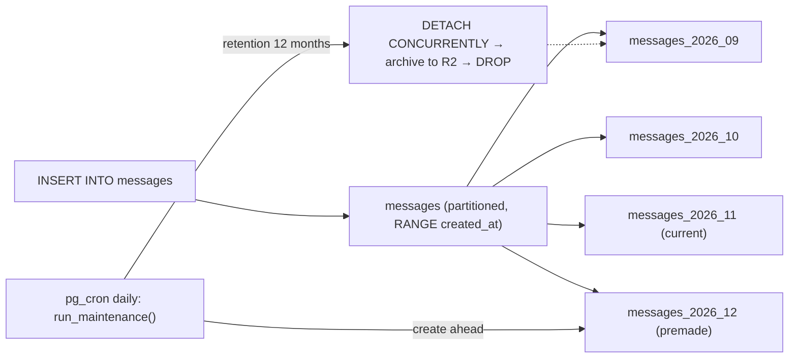

# PostgreSQL - Partitioning & Large Table Maintenance

> [!info] Deep dive of [[PostgreSQL]]

> [!abstract] TL;DR
> Partition **append-heavy, time-ordered tables with retention** (messages, webhook logs, audit events, metrics) by `RANGE (created_at)`, once they reach roughly 50–100M rows or exceed RAM. The big wins are:
> - **retention by `DROP`/`DETACH`** instead of `DELETE` (no bloat, seconds instead of hours);
> - smaller per-partition indexes and vacuum work;
> - pruning for time-bounded queries.
>
> Partitioning does **not** speed up queries that lack the partition key, and it adds constraints (the PK must include the key). For tables that don't need it, the work is boring maintenance: batched deletes, `CONCURRENTLY` index builds, `NOT VALID` constraints and per-table autovacuum tuning.

## Concept
| Strategy | Key | Good for | Watch out |
|---|---|---|---|
| `RANGE` | `created_at` (monthly/weekly) | Logs, messages, events with retention | Needs partitions created ahead (premake) |
| `LIST` | `region`, `tenant_tier` | A few large, isolated groups | Skewed sizes. New values need a partition or a `DEFAULT` |
| `HASH` | `tenant_id` (modulus 8–32) | Spreading write/vacuum load evenly | No retention benefit, can't drop "old" data |
| Sub-partitioning | RANGE → HASH | Very large multi-tenant event stores | Partition count explodes, slowing planning |

**Rules of declarative partitioning**:
- `PRIMARY KEY` / `UNIQUE` must include the partition key, e.g. `(id, created_at)`. Global uniqueness on `id` alone isn't enforced.
- Indexes created on the parent cascade to every partition. `CREATE INDEX CONCURRENTLY` doesn't work on the parent (workaround below).
- Pruning happens at plan time (constants) and at run time (params, joins). The query must filter on the key.
- A `DEFAULT` partition catches strays, but attaching a new partition then scans it for conflicting rows. Keep it empty.
- Partitions are normal tables: each has its own autovacuum, stats and storage.

## How It Works


## Practical Usage
**Monthly-partitioned messages table** (WhatsApp/Chatwoot-style inbox):
```sql
create table public.messages (
  id          bigint generated always as identity,
  tenant_id   uuid not null,
  conversation_id uuid not null,
  direction   text not null check (direction in ('in','out')),
  body        text,
  created_at  timestamptz not null default now(),
  primary key (id, created_at)                       -- must include the partition key
) partition by range (created_at);

create index on public.messages (tenant_id, conversation_id, created_at desc);   -- cascades to partitions

create table public.messages_2026_11 partition of public.messages
  for values from ('2026-11-01') to ('2026-12-01');
create table public.messages_2026_12 partition of public.messages
  for values from ('2026-12-01') to ('2027-01-01');
```
**Automate with pg_partman 5** (native partitioning only; maintenance via pg_cron):
```sql
create schema partman; create extension pg_partman schema partman;
select partman.create_parent(
  p_parent_table => 'public.messages', p_control => 'created_at',
  p_interval => '1 month', p_premake => 3);
update partman.part_config
   set retention = '12 months', retention_keep_table = false, infinite_time_partitions = true
 where parent_table = 'public.messages';
select cron.schedule('partman-maint', '15 2 * * *', $$call partman.run_maintenance_proc()$$);
```
**No pg_partman available** (managed platforms): a small function plus pg_cron:
```sql
create or replace function public.ensure_message_partition(p_month date) returns void language plpgsql as $$
declare s date := date_trunc('month', p_month); e date := s + interval '1 month';
        n text := format('messages_%s', to_char(s, 'YYYY_MM'));
begin
  execute format('create table if not exists public.%I partition of public.messages for values from (%L) to (%L)', n, s, e);
end $$;
select cron.schedule('msg-partitions', '0 3 * * *',
  $$select public.ensure_message_partition((now() + interval '1 month')::date)$$);
```
**Retention without bloat**:
```sql
alter table public.messages detach partition public.messages_2025_10 concurrently;   -- PG14+, no long lock
-- COPY / pg_dump the detached table to R2 if contracts require archives, then:
drop table public.messages_2025_10;
```
**Index on a big partitioned table without blocking writes**:
```sql
create index messages_body_trgm on only public.messages using gin (body gin_trgm_ops);   -- invalid parent index
create index concurrently messages_2026_11_body_trgm on public.messages_2026_11 using gin (body gin_trgm_ops);
alter index messages_body_trgm attach partition messages_2026_11_body_trgm;            -- repeat per partition → parent becomes valid
```
**Large-table maintenance without partitioning**:
```sql
-- Batched delete (repeat from a worker until 0 rows; keeps locks and WAL bursts small)
delete from public.webhook_logs where ctid in (
  select ctid from public.webhook_logs where created_at < now() - interval '90 days' limit 5000);

-- Add NOT NULL safely: CHECK NOT VALID → VALIDATE (no long ACCESS EXCLUSIVE scan) → SET NOT NULL uses it (PG12+)
alter table public.orders add constraint orders_tenant_nn check (tenant_id is not null) not valid;
alter table public.orders validate constraint orders_tenant_nn;
alter table public.orders alter column tenant_id set not null;

-- Hot table autovacuum tuning (per table, not global)
alter table public.messages_2026_11 set (autovacuum_vacuum_scale_factor = 0.02, autovacuum_vacuum_insert_scale_factor = 0.05);
```
**Wrong way**:
```sql
delete from messages where created_at < now() - interval '1 year';   -- ❌ 80M-row delete: hours, WAL spike, bloat, replication lag
select * from messages where id = 123;                               -- ❌ no created_at filter → scans every partition's index
create table events (...) partition by hash (id) partitions 512;     -- ❌ (pseudo) hundreds of tiny partitions → slow planning, no retention win
```

## Patterns & Anti-patterns
| Pattern | When | Anti-pattern to avoid |
|---|---|---|
| RANGE by `created_at`, monthly, 3 premade | Append-only data with retention | Partitioning a 2M-row table "for performance" |
| Retention via `DETACH CONCURRENTLY` + `DROP` | Logs, messages, audit | Nightly mass `DELETE` |
| Always filter on the key (`created_at >= …`) | Queries/APIs on partitioned tables | Lookups by `id` only (all partitions probed) |
| Keep partitions ≲ a few hundred | All schemes | Daily partitions kept for years (thousands) |
| Per-partition `CONCURRENTLY` index + `ATTACH` | Index changes on large data | `CREATE INDEX` on the parent during business hours |
| Batched deletes/updates (1–10k rows) in a worker | One-off cleanups | Single giant transactions holding back vacuum |

## Performance & Trade-offs
- **Planning cost** grows with partition count. Hundreds are fine, and thousands add measurable planning time to every query that can't prune at plan time.
- **Index size**: per-partition B-trees stay small and hot. Recent-partition indexes fit in `shared_buffers`, while old ones go cold.
- **Vacuum**: append-only partitions are frozen once and stay frozen, which cuts the anti-wraparound work on huge tables ([[PostgreSQL - Transactions & MVCC]]).
- **Cross-partition queries** (aggregates over a year) still read everything. Use rollup tables or materialized views for dashboards.
- **Foreign keys**: referencing a partitioned table needs the full PK `(id, created_at)`. Most designs reference conversations, not individual messages.

## Tips & Reminders
> [!tip] In ZP's stack
> - **Candidates**: WhatsApp messages, webhook delivery logs, n8n execution archives, audit logs and LLM usage/events. Partition monthly and keep 12–24 months hot, per the client contract.
> - **Supabase**: pg_cron is available. Check whether pg_partman is enabled on your plan, and if not, use the function + cron pattern above ([[Supabase - Edge Functions, Cron & Queues]]). RLS policies must exist on the parent, since they apply through it.
> - **Self-hosted Postgres on Hostinger KVM**: archive detached partitions to R2 before dropping, and check that restores include partition DDL ([[PostgreSQL - Backups, PITR & Restore Drills]]).

- Convert an existing big table by renaming it, creating the partitioned parent, and attaching the old table as one historical partition (add a matching `CHECK` constraint first so `ATTACH` skips the scan).
- Monitor partition creation. A missing future partition makes inserts fail at midnight on the 1st (`no partition of relation found for row`).
- Use `EXPLAIN (ANALYZE)` to confirm "Subplans Removed" or pruned partitions ([[PostgreSQL - Query Planning & EXPLAIN]]).
- Set `lock_timeout = '5s'` on DDL sessions so migrations fail fast instead of queueing behind long queries.

## Version Notes
| Version | Change relevant here |
|---|---|
| 10 | Declarative partitioning |
| 11 | Hash partitioning, default partition, PKs/indexes on parents, run-time pruning. `ADD COLUMN … DEFAULT` instant |
| 12 | Faster pruning with many partitions, FKs referencing partitioned tables, `SET NOT NULL` uses a valid CHECK |
| 14 | `DETACH PARTITION … CONCURRENTLY` |
| 17–18 | Better partition-wise planning, faster vacuum memory (17), async I/O for scans/vacuum (18) |
| 19 (GA 2026-11-19, scheduled) | `REPACK [CONCURRENTLY]` replaces `VACUUM FULL` / pg_repack for de-bloating |
| pg_partman 5.x | Native partitioning only (trigger-based removed), procedure-based maintenance |

> [!warning] Unverified — check before relying on this
> pg_partman versions come from distro packages (Fedora 5.4.3, Ubuntu 5.4.1–5.5.0), not upstream release notes. Supabase's pg_partman availability wasn't checked. See https://github.com/pgpartman/pg_partman/releases and Supabase's extension list.

## Critical Issues & Gotchas
> [!danger] Missing future partition = insert outage
> If maintenance stops (pg_cron disabled, extension upgrade failed), the first insert after the last partition boundary errors and the app stops writing messages. Premake at least 2–3 intervals, alert when the furthest partition is less than 30 days ahead, and treat the `DEFAULT` partition as an alarm, not a bucket.

> [!danger] Mass DELETE on huge tables
> A single `DELETE` of tens of millions of rows generates huge WAL (disk-full risk on small VPSs), lags replicas, bloats the table and holds back vacuum for its whole duration. Batch it, or partition and drop.

- **Uniqueness is per partition**: a `UNIQUE (external_id)` you relied on globally can't be declared without the key. Dedupe on `(external_id, created_at)` or in a separate small lookup table.
- **`ATTACH PARTITION` scans** the new table unless a matching `CHECK` constraint exists. It also scans the `DEFAULT` partition.
- **Long-running transactions** block vacuum on every partition. Keep `idle_in_transaction_session_timeout` set.
- **Logical replication / CDC**: use `publish_via_partition_root = true` so consumers see one table, not each partition.

## Related
- [[PostgreSQL]]
- [[PostgreSQL - Indexing]] — per-partition B-tree/GIN behaviour
- [[PostgreSQL - Transactions & MVCC]] — vacuum, freezing, long transactions
- [[PostgreSQL - Query Planning & EXPLAIN]] — verifying partition pruning
- [[PostgreSQL - Backups, PITR & Restore Drills]] — archiving detached partitions
- [[System Design - Multi-Tenant SaaS Architecture]] — tenant keys vs time keys

## References
- https://www.postgresql.org/docs/current/ddl-partitioning.html
- https://www.postgresql.org/docs/current/sql-altertable.html
- https://github.com/pgpartman/pg_partman
- https://packages.fedoraproject.org/pkgs/postgresql18-pg_partman/
- https://www.postgresql.org/docs/current/routine-vacuuming.html
