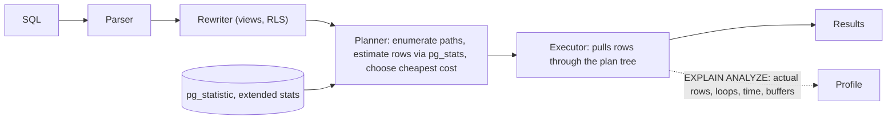

# PostgreSQL - Query Planning & EXPLAIN

> [!info] Deep dive of [[PostgreSQL]]

> [!abstract] TL;DR
> Postgres's cost-based planner picks scan methods, join algorithms and join order from **table statistics**. `EXPLAIN (ANALYZE, BUFFERS)` shows the chosen plan with **estimated vs actual rows**, time, and pages read.
> - **Big misestimates** (estimated 10 rows, actual 100k) are the root of most bad plans. Fix them with fresh/extended statistics, better predicates, or the right index ([[PostgreSQL - Indexing]]).
> - **Find what to fix first** with `pg_stat_statements` (total time), not by guessing.

## Concept

### Pipeline
1. **Parse** → **rewrite** (views, rules, RLS policies appended as predicates) → **plan** → **execute**.
2. The planner enumerates plans and estimates cost in abstract units:
   - `seq_page_cost` = 1.0 and `random_page_cost` = 4.0 (lower it to ~1.1 on SSD/cloud storage).
   - `cpu_tuple_cost`, `cpu_operator_cost`.
3. It picks the cheapest **estimated** plan. Estimates come from `pg_statistic` (via `pg_stats`): null fraction, n_distinct, most-common values, histograms, correlation.

### Plan nodes you'll see
| Node | Means | Good when |
|---|---|---|
| Seq Scan | Read the whole table | Small tables, or most rows needed |
| Index Scan | Walk index, fetch heap rows | Selective predicates, ordered output |
| **Index Only Scan** | Answer from the index alone (visibility map) | Covering indexes (`INCLUDE`), vacuumed tables |
| Bitmap Index/Heap Scan | Collect matching TIDs, then read pages in order | Medium selectivity, combining indexes (AND/OR) |
| Nested Loop | For each outer row, probe the inner side | Small outer side + indexed inner |
| **Hash Join** | Build a hash table of one side, probe with the other | Large unsorted equi-joins (needs `work_mem`) |
| Merge Join | Merge two sorted inputs | Both sides already sorted/indexed |
| Sort / Incremental Sort | Order rows (in memory or disk) | Watch "external merge Disk" |
| HashAggregate / GroupAggregate | GROUP BY strategies | — |
| Gather / Parallel * | Parallel workers | Large scans/aggregates |
| Memoize | Cache inner results of nested loops (14+) | Repeated lookups with few distinct keys |

## How It Works

- **Row estimation is multiplicative**: for `WHERE a = 1 AND b = 2`, Postgres multiplies selectivities assuming independence. Correlated columns (city + postcode, tenant + status) cause big underestimates. Fix with `CREATE STATISTICS … (dependencies, ndistinct, mcv)`.
- **Join order search**: exhaustive up to `join_collapse_limit`/`from_collapse_limit` (8), and genetic (GEQO) beyond `geqo_threshold` (12 tables).
- **Prepared statements**: after 5 executions Postgres may switch to a **generic plan** (ignoring parameter values). That's bad for skewed data (one huge tenant). Control it with `plan_cache_mode`.
- **work_mem** is per sort/hash node per worker. Too low means disk spills, and too high multiplied by many connections risks OOM.

## Practical Usage

### Reading EXPLAIN ANALYZE
```sql
explain (analyze, buffers, verbose, settings)
select o.id, o.total_sen, c.name
from orders o join customers c on c.id = o.customer_id
where o.tenant_id = $1 and o.status = 'paid' and o.created_at >= now() - interval '30 days'
order by o.created_at desc
limit 50;
```
```text
Limit  (cost=0.56..412.30 rows=50 width=48) (actual time=0.081..1.912 rows=50 loops=1)
  Buffers: shared hit=212
  ->  Nested Loop  (cost=0.56..9821.4 rows=1193 width=48) (actual time=0.080..1.900 rows=50 loops=1)
        ->  Index Scan Backward using orders_tenant_created_idx on orders o
              (cost=0.43..4120.2 rows=1193 width=40) (actual time=0.060..1.200 rows=50 loops=1)
              Index Cond: ((tenant_id = $1) AND (created_at >= (now() - '30 days'::interval)))
              Filter: (status = 'paid')
              Rows Removed by Filter: 31
        ->  Index Scan using customers_pkey on customers c (actual time=0.010..0.010 rows=1 loops=50)
              Index Cond: (id = o.customer_id)
Planning Time: 0.35 ms
Execution Time: 2.01 ms
```
How to read it:
- Compare **estimated `rows`** with **actual `rows`**. Within ~10× is fine. Off by 100–1000× means the statistics or predicate need work.
- Multiply actual time and rows by **`loops`**: inner nodes of nested loops run many times.
- **Buffers**: `shared hit` (cache) vs `read` (disk). High reads mean cold cache or a missing index.
- **`Rows Removed by Filter`** large → the index doesn't cover the filter column. Consider a composite or partial index.
- `Sort Method: external merge Disk: …` → sort spilled. Raise `work_mem` for that query/role, or add an index matching the `ORDER BY`.

### Finding the worst queries
```sql
create extension if not exists pg_stat_statements;
select query, calls, round(total_exec_time) as total_ms, round(mean_exec_time, 1) as mean_ms, rows
from pg_stat_statements order by total_exec_time desc limit 15;

-- Log plans of slow queries automatically (postgresql.conf / ALTER SYSTEM)
-- session_preload_libraries = 'auto_explain'; auto_explain.log_min_duration = '500ms'; auto_explain.log_analyze = on
```

### Fixing common misestimates
```sql
analyze orders;                                                     -- refresh stats after bulk loads
alter table orders alter column status set statistics 1000;          -- finer histogram for skewed columns
create statistics orders_tenant_status (dependencies, mcv) on tenant_id, status from orders;   -- correlated columns
analyze orders;

-- Sargable predicates (index-friendly):
-- bad:  where date(created_at) = '2026-10-15'
-- good: where created_at >= '2026-10-15' and created_at < '2026-10-16'
-- bad:  where lower(email) = $1          → add an expression index on lower(email), or use citext
```

## Patterns & Anti-patterns
| Pattern | When | Anti-pattern to avoid |
|---|---|---|
| `EXPLAIN (ANALYZE, BUFFERS)` on realistic data volumes | Any slow query | Tuning on a dev DB with 100 rows |
| `pg_stat_statements` top-N by total time | Prioritizing work | Optimizing a query that runs once a day |
| Sargable predicates, composite indexes in filter + sort order | Hot queries | Functions/casts on indexed columns |
| Keyset pagination (`where (created_at, id) < ($1,$2)`) | Feeds, lists | Deep `OFFSET` (reads and discards rows) |
| Extended statistics for correlated columns | Multi-tenant + status filters | Forcing plans with `enable_*` toggles in production |
| `random_page_cost ≈ 1.1` on SSD/cloud | Modern storage | Default 4.0 on NVMe (biases against index scans) |

## Performance & Trade-offs
- **EXPLAIN ANALYZE executes the query**: wrap writes in `begin; … rollback;`. Timing overhead can be significant on very fast nodes (`timing off` to reduce it).
- **Indexes vs writes**: each index speeds some reads but slows inserts/updates and uses memory. Drop unused ones (`pg_stat_user_indexes.idx_scan = 0`).
- **Parallel query** helps big analytical scans but adds overhead for small OLTP queries. Tune `max_parallel_workers_per_gather`.
- **JIT** (`jit = on`) can *slow down* short OLTP queries (compilation time). Many OLTP setups (including managed providers) disable it, or raise `jit_above_cost`.
- RLS policies are part of the plan, so slow policies show up as filters/subplans in EXPLAIN ([[Supabase - Row Level Security]]).

## Tips & Reminders
> [!tip]
> - Paste plans into explain.dalibo.com or pgMustard for visual analysis.
> - Use `EXPLAIN (ANALYZE, BUFFERS, SERIALIZE)` (17+) to include the cost of producing output rows, which matters for wide JSON responses.
> - Check autovacuum/analyze health (`pg_stat_user_tables.last_autoanalyze`, dead tuples). Stale stats or bloat ruin plans ([[PostgreSQL - Transactions & MVCC]]).
> - Set `statement_timeout` per role/app to stop runaway queries from taking the DB down.
> - **In ZP's stack**:
>   - On [[Supabase]], use the Query Performance report and Index Advisor (`index_advisor` extension), and run `explain analyze` in the SQL editor as the `authenticated` role with JWT claims set, to include RLS costs.
>   - For n8n Postgres nodes, parameterize queries so plans and stats stay stable.

## Version Notes
| Version | Change |
|---|---|
| 12 | Generated columns. Inlined CTEs by default (no longer optimization fences) |
| 13 | Incremental sort, `EXPLAIN (WAL)` |
| 14 | Memoize node |
| 16 | `EXPLAIN (GENERIC_PLAN)`, more parallel/incremental sort improvements |
| 17 | `EXPLAIN (SERIALIZE, MEMORY)`, better B-tree `IN` list handling, streaming I/O for sequential scans |
| **18** | **Asynchronous I/O**, **B-tree skip scan** (multicolumn index usable without the leading column in some cases), `BUFFERS` included by default with `EXPLAIN ANALYZE`, planner stats preserved across `pg_upgrade` |
| 19 (beta) | Further planner/executor work. Check release notes at GA |

> [!warning] Unverified — check before relying on this
> PostgreSQL 19 planner changes weren't confirmed this run. Check https://www.postgresql.org/docs/devel/release.html.

## Critical Issues & Gotchas
> [!danger] Generic plans and skewed tenants
> Prepared statements (used by most drivers, PgBouncer transaction mode setups, PostgREST) can switch to a generic plan tuned for the "average" tenant. Queries for your largest client then choose nested loops over millions of rows and time out. Watch for sudden slowdowns after N executions, test with `plan_cache_mode = force_custom_plan` for skewed workloads, and consider partitioning or per-tenant indexes for huge tenants.

> [!danger] Plans flip after data growth or stats changes
> A query fast at 100k rows can switch to a seq scan or hash join plan at 10M rows, or after an `ANALYZE`, causing sudden production incidents with no code change. Monitor p95 latency per query (`pg_stat_statements`), keep `auto_explain` on for slow queries, and load-test with production-sized data.

> [!warning] Gotchas
> - `LIMIT` with `ORDER BY` on a non-indexed column still sorts all matching rows.
> - `OR` across different columns often prevents index use. Rewrite with `UNION ALL` or ensure bitmap OR is possible.
> - Implicit casts (`varchar` column compared to a `text`/`int` parameter, `uuid` vs text) can disable indexes.
> - `count(*)` on big tables is a full scan (MVCC). Use estimates (`reltuples`) or counters for UI totals.
> - `NOT IN (subquery)` with NULLs behaves unexpectedly and plans poorly. Prefer `NOT EXISTS`.

## Related
- [[PostgreSQL]]
- [[PostgreSQL - Indexing]] — index types and design
- [[PostgreSQL - Transactions & MVCC]] — vacuum, bloat, visibility map
- [[Supabase - Row Level Security]] — policy cost in plans
- [[Big O Notation]] · [[Algorithms]] — join algorithms and complexity

## References
- Using EXPLAIN: https://www.postgresql.org/docs/current/using-explain.html
- Planner statistics: https://www.postgresql.org/docs/current/planner-stats.html
- pg_stat_statements: https://www.postgresql.org/docs/current/pgstatstatements.html
- auto_explain: https://www.postgresql.org/docs/current/auto-explain.html
- explain.dalibo.com: https://explain.dalibo.com/
- PostgreSQL 18 release notes: https://www.postgresql.org/docs/18/release-18.html
