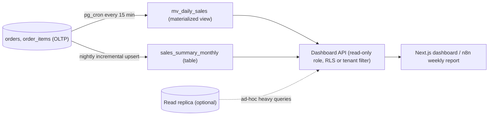

# PostgreSQL - Reporting Queries, Window Functions & Materialized Views

> [!info] Deep dive of [[PostgreSQL]]

> [!abstract] TL;DR
> Most SME "analytics" (daily sales, top products, repeat customers, staff performance) fits in Postgres. You don't need a warehouse:
> - **Bucket by local time**: `date_trunc('day', created_at at time zone 'Asia/Kuala_Lumpur')`. Fill gaps with `generate_series`.
> - **Conditional aggregates** with `count(*) filter (where …)`, and subtotals with `grouping sets`/`rollup`.
> - **Window functions** for running totals, ranks, period-over-period, and first/last purchase (`sum() over`, `rank()`, `lag()`).
> - **Materialized views** (or summary tables) refreshed by `pg_cron` for heavy dashboards. Use `refresh … concurrently` with a unique index.
> - Run reports on a **read replica** or off-peak, through a **read-only role**, with `statement_timeout`.

## Concept
| Tool | Use for | Note |
|---|---|---|
| `date_trunc` + `at time zone` | Daily/weekly/monthly buckets in MYT | Store `timestamptz`, convert at query time |
| `generate_series` | Gap-filling (days with zero sales) | Left join buckets to aggregates |
| `FILTER (WHERE …)` | Pivot-like conditional counts/sums | Cleaner than `sum(case …)` |
| `GROUPING SETS` / `ROLLUP` / `CUBE` | Subtotals and grand totals in one query | `grouping()` identifies total rows |
| Window functions | Running totals, ranks, moving averages, lag/lead | Don't reduce rows (unlike GROUP BY) |
| `DISTINCT ON` | Latest row per group | Postgres-specific, fast with matching index |
| Materialized view | Precomputed heavy aggregates | Stale until refreshed |
| Summary table + incremental upsert | Large, append-only facts | More code, fresher and cheaper |

## How It Works


## Practical Usage
**Daily sales in MYT with zero-filled days**:
```sql
with days as (
  select generate_series(date '2026-11-01', date '2026-11-30', interval '1 day')::date as day
), sales as (
  select (created_at at time zone 'Asia/Kuala_Lumpur')::date as day,
         count(*) as orders,
         sum(total_cents) / 100.0 as revenue_rm,
         count(*) filter (where channel = 'whatsapp') as wa_orders
  from orders
  where tenant_id = $1 and status = 'paid'
    and created_at >= timestamptz '2026-11-01 00:00 Asia/Kuala_Lumpur'
    and created_at <  timestamptz '2026-12-01 00:00 Asia/Kuala_Lumpur'
  group by 1
)
select d.day, coalesce(s.orders, 0) as orders, coalesce(s.revenue_rm, 0) as revenue_rm, coalesce(s.wa_orders, 0) as wa_orders
from days d left join sales s using (day) order by d.day;
```
**Running total and 7-day moving average**:
```sql
select day, revenue_rm,
       sum(revenue_rm) over (order by day) as mtd_revenue,
       avg(revenue_rm) over (order by day rows between 6 preceding and current row) as ma7
from daily_sales where tenant_id = $1 and day >= date_trunc('month', current_date);
```
**Top 5 products per category** (rank within partition):
```sql
select * from (
  select p.category, p.name, sum(oi.qty) as units,
         rank() over (partition by p.category order by sum(oi.qty) desc) as rnk
  from order_items oi join products p on p.id = oi.product_id
  join orders o on o.id = oi.order_id
  where o.tenant_id = $1 and o.status = 'paid' and o.created_at >= now() - interval '30 days'
  group by p.category, p.name
) t where rnk <= 5 order by category, rnk;
```
**Month-over-month growth with `lag`**:
```sql
select month, revenue,
       round(100.0 * (revenue - lag(revenue) over (order by month)) / nullif(lag(revenue) over (order by month), 0), 1) as mom_pct
from monthly_revenue where tenant_id = $1;
```
**Repeat customers / first purchase cohort**:
```sql
select date_trunc('month', first_order) as cohort, count(*) as customers,
       count(*) filter (where orders >= 2) as repeaters
from (
  select customer_id, min(created_at) as first_order, count(*) as orders
  from orders where tenant_id = $1 and status = 'paid' group by customer_id
) c group by 1 order by 1;
```
**Subtotals per outlet with a grand total**:
```sql
select coalesce(outlet, 'ALL') as outlet, coalesce(payment_method, 'ALL') as method, sum(total_cents)/100.0 as rm
from orders where tenant_id = $1 and created_at >= date_trunc('month', now())
group by rollup (outlet, payment_method) order by outlet nulls last, method nulls last;
```
**Materialized view refreshed concurrently**:
```sql
create materialized view mv_daily_sales as
select tenant_id, (created_at at time zone 'Asia/Kuala_Lumpur')::date as day,
       count(*) as orders, sum(total_cents) as revenue_cents
from orders where status = 'paid' group by 1, 2;
create unique index on mv_daily_sales (tenant_id, day);          -- required for CONCURRENTLY
select cron.schedule('refresh-daily-sales', '*/15 * * * *',
  $$ refresh materialized view concurrently mv_daily_sales $$);
```
**Wrong way**:
```sql
-- ❌ bucketing in UTC: orders after 4 pm MYT land on "tomorrow"
select date_trunc('day', created_at), sum(total_cents) from orders group by 1;
-- ❌ function on the column kills index use for the range filter
where date(created_at) = '2026-11-18'
-- ❌ materialized view exposed to all tenants via the Data API (no RLS on MVs)
```

## Patterns & Anti-patterns
| Pattern | When | Anti-pattern to avoid |
|---|---|---|
| Range filters on raw `timestamptz` with MYT boundaries | All date filters | `date(created_at) = …` |
| Composite index `(tenant_id, status, created_at)` | Sales queries | Separate single-column indexes |
| Materialized views behind RPC/security-definer with tenant check | Supabase | Exposing MVs directly (no RLS) |
| `refresh concurrently` + unique index | Dashboards during business hours | Blocking refresh at peak |
| Summary tables with incremental upserts | Large fact tables | Full recompute every 5 min |
| Read-only reporting role + `statement_timeout` | Ad-hoc/BI tools | BI tool using the app's owner role |
| Store money in integer cents | Always | Floats in aggregates |

## Performance & Trade-offs
- **Window functions** sort by partition/order keys, so an index matching `(partition, order)` avoids big sorts. Check `EXPLAIN (ANALYZE, BUFFERS)` for `Sort` spilling to disk ([[PostgreSQL - Query Planning & EXPLAIN]]).
- **Materialized views**: simple and fast reads, but full recompute each refresh. Cost grows with data, and `concurrently` takes longer but doesn't block readers.
- **Summary tables** cost more code but allow incremental updates (`insert … on conflict do update`) and partition-friendly retention.
- **When to leave Postgres**: tens of millions of events, heavy ad-hoc slicing, or many analysts. Consider ClickHouse/DuckDB fed by CDC or exports ([[PostgreSQL - Logical Replication & Change Data Capture]]).

## Tips & Reminders
> [!tip] In ZP's stack
> - **Owner dashboards** (today's sales, top items, repeat customers, WhatsApp vs web orders) are high-perceived-value features that take a day with these queries + a Next.js page ([[Next.js - Admin Dashboards, Data Tables & Server-Side Filtering]]).
> - **Weekly WhatsApp/Telegram report** from n8n: call an RPC that returns the summary JSON, then format it. Owners love it, and it's cheap to run.
> - **Supabase**: materialized views aren't covered by RLS. Put them in a non-exposed schema and serve via `security definer` RPCs that filter by the caller's tenant ([[Supabase - Performance Tuning & Advisors]]).

- Always state the time zone in report UIs ("Times in MYT").
- Round only at presentation. Aggregate integers (cents).
- Precompute "yesterday" and "last month" at night, and compute "today" live.
- Document metric definitions (what counts as revenue: paid? refunded?) with the client.

## Version Notes
| Version | Change relevant here |
|---|---|
| 8.4 / 9.0 | Window functions, `generate_series` for timestamps |
| 9.3 / 9.4 | Materialized views. `REFRESH … CONCURRENTLY`. `FILTER` clause |
| 9.5 | `GROUPING SETS`, `ROLLUP`, `CUBE` |
| 14 | `date_bin()` for arbitrary bucket sizes (e.g. 15-minute buckets) |
| 16–18 | Planner improvements for window/aggregate queries. 18: async I/O speeds large scans |

> [!warning] Unverified — check before relying on this
> PostgreSQL 19 analytics-related improvements weren't checked this run. See the release notes when upgrading ([[PostgreSQL]]).

## Critical Issues & Gotchas
> [!danger] Reports leaking across tenants
> Materialized views, views owned by privileged roles, and reporting RPCs can bypass RLS. A dashboard query missing `tenant_id = …` shows one client's revenue to another. Keep reporting objects in an unexposed schema, enforce tenant filters inside `security definer` functions using `auth.uid()`/claims, and test with two tenants ([[Supabase - Database Testing with pgTAP & Policy Tests]]).

> [!danger] Heavy reports degrading the live app
> An unindexed month-range report or a full MV refresh at lunchtime saturates CPU/IO on a small VPS, slowing checkout and WhatsApp bots. Set `statement_timeout` for reporting roles, schedule refreshes off-peak or incrementally, and move heavy ad-hoc analysis to a replica or export.

- **Time zone traps**: `now()::date` uses the session time zone (often UTC on servers). Be explicit.
- **`count(distinct …)` over windows** isn't supported. Pre-aggregate or use subqueries.
- **Refunds/cancellations**: decide whether revenue is by order date or payment date, and handle negative adjustments consistently.
- **MV refresh failures** (e.g. duplicate key in the unique index) leave stale data silently. Alert on cron job failures (`cron.job_run_details`).

## Related
- [[PostgreSQL]]
- [[PostgreSQL - Query Planning & EXPLAIN]] — sorts, hash aggregates, spills
- [[PostgreSQL - Indexing]] — composite indexes for report filters
- [[PostgreSQL - Partitioning & Large Table Maintenance]] — time-partitioned facts
- [[Next.js - Admin Dashboards, Data Tables & Server-Side Filtering]] — presenting reports
- [[Supabase - Performance Tuning & Advisors]] — Supabase-specific tuning

## References
- https://www.postgresql.org/docs/current/tutorial-window.html
- https://www.postgresql.org/docs/current/functions-window.html
- https://www.postgresql.org/docs/current/queries-table-expressions.html#QUERIES-GROUPING-SETS
- https://www.postgresql.org/docs/current/rules-materializedviews.html
- https://www.postgresql.org/docs/current/functions-datetime.html
