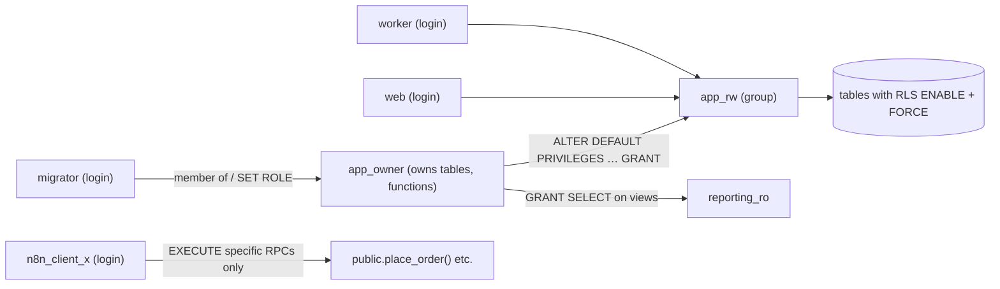

# PostgreSQL - Roles, Privileges & Least-Privilege Access

> [!info] Deep dive of [[PostgreSQL]]

> [!abstract] TL;DR
> Give **every consumer its own login role** with only the grants it needs: app, migrations, n8n, BI/reporting, backups.
> - Group privileges in **NOLOGIN group roles**, and set **default privileges** so new tables don't silently miss (or get too many) grants.
> - Keep **ownership** with a migration role, never the app role.
> - Use **RLS** for row-level rules, and remember **owners and `BYPASSRLS` roles skip it** unless `FORCE ROW LEVEL SECURITY`.
> - On Supabase, `anon`/`authenticated` are API roles, `service_role` bypasses RLS, and integrations like n8n should get **dedicated roles**, not the `postgres` password.

## Concept
| Concept | Meaning | Gotcha |
|---|---|---|
| Role | User or group (`LOGIN` decides which) | Roles are cluster-wide, privileges are per object |
| Owner | Creator of an object, has all rights, can `ALTER`/`DROP` | Owners bypass RLS unless `FORCE ROW LEVEL SECURITY` |
| `GRANT` on schema | `USAGE` (see objects), `CREATE` | Table grants are useless without schema `USAGE` |
| `GRANT` on table/sequence/function | `SELECT/INSERT/UPDATE/DELETE`, `USAGE` on sequences, `EXECUTE` | Functions get `EXECUTE` to `PUBLIC` by default |
| Default privileges | `ALTER DEFAULT PRIVILEGES` for future objects | Applies per *creating* role and schema |
| Predefined roles | `pg_read_all_data` (14), `pg_write_all_data` (14), `pg_maintain` (17), `pg_signal_backend`, `pg_monitor` | Broad, so use them only for ops roles |
| `BYPASSRLS` | Skips all RLS policies | Supabase `service_role` has it |
| Column privileges | `GRANT SELECT (col1, col2)` | Fine-grained but tedious, and views are often clearer |

**Role design for an SME SaaS**:

| Role | Login | Grants | Used by |
|---|---|---|---|
| `app_owner` | no | Owns schema objects | Migrations run `SET ROLE app_owner` |
| `migrator` | yes | Member of `app_owner` | CI migrations only |
| `app_rw` (group) | no | DML on app tables, `USAGE` on sequences, `EXECUTE` on chosen functions | — |
| `web` / `worker` | yes | Member of `app_rw` | Next.js server, BullMQ workers |
| `n8n_client_x` | yes | `SELECT` on a few views, `EXECUTE` on specific RPCs | n8n workflows |
| `reporting_ro` | yes | `pg_read_all_data` or `SELECT` on reporting views | Metabase / BI |
| `backup` | yes | `pg_read_all_data` (logical dumps) | pg_dump jobs |

## How It Works


## Practical Usage
**Self-hosted baseline**:
```sql
-- 1) lock down defaults
revoke all on database app from public;
revoke create on schema public from public;          -- default since PG15, explicit for older clusters
create schema app authorization app_owner;

-- 2) group + login roles
create role app_owner nologin;
create role app_rw nologin;
create role migrator login password :'migrator_pw' in role app_owner;
create role web login password :'web_pw' connection limit 30 in role app_rw;
create role reporting_ro login password :'ro_pw' connection limit 5;

-- 3) grants for existing and FUTURE objects created by app_owner
grant usage on schema app to app_rw, reporting_ro;
grant select, insert, update, delete on all tables in schema app to app_rw;
grant usage, select on all sequences in schema app to app_rw;
alter default privileges for role app_owner in schema app grant select, insert, update, delete on tables to app_rw;
alter default privileges for role app_owner in schema app grant usage, select on sequences to app_rw;
alter default privileges for role app_owner in schema app revoke execute on functions from public;
alter default privileges for role app_owner in schema app grant select on tables to reporting_ro;

-- 4) RLS that also applies to the owner
alter table app.orders enable row level security;
alter table app.orders force row level security;
```
**Supabase: dedicated integration role for n8n** (instead of the `postgres` password):
```sql
create role n8n_kedai login password 'use-a-generated-secret' connection limit 5 noinherit;
grant usage on schema public to n8n_kedai;
grant select on public.v_orders_for_automation to n8n_kedai;           -- curated view, no PII columns
grant execute on function public.mark_order_notified(uuid) to n8n_kedai;
alter role n8n_kedai set statement_timeout = '10s';
```
**Audit who can do what**:
```sql
select grantee, table_schema, table_name, string_agg(privilege_type, ',') as privs
from information_schema.role_table_grants
where table_schema in ('public', 'app') group by 1,2,3 order by 1,2,3;

select r.rolname, r.rolsuper, r.rolbypassrls, r.rolcanlogin, r.rolconnlimit
from pg_roles r where r.rolname !~ '^pg_' order by 1;

select p.proname, p.prosecdef as security_definer, has_function_privilege('anon', p.oid, 'execute') as anon_exec
from pg_proc p join pg_namespace n on n.oid = p.pronamespace where n.nspname = 'public';
```
**Password auth** (`pg_hba.conf` / `postgresql.conf`):
```ini
password_encryption = scram-sha-256
# pg_hba.conf: no "trust", no md5 (deprecated in PG18)
hostssl  app  web,worker  10.0.0.0/8   scram-sha-256
hostssl  app  reporting_ro 100.64.0.0/10 scram-sha-256   # tailnet only
```
**Wrong way**:
```text
❌ App connects as postgres/superuser                     → SQL injection = full cluster takeover (COPY PROGRAM, extensions)
❌ App role owns the tables                               → bypasses RLS, can DROP/ALTER in production
❌ Grants on "all tables" but no default privileges       → new table works for owner, 500s for the app after deploy
❌ Supabase service_role key in n8n for every workflow    → any workflow bug can read/write every tenant
```

## Patterns & Anti-patterns
| Pattern | When | Anti-pattern to avoid |
|---|---|---|
| Separate owner/migrator vs runtime roles | Every deployment | Runtime role with DDL rights |
| Group roles + membership for login roles | Several services | Grants copied per user |
| `ALTER DEFAULT PRIVILEGES` per creating role | Ongoing migrations | Manual grants after each new table |
| `FORCE ROW LEVEL SECURITY` on tenant tables | Self-hosted + RLS | Assuming RLS applies to the owner |
| Curated views/RPCs for integrations | n8n, BI, partners | Direct table access with broad grants |
| Connection limits + timeouts per role | Shared DB | One integration exhausting connections |
| Quarterly grant audit | Compliance, client handover | Grants nobody remembers giving |

## Performance & Trade-offs
- **Privilege checks are cheap**: least privilege has no meaningful runtime cost. The cost is setup and migration discipline.
- **Many roles** add operational overhead (passwords, rotation, pooler config). Group roles keep grants manageable, and secrets managers handle rotation ([[CI-CD - Secrets Management with SOPS & Infisical]]).
- **Poolers** need per-role auth configuration (PgBouncer `auth_query`/userlist). Each role gets its own server pool, so too many roles fragment pools ([[PostgreSQL - Connection Pooling with Supavisor & PgBouncer]]).
- **Views for integrations** hide schema changes and PII, but need maintenance when tables evolve.

## Tips & Reminders
> [!tip] In ZP's stack
> - **Supabase projects**: the app uses `anon`/`authenticated` via PostgREST with RLS, while server code uses the secret key only where needed (webhooks, admin jobs). n8n and BI get dedicated roles with views/RPCs, connecting through the pooler.
> - **Self-hosted Postgres on a KVM**: the role layout above, `scram-sha-256`, `hostssl` only, the DB port bound to the tailnet, and backups with a `pg_read_all_data` role ([[Linux Essentials - Networking, Firewalls & Tailscale]]).
> - **Client handover**: export the role/grant audit queries' output into the handover document, so the client knows exactly who can access what.

- Rotate integration passwords when staff or vendors change, and on any n8n credential exposure ([[n8n - Security, Credentials & Self-Hosting Hardening]]).
- Use `noinherit` + explicit `set role` for sensitive admin roles, so privileges aren't always active.
- Install `pgaudit` (where available) for DDL and role changes on regulated clients.
- Test RLS as the real runtime role (`set role authenticated` + JWT claims), not as `postgres`, which bypasses policies ([[Supabase - Row Level Security]]).

## Version Notes
| Version | Change relevant here |
|---|---|
| 9.5 | Row-level security |
| 14 | `pg_read_all_data`, `pg_write_all_data` predefined roles |
| 15 | `CREATE` on the `public` schema revoked from `PUBLIC` by default. `public` schema owned by `pg_database_owner` |
| 16 | Finer role-membership options (`INHERIT`/`SET` per grant). `CREATEROLE` restricted |
| 17 | `pg_maintain` predefined role (VACUUM/ANALYZE/REINDEX etc. without ownership) |
| 18 | MD5 password authentication deprecated (warnings). Use SCRAM |

## Critical Issues & Gotchas
> [!danger] Superuser or owner credentials in applications
> A superuser can read files, run programs (`COPY … PROGRAM`), load extensions and bypass all RLS. An owner can bypass RLS and drop tables. An SQL injection or leaked connection string with these rights becomes a full breach. Runtime roles must be non-owner, non-superuser, without `BYPASSRLS`. Keep the superuser for break-glass only.

> [!danger] Functions executable by PUBLIC
> New functions get `EXECUTE` for `PUBLIC` by default. Combined with `SECURITY DEFINER`, any role (including Supabase `anon` via `/rpc`) can call privileged code. Revoke `EXECUTE` from `PUBLIC` via default privileges, and grant explicitly ([[Supabase - Database Functions, Triggers & RPC]]).

- **Default privileges are per creator**: if a different role creates a table (someone running a manual migration as `postgres`), your defaults don't apply. Always create objects as the owner role.
- **Dropping roles** fails while they own objects or hold grants. Use `reassign owned by` + `drop owned by` carefully.
- **`GRANT ALL ON ALL TABLES`** doesn't include future tables, sequences or functions, the classic "works in dev, breaks in prod" cause.
- **Supabase `service_role`** bypasses RLS and is equivalent to full data access. Treat it like the root password.

## Related
- [[PostgreSQL]]
- [[Supabase - Row Level Security]] — row-level rules on top of privileges
- [[Supabase - Database Functions, Triggers & RPC]] — function execution rights and definer risks
- [[PostgreSQL - Connection Pooling with Supavisor & PgBouncer]] — per-role pools and auth
- [[Authentication & Authorization - Multi-Tenant Authorization with RLS]] — tenant isolation design
- [[n8n - Security, Credentials & Self-Hosting Hardening]] — scoped DB credentials for automations

## References
- https://www.postgresql.org/docs/current/user-manag.html
- https://www.postgresql.org/docs/current/ddl-priv.html
- https://www.postgresql.org/docs/current/sql-alterdefaultprivileges.html
- https://www.postgresql.org/docs/current/predefined-roles.html
- https://supabase.com/docs/guides/database/postgres/roles
