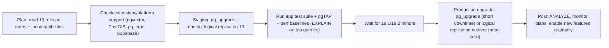

# PostgreSQL - Version 19 New Features & Upgrade Planning

> [!info] Deep dive of [[PostgreSQL]]

> [!abstract] TL;DR
> **PostgreSQL 19** went GA on **2026-11-19**, later than the usual September slot after several late-cycle feature reverts (including SQL/PGQ graph queries). Highlights relevant to app teams:
> - **`REPACK [CONCURRENTLY]`**: rebuild bloated tables without long exclusive locks, replacing `VACUUM FULL`/`CLUSTER` (both kept for compatibility). Beware a documented MVCC caveat for old snapshots.
> - **`pg_plan_advice` / `pg_stash_advice`**: describe, pin and auto-apply planner decisions. Plan stability for critical queries without hint hacks.
> - **`WAIT FOR LSN`**: read-your-writes on standbys (wait until a replica has replayed your write).
> - **Logical replication of sequences**: closes a classic gap in logical-replication upgrades and migrations.
> - **Server-side SNI** for TLS certificates. **RADIUS authentication removed**.
> - Parallel index vacuuming in autovacuum with priority scoring.
>
> **Upgrade advice**: test now, upgrade production at **19.1–19.2** (first quarterly minors), and only after extensions (PostGIS, pgvector, pg_cron, TimescaleDB…) and managed platforms (Supabase) support 19.

## Concept
| Feature | What it changes | Who benefits |
|---|---|---|
| `REPACK` / `REPACK (CONCURRENTLY)` | Online table rewrite/re-cluster | Bloated tables on small VPSs, no maintenance window |
| `pg_plan_advice` + `pg_stash_advice` | Plan advice language + automatic application by query ID | Regressions after stats changes, critical reports |
| `WAIT FOR LSN` | Session on a standby waits for a given primary LSN | Read replicas behind APIs (read-after-write) |
| Sequence logical replication | Sequence values replicate | Blue/green and logical-replication upgrades |
| Server-side SNI | Different certs per hostname on one server | Multi-tenant/managed Postgres endpoints |
| Parallel index autovacuum + priority scoring | Faster, smarter vacuum on big tables | Large write-heavy tables |
| Removed: RADIUS auth | Breaking for clusters using RADIUS | Rare in SME setups |

**Compared with 18** (context):

| 18 (2025-09) | 19 (2026-11) |
|---|---|
| Async I/O, `uuidv7()`, virtual generated columns, OAuth auth, skip scan | Online REPACK, plan advice, WAIT FOR LSN, sequence replication |
| Data checksums on by default, MD5 deprecated | RADIUS removed. Check the release notes for further incompatibilities |

## How It Works


## Practical Usage
**Online table rebuild instead of `VACUUM FULL`**:
```sql
-- old: VACUUM FULL orders;  -- ACCESS EXCLUSIVE for the whole rewrite
repack (concurrently) public.orders;                   -- rewrite with minimal blocking
repack (concurrently) public.events using index events_created_at_idx;   -- re-cluster by index (CLUSTER replacement)
```
**Pin a plan for a critical query** (concept: capture advice, store it, auto-apply by query ID):
```sql
create extension if not exists pg_plan_advice;
create extension if not exists pg_stash_advice;
-- capture the planner's current choices for a known-good plan, then store as advice for that query ID
-- (exact functions/GUCs: see the pg_plan_advice docs for 19)
```
**Read-your-writes on a replica**:
```sql
-- on primary after a write, get the LSN
select pg_current_wal_lsn();                 -- e.g. '0/3A1B2C40'
-- on the standby session before reading
wait for lsn '0/3A1B2C40' timeout 2000;      -- syntax per 19 docs; fall back to primary on timeout
select * from orders where id = 42;
```
**Logical-replication upgrade with sequences** (18 → 19):
```sql
-- publisher (18) / subscriber (19): sequences can now be included per 19 capabilities,
-- removing the manual setval() step at cutover (verify publication syntax in 19 docs)
```
**Pre-upgrade checks**:
```bash
/usr/lib/postgresql/19/bin/pg_upgrade --check \
  -b /usr/lib/postgresql/18/bin -B /usr/lib/postgresql/19/bin \
  -d /var/lib/postgresql/18/main -D /var/lib/postgresql/19/main
```
```sql
select extname, extversion from pg_extension order by 1;   -- confirm each has a PG19 build
select * from pg_hba_file_rules where auth_method = 'radius';   -- must be empty (RADIUS removed)
```
**Wrong way**:
```text
❌ Upgrading production on 19.0 day one            → first-minor bug fixes and extension builds not there yet
❌ Assuming REPACK CONCURRENTLY is invisible to all sessions → documented edge case with old snapshots
❌ Skipping ANALYZE after pg_upgrade               → bad plans until autovacuum catches up (stats kept since 18, verify)
❌ Self-hosted PG19 while Supabase projects stay on 15/17 → inconsistent features between client projects
```

## Patterns & Anti-patterns
| Pattern | When | Anti-pattern to avoid |
|---|---|---|
| Upgrade at 19.1–19.2 after staging tests | Production | Day-one major upgrades |
| Logical replication cutover for big/critical DBs | Low downtime needs | Multi-hour dump/restore windows |
| Use `REPACK (CONCURRENTLY)` for bloat | Live tables | `VACUUM FULL` during business hours |
| Plan advice only for proven regressions | Critical queries | Pinning plans everywhere (blocks planner improvements) |
| `WAIT FOR LSN` with timeout + primary fallback | Read replicas | Unbounded waits on lagging replicas |
| Extension compatibility matrix per client | Upgrades | Discovering missing pgvector build mid-upgrade |

## Performance & Trade-offs
- **REPACK CONCURRENTLY** still needs disk space for a full copy plus WAL, and takes longer than an offline rewrite. Schedule it off-peak on small disks ([[Linux Essentials - Disk, Inodes & Log Rotation Troubleshooting]]).
- **Plan advice** trades adaptability for stability. Review advice after data growth or upgrades.
- **WAIT FOR LSN** adds latency equal to replica lag. Use it only on read-after-write paths.
- **Upgrade method**: `pg_upgrade --link` is minutes for most SME databases. Logical replication needs more setup but near-zero downtime ([[PostgreSQL - Major Version Upgrades & Migrations]]).

## Tips & Reminders
> [!tip] In ZP's stack
> - **Supabase projects** move to new majors on Supabase's schedule. Don't plan client features around PG19 until Supabase announces support, and self-hosted Supabase images also lag ([[Supabase - Self-Hosting with Docker & Coolify]]).
> - **Self-hosted Postgres** (n8n, client apps on Coolify): stay on 18.x for now, test 19 in staging, and target upgrades in 2027-Q1 after 19.1+.
> - **Bloat pain on small VPSs** (audit/events tables) is the most immediately useful PG19 feature. `REPACK (CONCURRENTLY)` replaces risky `VACUUM FULL` windows ([[PostgreSQL - Partitioning & Large Table Maintenance]]).

- Read the "Migration to Version 19" incompatibilities section line by line.
- Re-run pgTAP and integration tests on 19 in CI before upgrading ([[Supabase - Database Testing with pgTAP & Policy Tests]]).
- Capture `EXPLAIN (ANALYZE, BUFFERS)` of top queries before and after.
- PG14 is already EOL, so upgrade those first (straight to 18, or to 19 after its first minors).

## Version Notes
| Version | Released | Notes |
|---|---|---|
| 17 | 2024-09 | Incremental backup, failover slots |
| 18 | 2025-09-25 | Async I/O, uuidv7, OAuth, checksums default |
| **19** | **2026-11-19** | REPACK CONCURRENTLY, pg_plan_advice, WAIT FOR LSN, sequence replication, SNI. RADIUS removed. SQL/PGQ reverted |
| 19.1 | Expected 2027-02 (quarterly minor cadence) | Recommended earliest production target |

> [!warning] Unverified — check before relying on this
> Exact SQL syntax for `WAIT FOR LSN`, sequence publication options and pg_plan_advice functions, plus the full incompatibilities list, weren't verified against the final 19 docs. The documented REPACK MVCC caveat came from a third-party review. Read https://www.postgresql.org/docs/19/release-19.html before relying on specifics.

## Critical Issues & Gotchas
> [!danger] Extensions and platforms lag new majors
> Upgrading a cluster that uses pgvector, PostGIS, pg_cron, TimescaleDB or pgaudit before PG19 builds exist leaves you unable to start, or forces dropping extensions. That's catastrophic for RAG apps or scheduled jobs. Verify each extension's 19 support, and test `pg_upgrade --check` with the exact extension set first.

> [!danger] REPACK concurrency caveat
> The release documentation reportedly warns that `REPACK (CONCURRENTLY)` isn't fully MVCC-safe: a transaction holding a very old snapshot may see the repacked table as empty in some cases. Long-running report transactions or replication consumers during a repack could read wrong results. Avoid running it alongside long transactions, and check `pg_stat_activity` for old `xact_start` first.

- **RADIUS removal** breaks the rare cluster using it. Switch auth methods before upgrading.
- **Feature reverts**: blog posts from the beta period describe features (e.g. SQL/PGQ graph queries) that didn't ship. Trust the final release notes.
- **Client tools** (pg_dump, drivers, ORMs, Debezium) need versions that understand 19 ([[Kafka - Kafka Connect & Debezium Pipelines]]).
- **Statistics**: confirm stats carry over with your upgrade method, and run `ANALYZE` anyway.

## Related
- [[PostgreSQL]]
- [[PostgreSQL - Major Version Upgrades & Migrations]] — pg_upgrade and logical cutovers
- [[PostgreSQL - Query Planning & EXPLAIN]] — plan regressions and advice
- [[PostgreSQL - Partitioning & Large Table Maintenance]] — bloat and REPACK
- [[PostgreSQL - Logical Replication & Change Data Capture]] — sequence replication
- [[PostgreSQL - Locking, Deadlocks & Concurrency Control]] — lock impact of maintenance

## References
- https://postgresql.org/about/news/postgresql-19-released-3449
- https://www.postgresql.org/docs/19/release-19.html
- https://www.postgresql.org/about/press/presskit19/
- https://planetscale.com/blog/whats-new-in-postgres-19
- https://www.snowflake.com/en/blog/engineering/postgresql-19-release-delay-feature-reverts/
