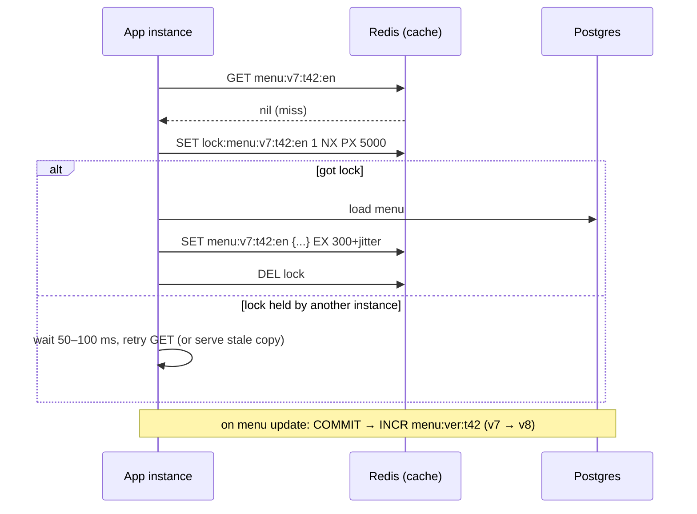

# Redis - Caching Patterns & Invalidation

> [!info] Deep dive of [[Redis]]

> [!abstract] TL;DR
> - **Default to cache-aside**: read → miss → load from Postgres → `SET key value EX ttl` (with **jitter**). Then **delete** keys on writes, or bump a **version namespace**.
> - **Protect against stampedes** with a single-flight lock or stale-while-revalidate.
> - **Key by everything that changes the result**: tenant, user or role, locale and parameters. Caching RLS-filtered data under a shared key is a cross-tenant leak.
> - **Run caches on their own Redis** with `allkeys-lru` (or LFU). Queues need `noeviction`, so never share an instance.

## Concept
| Pattern | Flow | Pros | Cons |
|---|---|---|---|
| **Cache-aside** (lazy) | App checks cache → on miss reads DB → writes cache | Simple, cache failure = slower, not broken | First request slow; stale until TTL/invalidation |
| Read-through | Cache library loads on miss | Centralized loading | Library coupling |
| Write-through | Write DB and cache together | Fresh reads | Write latency; cache holds cold data |
| Write-behind | Write cache, flush to DB async | Fast writes | **Data loss risk**; rarely right for business data |
| Refresh-ahead / SWR | Serve stale, refresh in background before expiry | Low tail latency | Extra load; complexity |

**Invalidation strategies**:

| Strategy | How | Use when |
|---|---|---|
| TTL only | `EX 300` | Data can be minutes stale (catalogs, rates) |
| Delete on write | `DEL product:{id}` after DB commit | Single-key entities |
| Versioned namespace | `menu:v{n}:{tenant}:…`; `INCR menu:ver:{tenant}` invalidates all at once | Many derived keys per tenant |
| Tag sets | `SADD tag:tenant:42 key…` then delete members | Arbitrary groups (careful with set size) |
| Event-driven | DB trigger/outbox → worker deletes keys | Multiple writers (app, n8n, SQL) |

## How It Works


## Practical Usage
**Cache-aside with jitter + single-flight lock** (node-redis / ioredis style):
```ts
const ttlWithJitter = (base: number) => base + Math.floor(Math.random() * base * 0.1);   // ±10% spreads expiries

export async function getOrLoad<T>(key: string, ttl: number, load: () => Promise<T>): Promise<T> {
  const hit = await redis.get(key);
  if (hit) return JSON.parse(hit) as T;

  const lockKey = `lock:${key}`;
  const gotLock = await redis.set(lockKey, '1', { NX: true, PX: 5_000 });
  if (!gotLock) {                                              // someone else is loading
    await new Promise((r) => setTimeout(r, 75));
    const retry = await redis.get(key);
    if (retry) return JSON.parse(retry) as T;
    return load();                                             // fall through rather than hang
  }
  try {
    const value = await load();
    await redis.set(key, JSON.stringify(value), { EX: ttlWithJitter(ttl) });
    return value;
  } finally {
    await redis.del(lockKey);
  }
}
```
**Versioned namespace per tenant** (invalidate everything for a tenant in O(1)):
```ts
async function menuKey(tenantId: string, locale: string) {
  const v = (await redis.get(`menu:ver:${tenantId}`)) ?? '0';
  return `menu:v${v}:${tenantId}:${locale}`;
}
export async function onMenuChanged(tenantId: string) {
  await redis.incr(`menu:ver:${tenantId}`);                   // old keys expire naturally via TTL
}
```
**Negative caching** (avoid hammering the DB for unknown IDs, e.g. bots probing):
```ts
if (!row) { await redis.set(key, '__none__', { EX: 30 }); return null; }
```
**Event-driven invalidation** when non-app writers (n8n, SQL editor) change data: an `AFTER UPDATE` trigger enqueues to pgmq, and a worker runs `INCR`/`DEL` ([[Supabase - Edge Functions, Cron & Queues]]).

**Wrong way**:
```ts
await redis.set('dashboard_stats', JSON.stringify(stats));          // ❌ no TTL, no tenant: stale forever + leaks across tenants
await redis.del(`product:${id}`); await db.update(product);         // ❌ delete BEFORE commit: a concurrent reader re-caches the old row
const keys = await redis.keys('menu:*'); await redis.del(keys);     // ❌ KEYS blocks Redis (O(N)); use versioning or SCAN
```

## Patterns & Anti-patterns
| Pattern | When | Anti-pattern to avoid |
|---|---|---|
| Delete/bump **after** DB commit | Every write path | Invalidate-then-write races |
| Key includes tenant + role/user when results depend on permissions | RLS-backed data | Shared keys for permission-filtered queries |
| TTL on every cache key (+ jitter) | Always | Immortal keys, synchronized mass expiry |
| Separate Redis for cache (`allkeys-lru`) vs queues (`noeviction`) | Mixed workloads | One Redis where LRU evicts BullMQ jobs |
| Cache **computed** results (aggregates, rendered menus) | Expensive queries | Caching single-row PK lookups Postgres serves in 0.1 ms |
| Measure hit ratio per key prefix | Tuning | Caching blindly, never checking hits |

## Performance & Trade-offs
- **What to cache**: expensive and frequently-read results (dashboard aggregates, menu/catalog JSON, third-party API responses, LLM results by input hash). A primary-key lookup in Postgres on the same host is already sub-millisecond, and caching it adds staleness for little gain.
- **Latency**: a Redis GET on the same Docker network is ~0.1–0.5 ms. Cross-region Redis (managed in another region) can be slower than your local Postgres.
- **Memory**: set `maxmemory` (e.g. 70% of the container limit) and `maxmemory-policy allkeys-lfu` for hot-key-skewed workloads. Compress large values (or store IDs, not blobs).
- **Client-side caching** (RESP3 `CLIENT TRACKING`): Redis pushes invalidations to clients holding local copies. That gives microsecond reads for hot keys, with more client complexity. Worth it only for very hot, rarely-changing keys.
- **Next.js caching vs Redis**: Next's data cache is per deployment and per instance, unless you configure a shared cache handler. Redis gives a cache shared across instances and invalidatable by your workers ([[Next.js - Caching]]).

## Tips & Reminders
> [!tip] In ZP's stack
> - **Cache prefixes per product**: `{app}:{tenant}:{entity}:…`.
> - **Instance**: a dedicated Redis/Valkey container on Coolify for caching (`allkeys-lfu`, no persistence needed), separate from the BullMQ/n8n Redis (`noeviction`, AOF on).
> - **What to cache in SME apps**: menu/catalog JSON per tenant + locale, exchange rates and shipping quotes from third-party APIs (respect their ToS), and LLM classification results keyed by a normalized-input hash.

- Track `keyspace_hits/keyspace_misses` (INFO stats) and per-prefix hit ratios in your app metrics.
- For WhatsApp bots, cache the conversation context (last N messages) with a TTL slightly above the 24-hour customer-service window if your flows need it. Postgres remains the record.
- Use `UNLINK` instead of `DEL` for large values (async free).
- On cache outage, degrade gracefully: wrap Redis calls with short timeouts (50–100 ms) and fall back to the DB.

## Version Notes
| Version | Change relevant here |
|---|---|
| Redis 6 | RESP3 + client-side caching (`CLIENT TRACKING`), ACLs |
| Redis 7.4 | Hash **field** expiration (`HEXPIRE`), useful for per-field TTLs in one hash |
| Redis 8.0 (2025) | Merged Redis Stack modules into core. AGPLv3 option. Performance gains |
| Redis 8.8 (2026-05) | Latest GA confirmed at re-check. 2026-07 security patches across 8.2–8.6 |
| Valkey 8/9 | BSD fork, protocol-compatible for these patterns ([[Valkey]]) |

## Critical Issues & Gotchas
> [!danger] Cross-tenant leaks through cache keys
> A query that RLS filters per user (orders, invoices) cached under `orders:recent` serves the first caller's rows to everyone. Include tenant **and** the permission-relevant identity in the key, or cache only data that's identical for everyone in the tenant ([[Supabase - Row Level Security]]).

> [!danger] Cache stampede on hot keys
> When a hot key expires, hundreds of concurrent requests miss together and hammer Postgres (often during a promo or broadcast). Use TTL jitter, single-flight locks or stale-while-revalidate, and pre-warm keys before scheduled campaigns.

- **Eviction policy mismatch**: `noeviction` on a cache instance makes writes fail at `maxmemory` (OOM errors). `allkeys-lru` on a queue instance evicts jobs. Configure per purpose.
- **Serialization drift**: deploying a new value shape while old cached values remain causes runtime errors. Version the key prefix on schema changes (`v2:`).
- **Big keys** (a 50 MB JSON blob, a set with 1M members) block Redis on read and delete. Split them, and use `--bigkeys` to find them.
- **Lock without expiry**: a crashed loader holding `lock:*` with no `PX` blocks refreshes forever. Always set an expiry on locks.

## Related
- [[Redis]]
- [[Redis - Data Structures & Patterns]] — commands, complexity, big keys
- [[Redis - Persistence & High Availability]] — why cache instances can skip persistence
- [[Next.js - Caching]] — framework-level caching vs Redis
- [[Valkey]] — drop-in alternative
- [[System Design - Reliability Patterns]] — fallbacks, timeouts, load shedding

## References
- https://redis.io/docs/latest/develop/clients/client-side-caching/
- https://redis.io/docs/latest/develop/reference/eviction/
- https://redis.io/docs/latest/commands/set/
- https://cseweb.ucsd.edu/~avattani/papers/cache_stampede.pdf (XFetch: probabilistic early expiration)
