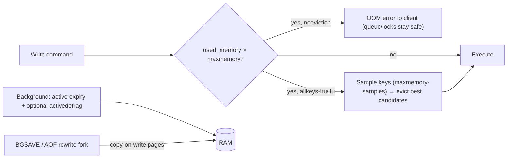

# Redis - Memory Management & Eviction Tuning

> [!info] Deep dive of [[Redis]]

> [!abstract] TL;DR
> Redis keeps everything in RAM, so **always set `maxmemory`** below the container/VM limit (leave headroom for fork/copy-on-write and fragmentation). Choose the eviction policy per **role**:
> - **cache**: `allkeys-lru` / `allkeys-lfu`;
> - **queues, locks, rate limits, sessions**: `noeviction` (BullMQ requires it).
>
> Don't mix those roles in one instance. Watch `used_memory`, `mem_fragmentation_ratio`, `evicted_keys` and big keys, set TTLs with jitter, and keep values small, since compact encodings (listpacks) save several times the memory.

## Concept
| Policy | Evicts | Use for |
|---|---|---|
| `noeviction` | Nothing. Writes fail with OOM errors when full | Queues (BullMQ, n8n), locks, limits, streams |
| `allkeys-lru` | Least recently used keys | General cache |
| `allkeys-lfu` | Least frequently used keys | Caches with stable hot sets (catalogue, configs) |
| `volatile-lru` / `volatile-lfu` | LRU/LFU among keys **with TTL** | Mixed instance where only TTL keys are disposable |
| `volatile-ttl` | Keys closest to expiry | TTL-driven caches |
| `allkeys-random` / `volatile-random` | Random | Rarely the right choice |

**Key memory metrics** (`INFO memory`, `INFO stats`):

| Metric | Meaning | Healthy range / action |
|---|---|---|
| `used_memory` | Bytes allocated by Redis | Keep < ~80% of `maxmemory` for non-cache roles |
| `used_memory_rss` | Bytes the OS sees | RSS ≫ used → fragmentation |
| `mem_fragmentation_ratio` | RSS / used | 1.0–1.5 OK. > 1.5 consider `activedefrag`. < 1 means swapping (bad) |
| `evicted_keys` | Keys evicted since start | Rising fast on a cache = too small. On a queue instance it should be 0 |
| `expired_keys` | Keys expired | Context for TTL behaviour |
| `maxmemory_policy` | Current policy | Matches the instance role? |

## How It Works


## Practical Usage
**Role-specific configuration**:
```conf
# cache instance (redis-cache)
maxmemory 1gb
maxmemory-policy allkeys-lfu
maxmemory-samples 10
lazyfree-lazy-eviction yes          # free large values in background
activedefrag yes

# queue/state instance (redis-queue) — BullMQ, n8n queue mode, locks, rate limits
maxmemory 512mb
maxmemory-policy noeviction
appendonly yes
appendfsync everysec
```
**Docker sizing** (container limit > maxmemory + fork headroom):
```yaml
services:
  redis-queue:
    image: redis:8
    command: ["redis-server", "--maxmemory", "512mb", "--maxmemory-policy", "noeviction", "--appendonly", "yes"]
    deploy: { resources: { limits: { memory: 900m } } }   # ~1.5–1.8× maxmemory when persistence forks
```
```bash
# host settings recommended for Redis persistence
sysctl -w vm.overcommit_memory=1
echo never > /sys/kernel/mm/transparent_hugepage/enabled
```
**Find what eats memory**:
```bash
redis-cli INFO memory | grep -E 'used_memory_human|used_memory_rss_human|mem_fragmentation_ratio|maxmemory_policy'
redis-cli INFO stats | grep -E 'evicted_keys|expired_keys'
redis-cli --bigkeys          # largest key per type (sampling, safe-ish on prod)
redis-cli --memkeys          # top keys by memory usage
redis-cli MEMORY USAGE "cache:menu:t42" SAMPLES 0
redis-cli MEMORY DOCTOR
```
**TTL with jitter** (avoid synchronized expiry stampedes):
```ts
const ttl = 3600 + Math.floor(Math.random() * 600);       // 60–70 min
await redis.set(`cache:menu:${tenantId}`, json, 'EX', ttl);
```
**Compact encodings** (hash of small fields instead of many keys):
```text
❌ 100k keys "user:42:name", "user:42:tier", ...         → per-key overhead (~50–90 bytes each) dominates
✅ HSET user:42 name "Aisyah" tier "gold"                 → small hashes stay in listpack encoding
   hash-max-listpack-entries 128 / hash-max-listpack-value 64 (defaults; tune with care)
```
**Wrong way**:
```text
❌ No maxmemory in a container                       → kernel OOM-kills Redis; queue state lost
❌ allkeys-lru on the BullMQ/n8n Redis                → jobs and locks silently evicted
❌ Caching 2 MB JSON blobs per user without TTL       → memory creep, slow eviction, latency spikes
❌ KEYS * in production to "check memory"             → blocks the single thread
```

## Patterns & Anti-patterns
| Pattern | When | Anti-pattern to avoid |
|---|---|---|
| Separate instances (or at least separate configs) for cache vs state | Any production setup | One Redis for cache + queues + sessions |
| `maxmemory` ~60–75% of container limit with persistence | Docker deployments | maxmemory = container limit |
| TTL on every cache key, with jitter | Caches | Immortal cache keys |
| Small values, hashes for related fields | Large key counts | Huge JSON strings per key |
| Alert on `evicted_keys` (state) and hit ratio (cache) | Monitoring | Noticing only when jobs vanish |
| `--bigkeys`/`--memkeys` after releases | Capacity checks | Guessing |
| `UNLINK` instead of `DEL` for big keys | Deleting large collections | `DEL` blocking on huge sets |

## Performance & Trade-offs
- **LFU vs LRU**: LFU protects consistently hot keys (menus, configs) from one-off scans, while LRU adapts faster to shifting traffic. Measure the hit ratio.
- **`maxmemory-samples`**: higher values approximate true LRU/LFU better at slightly more CPU. 5–10 is typical.
- **Fragmentation**: workloads with mixed value sizes and churn fragment memory. `activedefrag` reclaims it at some CPU cost, while restarts with persistence are blunt but effective.
- **Persistence forks** double memory touched in the worst case (copy-on-write during `BGSAVE`/AOF rewrite on write-heavy instances). This is the main reason for container headroom ([[Redis - Persistence & High Availability]]).
- **Valkey 8+** reduced per-key memory overhead in its new hashtable implementation. Migrating can lower memory for many small keys ([[Valkey]]).

## Tips & Reminders
> [!tip] In ZP's stack
> - **Two Redis containers per client server**: `redis-cache` (allkeys-lfu, no persistence or RDB only) for Next.js/app caches, and `redis-queue` (noeviction, AOF) for n8n queue mode, BullMQ, rate limits and locks ([[Message Queues - BullMQ in Production]], [[Redis - Rate Limiting & Distributed Locks]]).
> - **Sizing on an 8 GB KVM**: cache 512 MB–1 GB, queue 256–512 MB, container limits ~1.5× those values.
> - **Telegram alerts**: queue instance `used_memory` > 80% or `evicted_keys` > 0, and cache hit ratio < 80% ([[Docker - Logging, Metrics & Resource Limits on a VPS]]).

- Namespace keys by purpose (`cache:`, `rl:`, `lock:`, `bull:`), so `--memkeys` output maps to features.
- Compress large cached payloads (gzip/brotli) when values exceed a few KB and CPU is available.
- Prefer caching IDs or rendered fragments over whole object graphs ([[Redis - Caching Patterns & Invalidation]]).
- Review TTLs when traffic grows. Longer TTLs raise hit ratio and memory together.

## Version Notes
| Version | Change relevant here |
|---|---|
| 4.0 | LFU policies, `MEMORY` command, lazy freeing (`UNLINK`), active defrag |
| 7.0 | Listpack replaces ziplist for small hashes/lists/zsets |
| 7.4 | Hash field expiration (per-field TTL) |
| 8.x / Valkey 8 | Performance and memory-efficiency work. Valkey 8 new hashtable reduces per-key overhead |

## Critical Issues & Gotchas
> [!danger] Eviction on the wrong instance deletes jobs, locks and limits
> With `allkeys-*` policies, Redis can evict BullMQ job data, n8n queue entries, distributed locks and rate-limit counters under memory pressure, causing lost jobs, duplicate processing and disabled limits, with no error. State-bearing instances must run `noeviction` with alerts before they fill.

> [!danger] No maxmemory inside containers
> Without `maxmemory`, Redis grows until the container's memory limit or the host OOM killer stops it. That kills the process (and can corrupt in-flight AOF writes) instead of returning errors. Always set `maxmemory` with headroom for forks and fragmentation.

- **Swapping**: `mem_fragmentation_ratio` < 1 indicates swap use, and latency becomes terrible. Avoid swap for Redis hosts, or size memory properly.
- **Big keys** (huge lists/sets/hashes) cause latency spikes on read, delete and replication, and uneven Cluster slots. Split them, and use `UNLINK`.
- **Expiry isn't instant**: expired keys are removed lazily or by sampling, so memory can lag behind TTLs under heavy write loads.
- **`maxmemory` vs replication buffers**: replica output buffers and client buffers count toward memory pressure. Large pub/sub fan-out can trigger evictions or disconnections.

## Related
- [[Redis]]
- [[Redis - Caching Patterns & Invalidation]] — TTLs, stampede protection, invalidation
- [[Redis - Persistence & High Availability]] — fork behaviour, AOF/RDB
- [[Redis - Rate Limiting & Distributed Locks]] — state that must not be evicted
- [[Message Queues - BullMQ in Production]] — `noeviction` requirement
- [[Valkey]] — memory-efficient fork

## References
- https://redis.io/docs/latest/develop/reference/eviction/
- https://redis.io/docs/latest/operate/oss_and_stack/management/optimization/memory-optimization/
- https://redis.io/docs/latest/commands/memory-usage/
- https://redis.io/docs/latest/operate/oss_and_stack/management/admin/
- https://valkey.io/blog/valkey-8-0-0-rc1/
