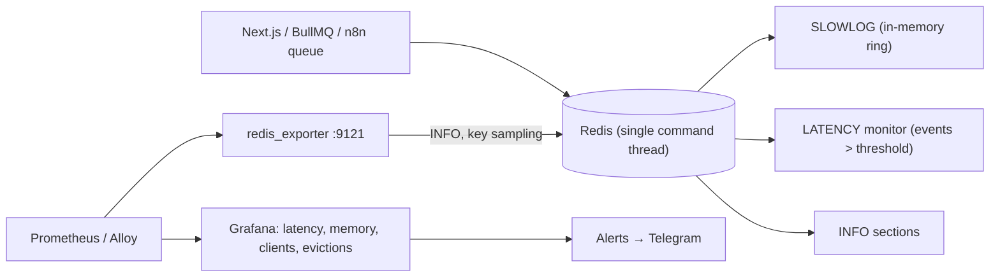

# Redis - Observability, Slow Log & Latency Troubleshooting

> [!info] Deep dive of [[Redis]]

> [!abstract] TL;DR
> Redis is single-threaded for command execution, so **one slow command delays every client**. Observe five things:
> 1. **Latency**: `redis-cli --latency`, `LATENCY DOCTOR`, client-side p99.
> 2. **Slow commands**: `SLOWLOG GET` (threshold `slowlog-log-slower-than`).
> 3. **Memory**: `INFO memory`, `MEMORY USAGE`, `--bigkeys`/`--memkeys`, fragmentation ratio.
> 4. **Clients/connections**: `CLIENT LIST`, `connected_clients`, `blocked_clients`, `rejected_connections`.
> 5. **Persistence**: fork time (`latest_fork_usec`), AOF fsync delays, `rdb_last_bgsave_status`.
>
> Export with **redis_exporter → Prometheus/Grafana**. Typical culprits: `KEYS *`, huge `HGETALL`/`SMEMBERS`/`LRANGE 0 -1`, big-key deletes, fork on a memory-tight VPS, swap, and noisy neighbours.

## Concept
| Signal | Command / metric | Healthy | Investigate when |
|---|---|---|---|
| Round-trip latency | `redis-cli --latency -i 1` | < 1 ms local | p99 > 5–10 ms |
| Intrinsic latency (host) | `redis-cli --intrinsic-latency 30` | < 0.5 ms | High: VM steal/noisy neighbour |
| Slow commands | `SLOWLOG GET 20` | Few entries | Repeated O(N) commands |
| Latency events | `LATENCY LATEST`, `LATENCY DOCTOR` | Empty | fork, aof-fsync, expire-cycle events |
| Memory | `INFO memory` → `used_memory`, `mem_fragmentation_ratio` | Ratio 1.0–1.5 | > 1.5 (fragmentation) or < 1 (swap!) |
| Evictions | `evicted_keys` | 0 for queues | Rising on a BullMQ instance |
| Keyspace hit ratio | `keyspace_hits / (hits + misses)` | Cache: > 80–90% | Drops after deploys |
| Clients | `connected_clients`, `blocked_clients` | Stable | Leaks (steady growth), `maxclients` reached |
| Persistence | `rdb_last_bgsave_status`, `aof_last_write_status`, `latest_fork_usec` | ok, fork < 100 ms/GB | Errors, multi-second forks |
| Replication | `master_link_status`, `master_repl_offset` lag | up, small lag | Link down, growing lag |

## How It Works


## Practical Usage
**Enable diagnostics** (runtime, then persist in `redis.conf`):
```bash
redis-cli CONFIG SET slowlog-log-slower-than 10000     # 10 ms (microseconds)
redis-cli CONFIG SET slowlog-max-len 256
redis-cli CONFIG SET latency-monitor-threshold 50      # record events > 50 ms
```
**Triage session**:
```bash
redis-cli --latency-history -i 5                       # is it slow right now?
redis-cli SLOWLOG GET 10                               # which commands?
redis-cli LATENCY DOCTOR                               # fork/fsync/expire events + advice
redis-cli INFO stats | grep -E 'instantaneous_ops|rejected_connections|evicted_keys|expired_keys'
redis-cli INFO memory | grep -E 'used_memory_human|maxmemory_human|mem_fragmentation_ratio'
redis-cli INFO persistence | grep -E 'latest_fork_usec|rdb_last_bgsave_status|aof_last_write_status'
redis-cli CLIENT LIST | awk '{print $2, $5, $NF}' | head    # addr, idle, last cmd
```
**Find big and hot keys** (on a replica or off-peak; they scan the keyspace):
```bash
redis-cli --bigkeys -i 0.01            # largest key per type (sleep between SCAN batches)
redis-cli --memkeys -i 0.01            # by memory usage
redis-cli --hotkeys                    # needs an LFU maxmemory-policy
redis-cli MEMORY USAGE "bull:reports:events" SAMPLES 0
```
**redis_exporter sidecar** (Docker, internal network only):
```yaml
redis-exporter:
  image: oliver006/redis_exporter:v1.62.0      # pin
  environment:
    REDIS_ADDR: redis://redis:6379
    REDIS_PASSWORD: ${REDIS_PASSWORD}
    REDIS_EXPORTER_CHECK_KEYS: "bull:*:wait,bull:*:failed"   # queue lengths as metrics
  expose: ["9121"]
```
**Alert rules** (examples):
```yaml
- alert: RedisMemoryHigh
  expr: redis_memory_used_bytes / redis_memory_max_bytes > 0.85
  for: 10m
- alert: RedisEvictingOnQueueInstance
  expr: increase(redis_evicted_keys_total{instance=~".*queue.*"}[5m]) > 0
- alert: RedisRejectedConnections
  expr: increase(redis_rejected_connections_total[5m]) > 0
- alert: RedisDown
  expr: redis_up == 0
  for: 1m
```
**Wrong way**:
```text
❌ KEYS * in production code/admin scripts         → blocks the server for seconds on large keyspaces
❌ MONITOR left running                           → halves throughput, floods the terminal/logs
❌ DEL on a 2 GB hash                             → long block; use UNLINK (async free)
❌ --bigkeys on the primary at peak                → extra load during an incident
```

## Patterns & Anti-patterns
| Pattern | When | Anti-pattern to avoid |
|---|---|---|
| `SCAN`/`HSCAN` with `COUNT` | Iterating keys/fields | `KEYS`, `HGETALL` on huge hashes |
| `UNLINK`, `lazyfree-lazy-*` on | Deleting big keys/expiry | Synchronous `DEL`/`FLUSHALL` |
| Separate instances: cache vs queue | BullMQ + caching | One Redis with `allkeys-lru` holding jobs |
| Slowlog threshold 5–10 ms + periodic review | Always | Default 10 ms never looked at |
| Exporter + Grafana dashboard | ≥ 1 production Redis | SSH + `INFO` during outages only |
| Client-side timeouts + p99 metrics | Apps | Infinite waits on a stuck Redis |
| `maxmemory` ~70–80% of container limit | Docker | No limit → OOM kill |

## Performance & Trade-offs
- **Fork latency**: `BGSAVE`/AOF rewrite forks the process. On VMs, page-table copying costs ~10–20 ms per GB, and more with Transparent Huge Pages. Disable THP (`never`) and leave RAM headroom for copy-on-write ([[Redis - Persistence & High Availability]]).
- **AOF `appendfsync everysec`** is the usual balance. Slow disks show as `aof-fsync-always`/`aof-write` latency events.
- **I/O threads** (`io-threads`) help network-heavy workloads, but commands still execute on one thread.
- **Monitoring overhead**: the exporter's `INFO` scrape is cheap. Key checks with patterns scan and should stay narrow.

## Tips & Reminders
> [!tip] In ZP's stack
> - **n8n queue mode and BullMQ** Redis: alert on any evictions, memory > 85%, and growing `bull:*:wait` lists. A backlog there usually means workers are down or stuck, not Redis ([[Message Queues - BullMQ in Production]]).
> - **Shared VPS**: run `--intrinsic-latency` when latency spikes without slow commands. High values mean CPU steal from the host, so consider a larger plan or a dedicated-CPU VPS.
> - **Dashboards**: reuse the Grafana "Redis Dashboard for Prometheus redis_exporter" and add a `client` label per instance ([[Docker - Logging, Metrics & Resource Limits on a VPS]]).

- Use `CLIENT SETNAME app:worker` in services so `CLIENT LIST` shows who's connected.
- Set `timeout 300` for idle clients if connection leaks are suspected (not for BullMQ blocking connections).
- `LATENCY RESET` after fixing, to confirm the issue is gone.
- Same commands apply to [[Valkey]] if you migrated.

## Version Notes
| Version | Change relevant here |
|---|---|
| 2.8.13+ | `LATENCY` monitor, `DOCTOR` |
| 4.0 | `MEMORY USAGE/DOCTOR`, `UNLINK`, lazy free |
| 6.0 | I/O threads, ACL (`CLIENT LIST` user field) |
| 7.x | `LATENCY HISTOGRAM` per command, `CLIENT NO-EVICT` |
| 8.x (8.10 current) | Performance improvements. 8.0 EOL 2026-12-01, so upgrade to 8.10+ ([[Redis]]) |

> [!warning] Unverified — check before relying on this
> The current redis_exporter release tag and any Redis 8.x observability additions weren't verified this run. Pin the exporter to a tag you've checked.

## Critical Issues & Gotchas
> [!danger] Swap turns Redis latency from microseconds to seconds
> If the VPS starts swapping (`mem_fragmentation_ratio` < 1, `si/so` in `vmstat`), every command may page-fault. This often happens when Redis has no `maxmemory` inside a container sharing RAM with Postgres and n8n. Set `maxmemory`, container memory limits and `vm.overcommit_memory=1`, and alert on swap usage ([[Redis - Memory Management & Eviction Tuning]]).

> [!danger] One O(N) command stalls every client
> `KEYS *`, `SMEMBERS` on a million-member set, `LRANGE 0 -1` on a long list, or a Lua script looping over keys blocks all clients. Queues stall, rate limiters fail open or closed, and sessions time out. Find them in `SLOWLOG`, replace them with `SCAN`/pagination, and cap collection sizes in code.

- **`MONITOR`** in production is a debugging tool for seconds, not minutes.
- **Exposed Redis** (no password, public port) shows up as unknown clients in `CLIENT LIST`. Bind to the Docker network only and use ACL users.
- **Slowlog is in-memory**: it's lost on restart and capped by `slowlog-max-len`, so export or review promptly.
- **Latency from the app side** includes the network and connection pool. Measure both client-side and `--latency` on the host.

## Related
- [[Redis]]
- [[Redis - Memory Management & Eviction Tuning]] — memory, eviction, fragmentation
- [[Redis - Persistence & High Availability]] — fork/AOF behaviour
- [[Message Queues - BullMQ in Production]] — queue-specific metrics
- [[Docker - Logging, Metrics & Resource Limits on a VPS]] — Prometheus/Grafana stack
- [[Valkey]] — compatible fork, same tooling

## References
- https://redis.io/docs/latest/operate/oss_and_stack/management/optimization/latency/
- https://redis.io/docs/latest/commands/slowlog-get/
- https://redis.io/docs/latest/operate/oss_and_stack/management/optimization/latency-monitor/
- https://github.com/oliver006/redis_exporter
- https://redis.io/docs/latest/commands/info/
