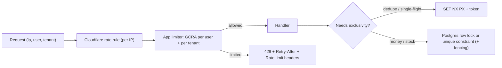

# Redis - Rate Limiting & Distributed Locks

> [!info] Deep dive of [[Redis]]

> [!abstract] TL;DR
> - **Rate limits**: use **GCRA** (a token bucket in one atomic Lua script, one key per subject) for smooth limits with bursts, and `INCR` + `EXPIRE` fixed windows for coarse quotas. Limit per IP, per user, per tenant and per API key, and return `429` + `Retry-After`.
> - **Locks**: `SET key token NX PX ttl`, release with a compare-and-delete script, and treat the lock as an **efficiency** lock. Where correctness matters (money, stock, sends), back it with **fencing tokens** or a DB constraint/row lock, because a paused process can outlive its TTL.
> - Edge limits ([[Cloudflare]] WAF) stop floods. Redis limits enforce business fairness. Both, not either.

## Concept
| Algorithm | Redis primitive | Accuracy | Memory per subject | Use for |
|---|---|---|---|---|
| Fixed window | `INCR` + `EXPIRE` | Allows 2× bursts at window edges | 1 int | Daily/monthly quotas, coarse API caps |
| Sliding log | ZSET of timestamps | Exact | O(requests in window) | Low-volume, strict limits (login attempts) |
| Sliding window counter | 2 fixed counters, weighted | ~Exact | 2 ints | General API limits |
| Token bucket / **GCRA** | 1 key (theoretical arrival time) via Lua | Smooth + burst | 1 value | Per-user API, outbound send pacing |
| Concurrency limit | `INCR`/`DECR` or ZSET of leases | Exact if leases expire | O(in-flight) | "Max 3 parallel LLM calls per tenant" |

**Locks: what they guarantee**:

| Lock | Guarantees | Breaks when |
|---|---|---|
| `SET NX PX` on one Redis | Mutual exclusion while the TTL holds and Redis is up | GC/VM pause > TTL, failover loses the key (async replication) |
| Redlock (N independent masters) | Survives single-node loss | Clock jumps, long pauses. Debated (Kleppmann vs antirez) |
| Fencing token (`INCR` counter) + check at the resource | Stale holders rejected by the resource | The resource can't check tokens |
| Postgres `SELECT … FOR UPDATE` / advisory lock / unique constraint | Transactional correctness | Lock held across slow external calls |

## How It Works


## Practical Usage
**GCRA limiter** (one key, atomic; `rate` per `period` with `burst`):
```ts
import Redis from 'ioredis';
const redis = new Redis(process.env.REDIS_URL!);

redis.defineCommand('gcra', {
  numberOfKeys: 1,
  lua: `
    local key = KEYS[1]
    local emission = tonumber(ARGV[1])      -- ms between requests (period / rate)
    local burst = tonumber(ARGV[2])         -- extra requests allowed instantly
    local t = redis.call('TIME')
    local now = tonumber(t[1]) * 1000 + math.floor(tonumber(t[2]) / 1000)
    local tat = tonumber(redis.call('GET', key) or now)
    if tat < now then tat = now end
    local allow_at = tat - burst * emission
    if now < allow_at then return {0, allow_at - now} end      -- limited, retry after ms
    local new_tat = tat + emission
    redis.call('SET', key, new_tat, 'PX', math.ceil(new_tat - now + burst * emission))
    return {1, 0}
  `,
});

export async function limit(subject: string, rate: number, periodMs: number, burst = rate) {
  const [ok, retryMs] = (await (redis as any).gcra(`rl:${subject}`, periodMs / rate, burst - 1)) as [number, number];
  return { ok: ok === 1, retryAfterSec: Math.ceil(retryMs / 1000) };
}
// usage: per user and per tenant
const u = await limit(`user:${userId}`, 30, 60_000);        // 30/min
const t = await limit(`tenant:${tenantId}`, 600, 60_000);   // 600/min shared by staff
if (!u.ok || !t.ok) return new Response('Too many requests', { status: 429, headers: { 'Retry-After': String(Math.max(u.retryAfterSec, t.retryAfterSec)) } });
```
**Monthly quota** (LLM tokens per tenant; fixed window):
```bash
INCRBY quota:tenant:42:2026-11 1830     # tokens used by this call
EXPIRE quota:tenant:42:2026-11 3456000 NX  # ~40 days, set once (NX: Redis 7+)
```
**Lock with token + safe release + fencing**:
```ts
const RELEASE = `if redis.call('GET', KEYS[1]) == ARGV[1] then return redis.call('DEL', KEYS[1]) else return 0 end`;

export async function withLock<T>(name: string, ttlMs: number, fn: (fence: number) => Promise<T>) {
  const token = crypto.randomUUID();
  const ok = await redis.set(`lock:${name}`, token, 'PX', ttlMs, 'NX');
  if (ok !== 'OK') return null;                                   // someone else is working on it
  const fence = await redis.incr(`fence:${name}`);                // monotonically increasing
  try { return await fn(fence); }
  finally { await redis.eval(RELEASE, 1, `lock:${name}`, token); }
}
// at the resource: reject stale holders
// UPDATE jobs SET result = $1, fence = $2 WHERE id = $3 AND fence < $2;
```
**Postgres instead of Redis** when correctness matters:
```sql
select pg_try_advisory_xact_lock(hashtext('invoice-run:' || $1));   -- held until COMMIT
-- or: unique (tenant_id, idempotency_key) and INSERT … ON CONFLICT DO NOTHING
```
**Wrong way**:
```ts
if ((await redis.get(k)) === null) await redis.set(k, '1');   // ❌ check-then-set race: two holders
await redis.del('lock:x');                                    // ❌ deletes someone else's lock after your TTL expired
const n = await redis.incr(k); await redis.expire(k, 60);     // ❌ crash between calls → key never expires (use a script or EXPIRE NX)
```

## Patterns & Anti-patterns
| Pattern | When | Anti-pattern to avoid |
|---|---|---|
| GCRA per subject in one Lua call | Per-user/tenant API limits | Multi-command limiters without atomicity |
| Layered limits: edge IP → user → tenant → global provider budget | Public SaaS endpoints | One global counter |
| Outbound pacing limiter (per WhatsApp number, per provider) | Bulk sends, LLM calls | Bursting into provider 429s and quality penalties |
| Lock TTL > p99 work time, with renewal for long jobs | Cron singletons, report builds | 5 s TTL on a 30 s job |
| Fencing token or DB constraint for correctness | Payments, stock, invoice numbers | Redis lock as the only guard |
| Fail-open for non-critical limits, fail-closed for auth/OTP | Redis outage | One policy for everything |
| Hash tags `{tenant:42}` for multi-key scripts | Redis Cluster | Scripts touching keys in different slots |

## Performance & Trade-offs
- **Cost**: one `EVALSHA` per check, ~0.1–0.3 ms on the same host. 10k req/s is trivial for one Redis. Network RTT dominates, so keep Redis next to the app.
- **Memory**: GCRA/fixed window are about 100 bytes per subject. Sliding logs grow with traffic, so avoid them for high-volume subjects.
- **Clock**: use Redis `TIME` inside scripts, not app clocks, so replicas with skewed clocks agree.
- **Redis down**: decide per limiter. Login/OTP limits fail closed (block), and general API limits fail open with a local in-memory fallback.
- **Locks under failover**: async replication can drop a just-acquired lock. Acceptable for "avoid duplicate work", not for "never double-charge".

## Tips & Reminders
> [!tip] In ZP's stack
> - **Next.js Server Actions / route handlers**: wrap every action with user + tenant GCRA limits ([[Next.js - Server Actions, Mutations & Security]]).
> - **WhatsApp outbound**: pace per phone number below the Cloud API throughput, and per tenant for fairness. BullMQ's `limiter` handles per-queue pacing ([[Message Queues - BullMQ in Production]]).
> - **OTP/login**: 5 attempts / 15 min per phone and per IP, fail-closed.
> - **n8n cron singletons** across workers use `withLock('cron:daily-report', 10min)`.
> - Use a **separate logical DB or instance** from the BullMQ/n8n queue Redis, so limiter keys never trigger queue eviction ([[Redis - Caching Patterns & Invalidation]]).

- Return `Retry-After`, plus `RateLimit-Limit/Remaining/Reset` if clients are your own apps. Flutter clients should back off on 429.
- Key by stable identifiers (user ID, API key hash), and by IP only before auth. Mobile carriers in Malaysia NAT many users behind one IP.
- Log limit hits per subject. Repeated hits are abuse or a bug in a client loop.

## Version Notes
| Version | Change relevant here |
|---|---|
| 2.6 | Lua scripting (`EVAL`), the basis of atomic limiters and lock release |
| 2.6.12 | `SET … NX PX` single-command lock acquisition |
| 7.0 | Functions (`FUNCTION LOAD`/`FCALL`), `EXPIRE … NX/XX/GT/LT` |
| 7.4 | Hash field expiration (`HEXPIRE`), per-field TTL for multi-limit hashes |
| 8.x / Valkey 8–9 | Same primitives. Valkey keeps API compatibility for these commands |

## Critical Issues & Gotchas
> [!danger] A Redis lock is not a correctness guarantee
> A GC pause, slow network or VM steal can stall the holder past its TTL. A second worker acquires the lock, and both write. Failover can also lose the lock key. For money, stock and invoice numbering, enforce correctness in Postgres (unique constraints, `FOR UPDATE`, fencing columns) ([[PostgreSQL - Transactions & MVCC]]).

> [!danger] Eviction deletes your limits and locks
> With `maxmemory-policy allkeys-lru` (typical for caches), Redis can evict limiter and lock keys under memory pressure, which silently disables rate limits. Run limiters/locks on an instance with `noeviction` or `volatile-*`, and monitor memory.

- **IP-only limits behind proxies**: without trusting `CF-Connecting-IP` correctly, every request appears to come from Traefik's IP, so one user blocks everyone ([[Network Security - Cloudflare WAF & Rate Limiting Rules]]).
- **Unbounded keys**: limiter keys per random value (e.g. unauthenticated email inputs) are a memory DoS vector. Always set a TTL.
- **Lua script errors** abort silently in some clients. Test scripts and handle `NOSCRIPT` (ioredis `defineCommand` does).
- **Lock renewals** must check the token too (compare-and-`PEXPIRE`), or you extend someone else's lock.

## Related
- [[Redis]]
- [[Redis - Data Structures & Patterns]] — sorted-set sliding window, Lua basics
- [[Redis - Caching Patterns & Invalidation]] — single-flight locks for cache rebuilds
- [[Network Security - Cloudflare WAF & Rate Limiting Rules]] — edge-layer limits
- [[Message Queues - BullMQ in Production]] — queue limiters and job concurrency
- [[PostgreSQL - Transactions & MVCC]] — row locks and constraints for correctness

## References
- https://redis.io/docs/latest/develop/use/patterns/distributed-locks/
- https://redis.io/docs/latest/commands/set/
- https://martin.kleppmann.com/2016/02/08/how-to-do-distributed-locking.html
- https://brandur.org/rate-limiting
- https://datatracker.ietf.org/doc/draft-ietf-httpapi-ratelimit-headers/
